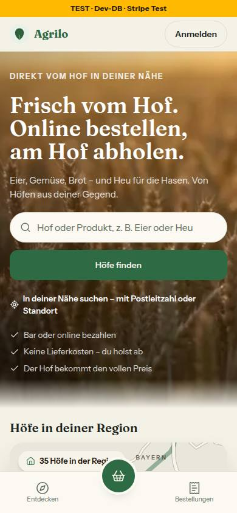
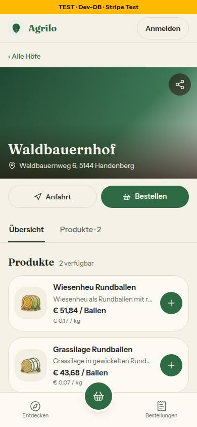
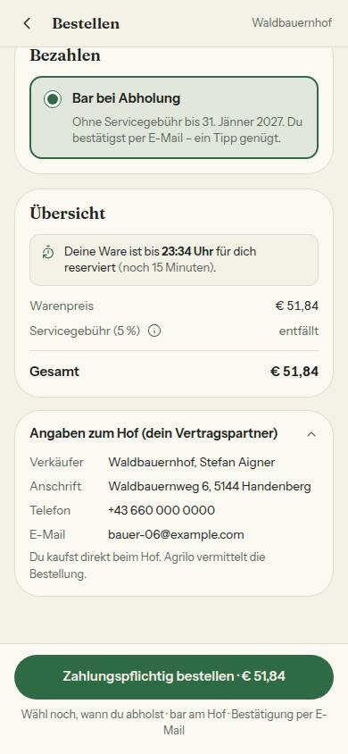
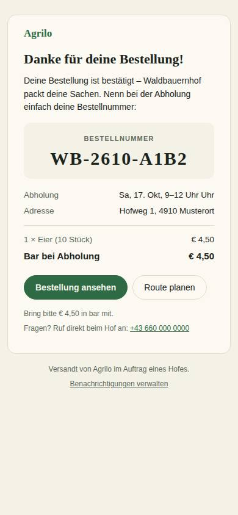
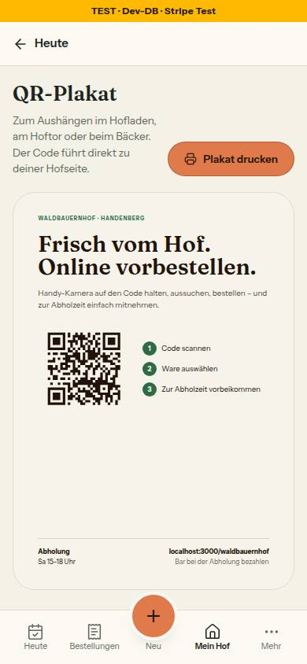
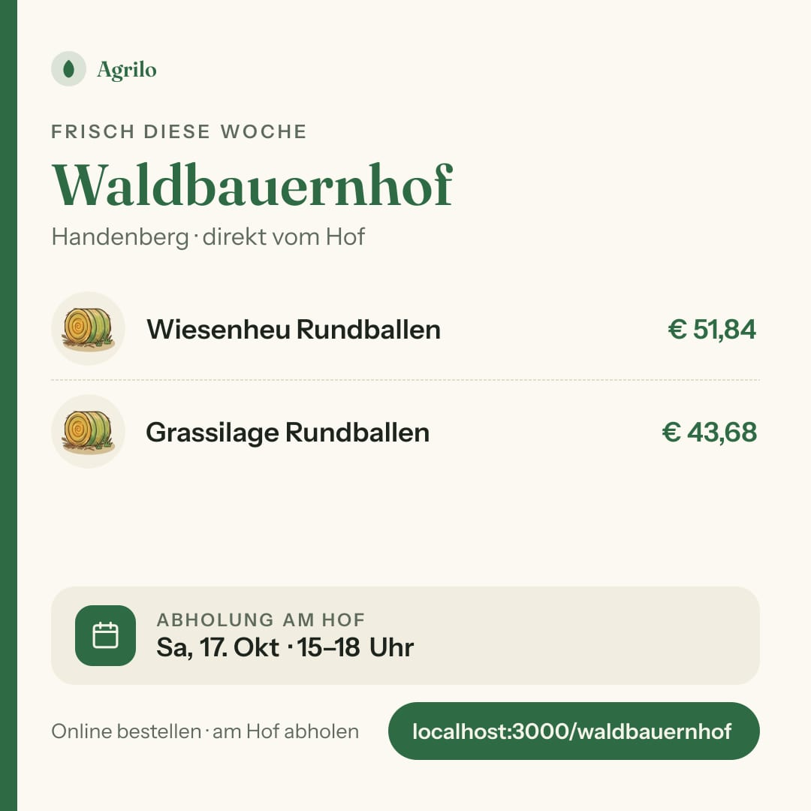

# Nr. 91 – Agrilo: Name und Domain (Register M1)

Keine Migration, kein neues Paket. Wiederverwendet: `PRODUKTION_HOST`/`PRODUKTION_ADRESSE` (`umgebung.ts`), `SUPPORT_EMAIL` & Co. (`support.ts`) / Neu, weil: `src/lib/marke.ts` (kein Baustein für den Namen), `tests/marke-name-wache.test.ts` (keine Wache für Name und Domain).

## Was geändert wurde
- `src/lib/marke.ts` (neu): `MARKE = 'Agrilo'` und `MARKE_TEAM` („Agrilo-Team“, aus `MARKE`); keine Kurzform nötig, der Name ist kürzer als der alte.
- `src/lib/umgebung.ts`: `PRODUKTION_HOST = 'agrilo.at'`, exportiert, einzige Stelle der Domain; Kommentare auf agrilo.at/test.agrilo.at.
- `src/lib/support.ts`: support@, kontakt@, datenschutz@ aus `PRODUKTION_HOST`.
- Feste Adressen aus `PRODUKTION_ADRESSE`: `stripe-connect.ts`, `status-update.tsx`, `newsletter.tsx`, `whatsapp-tap-client.tsx` (clientseitig, `umgebung.ts` ist rein), `geokodierung.ts` (Nominatim-Kennung `${MARKE}/1.0 (…)`).
- Adresstexte aus dem Host: `hof-adresse-vorschau.tsx`, `fuer-hoefe.ts`; Kommentare in `teilen-bild.ts`, `queries/teilen-bild.ts`, `teilen-fenster.ts`, `mein-hof.ts`, `onboarding.ts`.
- 42 Seiten: Tab-Titel `… — ${MARKE}`, dazu `layout.tsx` (Vorgabe), Startseite und Für Höfe (`siteName`), `manifest.ts` (`name`/`short_name`).
- Texte mit `MARKE`: Wortmarke, Kundenkopf, KundeShell, AdminShell (aria-label), Fuß der Startseite, Teilen-Bild, Statusbild, Kasse (Angaben zum Hof), Storno, Verkäufe, Foto-Hilfe, Teilen-Seite, Konto, Problem melden, Druckliste, Startbildschirm-Karte, Upload-Fehler, Artikel fehlt, Futter-Hinweis (E10a), Teilen-Text, Vorschaubild-alt, `UMSATZ_TEXT.ueberPlattform` (Schlüssel trug den alten Namen), Kalender-PRODID.
- Mails: Betreffzeilen in `email.ts`, Kopf und Fuß in `_layout.tsx`, fünf Vorlagen; Sätze mit dem Namen als eine Vorlage (react-email trennt Textteile sonst mit `<!-- -->`).
- Rechtstexte: Impressum und Datenschutz (Name), `docs/recht/agb.md` (42 × Name, 1 × Domain, Fassung 0.9 unverändert).
- `public/sw.js`, `.github/workflows/staging-nachziehen.yml` (test.agrilo.at); Kommentare in `src/` sagen „die Plattform“/`MARKE` statt des Namens.
- Tests: 55 Dateien auf `MARKE` bzw. agrilo.at, erfundene Hosts `farmerzone.example` → `plattform.example`; neu in `umgebung.test.ts`: agrilo.at ist die echte Herkunft (keine Warnung), die alte Domain meldet sich als fremder Host. Wache `marke-name-wache.test.ts` mit Gegenproben und Ausnahmeliste je Stelle mit Grund.

## Annahmen
- Technische Kennungen bleiben (Ausnahmeliste): Browser-Speicher-Schlüssel und Ereignisse, Nachrichtentypen der Vorschau, Kalender-UID (mit Kommentar), `.invalid`-Platzhalter, Repo-URL, Name der lokalen Test-DB. Umbenennen verlöre gespeicherte Stände bzw. bräche im Deploy-Fenster.
- Die Wache liest auch Kommentare und `public/`; der Name zählt in jeder Schreibweise, die Domain nur unter `src/`/`public/` (in Tests ist sie Prüfwert, wie die Freigabe es will).
- `testumgebung.ts` nennt die Testadresse über `PRODUKTION_HOST` statt wörtlich (Domain nur in `umgebung.ts`).
- `next.config.ts` `org: 'farmerzone'` bleibt: Kennung der Sentry-Organisation, kein Text.
- Die alte Domain gilt auch in der Vorschau nicht mehr als echte Seite (die Freigabe nennt nur die Produktion); nach dem 308 führt sie ohnehin auf agrilo.at, Vorschau-Variablen nennen nur test.….
- Einen Satz „vorher farmerzone.at“ gab es in den Rechtstexten nicht; nicht erfunden.

## Nicht gelöst
- `public/og/startseite.jpg` (Vorschaubild der Startseite) zeigt Schriftzug „FarmerZone“ und F-Symbol – neues Bild nötig; das alt nennt schon Agrilo.
- Icon-Befund: `icon-192.png`, `icon-512.png`, `icon-maskable-512.png`, `apple-icon.png` ohne Schriftzug, aber mit „F“ (Initiale des alten Namens) und Blatt; nicht neu gezeichnet.
- Außerhalb der Grenze: `docs/ai/` (DESIGN_SYSTEM 6, TECH_STACK 1, ARCHITECTURE 1), `docs/betrieb/testumgebung.md` (20) und `stripe-live.md` (5) nennen alten Namen bzw. alte Domain; `.claude/` (Agenten, Skills) nennt das Repo.

## Wie der Mensch es testet
- `pnpm vitest run tests/marke-name-wache.test.ts tests/umgebung.test.ts` → grün; „FarmerZone“ in eine Datei unter `src/` schreiben → Wache rot.
- Vorschau: `/`, `/waldbauernhof`, Kasse mit Produkt, `/status/plakat` (als Hof) → überall „Agrilo“, Tab „… — Agrilo“; Bestellung bar → Mail-Kopf und Fuß „Agrilo“.
- Produktion nach dem Cutover: Anmeldung auf https://agrilo.at klappt, Sentry meldet nicht „zeigt nicht auf agrilo.at“.

## Angepasste `.md`, Nacharbeit, Regelvorschlag
- `DEVELOPMENT.md` (Eintrag mit Cutover-Reihenfolge), `docs/recht/agb.md`, `docs/ai/BAUSTEINE.md` (erzeugt).
- Nacharbeit: Vor dem Merge Variablen umstellen (M1, Reihenfolge in DEVELOPMENT.md); Vorschaubild und Icons neu; `docs/betrieb/*` und `docs/ai/*` auf Agrilo; die Breitenschwellen in Kundenkopf/KundeShell sind mit dem längeren alten Wort gemessen (gelten weiter); Link „zur Startseite“ in der KundeShell ist 96 × 32 px (schon vorher so).
- Regelvorschlag – Ursache: Name und Domain standen als Literal in 88 Dateien. Gegenmaßnahme: Prüfung besteht (Wache); Textregel „Name nur über `MARKE`, Domain nur über `PRODUKTION_HOST`, Beispiel-Hosts in Tests ohne den Namen“ in `docs/ai/CODING_STANDARDS.md` §1 (Doku-PR).

## Prüfung
`grep -rniI "farmerzone" --exclude-dir=node_modules --exclude-dir=.git .`: 356 Treffer. docs/ 249 in 104 Dateien – mockups 105 (66 Dateien), nachtlauf 102 (28, mit diesem Bericht), betrieb 25 (2), ai 8 (3), entscheidungen.md 4, entwicklung 3 (2), umsetzungsprompt.md 1, nachtlauf.md 1; DEVELOPMENT.md 33 (2 im neuen Eintrag: Cutover mit alter Domain). Übrige einzeln: `src/` 13 in 12 Dateien und `tests/` 17 in 8 Dateien = Ausnahmeliste der Wache (dazu die Liste selbst, 20); `.claude/` 11 in 9 Dateien (Repo-Name in Agenten und Skills, Dateiname des Stop-Hook-Zählers); `.env.test.example` 2 und `.github/workflows/ci.yml` 2 (Test-DB `farmerzone_test`); `prisma/migrations/…_enable_rls` 2 (gepushte Migration, nie ändern); `next.config.ts` 1 (Sentry-Organisation); `README.md` 2, `CLAUDE.md` 1 (Repo-Name); nur lokal `.env.test` 2 (gitignored) und `.git` 1 (Zeiger des Worktrees).

## Bilder (hell, nur nachher; Mockups zeigen noch den alten Namen, sonst keine Abweichung)
Axe 0 auf `/` und `/waldbauernhof` (390). Plakat und Teilen-Bild zeigen lokal `localhost:3000/…` (Adresse aus APP_URL). Für die Kasse stand die Telefonnummer des Seed-Hofs kurz auf „+43 660 000 0000“; Nummer und Reservierung danach zurückgesetzt (`UPDATE 1`, `DELETE 1`, Rest 0).

  
  
