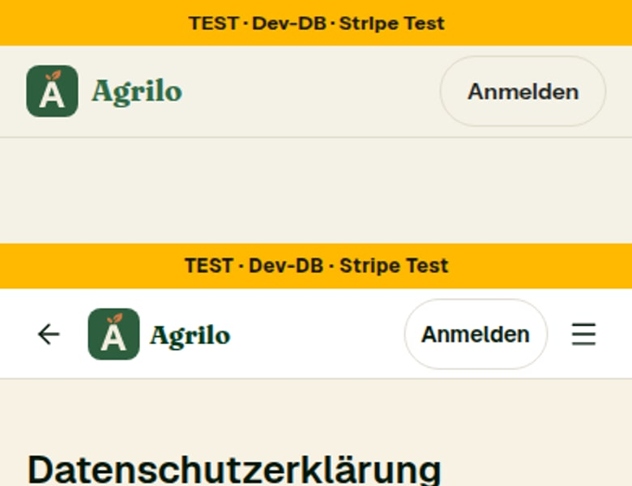
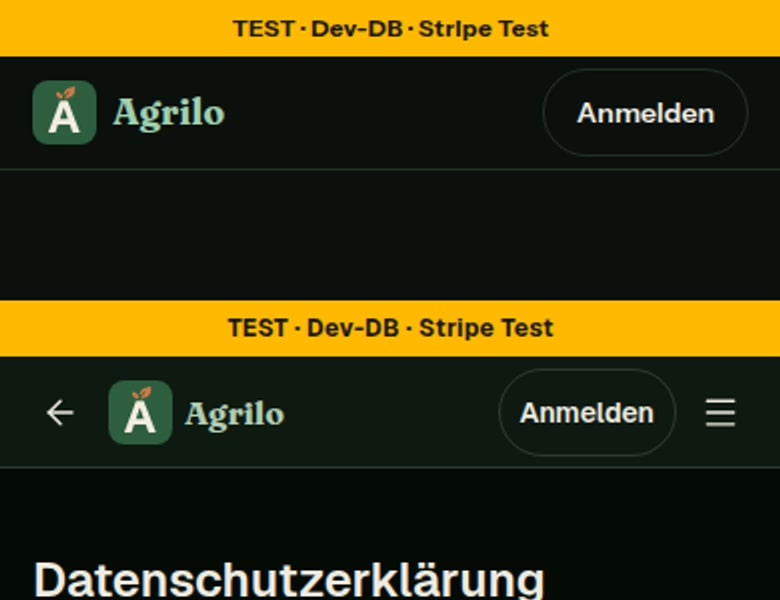
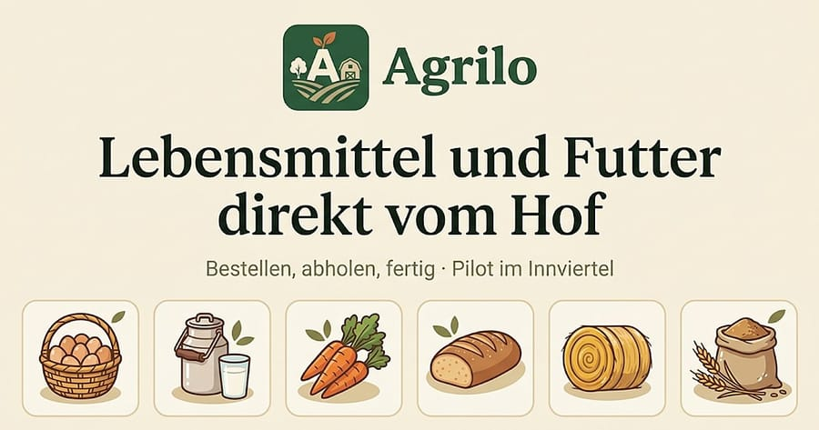
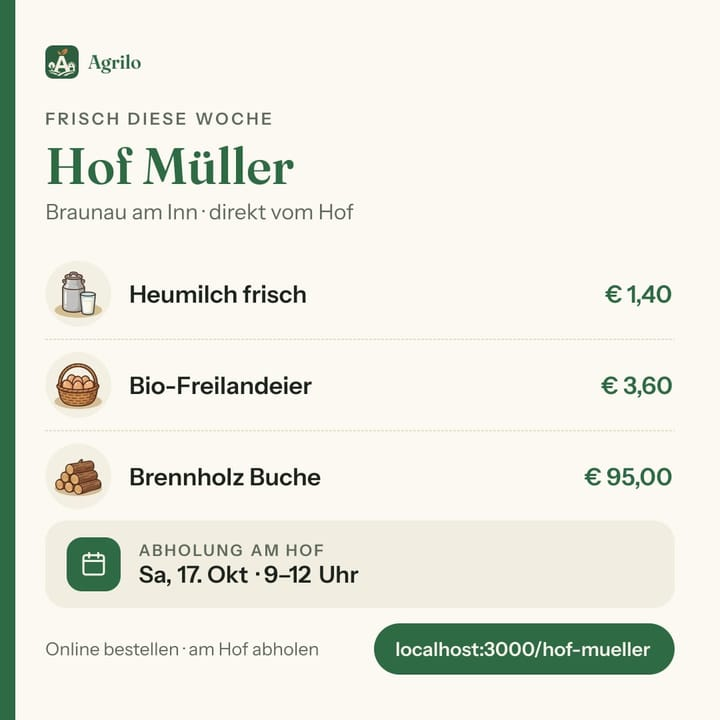
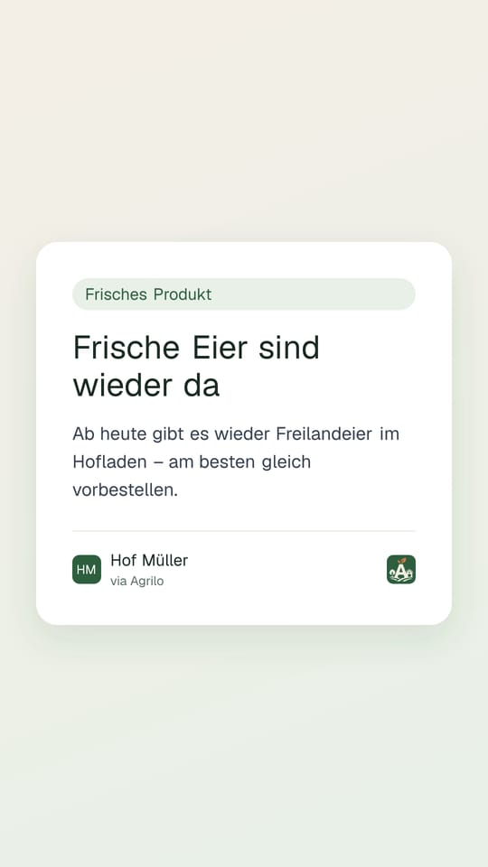
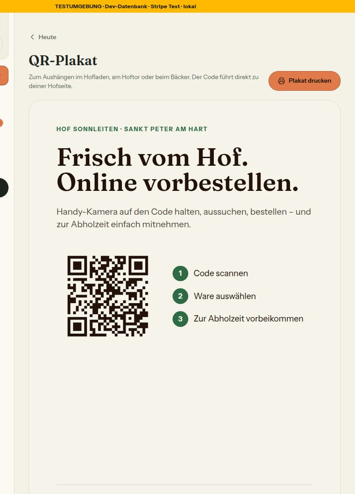
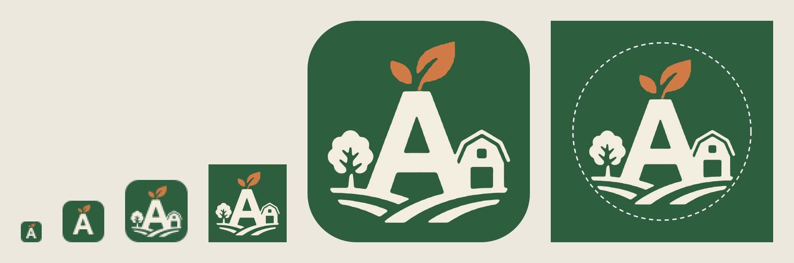

# Nr. 92 – Marke Agrilo: EINE Bildmarke für alles (Register M1, Ergänzung; Mockup system-m1-marke-agrilo-entscheidung)

Branch `nacht/2026-10-14/92-marke` von `main` (c013769, mit den gelieferten Dateien unter `public/marke/` und `public/og/`). Keine Migration, kein neues Paket (sharp war da), kein Netz. Beide Mockups lagen schon in `docs/mockups/`, im Wurzelverzeichnis nichts — kein Verschiebe-Commit.

## Was geändert wurde
- `src/lib/marke-bild.ts` (neu): Pfade (aus `MARKE` abgeleitet — die Namens-Wache aus 91 lässt kein zweites Literal zu, auch nicht in Pfaden), Ziele mit Größe, Fassung und Form, Grenze 48 px, Rundung 22 %, reine Umformungen (Größe, Rundung als clipPath, Sicherheitszone) und `ladeMarkeSvg`/`ladeMarkeDataUrl` (einmal gelesen; `process.getBuiltinModule` statt `import 'node:fs'`, weil dieselbe Datei der Client-Komponente ihre Pfade gibt).
- `src/components/shared/bildmarke.tsx` (neu): `<Image unoptimized>` auf die SVG-Datei, `alt=""`, `aria-hidden`, Rundung per CSS in Prozent der Kante, `priority` als Prop.
- `src/components/shared/wortmarke.tsx`: Bildmarke klein 32 px mit 25 % (= 8 px) Rundung (`MARKE_KOPF_PX`, `MARKE_KOPF_RUNDUNG_PROZENT`), `priority` als Prop (Standard an; der Fuß der Startseite gibt `false` — eine Zeile in `startseite-abschnitte.tsx`); Inline-SVG und Hexwerte weg.
- `src/components/shared/kunden-kopf.tsx` (Grenzerweiterung nach dem pruefer-Befund): Die Handy-Leiste zeigte das App-Icon `/icons/icon-192.png` als „F-Icon“ — mit der neuen Datei die volle Fassung bei 32 px. Jetzt die Bildmarke klein wie in der Wortmarke; Kommentare dort und in `src/lib/kunden-kopf.ts` nachgezogen.
- `src/components/teilen/teilen-bild-grafik.tsx`: die Marke ist ein `` (volle Fassung, 50 px im 1:1, 59 px in der Story, 22 % Rundung); neue Prop `marke`; `markeKreisFoto` entfällt.
- `src/app/(public)/[farmSlug]/opengraph-image/route.tsx`: lädt `ladeMarkeDataUrl('voll')` und reicht es der Grafik (Grenzerweiterung, zwei Stellen).
- `src/app/api/status-image/[id]/route.tsx`: Bildmarke 64 px rechts im Fuß (nur die Marke; die Tönung `#E8F0E8` bleibt).
- `src/components/teilen/qr-plakat.tsx`: Bildmarke (voll, 7 cqw — auf A4 rund 15 mm, am Bildschirm ab etwa 700 px Blattbreite über 48 px) im Fuß neben der Adresse.
- `next.config.ts`: `outputFileTracingIncludes` mit `public/marke/*.svg` für beide Routen (Grenzerweiterung, nötig — sonst fehlte die Datei auf Vercel).
- `scripts/marke.ts` (neu), `package.json` (`pnpm marke`): erzeugt icon-192/512 (gerundet, durchsichtige Ecken), maskierbar 512 (Zeichnung auf 80 %), apple-icon 180 (randlos), icon.svg (clipPath), favicon.ico (PNG-in-ICO 16/32 klein, 48 voll, gerundet; Kopf von Hand); idempotent; `--kontaktbogen <datei>`.
- `public/icons/*`, `src/app/apple-icon.png`, `src/app/favicon.ico`, `src/app/icon.svg` (neu): aus dem Skript.
- `src/app/manifest.ts`, `src/lib/vorschaubild.ts`: nur Kommentare.
- Tests neu: `marke-bild` (Grenze, Pfade, Umformungen, Lader), `marke-bilder` (Vergleich mit dem Repo, zwei Läufe gleich, Formen, 80-%-Zone, ICO), `bildmarke` (Wortmarke, Bildmarke, Wache „keine zweite Zeichnung“). Angepasst: `design-tokens` (Ausnahme Wortmarke gestrichen), `teilen-bild`, `teilen-fenster`, `shells` (der Vorlade-Link der Bildmarke steht in `renderToStaticMarkup` vor dem Baum).
- Doku: DESIGN_SYSTEM „Marke“ (dazu Hex-Liste und Teilen-Bild), entscheidungen M1, mockups/README Lauf 14, DEVELOPMENT, CLAUDE.md, TECH_STACK, BAUSTEINE (erzeugt).
- Geprüft: typecheck 0, lint 0 Fehler / 5 Warnungen (keine in den Dateien von 92), `pnpm test` 372 Dateien / 7496 Tests grün

## Annahmen
1. `rundung` der Bildmarke ist Prozent der Kante (22 Standard); die Kopfzeile nimmt 25 % = 8 px bei 32 px (Mockup „8 px Rundung“), nicht wörtlich `rundung={8}`.
2. Die Favicon-Einträge (16/32/48) sind wie `icon.svg` gerundet — ein eckiges und ein rundes Favicon nebeneinander wären zwei Bilder.
3. Plakat: Die Marke steht im Fuß links neben der Adresse (das Entscheidungs-Board nennt das Plakat; das ältere Plakat-Mockup kennt keine Marke), 7 cqw = gedruckt rund 15 mm, am Bildschirm ab etwa 690 px Blattbreite über 48 px. Am Handy ist das Blatt eine verkleinerte Vorschau des Drucks (etwa 25 px) — dort bleibt bewusst die volle Fassung, weil das Papier die Größe bestimmt. Status-Bild: 64 px rechts im Fuß neben Hofname und „via Agrilo“.
4. `priority` nur in der Kopfzeile: Die Wortmarke lädt vorab, der Fuß der Startseite gibt `priority={false}`. Next 16 nennt `priority` veraltet zugunsten von `preload`; der Auftrag sagt `priority`, eine Laufzeit-Warnung gibt es nicht — Umstellung auf `preload` nach Freigabe (Nacharbeit).
5. Der Vergleichstest arbeitet mit kleiner Pixel-Toleranz statt Byte für Byte: Ein anderer Rasterer darf an Kanten um Stufen abweichen; dass zwei Läufe auf derselben Maschine gleich sind, prüft ein eigener Test.

## Nicht gelöst
- `grep -rn "E8F0E8" src` ist nicht leer: Hintergrund-Tönung im Status-Bild (zweimal) und Titelbild-Verlauf „tannengrün“ in `src/lib/mein-hof.ts` — keine Zeichnung der Marke; das eine liegt außerhalb „nur die Marke“, das andere ist ein sichtbarer Verlauf der Höfe. Die beiden Pfade der alten Blätter sind weg (Wache in `tests/bildmarke.test.ts`).
- Favicon im Browser-Tab nur über die Vorschau prüfbar; lokal geprüft sind die `<link>`-Einträge im Kopf (favicon.ico 48×48, icon.svg any, apple-touch-icon 180) und die ausgelieferten Dateien.
- Das Teilen-Bild der Startseite ist die gelieferte Datei; ändert sich der Satz, liefert die Projektleitung ein neues Bild.

## Wie der Mensch es testet
- Vorschau: Der Browser-Tab zeigt das A mit Blatt; Kopfzeile auf /hoefe: kleine Marke 32 px neben „Agrilo“, hell und dunkel gleich.
- `/<hof>/opengraph-image?format=quadrat` und `?format=story`: oben links die volle Marke mit Namen; Status-Bild eines Beitrags: Marke unten rechts.
- Als Hof anmelden → /status/plakat: Marke neben der Adresse, auch in der Druckvorschau.
- Handy „Zum Startbildschirm“: Icon gerundet (any) bzw. maskiert mit der ganzen Zeichnung im Kreis.
- Lokal `pnpm marke`: jede Zeile „unverändert“.

## Bilder (Kopfzeile 390 hell/dunkel · Teilen-Bild Startseite · Hof-Teilen-Bild 1:1 · Status-Bild · Plakat · Kontaktbogen 16/32/48 dreifach, 180, 512, maskierbar mit 80-%-Zone)
 
   

- Mockup-Abweichungen: keine gegenüber dem Entscheidungs-Board. Das Bild „Kopf 390“ zeigt die KundeShell (/hoefe) und den KundenKopf (/datenschutz) am Handy. Das Plakat-Mockup (web-h4-qr-plakat-zum-drucken) zeigt keine Marke — das Board verlangt sie dort.

## Angepasste .md, Nacharbeit, Regelvorschlag
- Siehe „Doku“ oben. Wiederverwendet: `MARKE`, `TEILEN_BILD_FARBE`, sharp, die Muster `scripts/illustrationen.ts` und `tests/bausteine-verzeichnis.test.ts`, next/image. Neu, weil: kein Baustein kannte die Markendateien, es gab keine Bildmarke als Baustein und kein Icon-Skript.
- Nacharbeit: Plakat-Mockup um die Marke ergänzen (Canvas); Tönung und Flächenfarben des Status-Bilds auf die Token-Werte des Teilen-Bilds umstellen (eigene Nummer); `priority` → `preload` (Next 16) nach Freigabe; `STARTSEITE_VORSCHAUBILD.url` könnte aus `MARKE_OG` kommen (heute zwei Stellen für denselben Pfad, die Konstante war beauftragt).
- Regelvorschlag: Ursache — eine Komponente zeichnete die Marke selbst, Icons lagen von Hand erzeugt im Repo. Gegenmaßnahme — Prüfung statt Textregel, eingebaut: `tests/bildmarke.test.ts` (keine zweite Zeichnung) und `tests/marke-bilder.test.ts` (Icons = Skript), dazu die Hex-Wache ohne Ausnahme. Ort: DESIGN_SYSTEM „Marke“ (eingetragen; Freigabe steht aus).
- Prüfung: **tester** (Stand vor der Nachprüfung): typecheck 0, lint 0 Fehler / 5 Warnungen (keine in den Dateien von 92), `pnpm test` 372 Dateien / 7494 Tests, gezielt 9 Dateien / 167 Tests, `pnpm marke` sechsmal „unverändert“, Diff vor und nach dem Lauf gleich. **pruefer** (16 Schritte): **ein Blocker** – die Handy-Leiste des KundenKopf zeigte das App-Icon `/icons/icon-192.png` als „F-Icon“, mit der neuen Datei die volle Fassung bei 32 px → behoben: Bildmarke klein wie in der Wortmarke (Grenzerweiterung `kunden-kopf.tsx`, Kommentar in `src/lib/kunden-kopf.ts`), Wache erweitert (kein `/icons/icon-` unter `src/components`). **Drei Sollte:** `priority` ist in Next 16 veraltet (bleibt wie beauftragt, Nacharbeit `preload`); die 80-%-Zone wird jetzt als Kreis statt als Quadrat geprüft; „einmal gelesen“ prüft jetzt dasselbe Versprechen. **Vier Kann:** `priority` nur in der Kopfzeile (der Fuß gibt jetzt `false`), `MARKE_OG` als zweite Quelle (die Konstante war beauftragt, Nacharbeit), Plakat 6 cqw (jetzt 7 cqw = 49 px am Bildschirm), Startmuster des Skripts (enger gefasst). **Nachprüfung (8 Schritte):** Blocker behoben, keine neuen Blocker; die drei Sollte stimmen; offen nur Kann (Plakat-Vorschau am Handy unter 48 px — dokumentiert; kalter Cache im Lader-Test, Testnamen ohne „F-Icon“, Kopfkommentar der Wache — nachgezogen). Endlauf auf dem Commit-Stand: typecheck 0, lint 0 Fehler / 5 Warnungen (keine in den Dateien von 92), `pnpm test` 372 Dateien / 7496 Tests grün.
