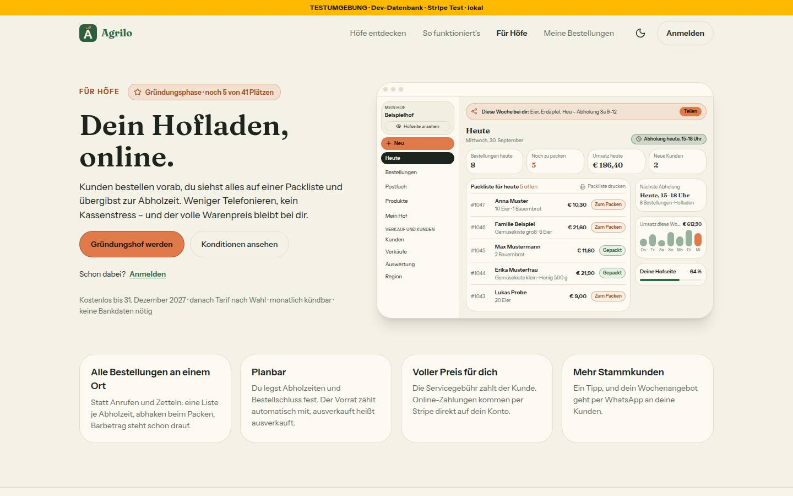
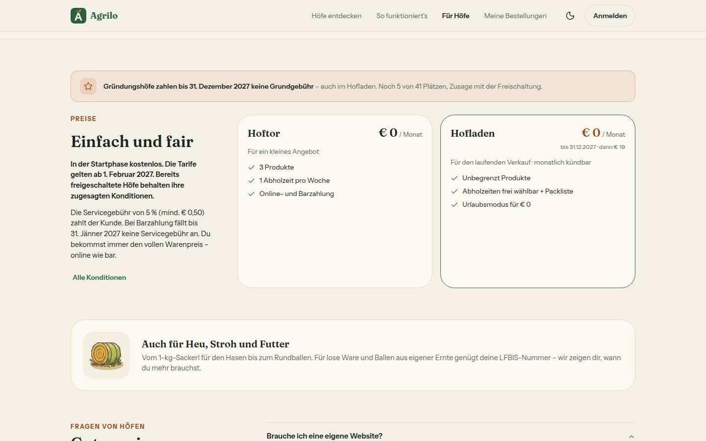
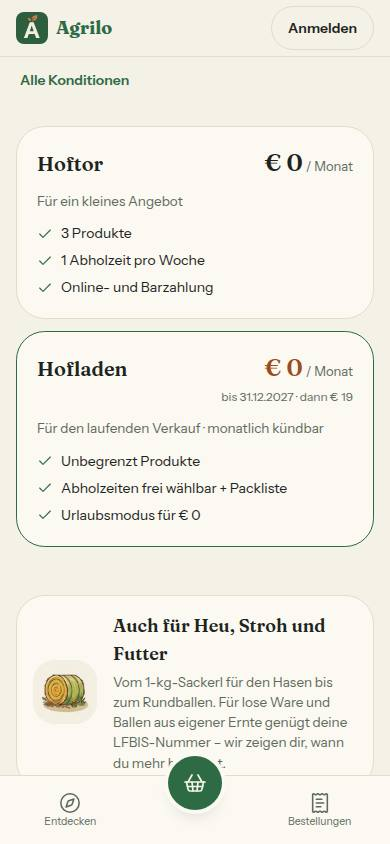
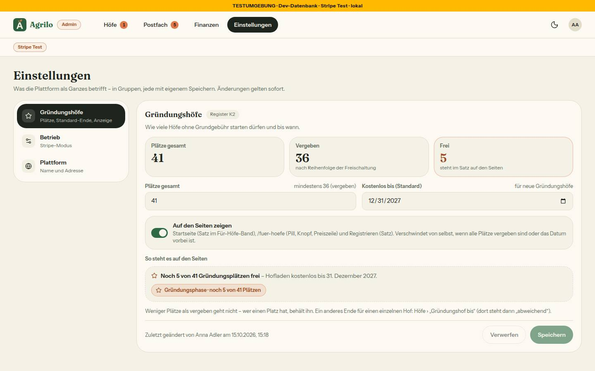
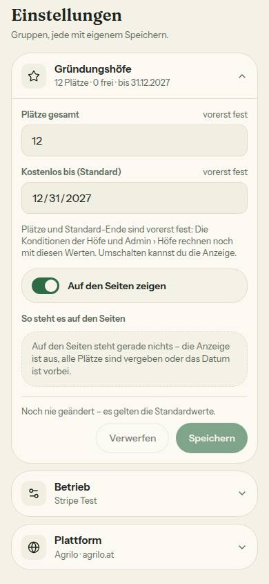
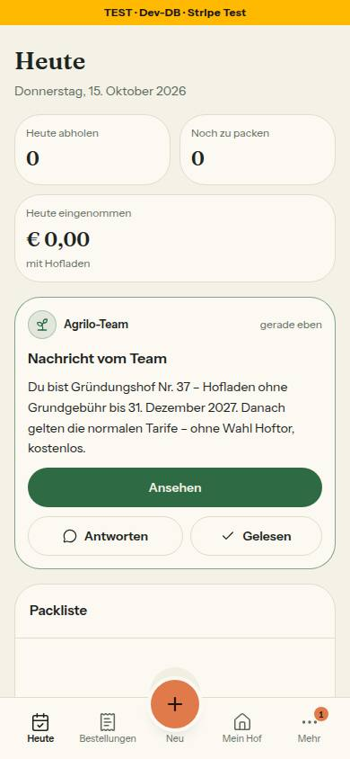

# Nr. 93 – Gründungshöfe sichtbar und Admin › Einstellungen (Register K2-Ergänzung, N15)

Branch `nacht/2026-10-15/93-gruendung` von `docs/lauf14`. Eine Migration `20261015120000_plattform_einstellung` (nur Expand: neue Tabelle, eine Seed-Zeile, RLS), kein neues Paket, kein Netz.

## Was geändert wurde
- `prisma/schema.prisma` + Migration: `PlattformEinstellung` (Plätze 12, Ende `'2027-12-31'::date`, Anzeige an, `zustellRegeln` für 95, `geaendertVonUserId`, `updatedAt`); erzeugt nach Regel 3 gegen `docs/lauf14`.
- `src/lib/gruendungshof.ts`: `plaetze` als Parameter mit Standard 12 an `istGruendungshof`/`vergebeneGruendungsplaetze`/`bekaemePlatzBeiFreigabe`; neu `fuerSeiten`, `seitenZahlen`, `voraussichtlicherPlatz`, `gruendungSeitenDaten`, `gruendungsZusageBeiFreigabe` und `GRUENDUNG_TEXT` (alle Sätze mit Zusage, K2).
- `src/lib/plattform-einstellung.ts` (neu): Typ, Standardwerte, `pruefeGruendungEingabe` (Plätze ≥ vergeben, Ende ≥ heute in Wien), `pruefeGruendungSperre` (Runde 1), Texte der Seite, Protokollzeile. `src/schemas/plattform-einstellung.ts` (neu): Zod strikt, nur eigene Sätze; Gruppe aus `?gruppe=`.
- `src/server/queries/plattform-einstellung.ts` (neu): `lesePlattformEinstellung` (frisch), `ladePlattformEinstellung` (gecacht, Etikett `plattform-einstellung`), `gruendungFuerSeiten()` (fängt Ladefehler → nichts zeigen).
- `src/server/actions/plattform-einstellung.ts` (neu): `speichereGruendungEinstellung` — Admin-Wache, upsert nur der Gruppe, `updateTag` + `revalidatePath` (/, /fuer-hoefe, /register, /admin/einstellungen).
- `src/server/actions/admin.ts` (nur `approveFarmAction`): danach EINE SYSTEM-Nachricht (Faden ohne Rundschreiben, eigene Idempotenz-Prüfung, Fehler → Sentry ohne Text, Freischaltung bleibt) und `revalidatePath('/')`/`('/fuer-hoefe')`.
- `src/lib/postfach.ts`: `GRUENDUNGS_NACHRICHT(n, bis)` = „Du bist Gründungshof Nr. n – “ + `baueGruendungsZusage(bis)`, `GRUENDUNGS_NACHRICHT_LINK`.
- `src/components/gruendung/` (neu): `satz.tsx`, `pill.tsx`, `preiszeile.tsx`, `registrieren-satz.tsx`, `satz-teile.tsx`.
- `startseite-abschnitte.tsx` (nur Band): `FuerHoefeBand` lädt selbst (async), `FuerHoefeBandInhalt` rendert; `page.tsx` unverändert.
- `fuer-hoefe-abschnitte.tsx`: Pill, Knopf „Gründungshof werden“, Fußnote, Preiszeile, Hofladen-Preis über `grundgebuehrText`. `(public)/fuer-hoefe/page.tsx`: async, lädt die Zahlen, `revalidate` 86400 → 300.
- `register-form.tsx`: Prop `gruendungSatz` (nur der Satz); `(auth)/register/page.tsx`: lädt und reicht `RegistrierenSatz`.
- `src/lib/admin-navigation.ts`: Reiter Einstellungen (genau die vorgegebene Zeile). `src/app/admin/einstellungen/page.tsx` + `loading.tsx`, `src/components/admin/einstellungen-{gruppen,gruendung,laden}.tsx` (neu).
- Tests neu: `gruendung-seiten`, `plattform-einstellung`, `gruendung-bausteine`, `integration/gruendung-freischaltung.int`; angepasst: `admin-navigation`, `admin-seiten-wache` (sechs Seiten), `startseite`, `hof-anmeldung`, `konditionen-seiten`, `konditionen-uebergang`, `stripe-pflicht` (Seiten jetzt async, Abfrage gemockt). `docs/ai/BAUSTEINE.md` neu erzeugt.

Wiederverwendet: `baueGruendungsZusage`, `gruendungsplaetze`, `ladeHoefeFuerGruendung`, `verlangeAdminSeite/-Aktion`, `AdminFehler`, `StatusBadge`, `Chip`, `DialogFehler`, `KNOPF_*`/`FELD`. Neu, weil: kein Baustein für Satz/Pill/Preiszeile; Kacheln/Seitenkopf von Nr. 94 liegen nicht auf diesem Branch.

## Annahmen
- **Link der Nachricht = `/settings/konditionen`** („Deine Konditionen“ laut Register K2), nicht `/konditionen` aus Freigabe/Hinweis: Die öffentliche Seite nennt den Stand des Hofs nicht. Bei Widerspruch gilt das Register.
- Nachrichtentext: Register-Satz + Zusage im Wortlaut von `baueGruendungsZusage` (wie „Dein Stand“); „wir erinnern dich rechtzeitig“ (Mockup) weggelassen — nichts erinnert.
- Register-Satz nur bei `zeigen` und k ≤ gesamt; Warteliste = `approvedAt` null und nicht stillgelegt. Nach Zurücknehmen + erneutem Freischalten bleibt es bei der ersten Nachricht (ggf. alte Nummer).
- Fußnote ersetzt im Kopf den Übergang K1 (Mockup); der Übergang bleibt im Abschnitt Preise. „keine Bankdaten nötig“ wörtlich aus dem Register, am Handy ausgeblendet (Mockup) — Hinweis: Stripe fragt beim Einrichten nach einem Konto für Auszahlungen.
- Obergrenze „Plätze gesamt“ 999 nur gegen Tippfehler. `updateTag` statt `revalidateTag` (Next 16, Muster `revalidiereProdukte`).

## Nicht gelöst
- **Bestehende Aufrufer rechnen weiter mit 12 Plätzen und 31.12.2027** (`admin/page.tsx`, `hof-aktion-dialog.tsx`, `queries/admin.ts` `ladeGruendungBis`/`getAdminFarms`, `setzeGruendungBisAction` — fremde Grenzen). Seit Runde 1 deshalb Plätze und Standard-Ende gesperrt (unten); umstellen erst mit der Nacharbeit.
- Schattendatenbank-Prüfung geht in Prisma 7 nicht (P3006 an `20260804091431_enable_rls`); ersetzt durch `migrate diff --from-config-datasource` gegen die migrierte Test-DB: leer.

## Wie der Mensch es testet
1. `/admin/einstellungen` als Admin: „Plätze gesamt“ (12) und „Kostenlos bis“ (31.12.2027) nur lesend, „vorerst fest“ mit Hinweis-Satz; „Auf den Seiten zeigen“ umschalten → „Speichern“ → Toast, Protokollzeile mit Name und Zeit.
2. Mit freien Plätzen: `/` (Band), `/fuer-hoefe` (Pill, „Gründungshof werden“, Fußnote, Preiszeile, Hofladen „€ 0 · bis 31.12.2027 · dann € 19“), `/register` (voraussichtlich Nr. k). Schalter aus → alles weg, Knopf „Kostenlos starten“.
3. Wartenden Hof freischalten → auf Heute die Karte „Nachricht vom Team“, „Ansehen“ öffnet Deine Konditionen; „Gelesen“ → Karte weg. Zurücknehmen + freischalten → keine zweite.

## Angepasste .md
`docs/ai/ARCHITECTURE.md` §5 (Plattform-Einstellungen), `docs/ai/DESIGN_SYSTEM.md` (Admin › Einstellungen, „Gründungshöfe sichtbar“, Stand N15), `DEVELOPMENT.md`, `docs/ai/BAUSTEINE.md` (erzeugt).

## Nacharbeit
- Bestehende Aufrufer auf die Einstellung umstellen — vorher Zusagen je Hof festschreiben (K2, Migration mit Freigabe), dann `pruefeGruendungSperre` heraus und die Felder wieder bearbeitbar. Nach dem Merge mit 94 Seitenkopf/Kennzahlen-Bausteine in Admin › Einstellungen nehmen.
- pruefer „sollte“: „keine Bankdaten nötig“ (`GRUENDUNG_TEXT.fussnote`, gruendungshof.ts) widerspricht wohl der Stripe-Pflicht — Register-Wortlaut K2 dem Menschen vorlegen; Code nur nach Registeränderung. „kann“: Name der Person in `src/server/queries/plattform-einstellung.ts` statt `prisma` in `admin/einstellungen/page.tsx`.
- Zweiter Prüfdurchgang (vom Dirigenten nachgetragen, keine Runde, weil kein Blocker): „sollte“ die Preiszeile steht bei 390 über Kicker und Überschrift statt direkt über den Karten (Mockup mobil-k2-fuer-hoefe-gruendung; das Bild Preise 390 zeigt sie nicht); „sollte“ `gruendungFuerSeiten` meldet den Rohfehler an Sentry, der Kommentar sagt „ohne Text“ (`src/server/queries/plattform-einstellung.ts`); „kann“ nach dem Standard-Ende keine Nachricht mit vergangenem Datum (`gruendungsZusageBeiFreigabe`).

## Regelvorschlag
Ursache: Ein Wert, der Zusagen trägt, bekam eine zweite Quelle (Einstellung), während alte Aufrufer die Konstante lesen. Gegenmaßnahme: Quelltext-Wache, dass `MAX_GRUENDUNGSHOEFE`/`GRUENDUNG_BIS_STANDARD` nur noch als Standard in `gruendungshof.ts`/`plattform-einstellung.ts` stehen — scharf schalten mit der Nacharbeit. Ort: `tests/gruendung-seiten.test.ts`.

## Nachbesserung Runde 1
- Blocker „Zusage aus zwei Quellen“ nach Weg (b): `pruefeGruendungSperre` lehnt Plätze ≠ `MAX_GRUENDUNGSHOEFE` und Ende ≠ `GRUENDUNG_BIS_STANDARD_TAG` mit dem festen Satz `GRUENDUNG_EINSTELLUNG_FEHLER.gesperrt` ab — in der Action nach `pruefeGruendungEingabe` (deren Sätze bleiben die genaueren) und im Formular. Formular: beide Felder `readOnly` (`bg-muted`, „vorerst fest“, Hinweis-Satz), schaltbar nur die Anzeige; `plaetzeAusEingabe` entfiel (toter Code).
- Tests rot vor dem Fix (Action gab `{ ok: true }` für 13 Plätze bzw. 30.06.2028; Felder ohne readonly), dann grün: `tests/plattform-einstellung.test.ts` (Sperre rein mit Gegenprobe, Action dreimal ohne upsert/Cache, Gegenprobe nur Anzeige; Rendertest), Integration (gesperrt → Zeile bleibt; nur Anzeige → gespeichert).
- Bilder Einstellungen 1440/390 neu (Seed: alle 12 vergeben → Vorschau leer); im Browser Anzeige aus + Speichern geprüft, danach Zeile zurück (psql: 12/2027-12-31/an/ohne Person). Axe 0 (1440 hell/dunkel, 390). Heute-Bild bleibt (Oberfläche unverändert; seine 41 Plätze lassen sich über den Admin nicht mehr setzen).

## Bilder und Mockup-Abweichungen (hell; Testdaten: Plätze 41 per Admin, `hof-wartend` freigeschaltet — danach zurückgesetzt, belegt per psql: approvedAt null, stripeAccountReady false, 0 Fäden, Zeile 12/2027-12-31/an/ohne Person)
   
  
  
- Band: Satz ganz in Vordergrundfarbe statt leise (Kontrast 4,4:1 auf dem Verlauf, Bild Band). Preise: ohne Link „Was Gründungshöfe bekommen“ und ohne Zusatz „als Gründungshof ohne Grundgebühr“ (keine Seite beschreibt das Angebot; Zusage steht im Preis), Beträge im Format `€ 0`/`€ 19` (format.ts) (Bild Preise). Abschluss von /fuer-hoefe ohne Gründungssatz (nicht im Register). Einstellungen: eine Protokollzeile statt Verlauf, keine Gruppe Benachrichtigungen, Betrieb/Plattform nur Name, Adresse, Stripe-Modus (Bilder Einstellungen). Heute: Knopf „Ansehen“ der Postfach-Karte statt „Deine Konditionen ansehen“ (Bild Heute).
- Die Zahlen in den Bildern Band, Kopf, Preise und Heute („5 von 41“, „Nr. 37“) stammen aus einer Testeinstellung vor der Sperre aus Runde 1 und belegen nur das Layout; heute lässt der Admin nur 12 Plätze zu.
- Axe: 0 Verstöße auf allen sechs Seiten (Band, /fuer-hoefe, /register, Einstellungen auch dunkel); „incomplete“ nur über Verläufen (Band, Abschluss). Tippflächen ≥ 44 px, kein seitliches Scrollen bei 390.
