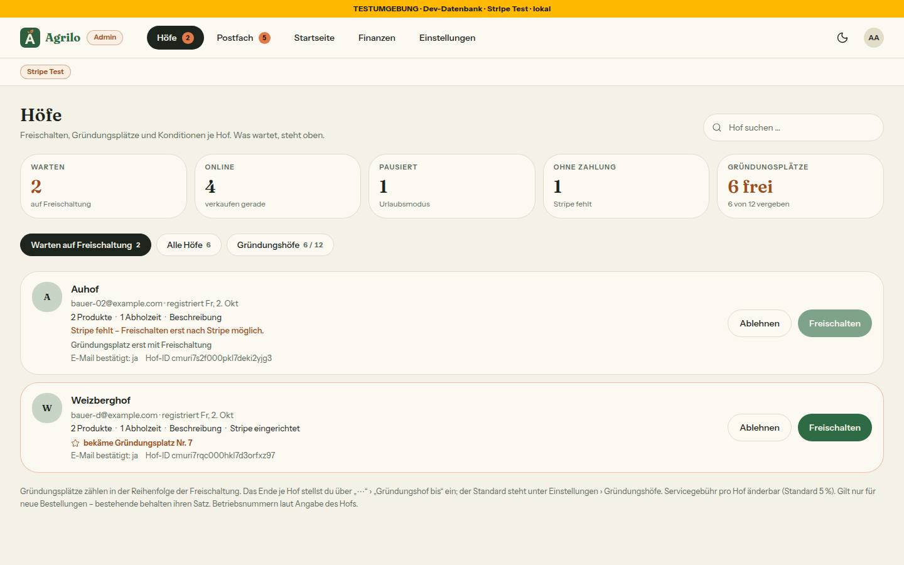
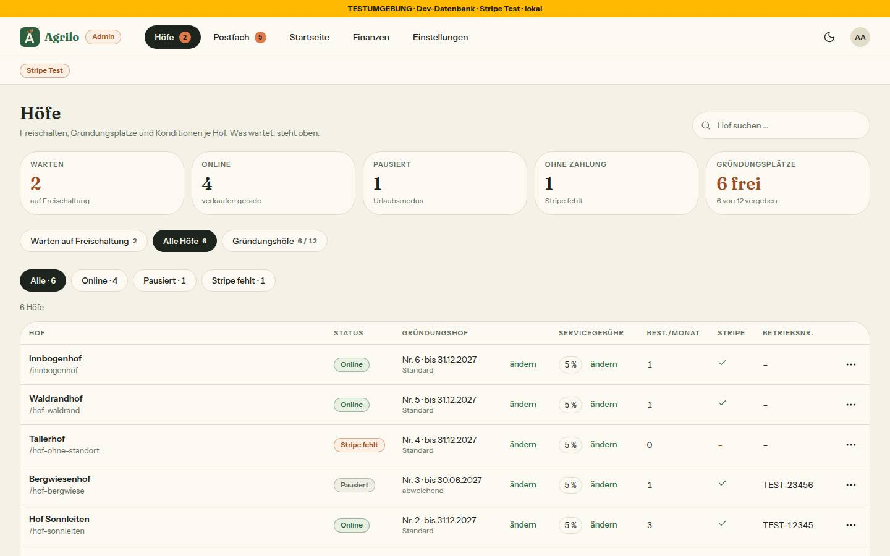
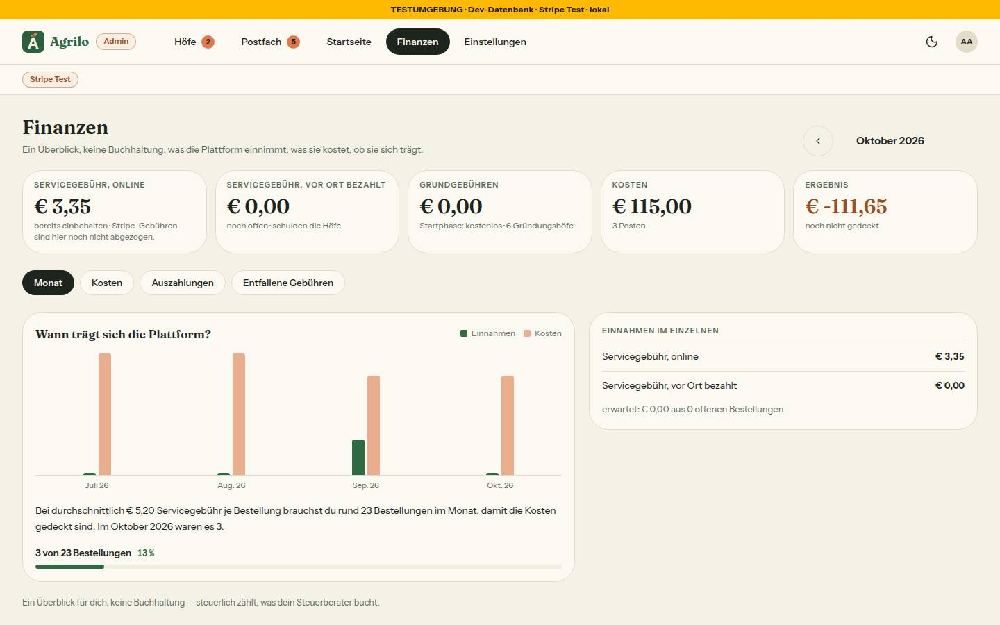
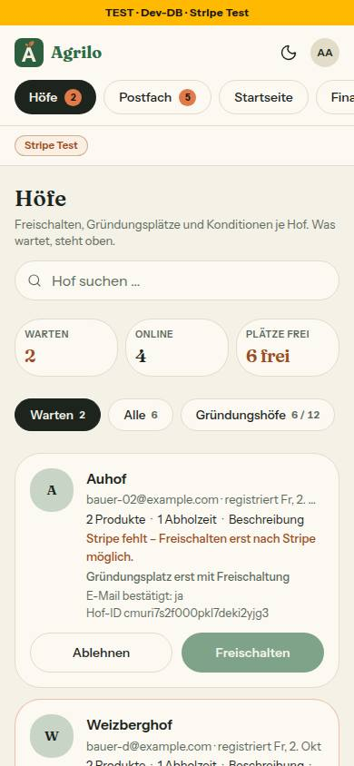

# Nr. 94 – Admin-Seitenmuster, Höfe und Finanzen (Register N15, Z3-Korrektur; Mockups admin-hoefe-und-freischaltung, admin-finanzen, admin-mobil-unterwegs-freischalten)

Branch `nacht/2026-10-15/94-admin-muster` von `docs/lauf14`. Keine Migration, kein Schema, kein neues Paket, kein Netz. Geprüft: typecheck 0, lint 0 Fehler / 5 Warnungen (keine in meinen Dateien), `pnpm test` 375 Dateien / 7571 Tests grün (main: 372 / 7496).

## Was geändert wurde
- `src/components/admin/seitenkopf.tsx`, `kennzahlen.tsx`, `unterreiter.tsx` (neu): die drei Bausteine des Musters; der Unterreiter ist eine Reihe `FilterChip` (Tippfläche 44 px über `::before`), die Kachel-Töne `tun`/`laeuft` kommen als Bedeutung aus der Fachregel und werden über `text-zustand-*` gezeichnet.
- `src/lib/admin-seiten.ts` (Typen, Platzhalter), `admin-hoefe-seite.ts` (Kennzahlen, Reiter, Platz bei Freischaltung, Spalte Gründungshof), `admin-finanzen-seite.ts` (Reiter, Kachel Grundgebühren) und `src/schemas/admin-reiter.ts` (Zod, unbekannt = Standard): alle Regeln und Texte rein in `src/lib/`.
- `src/lib/admin-navigation.ts` und `src/components/shells/admin-shell.tsx`: Reiter Höfe · Postfach · Startseite · Finanzen · Einstellungen, `ADMIN_TESTUMGEBUNG` und Prop `testumgebungUrl` entfallen, Betriebsleiste nur mit Stripe-Marke, der gewählte Reiter scrollt am Handy in die Mitte.
- `src/app/admin/startseite/page.tsx` + `loading.tsx` (neu), `src/components/admin/admin-laden.tsx`, `src/app/admin/layout.tsx`: Platzhalter „Startseite · Kommt mit Nr. 96.“ (nur Admin); Ladeansichten im Muster; das Layout reicht keine Adresse der Testumgebung mehr an die Shell (Grenzerweiterung, nötig).
- `src/app/admin/page.tsx` und `src/components/admin/hoefe-ansicht.tsx`: Seitenkopf mit Suche, fünf Kennzahlen, drei Unterreiter (`?reiter=`), Warteliste mit Platz-Zeile, Tabelle mit Spalte Gründungshof, Regel-Zeile; die Zahl der Plätze steht in der Seite an einer Stelle (`MAX_PLAETZE`, Kommentar „bis Nr. 93 gemergt ist“).
- `src/app/admin/finanzen/page.tsx`: Seitenkopf mit Monat (der Testzahlungen-Hinweis als `hinweis` des Kopfs), Kennzahlen, vier Unterreiter, Beträge und Abfragen unverändert; die Zahl der Gründungshöfe kommt aus der bestehenden `ladeHoefeFuerGruendung` — scheitert nur sie, fehlt nur die Kachel „Grundgebühren“.
- Tests neu: `admin-seitenmuster`, `admin-hoefe-seite`, `admin-finanzen-seite`; angepasst: `admin-ansichten`, `admin-navigation`, `admin-seiten-wache` (sechs Seiten), `shells`, `testumgebung-anzeige`, `testzahlungen-hinweis` (Mock der Gründungshof-Abfrage). Gegenprobe: 22 Regeln und Zweige einzeln gebrochen, jeder Test wurde rot.

## Zählregeln (keine neue Abfrage; `queries/admin.ts` blieb unberührt)
- **Warten** = Status „Wartet“ (nicht freigeschaltet, nicht stillgelegt); **Online** = Status „Online“; **Pausiert** = Status „Pausiert“; **Ohne Zahlung** = Filter „Stripe fehlt“ (auch pausierte Höfe ohne Stripe) — dieselben Zahlen wie die Filter (`zaehleHofFilter`). **Gründungsplätze** = Plätze − Vergebene („n frei“, darunter „v von m vergeben“).
- **„bekäme Gründungsplatz Nr. k“:** der wartende Hof käme mit `jetzt` als Letzter in die Reihenfolge der Freischaltung (`gruendungsplatzVon`); nur mit Stripe, sonst „Gründungsplatz erst mit Freischaltung“, bei vergebenen Plätzen keine Zeile.
- **Grundgebühren** = € 0,00 + „Startphase: kostenlos · n Gründungshöfe“ nur vor `TARIFE_AB`; danach fehlt die Kachel (keine Summe, die die Seite kennt).

## Annahmen
1. Die Unterreiter schalten den Inhalt um (das Mockup zeigt Warteliste und Tabelle untereinander); ohne Wahl gilt „Warten“, solange jemand wartet, sonst „Alle Höfe“.
2. Zwei wartende Höfe mit Stripe zeigen beide dieselbe Nr. k: gefragt ist der Platz bei sofortiger Freischaltung, keine Warteschlange.
3. Ton: Warten `tun`, wenn jemand wartet; Gründungsplätze `tun`, wenn einer wartet und ein Platz frei ist (Mockup: orange); Ohne Zahlung neutral wie im Mockup.
4. Die Filter-Chips bleiben im Reiter „Alle Höfe“ (sie erreichen „Stillgelegt“, „Online-Zahlung aus“); die Suche gilt in jedem Reiter. „Neu im Postfach“ (Handy) steht im Reiter „Warten“.
5. Finanzen: „Monat“ = Verlauf + „Einnahmen im Einzelnen“, „Kosten“ = Kostenposten (kein Block steht zweimal).
6. Bilder mit einer Kopie der Test-DB (`pg_dump`, eigener DB-Name, nach den Bildern gelöscht): Die gemeinsame Seed-DB hat 36 freigeschaltete Höfe, alle Plätze wären vergeben und die Platz-Zeile unsichtbar. Die gemeinsame DB blieb unverändert.

## Nicht gelöst
- Reiter **Auszahlungen** und **Entfallene Gebühren** haben keinen Inhalt: `getFinanzen` liefert dazu nichts, neue Zahlen sind ausgeschlossen. Die Seite sagt es in einem Leerzustand. Braucht eine Summe in der Abfrage (eigene Nummer).
- „Admin am Handy › Einstellungen (390)“ gibt es hier nicht (Seite aus Nr. 93); der Reiter zeigt bis zum Merge auf `/admin/einstellungen` (freigegeben). Das Bild macht der Dirigent nach dem Zusammenführen.
- Kommentare in `src/lib/umgebung.ts`, `umgebung-server.ts` und `env.ts` nennen noch „Zur Testumgebung“ (andere Dateien, nur Kommentare).
- Die Reiter der Shell sind 38 px hoch (wie im Mockup und vor Nr. 94); die Pillen der Unterreiter messen 44 px über `::before`.

## Wie der Mensch es testet
- Als Admin `/admin` öffnen: Kennzahlen, drei Pillen; mit einem wartenden Hof mit Stripe steht darunter „bekäme Gründungsplatz Nr. k“, ohne Stripe „Gründungsplatz erst mit Freischaltung“. Auf „Alle Höfe“ tippen: Tabelle mit Spalte „Gründungshof“ („Nr. 3 · bis 30.06.2027“, „abweichend“, „kein Gründungshof“); `?reiter=unsinn` zeigt den Standard.
- `/admin/finanzen`: Kennzahlen mit „Grundgebühren € 0,00“, vier Pillen; Monatspfeile behalten den Reiter; „Kosten“ zeigt die Kostenposten. `/admin/startseite`: nur der Kopf.
- Am Handy (390 px): Reiter scrollen, der gewählte steht sichtbar; Kennzahlen zu dritt. Oben steht nur „Stripe Test“ (kein Link zur Testumgebung).

## Angepasste .md
`docs/ai/DESIGN_SYSTEM.md` (Admin-Seitenmuster, Admin: Höfe, Betriebsleiste, Finanzen, Shells), `docs/ai/BAUSTEINE.md` (erzeugt), `DEVELOPMENT.md` (Eintrag), `docs/betrieb/testumgebung.md` (Korrektur: kein Link mehr).

## Nacharbeit, Regelvorschlag
- Nacharbeit: Inhalt der Reiter Auszahlungen und Entfallene Gebühren; beim Zusammenführen mit 93 `MAX_PLAETZE` in `admin/page.tsx` auf die Plattform-Einstellung umstellen; die Kommentare zur Testumgebung nachziehen.
- Regelvorschlag: Ursache — Der Satz „Startphase · n Gründungshöfe“ aus dem Register hätte das Wort in eine zweite Datei geschrieben; `tests/konditionen-uebergang.test.ts` liest auch Kommentare und fing es erst im vollen Lauf. Gegenmaßnahme — Prüfung statt Textregel, vorhanden. Ort — Rahmen: Bilder, die einen Datenzustand brauchen, den die gemeinsame Seed-DB nicht hat (hier: unter 12 Gründungshöfe), mit eigener Kopie der DB machen (`pg_dump | psql`, `start-dev.sh` mit anderem DB-Namen).

## Bilder (hell; `docs/nachtlauf/berichte/bilder/94/`) und Mockup-Abweichungen
   
- Axe (hell und dunkel, 390 und 1440, Höfe in allen Reitern, Finanzen in drei Reitern, Startseite): 0 Verstöße; kein seitliches Wischen. Tippflächen unter 44 px: nur die Shell-Reiter (38 px, bestand) und das Logo (32 px, bestand); die Pillen messen 44 px über `::before`.
- Abweichungen: (a) Die Unterreiter schalten um, das Mockup zeigt Warteliste und Tabelle untereinander (Bild „Alle Höfe“ ist der zweite Reiter). (b) Die Filter-Chips bleiben im Reiter „Alle Höfe“ (das Mockup hat keine). (c) „Standard“ steht leise unter dem Ende, das Mockup nennt nur „abweichend“ (Nr. 62 bleibt). (d) Kosten im Reiter „Kosten“ statt neben dem Verlauf (Annahme 5). (e) Ohne „Hofseite n von 11“ und ohne „Hofseite“-Knopf in der Warteliste und ohne Erklärtext rechts in der Betriebsleiste (nicht beauftragt; der orange Testbetrieb-Hinweis bleibt).
- Wiederverwendet: `FilterChip`, `FilterChipReihe`-Muster, `KARTE`/`LEISE`, `EmptyState`, `StatusBadge`, `zaehleHofFilter`, `gruendungsplatzVon`, `baueGruendungAnzeige`, `ladeHoefeFuerGruendung`, die Finanzen-Komponenten. Neu, weil: kein Baustein für Seitenkopf, Kachel-Reihe mit Ton aus G5 und Reiter-Pillen mit Zahl in der Adresse (BAUSTEINE nach „Kennzahlen“, „Kachel“, „Reiter“ gesucht).
