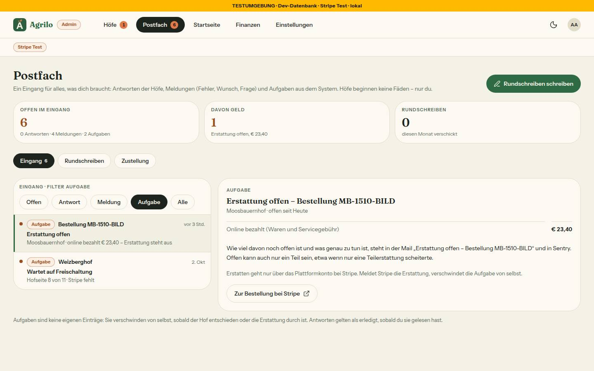

# Nr. 95 – Postfach Stufe 2: Eingang, Zustellung, Antwort möglich (Register N12-Änderung, N14)

Branch `nacht/2026-10-15/95-postfach-stufe2` (94 + 93). Eine Migration `20261015130000_postfach_stufe2` (Expand: `Rundschreiben.antwortMoeglich` Default true, `Order.erstattungOffenSeit` nullable + Index, Tabelle `BetreiberEmpfaenger` mit RLS; Regel 3 gegen HEAD = 94+93), kein Paket, kein Netz.

## Was geändert wurde
- `src/lib/zustellung.ts` (neu): Regeln (Zod mit `.catch`, Standard = heutiges Verhalten), `empfaengerFuer(art, …)` (SUPPORT_EMAIL fest + bestätigte; aus = leer, außer Erstattung offen), Frist des Links, alle Texte.
- `src/lib/postfach.ts`: Reiter Eingang · Rundschreiben · Zustellung, `alteReiterAdresse`, Eingang rein (`eingangEintraege`, Zählung, Prüfliste, Kennzahlen, Unterreiter, Stripe-Link), `ANTWORT_NICHT_MOEGLICH`, Texte. `src/schemas/postfach.ts`: `antwortMoeglich` Pflicht, Reiter/Filter/Auswahl per Zod, Schemas der Zustellung.
- `src/server/queries/postfach.ts`: `zaehleOffenImEingang` (eine Zählung für Reiter und „Offen“), `ladeEingang`, `ladeHofAufgaben`, `ladeErstattungAufgaben`, `ladeZustellung`, `ladeBetreiberEmpfaenger` (Fehler → nur SUPPORT_EMAIL), Token-Hash, Rundschreiben mit Antworten.
- `src/server/actions/postfach.ts`: `antworteAlsHof` mit „Antwort möglich“ in der WHERE-Klausel + Mail an die Liste; `sendeRundschreiben` speichert den Haken; neu `fuegeEmpfaengerHinzu`, `entferneEmpfaenger`, `speichereZustellRegeln`, `sendeTestmail` (das Einlösen seit Runde 1 in `src/server/zustellung-bestaetigen.ts`).
- `src/lib/email.ts`: die vier Betreiber-Mails nehmen die Liste (`sendeAnListe`, leer = keine Mail); neu Bestätigung, Antwort eines Hofs, Testmail; Links in den Eingang. `src/emails/betreiber-{bestaetigung,antwort,testmail}.tsx` (neu).
- Admin: `postfach/page.tsx` im Seitenmuster, `eingang-reiter.tsx`, `faden-spalte.tsx`, `zustellung-reiter.tsx` (neu), Rundschreiben mit Haken und „n Antworten“, `loading.tsx`; `unterhaltungen-reiter.tsx`/`meldungen-reiter.tsx` entfernt; `zustellung/bestaetigen/route.ts` (neu, ohne Anmeldung); `meldungen/[id]/page.tsx` nur 308.
- `src/components/admin/`: `briefkasten-teile.tsx` + `MeldungEntscheidenSpalte`, Links in den Eingang; `postfach-aufgabe-hof.tsx`, `postfach-zustellung.tsx` (neu).
- `(hof)/postfach/[id]/page.tsx`: Hinweis statt Antwortfeld. `adminbereich.ts`: Zähler = `zaehleOffenImEingang`. Cron Wochenbericht nach Regel.
- `orders.ts`/`webhook/route.ts`: `erstattungOffenSeit` bedingt setzen (Nachlauf) und löschen (REFUNDED bzw. spätere erfolgreiche Erstattung), Empfänger der Mail aus der Zustellung.
- Tests neu: `zustellung`, `zustellung-mails`, `zustellung-bestaetigen`, `postfach-eingang`, `integration/postfach-eingang.int` (8); angepasst: `postfach`, `admin-seiten-wache`, `briefkasten-cron`, `meldung-absenden`, `storno-atomar`, `storno-erstattung`, `integration/postfach.int`.

Wiederverwendet: `Seitenkopf`/`Kennzahlen`/`Unterreiter`, `FilterChip`, `Marke`, `EmptyState`, `HofAktionDialog`, `TriageForm`/`KiVorschlag`, `FadenVerlauf`/`TeamAntwort`, `hofseiteFortschritt`, `platzBeiFreischaltung`, `stornoBetraege`, `emailSchema`, `createRateLimiter`. Neu, weil: keine Spalte/Liste für drei Arten, keine Empfängerliste.

## Annahmen
- „Offen“ bei Meldungen = NEU/GEPRUEFT (Freigabe wörtlich) — Vorschläge der KI zählen nicht mehr am Reiter.
- Erstattung: Eingang zeigt „online bezahlt“ (`stornoBetraege`) und verweist für offenen Betrag und Handanweisung auf die Mail mit ihrem Betreff (nicht gespeichert, braucht Stripe). „Zur Bestellung“ = Zahlung im Stripe-Dashboard des Modus.
- Antwort eines Hofs → Mail an die Liste (Regel „sofort“, Standard laut Freigabe; vorher keine Mail). Wünsche/Fragen fest „nur im Eingang“, Testmail an die ganze Liste inkl. SUPPORT_EMAIL.
- Bestätigungsseite als Route Handler: Unter `/admin` hängt jede Seite im Admin-Layout (Login), auch in einer Routengruppe. Gespeichert nur der SHA-256 des Tokens.
- Wartend = `approvedAt` null und nicht stillgelegt; Platzzahl `MAX_GRUENDUNGSHOEFE` wie Admin › Höfe (Nacharbeit 93).

## Nicht gelöst
- Hof-Liste (`(hof)/postfach/teile.tsx`) zeigt „keine Antwort möglich“ nicht (außerhalb der Grenze). Kennzahl „Antwortzeit“, „zuletzt …/Letzte Mail“ der Zustellung und „Hofseite ansehen“ weggelassen (nicht in Freigabe/Register bzw. Seite eines wartenden Hofs ist nicht öffentlich).

## Wie der Mensch es testet
1. `/admin/postfach` als Admin: Kennzahlen, Unterreiter „Eingang n“, Liste mit Antwort/Meldung/Aufgabe; Filter umschalten; eine Zeile öffnen → rechts Faden, Entscheiden, Prüfliste oder Erstattung.
2. `/admin/meldungen/<id>` → landet im Eingang bei der Meldung. `?reiter=unterhaltungen` → Filter Antwort.
3. Rundschreiben „Info“ an einen Hof (Haken aus) → als Hof `/postfach/<id>`: Hinweis statt Feld; „Wichtig“ → Haken an, Feld da.
4. Zustellung: Adresse hinzufügen → Log zeigt den Link → öffnen (ohne Anmeldung) → Knopf → „Adresse bestätigt“; zweiter Klick: „gilt nicht“.
5. Wochenbericht: Nur ein wartender Hof offen, `GET /api/cron/briefkasten` mit `Authorization: Bearer <CRON_SECRET>` → `zusammenfassung: true`, Mail im Log mit „Offen im Eingang: 0 Antworten · 0 Meldungen · 1 Aufgabe“; Regel aus → keine Mail.

## Angepasste `.md`
`docs/ai/ARCHITECTURE.md` (Postfach Stufe 2), `docs/ai/DESIGN_SYSTEM.md` (Postfach, Admin, Seitenmuster-Stand), `DEVELOPMENT.md`, `docs/ai/BAUSTEINE.md` (erzeugt).

## Grenzerweiterungen und Nacharbeit
- Gebraucht außerhalb der Liste: `src/schemas/postfach.ts`, `src/server/actions/onboarding.ts` und `meldung.ts` (je nur der Mail-Aufruf mit Empfängern), zwei zusätzliche Mail-Vorlagen (Antwort, Testmail); Runde 1: `src/server/zustellung-bestaetigen.ts` (vom Dirigenten genannt), `src/emails/briefkasten-zusammenfassung.tsx` (Zeile „Offen im Eingang“).
- **Nacharbeit:** (1) „Erstattung offen“ löscht jede spätere erfolgreiche Erstattung derselben Zahlung, auch eine Teilerstattung; eine Erstattung im Stripe-Dashboard womöglich nie (`charge.refunded`/`refund.created` nicht abonniert) — Entscheidung: Knopf „Erstattung erledigt“ oder offenen Betrag speichern. (2) `WARTENDER_HOF` (ohne stillgelegte) gegen `zaehleWartendeHoefe` in `queries/admin.ts` (mit) — Grenze 94/admin. (3) Keine Drossel für „Ein Hof hat geantwortet“ (bis 30 je Hof und Tag). (4) `triage-form`/`ki-vorschlag` aus `app/admin/meldungen/[id]` nach `components/admin`; `MeldungListe` ohne Aufrufer. (5) Hof-Liste ohne „keine Antwort möglich“ (`teile.tsx`). (6) Anführungszeichen ‚Problem melden‘ wie im Register. (7) `brauchtZusammenfassung` (`src/lib/meldung.ts`) hat seit Runde 1 keinen Aufrufer mehr (nur Tests). Aus der Nachprüfung (vom Dirigenten nachgetragen): (8) die Kennzahl „Davon Geld“ (`geldSatz`) nennt den online bezahlten Betrag „Erstattung offen, € …“, bei einer gescheiterten Teilerstattung ist offen weniger — ehrlicher Wortlaut wie `erstattungZeile` („online bezahlt“); (9) „offen seit Heute“ mitten im Satz groß.
- **Regelvorschlag:** Ursache: Eine Seite „ohne Anmeldung unter /admin“ war geplant, geht aber wegen des Layouts nicht. Gegenmaßnahme: Wache „jede Datei unter `src/app/admin` ist `page`/`loading` mit `verlangeAdminSeite` oder ein `route.ts` mit Kommentar ‚ohne Anmeldung‘“. Ort: `tests/admin-seiten-wache.test.ts`.

## Bilder (hell; Axe 0 Verstöße hell/dunkel auf 8 Admin-Ansichten und dem Hof-Faden; Tippflächen ≥ 44 px, Chips 36 px sichtbar mit 44 px über `::before`)
  
  

Abweichungen (je im Bild): Filterchips ohne Zahl (Zahl am Unterreiter); Zustellung ohne „Verwerfen/Speichern“ unter Empfänger (Hinzufügen/Entfernen wirken sofort, Freigabe), Wünsche/Fragen als gesperrter Haken, „montags früh“ statt „7 Uhr“ (Cron 05:00 UTC); Aufgabe Hof ohne Personenname/„Hofseite ansehen“. Testdaten (2 Rundschreiben, 1 Bestellung, 2 Adressen an moosbauernhof) per `bild95-weg.sql` entfernt, Nachzählung 0.

## Nachbesserung Runde 1
- **Blocker Bestätigung:** `bestaetigeEmpfaenger` aus der `'use server'`-Datei nach `src/server/zustellung-bestaetigen.ts` (ohne `'use server'`, Logik gleich); nur `route.ts` ruft es. Wache in `tests/zustellung-bestaetigen.test.ts`: jeder `export async function` in `actions/postfach.ts` verlangt `verlangeAdminAktion`/`hofDerSitzung` (oder ruft einen Export, der es tut) — rot mit genau `bestaetigeEmpfaenger`, jetzt grün.
- **Blocker Wochenbericht:** Cron sendet bei Regel an UND `zaehleOffenImEingang().gesamt > 0`; die Mail trägt „Offen im Eingang: … Antworten · … Meldungen · … Aufgaben“ (`offenSatz`, Betreff aus `ZUSTELLUNG_MAIL_TEXT`), der Meldungsteil bleibt, Link auf „Offen“. Tests: nur Aufgabe/Erstattung/Antwort → Bericht; nichts offen → keiner (auch bei liegen gebliebener Meldung außerhalb NEU/GEPRUEFT); Regel aus → keiner.
- **Sollte:** ARCHITECTURE korrigiert (`charge.refund.updated`, Grenzen) und Regel „Export einer `'use server'`-Datei = öffentlicher Endpunkt“; Aufgabe Erstattung als `PostfachErstattungSpalte` mit Satz auf die Mail (Betreff aus `EINGANG_TEXT.erstattungKopf`, auch in `sendErstattungOffen`), Rendertest. **Kann:** `faden` per Zod (`fadenKennungAus`), Regeln-Schema ohne Cast.
- Bild neu: Erstattung bei 1440 hell (Axe hell/dunkel 0). Testdaten: 1 Bestellung per `bild95r1.sql`, entfernt per `bild95r1-weg.sql`, Nachzählung 0.

## Nachbesserung Runde 2
- **Blocker 19c (artikel-fehlt.int:736):** Belegt per Diagnose: zwei Aufrufe mit VERSCHIEDENEN `bestellId` — der zweite stammt aus dem vorigen Fall („Storno … ohne Zuordnung“), dessen Nachlauf seit 95 vor dem Versand `queries/postfach` lädt und die Empfänger liest und so erst im nächsten Fall ankam; kein Doppelversand im Code. Fix nur im Test: `nachDerAntwort`-Mock startet sofort und merkt sich das Ende, `nachlaufFertig()` und `afterEach` (vor `raeumeAuf`) warten; Zählung bleibt „genau einmal für diese Bestellung“, der auslösende Fall prüft seine Mail jetzt selbst. Gegenprobe ohne Abwarten rot.
- Gleiches Muster in `erstattung-gescheitert.int` (Webhook-Nachlauf liest seit 95 die Datenbank; feste 200 ms, unabgewartete Mails vor „keine Mail“-Fällen) ebenso umgestellt. `docs/ai/TESTING_GUIDELINES.md` §3 um das Muster ergänzt. Ganze Integrationssuite und voller Lauf grün (Zahlen in der Rückgabe).
