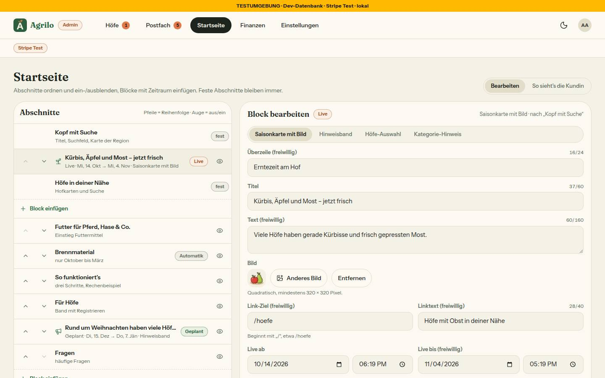
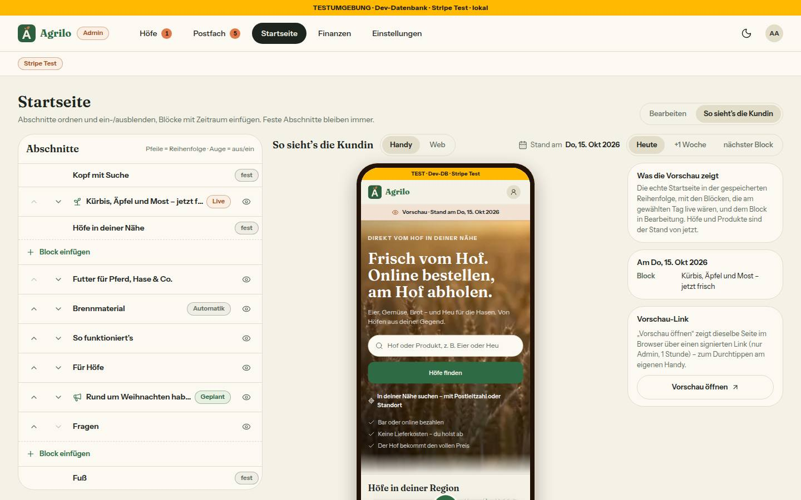
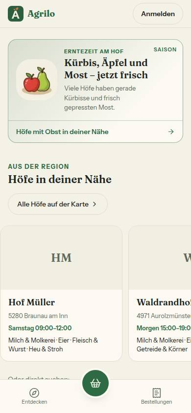
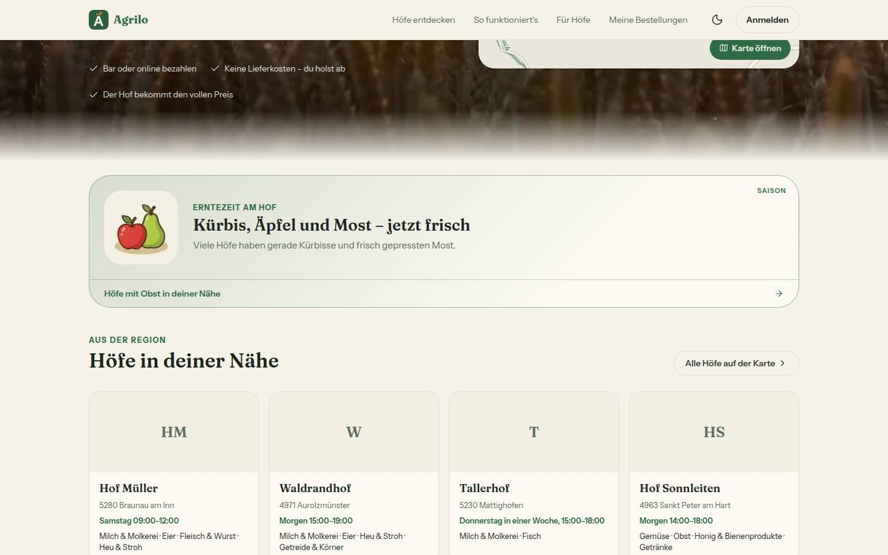

# Nr. 96 – Startseite gestalten: Abschnitte, Blöcke, Vorschau (Register N16)

Branch `nacht/2026-10-15/96-startseite-gestalten` (von 95). Eine Migration `20261015140000_startseite_gestalten` (Expand + Seed: Enums `StartseiteArt`/`StartseiteVorlage` mit Guards, Tabellen `StartseiteAbschnitt`/`StartseiteBlock` mit RLS, eindeutiger Index auf `blockId`, acht Seed-Zeilen `startseite-<art>` mit `ON CONFLICT DO NOTHING`; Regel 3 gegen HEAD = 95). Gegen die migrierte Test-DB ist `migrate diff … --to-schema` leer. Kein Paket, kein Netz.

## Was geändert wurde
- `prisma/schema.prisma` + Migration: die zwei Tabellen aus N16 (`farmIds String[] @default([])`, `kategorie ProductCategory?`, `erstelltVonUserId` ohne Fremdschlüssel).
- `src/lib/startseite-gestalten.ts` (neu): Reihenfolge-Regeln (`pruefeReihenfolge`, `darfVerschieben`), Zeitraum (`istLive`, `blockZustand`), Wiener Zeit (`zeitpunktAusEingabe` über `fristen.ts`), `zuRendern` mit Rückfall, Grenzen, Texte. `src/schemas/startseite.ts` (neu): Zod für Block, Speichern, Löschen, Vorschau, URL-Parameter.
- `src/server/queries/startseite.ts` (neu): `ladeStartseite` (eine Abfrage samt Blöcken + höchstens eine für die Höfe, `unstable_cache` Tag `'startseite'`, Fehler → leere Liste + Sentry), `ladeStartseiteAdmin`.
- `src/server/actions/startseite.ts` (neu): `speichereStartseite` (eine Transaktion, Server prüft feste Abschnitte, Permutation, freigeschaltete Höfe, eigenes Bild; `updateTag`), `loescheStartseitenBlock`, `erzeugeStartseitenVorschau` (Draft Mode + signierter Pfad).
- `src/server/startseite-vorschau.ts` (neu): HMAC-Link (`BETTER_AUTH_SECRET`, 1 h, Inhalt `{ Ausstellzeit, datum, blockEntwurfId }`), `vorschauDieserAnfrage` (Draft Mode → Link → Admin-Sitzung), `oeffneVorschau` für die Route `app/admin/startseite/vorschau/route.ts` (neu, Runde 2).
- `src/app/page.tsx`: rendert die Liste je `art` (Kopf/Höfe selbst, Rest über `STARTSEITE_ABSCHNITTE`), Blöcke über `StartseitenBlock`, Vorschau-Band; `revalidate = 300` bleibt, statisch ohne Draft Mode.
- `startseite-abschnitte.tsx`: nur der Export `STARTSEITE_ABSCHNITTE` (+ Import `beispielRechnung`).
- `src/components/startseite/bloecke/` (neu): Saisonkarte, Hinweisband, Höfe-Auswahl (`HofKarten`), Kategorie-Hinweis, Verteiler `StartseitenBlock`, `stil.ts`.
- Admin: `app/admin/startseite/page.tsx` + `loading.tsx` ersetzt; `components/admin/startseite-gestalten.tsx`, `startseite-vorschau.tsx` (eigener Rahmen; der von Mein Hof hängt an der Hofseiten-Adresse), `startseite-laden.tsx` (neu). `admin-seiten.ts`: `STARTSEITE_PLATZHALTER` entfällt.
- Upload: `upload-pfade.ts` Zweck `'startseite'` (eigener Ordner, 1600, ≥ 320, `istEigeneStartseitenBildUrl`); `api/upload/token` und `/verarbeiten` nur dafür mit Admin-Sitzung (1:1-Zuschnitt), sonst unverändert.
- Tests neu: `startseite-gestalten` (29), `startseite-vorschau` (9), `startseite-bloecke` (12), `startseite-aktion` (14), `upload-startseite` (12), `integration/startseite-gestalten.int` (6, unter der Sperre grün: 6/6, Runde 2). Angepasst: `startseite` (Saison/Reihenfolge jetzt aus der Liste), `ladeansichten` (genau zwei `await` erlaubt), `hofseite-einmal` (Ausnahme für den Startseiten-Link), `upload-url-guard` (Wert 1600).

Wiederverwendet: `Seitenkopf`, `Segment`, `Marke`, `StatusBadge`, `Hinweiskarte`, `HofKarten`, `Kicker`, `ZeichenZaehler`, `useImageUpload`, `wienerMitternacht`, `kalendertagInWien`, `wienerZeitpunkt`/`uhrzeitInWien` (fristen.ts), `vorschauMassstab`/`VORSCHAU_*`, `useElementGroesse`, HMAC-Muster aus `abo-bestaetigung-token.ts`. Neu, weil: kein Baustein für Blöcke/Liste; der Vorschau-Rahmen von Mein Hof ist nicht parametrisierbar.

## Annahmen
- „HOEFE nicht verschiebbar“ = Höfe ist der erste Abschnitt unter dem Kopf; nur Blöcke dürfen dazwischen (Mockup: Osterblock zwischen Kopf und Höfe).
- Vorschau-Link als `/?vorschau=<Inhalt>&sig=<Signatur>` statt eines Parameters: `sig` entfernt die Sentry-Hygiene schon nach dem Namen („nie in Sentry“ ohne fremde Datei). Statisch bleibt die Seite über Draft Mode (Admin-Action bzw. Route schalten ihn ein); nur dann liest sie Parameter und Sitzung. Die Route setzt per GET nur das Draft-Mode-Cookie, keinen Datensatz (ARCHITECTURE §3 ergänzt).
- Die Vorschau zeigt den gespeicherten Stand + Block in Bearbeitung (Payload laut Freigabe); ungespeicherte Reihenfolge erst nach dem Speichern (Hinweis an der Vorschau).
- Drag weggelassen (optional), nur Pfeil-Knöpfe. Löschen ohne Rückfrage. Ein altes Bild löscht der Upload nicht (kann noch an einem Block hängen). Hinweisband = ein Satz (Titel + Link).

## Nicht gelöst
- Zu kleines Bild meldet der Upload-Haken als Format-Fehler: Die Route schickt `code: 'BILD_ZU_KLEIN'`, den Satz „Das Bild ist zu klein – mindestens 320 × 320 Pixel.“ zeigte nur `image-upload.tsx` (Grenzerweiterung nötig; bis dahin steht die Grenze als Hinweis am Feld). `KopfLaden` (admin-laden.tsx) hat keinen Aufrufer mehr.

## Wie der Mensch es testet
1. `/admin/startseite` (Admin): „Block einfügen“ unter den Höfen → Saisonkarte, Titel, Bild, Live ab heute → Speichern → `/` zeigt den Block zwischen Kopf und Höfen; „Live ab“ morgen → Block weg.
2. Pfeile: Futter lässt sich nicht über die Höfe, Fragen nicht unter den Fuß; Auge an „Fragen“ → Speichern → `/` ohne Fragen.
3. „So sieht’s die Kundin“: der Rahmen (Handy/Web) zeigt die Startseite mit Band „Vorschau · Stand am …“; „Vorschau öffnen“ (neuer Tab) ebenso. Link kopieren, am Handy als Admin angemeldet öffnen → dieselbe Vorschau; abgemeldet oder nach 1 h → normale Startseite. Zurück auf „Bearbeiten“ → `/` in diesem Browser wieder gecacht (kein Band).

## Angepasste `.md`
`docs/ai/DESIGN_SYSTEM.md` (neu „Startseite gestalten“, Seitenmuster-Stand, Admin), `docs/ai/ARCHITECTURE.md` (statische Seite mit Vorschau, Upload-Zweck), `DEVELOPMENT.md`, `docs/ai/BAUSTEINE.md` (erzeugt).

## Grenzerweiterungen und Nacharbeit
- Neue Dateien außerhalb der wörtlichen Liste: `src/server/startseite-vorschau.ts`, `src/schemas/startseite.ts`; angepasste Tests anderer Bereiche (s. oben). Erweitert in Runde 1: `next.config.ts` (Rahmen).
- Nacharbeit (offen): `istRelativerLink` sperrt „//“ nur am Anfang („/a//b“ geht durch, unkritisch) · Bilder mit deutschem Gebietsschema: `--lang=de-AT` wirkt im Headless-Chromium nicht, das Admin-Bild zeigt „10/14/2026“ · Satz für `BILD_ZU_KLEIN` (s. Nicht gelöst). Erledigt in Runde 2: Satz „am eigenen Handy“, `uhrzeitInWienFuerFeld`, `ADMIN_STARTSEITE_HREF`, Draft Mode aus.
- **Regelvorschlag:** Ursache: Die Freigabe verlangte `?vorschau=` auf einer statischen, nicht einbettbaren Seite. Gegenmaßnahme: Vor jeder Vorschau im Rahmen prüfen, ob die Route `X-Frame-Options` erlaubt und statisch bleiben muss (Draft Mode). Ort: ARCHITECTURE (steht jetzt dort); Prüfung: `sicherheits-header.test.ts` um eine Liste „einbettbar mit Parameter“ erweitern.

## Bilder (hell; Axe 0 Verstöße hell/dunkel auf `/` 390 + 1440 und Admin › Startseite mit offenem Block; Tippflächen ≥ 44 px außer „Alle Höfe auf der Karte“ 40 px ab 768 px, Bestand)
 
 
Das Bild „So sieht’s die Kundin“ ist seit Runde 1 vom committeten Stand (Header `/?vorschau=…` → SAMEORIGIN per curl belegt, Rahmen lädt Band und Block). Testdaten (beide Runden): zwei erfundene Blöcke (Bild `public/categories/obst.webp`), danach gelöscht und die Reihenfolge zurückgesetzt (`bild96-weg.sql`: 8 Zeilen, 0 Blöcke).
Abweichungen: (a) Pfeile statt Griff (Drag optional) und Hinweis „Pfeile = Reihenfolge“; (b) keine Kennzahlen (Mockup zeigt keine); (c) am Handy steht der Block nach der Karte der Region, weil sie zum Kopf gehört; (d) Vorschau-Text „gespeicherte Reihenfolge“ statt „inklusive ungespeicherter Änderungen“; (e) Regel-Zeile unter der Vorlagen-Bibliothek, wenn kein Block offen ist; (f) Sätze der Liste „Titel, Suchfeld, Karte der Region“ / „Hofkarten und Suche“ statt „Titel, Suchfeld, Standort“ / „Karte und Hofkarten“: Die Regionskarte gehört zum Kopf (Nr. 59, vgl. (c)), unter den Höfen stehen Hofkarten und „Oder direkt suchen“ (Bild oben, linke Spalte).

## Nachbesserung Runde 1
- **Blocker Rahmen leer:** `next.config.ts` erlaubt genau `/` mit `?vorschau` das Einbetten von uns selbst (`SAMEORIGIN`, `frame-ancestors 'self'`); ohne Parameter, für Unterseiten und jede andere Route bleibt `DENY`. Tests zuerst rot: `sicherheits-header` (Startseite mit/ohne Parameter, andere Pfade), `hofseite-einmal` (zwei Regeln in next.config). Bild neu, Doku (ARCHITECTURE, DEVELOPMENT) nachgezogen.
- **Zur Bestätigung (Dirigent):** Link-Format `/?vorschau=<Inhalt>&sig=<Signatur>` statt `/?vorschau=<token>` (Register N16); seit Runde 2 heißt der geteilte Link `/admin/startseite/vorschau?vorschau=…&sig=…` und leitet dorthin weiter.
- „Sollte“ 1–3 und „Kann“ in Nacharbeit (Dateien nicht angefasst; zu 1 Folge und Link-Format oben); „Sollte“ 4 als Abweichung (f).

## Nachbesserung Runde 2
- **Blocker „am eigenen Handy“ (Variante a):** Route `app/admin/startseite/vorschau/route.ts` (in der Grenze `admin/startseite/**`): prüft Signatur, Ablauf und Admin-Sitzung (`oeffneVorschau`), schaltet den Draft Mode für den aufrufenden Browser ein, 303 auf das neu gebaute `/?vorschau=…&sig=…` (`no-store`), sonst `/`. „Vorschau öffnen“ zeigt auf die Route; der Satz des Mockups bleibt und stimmt jetzt. Tests zuerst rot (`startseite-vorschau`: Route mit/ohne Admin, abgelaufen, falsch signiert; `startseite-aktion`: Link über die Route). Per curl gegen den Dev-Server belegt: Cookie gesetzt, Band „Vorschau · Stand am …“; ohne Sitzung/falsche Signatur kein Cookie. Oberfläche unverändert, keine neuen Bilder.
- **Sollte:** `zeitpunktAusEingabe` = `wienerZeitpunkt` + Rundweg über `uhrzeitInWien` (fristen.ts), eigene Kopien gestrichen · `ADMIN_STARTSEITE_HREF` aus der lib · Test VORLAGEN/Arten = Prisma-Enums · `beendeStartseitenVorschau` beim Aushängen der Vorschau (zurück auf „Bearbeiten“, weg von der Seite) · Integrationslauf oben ergänzt. `BILD_ZU_KLEIN` und Link-Format: s. Nicht gelöst bzw. Zur Bestätigung. `hofseite-einmal`: Schreibstelle jetzt `alsAbfrage`.
- **Regelvorschlag:** Ursache: Ein `.next` aus Runde 1 ließ den Dev-Server jede Route außer `/` mit 404 beantworten (auch `/impressum`, `/api/auth`). Gegenmaßnahme: `start-dev.sh` löscht `.next` vor dem Start. Ort: `$SP/start-dev.sh`.
