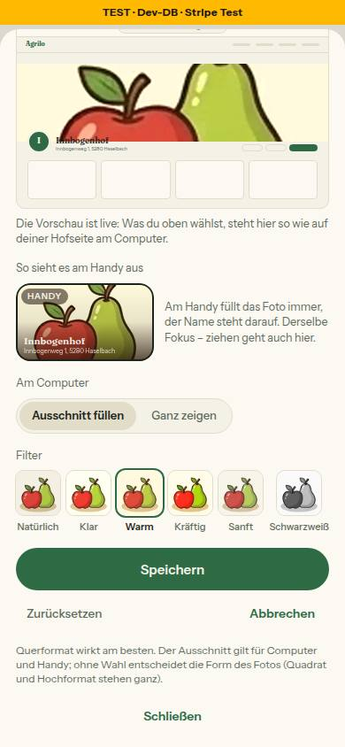

# Nr. 97 – Bild-Baustein und Titelbild: Ausschnitt, Zoom, füllen oder ganz, sechs Filter, Vorschau (N13 ergänzt, N17)

## Was geändert wurde
- `prisma/schema.prisma` + `prisma/migrations/20261016110000_bild_ausschnitt/migration.sql`: fünf nullable Json-Spalten (Expand, Regel 3, Basis db2ded1).
- `src/schemas/bild-ausschnitt.ts` (neu): ein strenges Format `{ fokusX, fokusY, zoom, filter, darstellung? }`, `leseAusschnitt` (Müll → null), Union für „Speichern“ mit allen fünf Zielen (Logo nur NATUERLICH).
- `src/lib/bild-ausschnitt.ts` (neu): `BILD_FILTER` (wörtlich Mockup, kein hue-rotate), `bildStil`, `filterMit`, `bildLage` (Rechnung), `ausschnittNachZiehen`, `ausschnittNachTaste`, Texte.
- `src/components/shared/bild-ausschnitt.tsx` (neu): der Baustein — Bühne mit blasser Fortsetzung, Ziehen (Pointer Capture, `touch-none` nur auf Rahmen), Pfeiltasten, Zoom, Vorschau-Rahmen, füllen/ganz, sechs Filter, Speichern · Abbrechen · Zurücksetzen.
- `src/server/actions/bild-ausschnitt.ts` (neu): `speichereBildAusschnittAction` — Hof aus der Sitzung, Besitz in der WHERE-Klausel, schreibt `bannerAusschnitt` + `bannerFocusY`; nur `banner` freigeschaltet.
- `src/lib/titelbild.ts`: `titelbildDarstellung(masse, wahl)`, `titelbildHinweis(masse, wahl)`, `titelbildAusschnitt` (Rückfall), Rahmenmaße und Texte.
- `src/components/hofseite/titelbild.tsx`: `ausschnitt` statt `fokusY`; füllende Lage und Kopie mit `bildStil`, Kopie `blur(28px)` + Filter in EINER Angabe, ganze Lage nur Filter.
- `src/components/hofseite/hofseite-kunde.tsx`: nur der Titelbild-Aufruf. `src/server/queries/farm.ts`: Selects + `leseAusschnitt`. `abschnitt-inhalt.tsx`, `farm-page/page.tsx`: Durchreichen.
- `src/components/mein-hof/bild-bausteine.tsx`: `TitelbildBaustein` öffnet den Baustein mit Browser- und Handy-Vorschau; neuer Satz unter dem Baustein.
- `src/components/farm/farm-page-view.tsx`: `CoverFocusAdjust` entfernt (kein Aufrufer mehr). `src/server/actions/appearance.ts`: `updateBannerFocusAction` als dünner Aufruf.
- Tests: neu `bild-ausschnitt.test.ts`, `bild-ausschnitt-baustein.test.ts`, `integration/bild-ausschnitt.int.test.ts`; umgestellt `banner-focus.test.ts`, `titelbild.test.ts`; Fixtures (+`bannerAusschnitt: null`) in sieben Tests; Liste der Aktionen in `hofseite-editor.test.ts`.

Wiederverwendet: `Segment`, `useBildmasse`, `FOKUS_RAHMEN(_INNEN)`, `TITELBILD_KNOPF_STIL`, `CoverEditButton`, `hofInitialen`, `MARKE`. Neu, weil: kein Baustein für Ausschnitt/Filter im Verzeichnis (Stichworte Bild, Titelbild, Fokus, Vorschau, Blatt).

```sql
SET lock_timeout = '5s';
ALTER TABLE "Farm" ADD COLUMN IF NOT EXISTS "bannerAusschnitt" JSONB,
ADD COLUMN IF NOT EXISTS "logoAusschnitt" JSONB;
ALTER TABLE "Product" ADD COLUMN IF NOT EXISTS "bildAusschnitt" JSONB;
ALTER TABLE "StatusPost" ADD COLUMN IF NOT EXISTS "fotoAusschnitt" JSONB;
ALTER TABLE "FarmPhoto" ADD COLUMN IF NOT EXISTS "ausschnitt" JSONB;
```

## Annahmen
- „Zurücksetzen“ stellt beim Titelbild auch die Wahl auf AUTO zurück — sonst gäbe es keinen Weg zurück zu „ohne Wahl“.
- Pfeiltasten verschieben das Foto in Pfeilrichtung (wie das Ziehen), nicht einen Fokuspunkt.
- `updateBannerFocusAction` schreibt als dünner Aufruf `{ fokusX 50, fokusY, zoom 100, NATUERLICH }` (Stand von vorher); kein Aufrufer mehr im Code.
- Prop heißt `vorschauen` statt `vorschau`: `vorschau=` als Text sperrt `tests/hofseite-einmal.test.ts` (Parameter der Hofseite).
- Weichzeichner der Kopie in der Browser-Vorschau 8 px (28 px × Verkleinerung).

## Nicht gelöst
- Die große Vorschau ab lg (echte Hofseite im iframe) zeigt den Ausschnitt erst nach dem Speichern; live ginge nur über `mein-hof-ansicht`/`hofseite-vorschau-rahmen` (außerhalb der Grenzen) — darum die Browser-Vorschau auch in der Zeile.
- Der Kopf von Mein Hof (`seitenkopf.tsx`, `getMeinHofKopf`) zeigt den Titelbild-Streifen weiter nur mit `bannerFocusY` — Datei gehört Nr. 98.

## Wie der Mensch es testet
1. Vorschau-Deployment, als Hof mit quadratischem Titelbild: `/farm-page` → Titelbild → „Ausschnitt anpassen“. Ziehen, Zoom 115 %, „Warm“, „Ausschnitt füllen“, Speichern. Erwartung: `/<slug>` am Computer füllt die Breite im gewählten Ausschnitt und Filter, am Handy derselbe Fokus.
2. „Ganz zeigen“ speichern → am Computer ganz mit weichem Rand (wie vorher); ein Hof ohne Wahl → unverändert.
3. Am Handy (375 px) dasselbe im Blatt mit dem Finger; die Browser-Vorschau im Blatt = Hofseite am Computer danach. Tab auf den Rahmen, Pfeiltasten verschieben.

## Angepasste .md
`docs/ai/DESIGN_SYSTEM.md` (neu „Bild-Baustein“, Ergänzungen Hofseite › Titelbild und Mein Hof › Titelbild), `DEVELOPMENT.md`, `docs/ai/BAUSTEINE.md` (erzeugt).

## Nacharbeit
- `updateBannerFocusAction` im nächsten Zug löschen; Contract von `Farm.bannerFocusY` später (eigene Freigabe).
- Nr. 98: Ziele in `FREIGESCHALTET` aufnehmen und je Ziel testen; für hohe Rahmen (Logo 1:1) ist `rahmenPlatz` vorbereitet, aber noch ungesehen.

## Regelvorschlag
- Ursache: `scrollIntoView` auf einem Rahmen in `overflow-hidden` verschob beim Prüfen die Bühne (scrollTop 70) und täuschte einen Layoutfehler vor. Gegenmaßnahme: In Bildprüfungen nur das Fenster scrollen (`window.scrollTo`), nie `scrollIntoView` auf Kinder abgeschnittener Kästen. Ort: Rahmen „Bilder“.

## Bilder und Mockup-Abweichungen
Testdaten: Seed-Hof `innbogenhof`, Titelbild vorübergehend auf eine Kopie von `public/categories/obst.webp` (1024 × 1024, unversioniert unter `public/_97/`, danach gelöscht); gespeichert einmal über die Oberfläche (Ergebnis `{"zoom":115,"filter":"WARM","fokusX":50,"fokusY":42,"darstellung":"FUELLEN"}`, `bannerFocusY` 42), GANZ per psql. Danach zurückgesetzt auf GRADIENT, leer, leer, 50, `bannerAusschnitt` null (verglichen).
- Mein Hof, Zeile (1440):  — Abweichung: Browser-Vorschau auch in der Zeile (Grund oben, Register N17).
- Mein Hof, Blatt (390):   — Abweichungen: kein „Titelbild ersetzen“ im offenen Baustein (steht davor), dafür „Abbrechen“ (Freigabe); Satz unter der Browser-Vorschau „… so wie auf deiner Hofseite am Computer“ statt „über die ganze Breite“ (stimmt auch bei „Ganz zeigen“); Umschalter im Stil von `Segment` (gedrückt `bg-border` statt invertiert); Kopf der Mini-Hofseite mit Strichen statt Menüwörtern (Texte nur aus einer Quelle).
- Hofseite „Ausschnitt füllen“:  ; „Ganz zeigen“: 
- Axe (wcag2a/aa/21a/21aa): Zeile 1440 hell und dunkel, Blatt 390, Hofseite 390/1440 — 0 Verstöße (unklar nur `color-contrast` über Bildern/Überdeckung und Fokuswächter von Base UI, Bestand). Tippflächen: alle ≥ 44 px (Rahmen 352 × 98 am Handy, Kacheln 52 × 74, Speichern 354 × 48); kein waagerechtes Scrollen bei 375/390; sechs Kacheln passen bei 375 px.
