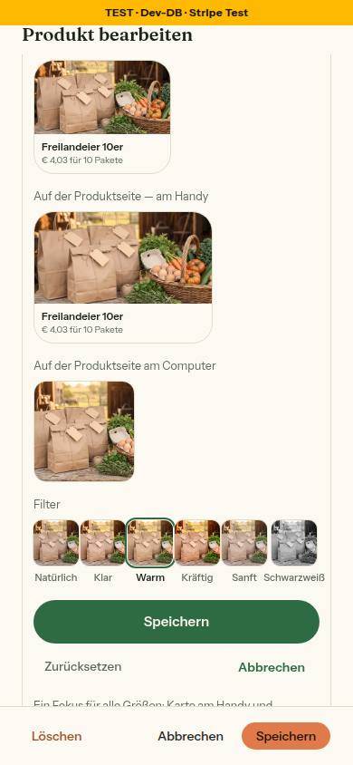
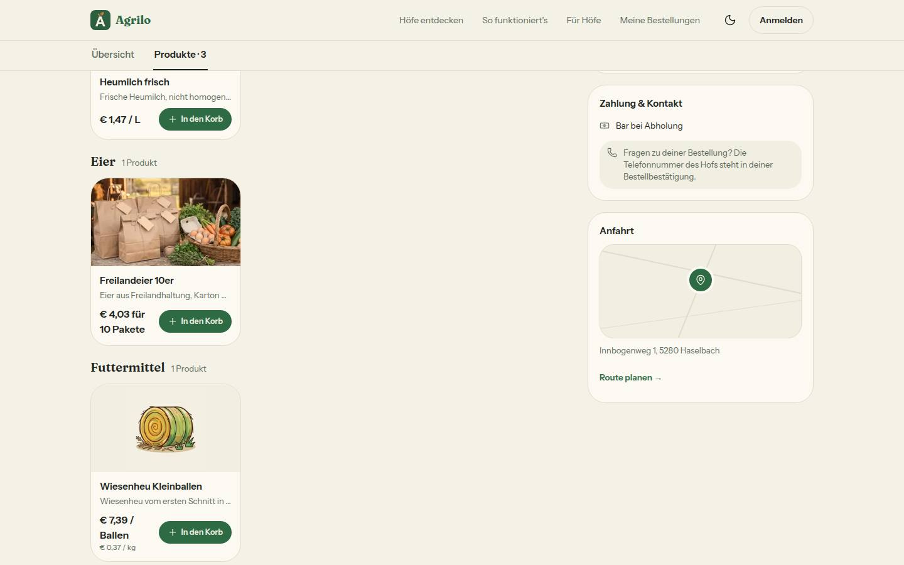
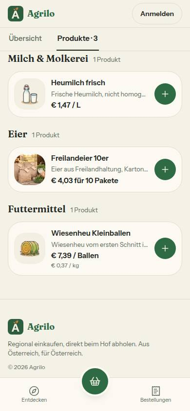
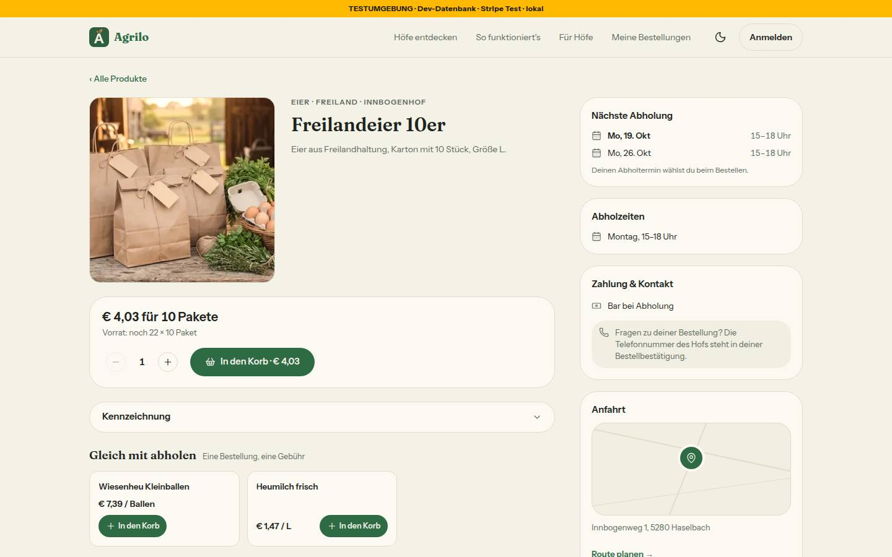
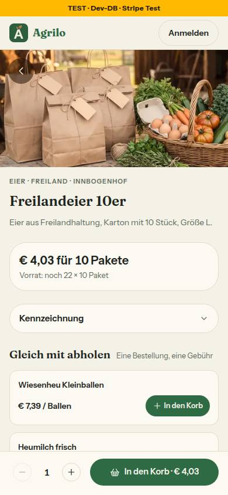
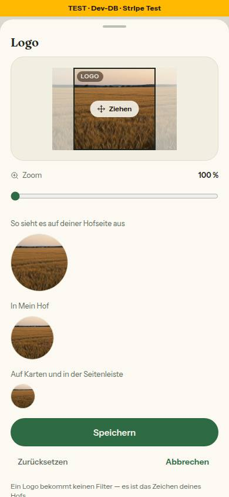

# Nr. 98 – Bild-Baustein für Logo, Produktfoto, Galerie und Beitragsfoto (Register N17)

## Was geändert wurde
- `src/server/actions/bild-ausschnitt.ts`: Ziele `logo`, `produkt`, `foto`, `beitrag` frei; Besitz in der WHERE-Klausel (Logo `id`+`ownerId`, sonst Kennung+`farmId`); Mitte/100 %/Natürlich → NULL; 0 Zeilen: Logo „Hof fehlt“, sonst „Dieses Foto gibt es nicht mehr“; Produkt baut über `revalidiereProdukte` neu (auch Cache von /hoefe).
- `src/lib/bild-rahmen.ts` (neu): Rahmen und Vorschau je Zweck, Texte, `alsFotoAusschnitt` (ohne Wahl füllen/ganz).
- Queries `farm.ts`, `products.ts`, `appearance.ts`, `status-posts.ts`, `dashboard.ts`, Typen in `bereiche-anzeige.ts`/`hofuebersicht.ts`, `server/hofbereich.ts`: die vier Spalten nur über `leseAusschnitt`.
- Anzeige Produktfoto (nur mit `imageUrl`, ausverkauft/gedämpft ohne Filter): `produkt-karte.tsx`, `produktdetail-kunde.tsx`, `entdecken-teile.tsx`, `hoefe-produktzeilen.tsx`, `produkte-ansicht.tsx`. Logo rund ohne Filter: `hofseite-kunde.tsx`, `seitenkopf.tsx`, `farm-identity-card.tsx` (+ `farmer-nav.tsx`, `(farmer)/layout.tsx`), `hoefe-karussell.tsx`. Beitrag mit Ausschnitt `object-cover`, ohne `object-contain` (`hofseite-kunde.tsx`); Galerie-Kachel (`hofseite-fotos.tsx`).
- Upload: `bild-bausteine.tsx` – Logo (Baustein ohne Filter, Vorschau rund 96/72/40, nach dem Upload einmal offen, alter Ausschnitt zurück), Galerie (Vorschaubild = „Ausschnitt anpassen“, nach dem Upload offen); `product-dialog.tsx` – Baustein im Fotofeld, nach neuer Auswahl offen, geschrieben nach dem Produkt; `status-new-client.tsx` – nach dem Upload offen, geschrieben nach dem Veröffentlichen.
- Tests: neu `bild-ausschnitt-ziele.test.ts` (je Ziel WHERE mit Hof bzw. Besitzer, fremd = 0 Zeilen, ohne Hof nichts, Logo mit Filter/Wahl abgewiesen, NULL), `bild-ausschnitt-anzeige.test.ts` (Karte und Produktseite mit/ohne, Illustration, ausverkauft; Wache „Problem melden“ und Rohfoto-Stellen mit Gegenprobe); `integration/bild-ausschnitt.int.test.ts` auf freie Ziele umgestellt; Sperrfälle aus `banner-focus.test.ts` entfernt (jetzt erlaubt, geprüft in der neuen Datei); Select in `hofuebersicht.test.ts`; Fixtures in 15 Tests.

Wiederverwendet: `BildAusschnitt`, `bildStil`, `leseAusschnitt`, `AUSSCHNITT_STANDARD`, `speichereBildAusschnittAction`, `revalidiereProdukte`, `useImageUpload`, `FOKUS_RAHMEN`. Neu, weil: Rahmen und Texte je Zweck hatten keine Quelle (BAUSTEINE: Logo, Produktfoto, Galerie, Beitrag).

## Annahmen
- Produktdialog: „Speichern“ im Baustein übernimmt die Wahl, geschrieben wird sie mit dem Produkt („Abbrechen“ des Dialogs verwirft alles); ein neues Foto schreibt immer (alter Ausschnitt gehört zum alten Foto).
- „Passt so“ = „Speichern“ ohne Änderung (NULL); „Abbrechen“ nach dem Upload lässt NULL. Ein Knopf „Passt so“ bräuchte eine Prop in `bild-ausschnitt.tsx`.
- Galerie-Serie: Baustein öffnet einmal, für das erste Foto. Neues Logo: Ausschnitt sofort zurück (immer, ein Aufruf).
- `product-grid.tsx` (Upload im Bearbeitungsmodus) unverändert: kein Aufrufer mit `ownerMode` (toter Pfad). `image-upload.tsx` unverändert: Öffnen macht jeder Aufrufer nach seinem Speichern.
- Fotostreifen auf /hoefe (Titelbild, Galerie, Produkt gemischt) und das kleine Logo in der Titelbild-Vorschau (`AbschnittHof`) bleiben Rohfoto.

## Nicht gelöst (Grenzerweiterung nötig)
- Mein Hof › Logo kennt den gespeicherten Ausschnitt nach dem Neuladen nicht: `mein-hof/abschnitt-inhalt.tsx` reicht ihn nicht durch (eine Zeile `logoAusschnitt={auftritt.logoAusschnitt}`; `LogoUpload` nimmt ihn schon an).
- Bildansicht der Galerie ohne Filter: `hofseite/bildansicht.tsx` (`nurFilterStil` am großen Bild, drei Zeilen).
- Käufer-Vorschau im Produktdialog ohne Ausschnitt: `products/lebensmittel-vorschau.tsx` reicht `ausschnitt` an `ProduktKarte` (Prop vorhanden) nicht weiter.
- Runder Hauptrahmen beim Logo, Knopf „Passt so“, zwei Vorschau-Rahmen je Titel: nur mit `shared/bild-ausschnitt.tsx` (Nr. 97). `BILD_AUSSCHNITT_TEXT.nochNicht` ist ohne Verwendung (Datei von 97).

## Wie der Mensch es testet
1. /products → Produkt bearbeiten → Foto wählen: Baustein öffnet im Fotofeld; Zoom 140 %, „Warm“, Speichern, Produkt speichern. Erwartung: Karte auf `/<slug>`, Produktseite, /hoefe und /products im Ausschnitt mit Filter; Warenkorb und Kasse Rohfoto.
2. /farm-page › Logo hochladen: Baustein ohne Filterkacheln, drei runde Vorschauen; Speichern → Hofseite (96 px), Kopf von Mein Hof, Seitenleiste.
3. /farm-page › Fotos hinzufügen: Baustein (Kachel), Speichern → Kachel der Hofseite im Ausschnitt; Tipp → Bildansicht ganz.
4. /status/new mit Foto: einmal mit Ausschnitt (füllt 3 : 2), einmal „Abbrechen“ (ganz wie bisher). Am Handy (375 px) dasselbe; Tab auf den Rahmen, Pfeiltasten.

## Angepasste .md
`docs/ai/DESIGN_SYSTEM.md` (Bild-Baustein › Rahmen je Zweck), `DEVELOPMENT.md`, `docs/ai/BAUSTEINE.md` (erzeugt).

## Nacharbeit
- Die vier Grenzerweiterungen oben in einer Runde; Fußknöpfe des Produktdialogs 32 px hoch (Bestand).

## Regelvorschlag
- Ursache: `pnpm exec prettier --write` ohne Projektkonfiguration schrieb eine Datei mit Vorgaben um (Anführungszeichen, Semikolons, 80 Zeichen; 700 Zeilen Diff, von Hand zurückgeholt). Gegenmaßnahme: `gefahr-blocken.mjs` blockt `prettier --write`, solange das Projekt keinen Formatierer hat (Prüfung vor Textregel). Ort: `.claude/hooks`, Rahmen „Verboten“.

## Bilder und Mockup-Abweichungen
Testdaten (innbogenhof): Freilandeier `imageUrl` → Kopie von `public/landing/row-1.jpg` unter `public/_98/`, `bildAusschnitt` {30, 60, 140 %, WARM} per psql; Logo → Kopie von `corn-2.jpg`. Danach `imageUrl`, `bildAusschnitt`, `logoUrl`, `logoAusschnitt` NULL (verglichen), `public/_98/` gelöscht; Galerie-Fotos und Beiträge 0/0 (keine angelegt).
- Produktfoto im Blatt (390):   — Abweichungen: Baustein im Fotofeld des Dialogs (am Handy Vollbild) statt eigenem Blatt; vier Vorschauen je mit Titel untereinander statt zwei Paaren nebeneinander (der Baustein legt je Vorschau einen Titel an); Hauptrahmen 80 % hoch auf der 2 : 1-Bühne (`rahmenPlatz`, Nr. 97); „Foto ersetzen“ steht vor dem Baustein, „Abbrechen“ statt dessen darin.
- Produktkarte:   · Produktseite:  
- Logo-Baustein ohne Filter (390):  — Abweichung: Hauptrahmen eckig statt rund (Baustein von 97), Vorschau rund.
- Axe (wcag2a/aa/21a/21aa): Logo-Baustein 390, Produktdialog mit Baustein 390 hell und dunkel, Hofseite und Produktseite 390/1440 — 0 Verstöße (unklar nur Fokuswächter von Base UI und Kontrast über Fotos, Bestand). Neue Tippflächen ≥ 44 px; kein waagrechtes Scrollen bei 390.
