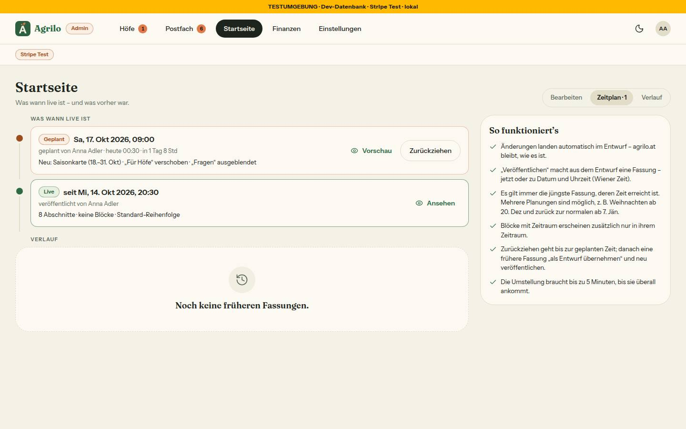
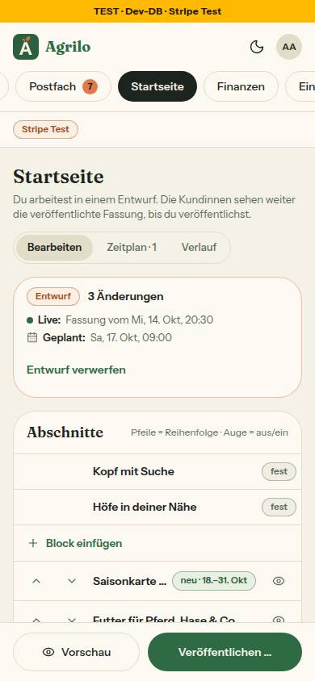

# Nr. 99 – Startseite: Entwurf, Vorschau, Veröffentlichen jetzt oder geplant (Register N16, Änderung)

Branch `nacht/2026-10-16/99-startseite-fassung` (von docs/lauf15). Eine Migration `20261016100000_startseite_fassung` (Expand: neue Tabelle, RLS, kein Seed; Regel 3 gegen `docs/lauf15` — `migrate diff` liefert genau CREATE TABLE + CREATE INDEX). Fortsetzung des abgebrochenen ersten Umsetzers: Schema, Migration und Format übernommen (Zeilen als Union statt Prüfung per refine), sein Test angepasst und erweitert.

## Was geändert wurde
- `prisma/schema.prisma` + Migration: `StartseiteFassung { id, inhalt Json, liveAb, zurueckgezogenAm?, erstelltVonUserId, createdAt }`, Index auf `liveAb`.
- `src/schemas/startseite-fassung.ts` (neu): Format `v: 1` strikt, Grenzen und feste Abschnitte aus startseite-gestalten; Schemas für Veröffentlichen, Zurückziehen, Übernehmen.
- `src/lib/startseite-fassung.ts` (neu): `fassungAusEntwurf`, `zeilenAusFassung` (EIN Weg), `vergleicheMitLive` (sechs Arten, längste steigende Teilfolge für „verschoben“), `ordneFassungen`, `mussFrischLesen`, `pruefeTermin`, Texte `ENTWURF_TEXT`.
- `src/lib/startseite-gestalten.ts`: `istRelativerLink` sperrt „//“ überall; `felderDerVorlage` (eine Regel für Action und Browser); „geplanter Termin“ in `standZeitpunkt`; Texte ohne „Speichern“.
- `src/server/queries/startseite.ts`: `leseFassung` (ungültig → null + Sentry ohne Inhalt), Live beim Lesen, Cache trägt den nächsten Termin, `ladeVorschauZeilen`, Zeitplan in `ladeStartseiteAdmin`.
- `src/server/actions/startseite.ts`: `speichereEntwurf` (ohne Live-Wirkung), `veroeffentlicheStartseite`, `zieheFassungZurueck`, `uebernehmeFassungAlsEntwurf`; Vorschau mit Quelle.
- `src/server/startseite-vorschau.ts`: Quelle im signierten Inhalt; `erzeugeVorschauPfad` entfernt; Kommentar §5 → §3. `src/schemas/startseite.ts`: `vorschauQuelleSchema`.
- `src/app/page.tsx`: Vorschau liest ihre Quelle (eine Zeile). `src/app/admin/startseite/page.tsx`: `jetzt` an die Abfrage.
- Admin-UI: `startseite-gestalten.tsx` (Statusleiste, Liste mit Marken, Ansichten, Leiste am Handy), neu `startseite-entwurf.tsx` (Autosave-Hook), `startseite-block-formular.tsx`, `startseite-veroeffentlichen.tsx`, `startseite-zeitplan.tsx`; `startseite-vorschau.tsx` (Entwurf | Live, Band, Fenster); `startseite-laden.tsx`.
- Tests: neu `startseite-fassung` (20), `startseite-live` (6), `startseite-entwurf` (6, Prüfstand), `integration/startseite-fassung.int` (8); angepasst `startseite-aktion` (+14, Wache), `startseite-vorschau` (+3), `startseite-gestalten` (+2), `startseite-bloecke` (Lesen umgezogen), `ladeansichten`, `integration/startseite-gestalten.int`.

Wiederverwendet: `BestellDialog`/`DialogFehler`, `Segment`, `Marke`, `StatusBadge`, `EmptyState`, `Seitenkopf`, Dialog/Sheet, `useMindestbreite`, `zeitpunktAusEingabe`/`wienerZeitpunkt`, `formatTagKurz`, `befundVon`/`istNetzfehler`, `ABSCHNITT_SPEICHERN_TEXT`. Neu, weil: kein Autosave-Baustein mit Kette und neuer Kennung; Zeitleiste und Radiokarten gibt es nicht.

```sql
SET lock_timeout = '5s';
CREATE TABLE IF NOT EXISTS "StartseiteFassung" (
    "id" TEXT NOT NULL, "inhalt" JSONB NOT NULL, "liveAb" TIMESTAMP(3) NOT NULL,
    "zurueckgezogenAm" TIMESTAMP(3), "erstelltVonUserId" TEXT NOT NULL,
    "createdAt" TIMESTAMP(3) NOT NULL DEFAULT CURRENT_TIMESTAMP,
    CONSTRAINT "StartseiteFassung_pkey" PRIMARY KEY ("id")
);
CREATE INDEX IF NOT EXISTS "StartseiteFassung_liveAb_idx" ON "StartseiteFassung"("liveAb");
ALTER TABLE "public"."StartseiteFassung" ENABLE ROW LEVEL SECURITY;
```

## Annahmen
- Blöcke tragen in der Fassung die Kennung ihres Entwurfs-Blocks (`id`, optional) — sonst wäre jede Textänderung „entfernt + neu“, und Übernehmen verlöre die Kennung.
- Die Quelle steht im signierten Inhalt `vorschau` (`…:entwurf|live|fassung:<id>`), kein eigener Parameter `quelle=`; „Live“ in der Vorschau = die Fassung, die am gewählten Tag live ist.
- Ein Termin leert nur den Datencache (`updateTag`, kein `revalidatePath('/')`), damit der Cache den Termin kennt; Zurückziehen ebenso. Vor „Veröffentlichen …“ wird sofort gespeichert; ein ungültiger offener Block sperrt es (Satz im Dialog).
- „· gespeichert hh:mm“ erst nach der ersten Speicherung der Sitzung (keine Spalte für den Zeitpunkt des Entwurfs; Expand nur eine Tabelle). Termin-Vorschlag: morgen 09:00; Block-Hinweise nur bei Termin.
- Der 17.10.2026 ist ein Samstag; Mockup und Freigabe schreiben „Fr“ — es gilt `formatTagKurz`.

## Nicht gelöst
- Axe 1440 mit Vorschau-Rahmen: 1 moderat `landmark-unique` (Kopf/Hauptbereich der eingebetteten echten Startseite neben denen von Admin); Dialog, Zeitplan, 390 hell/dunkel: 0.
- Zweiter Prüfdurchgang (pruefer) nicht hier — kein Subagent-Werkzeug in dieser Sitzung.

## Wie der Mensch es testet
1. `/admin/startseite`: Auge bei „Fragen“ aus → Leiste „1 Änderung gegenüber live · gespeichert hh:mm“, Zeile durchgestrichen mit „ausgeblendet“; Vorschau „Entwurf“ ohne Fragen, „Live“ und `/` (anderer Browser) mit Fragen.
2. „Veröffentlichen …“ → „Zu einem Zeitpunkt“, in 10 Minuten → Toast „Geplant für …“; `/` bis dahin unverändert, danach (≤ 5 min) ohne Fragen. Zeitplan: zweite Planung → „Zurückziehen“ → bleibt aus.
3. Verlauf → „Als Entwurf übernehmen“ → Entwurf = alte Reihenfolge. Am Handy (375 px) dieselben Schritte über die Leiste unten.

## Angepasste `.md`
`docs/ai/ARCHITECTURE.md` (Startseite: Entwurf vs. Fassung, Lesen zur Lesezeit), `docs/ai/DESIGN_SYSTEM.md` („Startseite gestalten“: Entwurf und Fassung), `DEVELOPMENT.md` (Anlass, warum kein Cron, warum kein Seed), `docs/ai/BAUSTEINE.md` (erzeugt).

## Nacharbeit
- Das Band der Seite selbst („Vorschau · Stand am …“, page.tsx) nennt die Quelle nicht (Grenze: page.tsx nur Quelle). Zeitplan liest höchstens 50 Fassungen.
- Regelvorschlag — Ursache: `revalidatePath` auf die eigene Seite liefert der Action-Antwort neue Props mitten ins automatische Speichern; übernommen hätten sie offene Eingaben zurückgesetzt. Gegenmaßnahme: Ein Client mit Autosave übernimmt Props nach dem ersten Rendern nie still, nur aus einer Action-Antwort (hier `setzeZurueck`). Ort: ARCHITECTURE §4; Prüfung: Prüfstand-Test „neue Props → Liste bleibt“.

## Bilder (hell; Axe s. oben; Tippflächen ≥ 44 px, Segmente 32 px sichtbar + 44 px über `::before`; keine Breite > 390)
 
 
Testdaten in `farmerzone_test` (ein Block, zwei Fassungen, Entwurf geändert), danach zurückgesetzt: `fassungen 0 | bloecke 0 | kopf:0 hoefe:1 futter:2 brennmaterial:3 so-funktionierts:4 fuer-hoefe:5 fragen:6 fuss:7, alle sichtbar`.
Abweichungen: (a) Pfeile 44 statt 32 px, am Handy nebeneinander (Tippfläche; Bild 1, 4). (b) Solange ein Block offen ist, steht rechts sein Formular statt der Vorschau; das Mockup zeigt nur die Vorschau (Bild 1). (c) Band als Zeile über dem Rahmen, darunter das Band der Seite selbst (Bild 1). (d) „Stand am“ als zweite Zeile, „Vorschau öffnen“ als Textknopf (Bild 1). (e) Dialog: „Abbrechen“ links vom Hauptknopf (BestellDialog), „Zurückziehen geht bis …“ darüber; Datum im Format des Headless-Chromium (Bild 2). (f) Verlauf leer als EmptyState (Bild 3). (g) Am Handy „Entwurf verwerfen“ als Textknopf in der Statuskarte (Bild 4).
