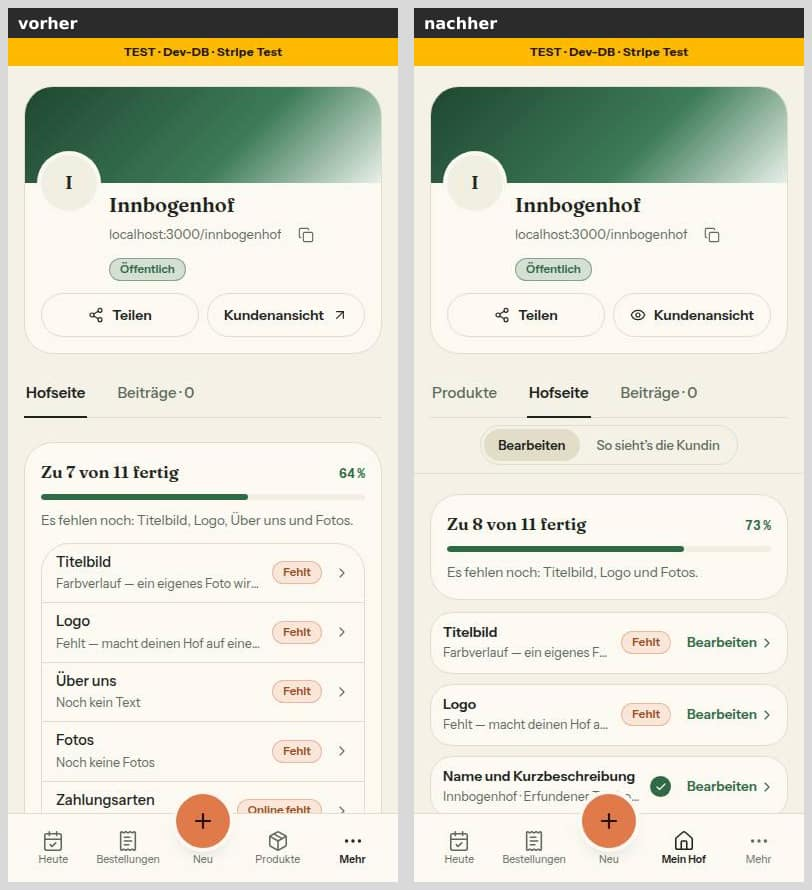
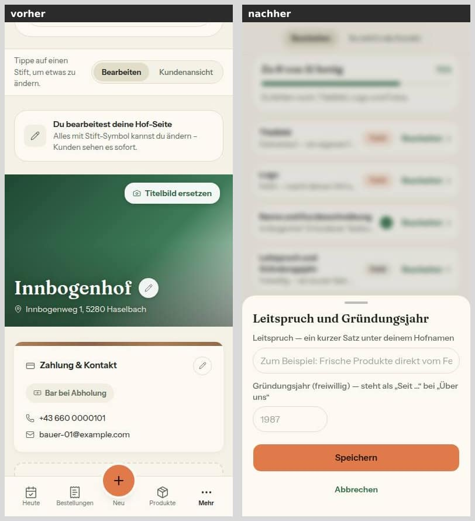
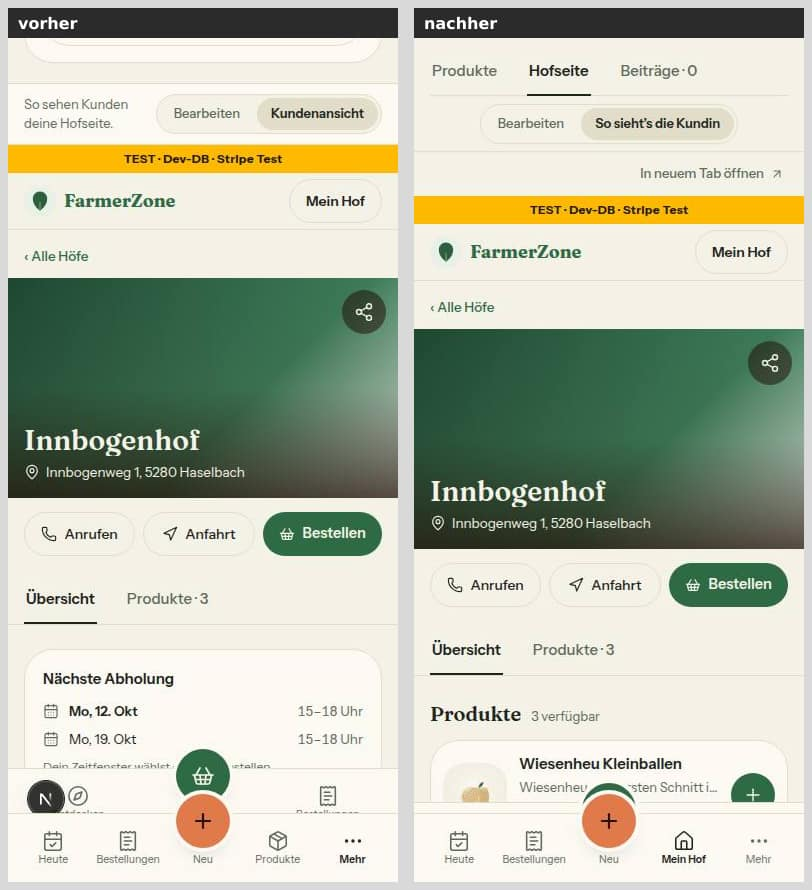
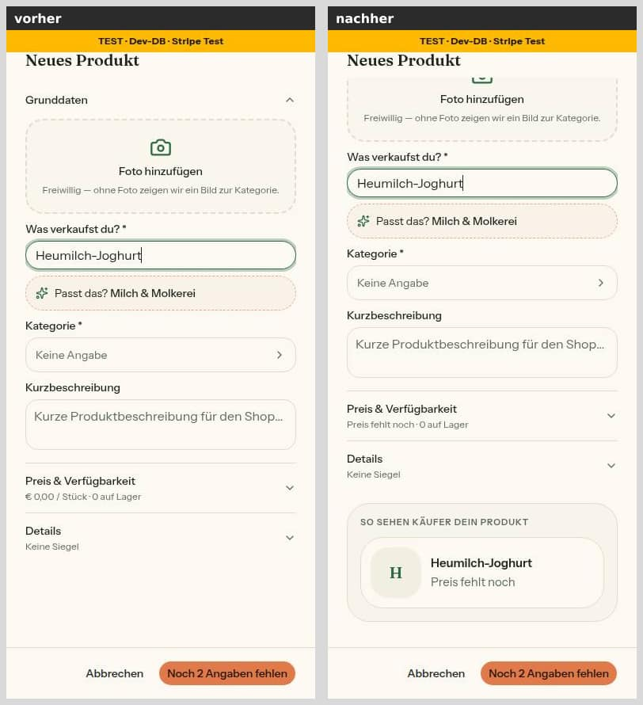
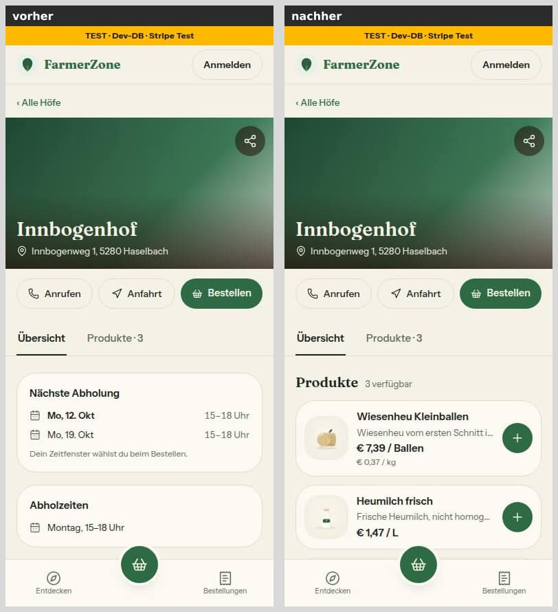
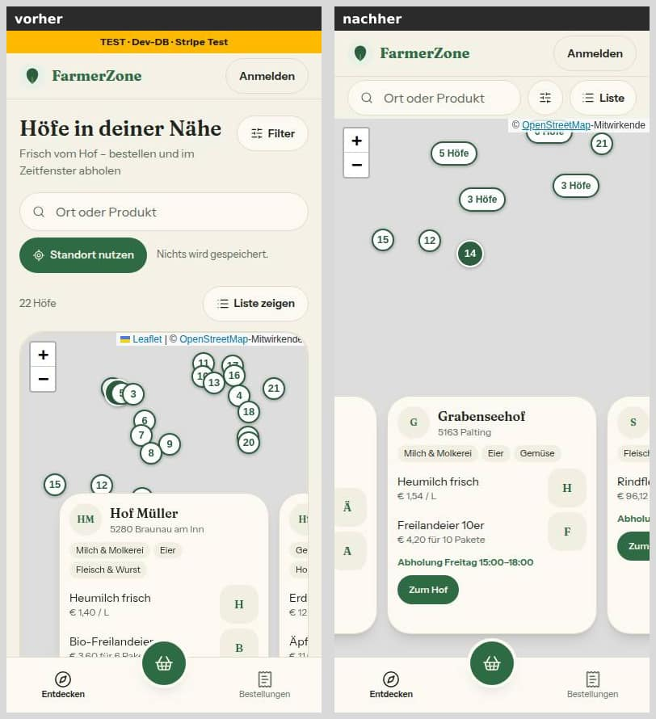
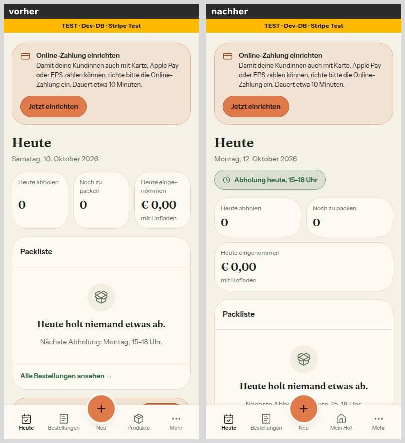
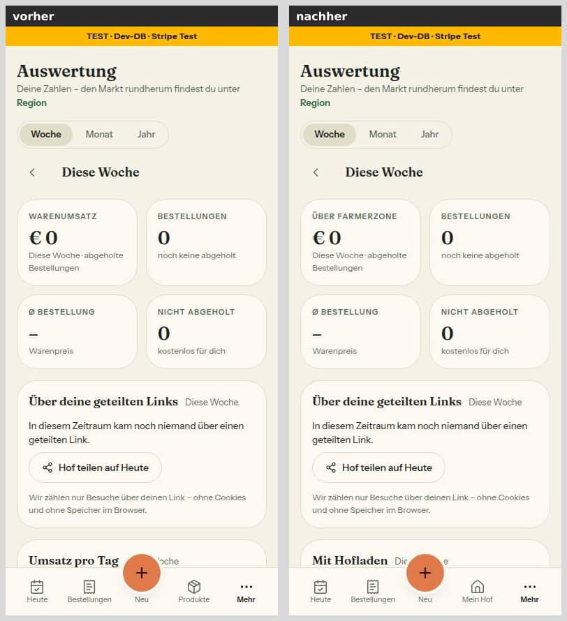

# Morgenbericht Nachtlauf 9 (2026-10-10 bis 12)

Der Dirigent lief interaktiv in einer Cloud-Sitzung (Abschnitt 8 von `docs/nachtlauf.md`). uttoranger hat die Freigabe am 10.10.2026 im Chat erteilt (`freigabe.md` §13). Mehrere Sitzungsgrenzen haben den Lauf unterbrochen; nach jeder ging es auf Zuruf („continue") weiter (Abschnitt 6).

Erledigt:
- Schritt 0, der Doku-PR #230.
- Die Nummern 49 bis 56 in der festen Reihenfolge 49 → 52 → 50 → 55 → 53 → 51 → 54 → 56. 50 ist auf 49 gestapelt, 53 auf 55.
- 57 als **Entwurf** #236 auf #210 (Nr. 33), wie verlangt nicht im Sammel-PR.
- Der **Sammel-PR #240**, der Haltepunkt des Laufs.

Keine Nummer brauchte eine Migration, keine wurde angehalten, und keine blieb unbegonnen. Es lief kein Aufruf an Stripe, Resend, Vercel (schreibend), Supabase oder DNS und kein Zugriff auf die Produktion.

## 1. PRs

| Nr | Auftrag | PR | Basis | Migration | Vorschau | Prüfung, Nachbesserungen | Entwurf? |
|---|---|---|---|---|---|---|---|
| 0 | Doku Lauf 9: Register N3, N4, N5, Z4 (O6, O7 offen); Freigabe §13; Status | #230 | `main` | **nein** | [Vorschau](https://farmer-zone-git-docs-lauf9-bierbaron.vercel.app) | – | nein |
| 49 | Mein Hof in der Leiste und Kundensicht (N3, N4 Teil 1) | #231 | `main` | **nein** | [Vorschau](https://farmer-zone-git-nacht-2026-10-1049-mein-hof-leiste-bierbaron.vercel.app) | ohne Blocker; „Über uns" in den Metadaten, feste Toast-Kennung (Runde 1) | nein |
| 52 | Karte: /hoefe am Handy, Standortkarte, Gruppen-Pins | #234 | `main` | **nein** | [Vorschau](https://farmer-zone-git-nacht-2026-10-1052-karte-bierbaron.vercel.app) | ohne Blocker; 4 „Sollte" (Vorschlagsliste schob die Karte, Querformat, Testfall, Bild) in Runde 1 | nein |
| 50 | Mein Auftritt zieht in Mein Hof (N4 Teil 2, O2) | #238 | **#231** (49) | **nein** | [Vorschau](https://farmer-zone-git-nacht-2026-10-1050-auftritt-in-75b94d-bierbaron.vercel.app) | Runden 1 und 2 mit Nachprüfung; Kartenpunkt-Toleranz vom Dirigenten nachgezogen, kurz nachgeprüft (a99e5d8, 628c855) | nein |
| 55 | Testzahlungen aus Auswertungen (Z4) | #232 | `main` | **nein** | [Vorschau](https://farmer-zone-git-nacht-2026-10-1055-testzahlungen-bierbaron.vercel.app) | Runden 1 und 2 mit Nachprüfung; Zeitbombe im Integrationstest vom Dirigenten entschärft (5ca0874) | nein |
| 53 | Heute, Auswertung, Verkäufe (F4-Vermerk) | #233 | **#232** (55) | **nein** | [Vorschau](https://farmer-zone-git-nacht-2026-10-1053-heute-auswertung-bierbaron.vercel.app) | ohne Blocker; Runde 1 (c0080bc); 55 im Endstand hereingeholt | nein |
| 51 | Hofseite: Schaufenster zuerst (N5), Käufer-Vorschau | #235 | `main` | **nein** | [Vorschau](https://farmer-zone-git-nacht-2026-10-1051-hofseite-sc-b07af5-bierbaron.vercel.app) | ohne Blocker; Lesereihenfolge unter lg (Runde 1) | nein |
| 54 | Admin am Handy, alte Seiten ins neue Design (Sicherheitspfad) | #237 | `main` | **nein** | [Vorschau](https://farmer-zone-git-nacht-2026-10-1054-admin-handy-bierbaron.vercel.app) | Runden 1 und 2 mit Nachprüfung; Token-Test im Syntaxbaum vom Dirigenten nachgeschärft (39e2bfa) | nein |
| 56 | Altlasten Lauf 8 §6 und Kleinkram (Sicherheitspfad) | #239 | `main` | **nein** | [Vorschau](https://farmer-zone-git-nacht-2026-10-1056-altlasten-bierbaron.vercel.app) | Runden 1 und 2 mit Nachprüfung; danach hat der Dirigent den Sentry-Filter in neun Schritten nachgearbeitet (97db8e7 bis 172cd0f), jeden Schritt nachprüfen lassen bis auf den letzten, der der geprüfte Vorschlag der Nachprüfung ist | nein |
| 57 | Datenschutzerklärung, Nachtrag | #236 | **#210** (33) | **nein** | [Vorschau](https://farmer-zone-git-nacht-2026-10-1057-datenschutz-8642a4-bierbaron.vercel.app) | 1 Blocker (Kartenansicht über Links) in Runde 1 behoben | **ja** (Rechtsfragen offen) |
| Sammel | 49–56 und der Doku-PR zusammengeführt | **#240** | `main` | **nein** | [Vorschau](https://farmer-zone-git-integration-lauf9-bierbaron.vercel.app) | Gesamtstand grün (Abschnitt 2) | nein |

Die Vorschau-Links sind Branch-Adressen und zeigen immer den neuesten Stand eines PR. CI (`ci`, `integration`) läuft nur für PRs mit Basis `main`; dort ist sie überall grün, bei den gestapelten #233, #238 und #236 läuft nur Vercel.

**Ablauf je Nummer:**
- Ein frischer Umsetzer, danach `tester` und `pruefer`, höchstens zwei Nachbesserungsrunden.
- Nachprüfung der Fix-Commits bei 50, 54, 55 und 56. Wo nach der zweiten Runde noch etwas offen war, hat der Dirigent es selbst behoben und wieder nachprüfen lassen (50: Kartenpunkt; 56: Sentry-Filter) oder als Test nachgeschärft (54, 55). Das steht jeweils im PR.
- Typecheck und Tests hat der Dirigent vor jedem Push selbst wiederholt.

## 2. Sammel-PR #240 (`integration/lauf9`)

**Reihenfolge**, je `git merge --no-ff`: #230 → #231 (49) → #234 (52) → #238 (50) → #232 (55) → #233 (53) → #235 (51) → #237 (54) → #239 (56). Dazu zwei eigene Commits: die Reihenfolge der Liste „Bearbeiten" (ebee305, zur Freigabe) und die Probelauf-Checkliste (f8147c1). Am Ende ist der Doku-Branch noch einmal hereingeholt (Status und dieser Bericht). 57 ist nicht dabei.

**Prüfung auf dem Gesamtstand (1698b55; danach kam nur noch der Doku-Branch dazu):**
- `pnpm typecheck` grün.
- `pnpm lint` 7/7 — weniger als `main` (13/7), kein neuer Befund.
- `pnpm test` **327 / 6648** grün.
- `pnpm test:integration` **42 / 380** grün.
- Kein Diff unter `prisma/`.

**Auflösungen** (je auch in der Commit-Nachricht des Merges):

| Merge | Commit | Konflikt | Auflösung und Grund |
|---|---|---|---|
| Doku-PR (`docs/lauf9`) | 8b32e91 | keiner | — |
| 49 | 11debb6 | keiner | — |
| 52 | 3a465a4 | DEVELOPMENT.md | Abschnitte von 49 und 52 an derselben Stelle: beide behalten, 49 zuerst, Leerzeile davor. |
| 50 | 4f9a3bf | DEVELOPMENT.md | Abschnitte von 52 und 50: beide behalten, 52 zuerst. `profile-form.tsx` ohne Konflikt: 52 ändert dort nur den Platzhalter der Standortkarte, 50 nur das Speichern. Erst beide zusammen machen den Kartenpunkt dicht (Toleranz aus 50, Größenwechsel ohne Punktwahl aus 52). |
| 55 | d2dc89c | DEVELOPMENT.md | Abschnitt von 55 hinter 49, 52, 50. `erste-schritte.ts` ohne Konflikt (50: Link auf Mein Hof; 55: Kommentar zu `getDashboardStats`). |
| 53 | 40debc3 | `erste-schritte.ts`, `hofseite-fortschritt.ts` (Code) | **Importe:** beide behalten (`HOFSEITE_HREF` aus 50, `EINSTELLUNG_FUER_ZEILE` aus 53); kein Importkreis. **Kommentare:** Text von 50 plus der Satz von 53 zu „Zu tun". Die Tabelle `EINSTELLUNG_FUER_ZEILE` kommt aus 50: „Zu tun" verlinkt Auftritt-Zeilen auf Mein Hof statt auf die Umleitung `/settings/appearance`. **Erst im Zusammenspiel gebrochen** (9 rote Tests): `zuTun` nimmt die freiwilligen Zeilen aus 50 (Leitspruch, Werte) nicht auf; sonst standen sie auf Heute als Aufgabe, auch beim fertigen Hof. Dazu ein neuer Test mit Gegenprobe, gegen den Stand ohne Filter rot. Ein Testfall aus 53 erwartete „Über uns" offen trotz Kurzbeschreibung; seit 49 zählt die Zeile dann als fertig (`ueberUnsText`), die Erwartung folgt 49. |
| 51 | da12f9e | `hofseite-kunde.tsx`, `lib/hofseite-kunde.ts`, `tests/hofseite-kunde.test.ts` (Code), DEVELOPMENT.md | **hofseite-kunde.tsx:** Grundlage ist die Fassung von 51 (neues Raster: Schaufenster zuerst, Seitenspalte und Über uns je an genau einer Stelle). Darauf liegen die drei Änderungen der anderen Seite: `ueberUnsText` (49) und `data-abschnitt="ueberuns"` (50, Sprungziel aus Mein Hof), jetzt an der einen Karte `ueberUnsKarte`. **lib:** `ueberUnsText` (49) und die Käufer-Vorschau (51) vollständig hintereinander. **Test-Kopf:** beide Punkte. |
| Nachtrag 50/51 | ebee305 | — (Zusammenspiel) | **Zur Freigabe.** Die Liste „Bearbeiten" aus 50 folgt der Hofseite am Handy; mit dem Schaufenster aus 51 steht der Fotostreifen dort oben. „Fotos" steht in der Liste jetzt hinter den Reitern statt am Ende. Maßstab ist die Übersicht mit Produkten, ohne Produkte stehen die Fotos auf der Seite nach Über uns. Eigener Commit, damit er sich einzeln zurücknehmen lässt. |
| 54 | eb1af47 | `eslint.config.mjs` (Code), DESIGN_SYSTEM, DEVELOPMENT.md | **eslint:** In `FARBLITERAL_BESTAND` nimmt 54 `/forgot-password` und `/reset-password` heraus (umgezogen), 50 `appearance-client.tsx` (gelöscht). Alle drei fallen; die Liste darf nur schrumpfen. **DESIGN_SYSTEM:** neue Zeile „Maße der KundeShell" (52) plus die Zeile „Kunde Handy, Kopf" in der Fassung von 54. Ohne Konflikt geprüft: Finanzseite und `finanzen.ts` (55 und 54), `product-grid.tsx` (51 und 54), `tests/shells.test.ts` (52 und 54). |
| 56 | 1698b55 | DEVELOPMENT.md, DESIGN_SYSTEM, `tests/umgebung.test.ts` (Code) | **DEVELOPMENT.md:** Abschnitt von 56 hinter 49–54. **DESIGN_SYSTEM:** Unterseiten-Kopf (56) und sichtbarer Fokus (54) zeilenweise zusammengeführt; in der Zeile „Meldung abgeben" haben beide dieselbe Zeile geändert: Grundlage ist die Fassung von 54 (Satz „Mitgeschickt"), dazu die h1-Angabe aus 56 („unter 768 px nur für den Screenreader"), davor die neue Zeile „Problem melden" aus 54. **Test:** Importe beider Seiten (55: Stichtag; 56: `produktionsAdresse`) alphabetisch, die Testblöcke STRIPE_LIVE_AB (55) und NEXT_PUBLIC_APP_URL (56) hintereinander. Ohne Konflikt geprüft: `umgebung.ts` (Stichtag aus 55 und Produktionsadresse aus 56 unabhängig, Warnungen getrennt) und `product-dialog.tsx` (Käufer-Vorschau aus 51, Feldhinweise aus 56 an getrennten Stellen). |

**Kontrolle:** Jede Zeile, die eine Seite seit der Merge-Basis eingefügt hat, steht im Ergebnis; jeder Abschnitt von `DEVELOPMENT.md` aus allen Lauf-9-Branches steht wortgleich darin. Wo das nicht gilt, sind zwei Fassungen bewusst zu einer zusammengelegt; das steht oben.

**Merge-Empfehlung:** Nur **#240** mergen, per Merge-Commit; die Einzel-PRs gelten danach als gemergt. Vor dem Merge `NEXT_PUBLIC_APP_URL` in Production ansehen (Abschnitt 5, Punkt 3). Wer lieber einzeln merged: Reihenfolge oben, **#231 vor #238** und **#232 vor #233**; die zwei eigenen Commits gibt es dann nicht.

## 3. Bilderstrecke „Handy vorher/nachher" (390 px, hell)

Vorher ist `main` (90cff24), nachher `integration/lauf9` ohne 56 (eb1af47; 56 ändert keine dieser Seiten), beide lokal gegen die Test-Datenbank mit erfundenen Seed-Daten. Ohne Netz zu den Kartenkacheln bleibt die Karte grau. Bilder in beiden Themes und in 375 und 1440 px stehen in den Berichten der Nummern.

**Mein Hof** (49: „Mein Hof" in der Leiste, Reiter, Umschalter oben; 50: alle Abschnitte als Karten)

**Mein Hof, Bearbeiten** (vorher Stifte auf der Hofseite; 50: ein Blatt je Abschnitt, hier Leitspruch und Gründungsjahr)

**Mein Hof, „So sieht’s die Kundin"** (49: die echte Hofseite unter dem Umschalter)

**Produkt anlegen mit Vorschau** (51: „So sehen Käufer dein Produkt", „Preis fehlt noch" statt „€ 0,00")

**Hofseite oben** (51: Schaufenster zuerst — der Seed-Hof hat keine Fotos, darum ohne Fotostreifen)

**Karte mit gewähltem Hof** (52: Werkzeugzeile, Karte bis zur Unterleiste, Gruppen-Pins, Karussell über der Leiste)

**Heute** (53: Kennzahlen 2 + 1; „Zu tun" steht weiter unten)

**Auswertung** (53: „Über FarmerZone", „Mit Hofladen")

**Admin-Finanzen** (54: kein seitliches Wischen, Breite 726 → 390 px)

## 4. Messwerte der Karte (Nr. 52)

Gemessen mit agent-browser gegen die Test-Datenbank (21 Höfe), Kacheln nie geladen. Spalte „nachher" ist der Endstand nach Runde 1.

| Messung | vorher (90cff24) | nachher |
|---|---|---|
| 390 × 844: Unterkante Karussell-Karte / „Tippe einen Hof an" (Unterleiste ab 775 px) | 866,9 / 862,9 px (hinter der Leiste) | 747 / 747 px |
| 375 × 667 (Leiste ab 598 px) | 793,2 / 789,2 px | 570 / 570 px |
| 360 × 740 (Leiste ab 671 px) | 837 / 833 px | 643 / 643 px |
| Querformat 844 × 390: sichtbare Karte | 72,5 px = 18,6 % | 273 px = **70,0 %**; mit einem Filter 56,7 % |
| Querformat 740 × 360 / 667 × 375: sichtbare Karte | 0 / 1,5 % | 50,6 / 52,5 % (mit Kopf und Unterleiste nicht mehr) |
| Querformat, Hof gewählt: Platz über der Karussell-Karte bei 740 × 360 / 667 × 375 | — | 6 / 21 px (Pin teils verdeckt, offen) |
| Seitenhöhe nach dem Tipp → Karte geladen, 390 / 375 / 360 | 872 → 1138 / 695 → 1065 / 768 → 1109 px | 1038 → 1038 / 861 → 861 / 934 → 934 px (nichts springt) |
| Überdeckte Pins in der Übersicht, 390 / 375 / 360 / 1440 / 1100 | 18 / 114 / 46 / 5 / 18 | 0 überall |
| Marken in der Übersicht, 390 / 844 × 390 / 1440 / 1100 | je 21 Pins | 8 / 2 / 13 / 8 |
| 1440 ↔ 1100: Höfe im Kartenausschnitt | 19 von 21 | 21 von 21 in beiden Richtungen |
| Standortkarte 1440 → 390 → 1439: Punkt unter dem festen Pin | — | unverändert auf 6 Nachkommastellen, keine Adress-Anfrage |

## 5. Für dich zu tun

1. **Freigaben, gesammelt** (Bilder und Einzelheiten in den PRs):
   - **Mockup-Abweichungen:** alle mit Bild in den Berichten von 49 bis 54 (56 hat keine neue).
   - **49:** Leiste „Mein Hof" statt Produkte, Reiter und Umschalter auch über „Produkte" (`mobil-h2-produkte`, folgt aus N3). Höfe mit Kurzbeschreibung, aber ohne eigenen Über-uns-Text, bekommen einen Punkt mehr von 11.
   - **50:** Leitspruch und Werte zählen nicht mit („von 11" bleibt). Die Wahl des Farbverlaufs ist weggefallen (nicht beauftragt, nicht neu gebaut). Restrisiko bei zwei Tabs, die im selben Augenblick speichern.
   - **51:** Anfahrt vor Über uns (heutige Reihenfolge); Ladeansicht ohne Platzhalter für den Fotostreifen; ab lg erreicht die Tastatur die Spalte erst nach den Produkten.
   - **52:** Kartenmodus, Gruppen-Pins und kompakte Karussell-Karte ohne Mockup; „Standort nutzen" nur in der Liste.
   - **53:** „Online-Zahlung einrichten" steht bei wartenden und stillgelegten Höfen einmal in „Zu tun" (F4-Vermerk sagt „nur im Kasten"); „Zu tun" zeigt keinen Fortschritt.
   - **54:** „Problem melden" als Seite statt Dialog, mit „Wunsch" und Fehlernummer; Bestellseite mit gleichen Beträgen in neuer Darstellung; Vorschlag `no-referrer` auch für die Bestellseite (eigener Auftrag).
   - **55:** Entscheidung A / B / C zur Admin-Hofliste; gebaut ist A.
   - **56:** Soll ein Wert mit `*` in `NEXT_PUBLIC_APP_URL` als ungültig gelten?
   - **Sammel-PR (ebee305):** „Fotos" steht in der Liste „Bearbeiten" jetzt hinter den Reitern, weil 51 den Fotostreifen nach oben holt. Eigener Commit, lässt sich einzeln zurücknehmen.
2. **#210 und 57 zusammen lesen.** 57 baut auf 33 auf. Im Bericht 57 stehen 18 offene Rechtsfragen. Vorschlag, nicht gebaut: Sentry-Sitzungen abschalten (`browserSessionIntegration`).
3. **`NEXT_PUBLIC_APP_URL` in Production vor dem Merge von 56 prüfen** (nur ansehen, im Vercel-Dashboard). Erwartet: `https://farmerzone.at` oder mit www. Steht dort ein Pfad oder ein Schrägstrich am Ende, gilt künftig die reine Herkunft. Steht dort etwas ohne https, bleibt es roh, und nach dem Deploy kommt einmal je Instanz eine Warnung ohne den Wert an Sentry.
4. **Testumgebung einrichten** nach `docs/betrieb/testumgebung.md`, **danach der Probelauf** nach `docs/nachtlauf/probelauf-checkliste.md`:
   - nur an test.farmerzone.at (die Branch-Adresse ist aus der Checkliste gestrichen);
   - `STRIPE_LIVE_AB` nie für den Branch `staging` (Abschnitt 2 der Checkliste, Nr. 55);
   - neu ist Abschnitt 9a (Mein Hof, Hofseite, Karte, Heute, Seiten im neuen Kopf);
   - Abschnitt 11 ausfüllen; jeder Fehler wird eine eigene Nummer mit Test.
5. **Entscheidungen O6 und O7:**
   - **O6 (Kachelquelle):** Vorschlag aus Bericht 52: in der Pilotphase OSM lassen und die Datenschutzerklärung mit 57 vervollständigen; vor spürbarer Werbung ein EU-Anbieter mit Schlüssel und Auftragsverarbeitungsvertrag. basemap.at deckt nur Österreich ab.
   - **O7 (Gründungszusage):** offen, nicht gebaut.
6. **Als letzter Schritt: die Live-Schaltung** nach `docs/betrieb/stripe-live.md`, samt `STRIPE_LIVE_AB` (Schritt 4, nur für Production, mit Zeitzone):
   - Online-Bestellungen im Bau-Fenster des Redeploys zählen mit; danach Admin → Finanzen prüfen (Schritte 0, 4, 8).
   - Kein Lauf schaltet um.

## 6. Offen und Altlasten (nicht Teil dieses Laufs)

- **Zwei Zählweisen für denselben Hof:** Heute zählt offene Aufgaben in „Zu tun", Mein Hof „Zu n von 11 fertig". Mit 50 ist die alte Checkliste weg, die Zählweisen bleiben verschieden (offener Teil aus 53).
- **Sentry-Filter (56, Restrisiko):** Im Fehlertext endet eine absolute Adresse weiter an Klammer und Anführungszeichen; ein verstümmelter Mail-Link mit kodiertem `?`, ein doppelt kodiertes Escape vor einem Schlüssel, ein Anker hinter einem heiklen Abfragenamen und die Altlasten aus Runde 2 (rohes „+" in der Query, `Authorization: Basic …`, escaptes JSON) bleiben.
- **Hofbereich:** Die gezeichnete Handy-Leiste auf `/fuer-hoefe` zeigt noch „Produkte" (49). Entfernte Titelbild-Blobs werden nie gelöscht; Unterschrift, Reihenfolge und Löschen der Fotos fangen eine gescheiterte Anfrage nicht ab (50).
- **Hofseite (51):** Die Korb-Leiste deckt die letzte Fußzeile; bei 360 px ragt „Bestellen" 9 px über.
- **Karte (52):** Leaflets Zoom-Knöpfe sind 30 px groß und englisch beschriftet; im Querformat unter 768 px liegt ein gewählter Pin teils hinter der Karussell-Karte.
- **Admin (55):** Die Admin-Hofliste zählt „online" ohne Storno-Ausschluss, die Finanzseite schließt Stornos aus.
- **Seiten (54):** Platzhalter `name@hof.at` im Vergessen-Formular; der gemeinsame `PasswordInput` hat einen 16-px-Knopf.
- **Tests unter Last:** `keine-emojis` und einige andere reißen bei Last über 10 die 5 s; einzeln und im Gesamtlauf mit `--maxWorkers` grün.
- **Umgebung des Laufs:**
  - Mehrere Sitzungsgrenzen (die letzte am 12.10.); danach war die Maschine jeweils neu gestartet. Postgres ist jedes Mal neu gestartet, die Worktrees blieben, nichts ging verloren. Abgebrochene Agenten wurden mit ihrem Stand fortgesetzt, Zwischenstände vorher als WIP-Commit gesichert.
  - Ein Dev-Server startet nur noch mit mindestens 5 GB freiem Speicher (Sperre im Startskript), damit parallele Bildläufe sich nicht gegenseitig beenden.
