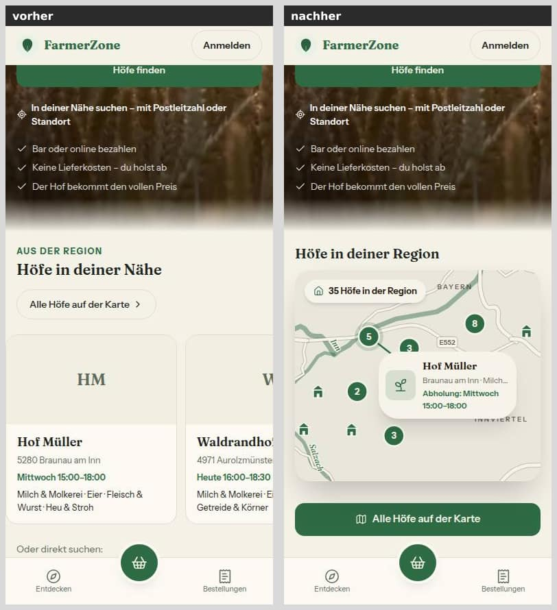
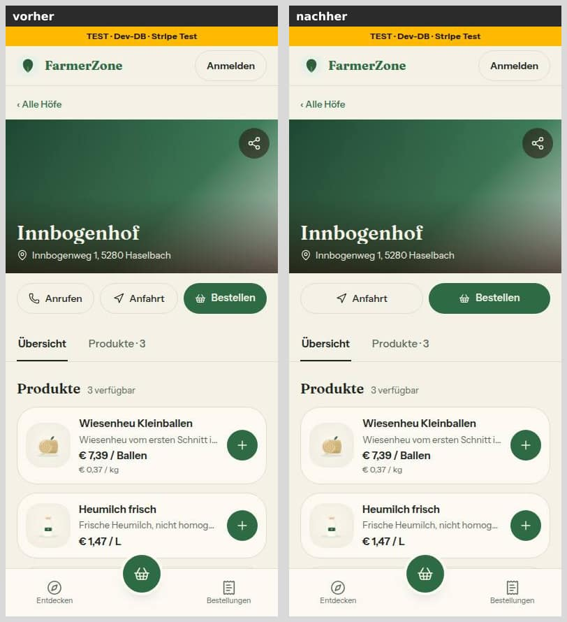
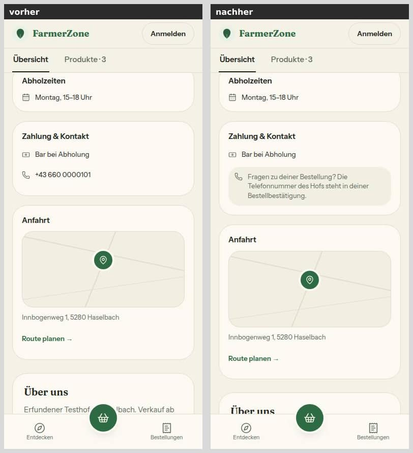
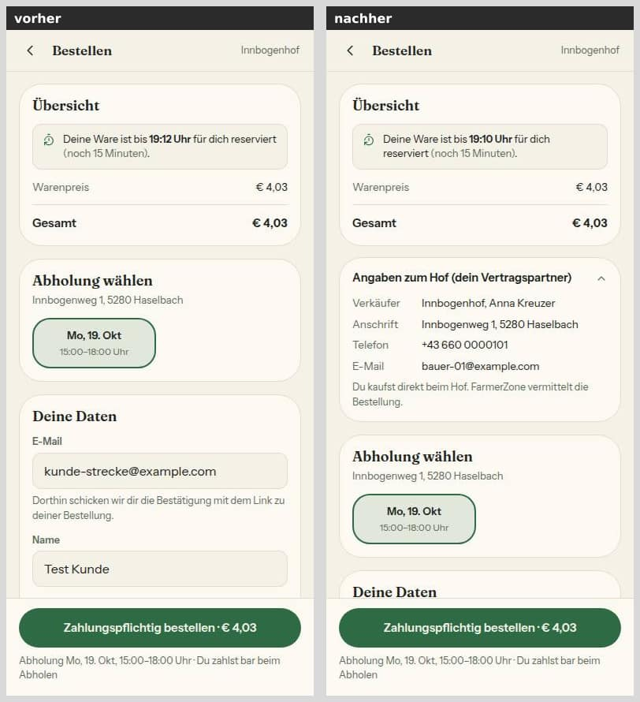
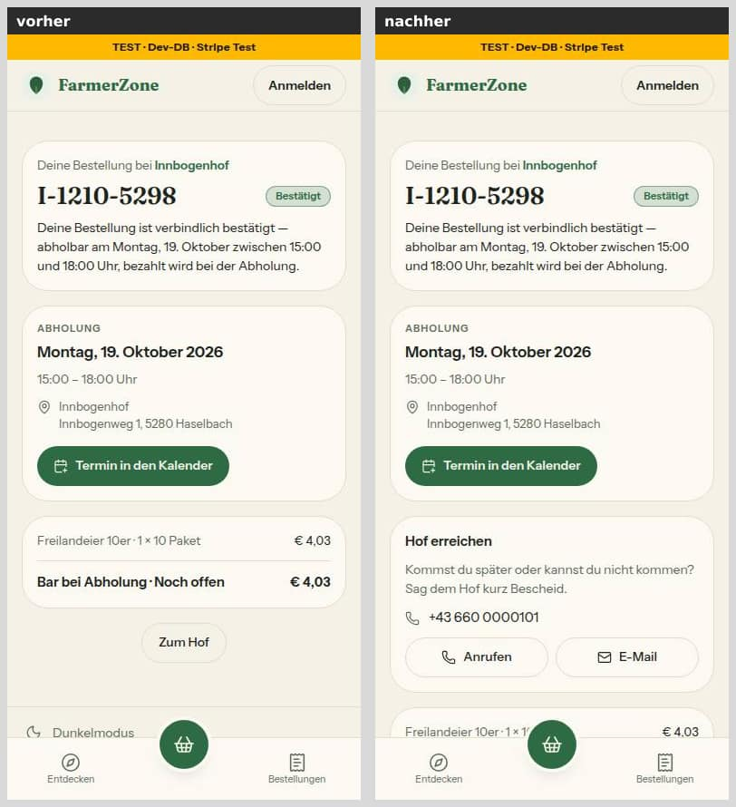
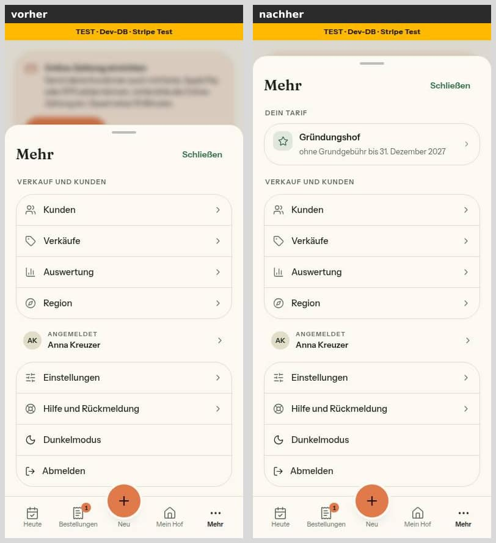
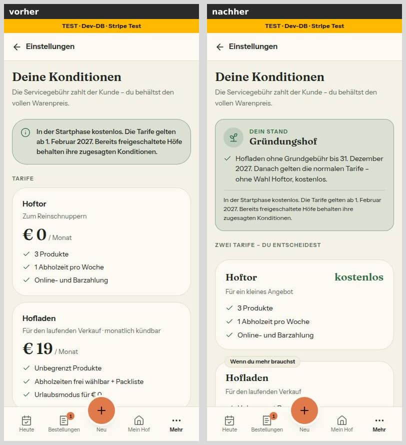
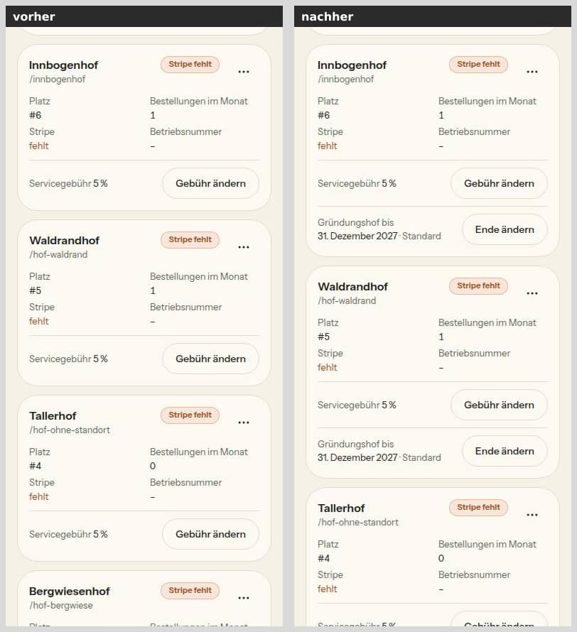

# Morgenbericht Nachtlauf 10 (12.10.2026)

Freigabe: `docs/nachtlauf/freigabe.md` §14 (im Chat erteilt am 12.10.2026). Dirigent nach `docs/nachtlauf.md`, Tempo nach §0 der Freigabe (jetzt Abschnitt 4a).

**Kurz:** Alle acht Nummern und der Doku-PR sind fertig, keine ist ein Entwurf, keine blieb liegen. Der Sammel-PR **#250** ist auf dem Gesamtstand grün: typecheck, **lint 0 Fehler** (7 Warnungen wie auf main), 340 Testdateien / 6871 Tests, Integration 43 / 397. Eine Migration (Nr. 62, genau wie freigegeben). Ein Sitzungslimit um 13:51 unterbrach vier Agenten; alle setzten ohne Verlust fort.

## 1. PRs

| Nr | Thema | PR | Basis | Migration | Runden | Vorschau |
|---|---|---|---|---|---|---|
| Doku | Freigabe §14, Tempo 4a, Register G4/K2/O8/S16, Mockups, Status | #241 | main | nein | – | [Vorschau](https://farmer-zone-git-docs-lauf10-bierbaron.vercel.app) |
| 63 | Lint auf null, Lint im Stop-Hook | #242 | main | nein | 0 | [Vorschau](https://farmer-zone-git-nacht-2026-10-1263-lint-null-bierbaron.vercel.app) |
| 58 | Bausteinverzeichnis und Regelvorschläge (G4) | #243 | main | nein | 0 | [Vorschau](https://farmer-zone-git-nacht-2026-10-1258-bausteine-bierbaron.vercel.app) |
| 64 | Sentry-Filter und Herkunft (S16) | #249 | main | nein | 1 (2 Blocker), 2 volle Durchgänge | [Vorschau](https://farmer-zone-git-nacht-2026-10-1264-sentry-herkunft-bierbaron.vercel.app) |
| 65 | Mein Hof speichern, Testzahlungen (N4, Z4) | #244 | main | nein | 1 (1 Blocker), 2 volle Durchgänge | [Vorschau](https://farmer-zone-git-nacht-2026-10-1265-mein-hof-te-71df24-bierbaron.vercel.app) |
| 59 | Startseite: Karte der Region | #247 | 63 (#242) | nein | 1 (1 Blocker) | kein Build (Vercel legte für den Branch keinen an) – Stand in #250 |
| 60 | Telefonnummer erst nach dem Kauf | #246 | 63 (#242) | nein | 0 (Bericht-Nachtrag), 2 volle Durchgänge | Build gescheitert (Vercel `git_info_fail`, Infrastruktur) – Stand in #250 |
| 61 | Tarif-Zeile, „Deine Konditionen" Fassung 2 | #245 | 63 (#242) | nein | 1 (Blocker der Kette 61→62) | [Vorschau](https://farmer-zone-git-nacht-2026-10-1261-tarif-zeile-bierbaron.vercel.app) |
| 62 | Gründungs-Enddatum je Hof (K2) | #248 | 61 (#245) | **ja** | 0, 2 volle Durchgänge | [Vorschau](https://farmer-zone-git-nacht-2026-10-1262-gruendung-bis-bierbaron.vercel.app) |
| Sammel | alle oben, `pnpm bausteine` | #250 | main | **ja** (aus 62) | – | [Vorschau](https://farmer-zone-git-integration-lauf10-bierbaron.vercel.app) |

**Merge-Empfehlung:** Nur **#250** mergen, per **Merge-Commit** (nicht Squash); die Einzel-PRs gelten danach als gemergt. Einzeln: #241, #242, #243, #249, #244, dann #247, #246, #245 (auf #242), zuletzt #248 (auf #245) – jeweils per Merge-Commit. Gestapelte PRs nie per Squash.

**Was die Runden fanden:**
- **64:** Der Vollvergleich des Umsetzers gegen den ganzen Code von main zeigte 11 Fälle, die main schwärzte und der neue Filter nicht – der pruefer bestätigte echte Lecks (Ziffern im Klartext). Dazu blieben Nummern mit Trenner in Abfragewerten von Freitext-Feldern stehen. Runde 1: 0 Rückschritte (auch mit neuen Startwerten des pruefers).
- **65:** „N weitere Bestellungen" rechnete mit der Zahl ohne Testzahlungen, die Liste zeigte sie mit. Nebenbei belegt: Prisma 7.8 setzt bei leerem `data` kein UPDATE ab – zwei Tabs hätten die Werteliste doppeln können; jetzt wird `updatedAt` immer geschrieben.
- **59:** Am Handy fehlte der eigene Abschnitt „Höfe in deiner Region" unter dem Kopf (Mockup).
- **61:** Kein Blocker in 61 selbst, aber eine Lücke der Kette: Der Gründungshof-Fall von „Dein Stand" fehlte, nach 62 hätte ein Gründungshof oben keinen Hinweis auf seine Zusage gesehen. Runde 1 baute ihn; 62 setzt nur noch den Wert ein.
- **60:** Eine Mockup-Abweichung war im Bericht nicht begründet – vom Dirigenten nachgetragen (nur Doku).

**Dateigrenzen, vom Dirigenten erweitert** (keine andere Nummer berührt die Dateien): 65 eine Zeile in `kunden-detail.tsx` (Blocker); 62 die vier Lader in `server/queries/einstellungen.ts` (nur das Datum durchreichen) und eine Zeile in `src/app/admin/page.tsx` (sonst Typecheck rot).

## 2. Sammel-PR #250

Reihenfolge: Doku-PR, 63, 58, 64, 65, 59, 60, 61, 62 (`--no-ff`), danach `pnpm bausteine` als eigener Commit (461 Dateien, 10 unbenutzt, 34 ohne Zweck; zweimal erzeugt gleich).

**Konfliktauflösungen:** Code: keine. `DEVELOPMENT.md` (beide Seiten vollständig): bei 64 steht dessen Eintrag direkt nach der Lauf-9-Liste zum Sentry-Filter, die er fortsetzt, der Abschnitt von 58 danach; 65, 59, 60, 61 hängen neue Abschnitte in Merge-Reihenfolge an; 62 ohne Konflikt. Die automatisch gemergte Doku (`CLAUDE.md`, `docs/nachtlauf.md`, `docs/ai/*`) ist per Skript geprüft: Jede eingefügte Zeile jeder Nummer steht im Ergebnis; einzige Abweichung ist eine Zeile von 61 in ARCHITECTURE, die 62 (auf 61) weiterschrieb. Der Doku-Branch (dieser Bericht, Status, Bilder) kommt am Ende noch einmal herein.

## 3. Nicht begonnene Nummern

Keine.

## 4. Tempo

| Nr | Beginn | Ende (PR) | Runden | volle Testläufe | Bilder |
|---|---|---|---|---|---|
| Doku | 11:27 | 11:46 | – | 1 (+4 für Status-Commits) | 0 |
| 63 | 11:36 | 12:12 | 0 | 1 (+ Lint durch den Dirigenten) | 0 |
| 58 | 11:36 | 12:15 | 0 | 1 | 0 |
| 64 | 11:36 | 16:23 | 1 | 2 | 0 |
| 65 | 11:59 | 14:01 | 1 | 3 | 2 |
| 61 | 12:12 | 14:20 | 1 | 2 | 10 |
| 60 | 12:46 | 14:22 | 0 | 2 | 12 |
| 59 | 13:59 | 15:24 | 1 | 2 | 6 (4 + 2 nach Runde 1) |
| 62 | 14:21 | 15:31 | 0 | 1 (+ Integration ganz, 2×) | 6 |
| Sammel | 15:35 | 16:32 | – | 1 (mit Integration) | 16 (Strecke) |

Zeiten UTC. Gesamt rund 5 Stunden vom Start bis zum grünen Sammel-PR (Lauf 9: 35 Stunden).

**Was aus §0 nicht einzuhalten war, und warum:**
- **Sitzungslimit 13:51:** Vier Agenten (64, 60, Runde 61, zweiter Durchgang 65) brachen ab; ab 13:53 ging es weiter, jeder setzte an seiner Stelle fort, nichts ging verloren. Die Parallelität (drei Umsetzer plus Prüfer) erreichte das Limit früher, als ein serieller Lauf es getan hätte – die Tokenzahl ändert sie nicht.
- **Tester-Modus (Punkt 2):** eingehalten. Bei 63 lief `pnpm lint` (die Abnahme der Nummer) beim Dirigenten; die tester nahmen zusätzlich Tests mit, die geänderte Dateien per Pfad einlesen (findet `vitest related` nicht).
- **`test:integration` (Punkt 2):** ganze Suite nur bei 62 und im Sammel-PR; 65 und 61 ließen nur ihre geänderten Integrationsdateien laufen (sonst wären neue Integrationstests ungeprüft geblieben).
- **Runden nur für Blocker (Punkt 4):** Bei 61 stufte der Dirigent eine Lücke der Kette als Blocker ein (Konditionen eines Gründungshofs, Geld). Bei 60 wurde eine fehlende Begründung ohne Runde vom Dirigenten nachgetragen. „Sollte" lösten nie eine Runde aus; behoben nur in ohnehin angefassten Dateien.
- **Berichte ≤ 60 Zeilen (Punkt 7):** nach Runden länger (64, 65, 61, 59: 63–100 Zeilen), wie im Rundenauftrag erlaubt.
- **pruefer/tester am Schrittlimit:** dreimal (58, 63, tester 58) ohne Bericht gestoppt; nach kurzer Nachricht berichteten sie. Danach bekam jeder Aufruf ein Schrittbudget.
- **Status sparsam (Punkt 8):** Jeder Status-Commit verlangt den vollen Lauf; deshalb gebündelt (5 Status-Commits).

## 5. Bilderstrecke „Handy vorher/nachher" (390 px, hell)

Vorher `main` (e2f5add), nachher `integration/lauf10` (d131268), beide lokal gegen die Test-Datenbank mit erfundenen Seed-Daten, gleicher Port (der signierte Bestell-Link gilt auf beiden).

**Startseite** – Unter dem Kopf statt „Höfe in deiner Nähe" der Abschnitt „Höfe in deiner Region" mit Karte (Pins, Zähler, Hofkarte) und „Alle Höfe auf der Karte" (59).

**Hofseite oben** – „Anrufen" ist weg, es bleiben „Anfahrt" und „Bestellen" (60).

**Hofseite, „Zahlung & Kontakt"** – Statt der Telefonnummer der Hinweis „Fragen zu deiner Bestellung? Die Telefonnummer des Hofs steht in deiner Bestellbestätigung." (60).

**Kasse** – Unter der Übersicht neu „Angaben zum Hof (dein Vertragspartner)" mit Verkäufer, Anschrift, Telefon, E-Mail (60).

**Bestellung ansehen** – Neue Karte „Hof erreichen" mit Nummer und den Knöpfen „Anrufen" und „E-Mail" – nur über den signierten Link (60).

**Mehr-Blatt im Hofbereich** – Oben die Gruppe „Dein Tarif" – der Seed-Hof ist Gründungshof: „ohne Grundgebühr bis 31. Dezember 2027" (61, 62).

**Deine Konditionen** – „Dein Stand – Gründungshof" statt der grünen Hinweiskarte, Tarife als „Zwei Tarife – du entscheidest", Hoftor „kostenlos" (61, 62).

**Admin, Hofkarte am Handy** – Neue Zeile „Gründungshof bis 31. Dezember 2027 · Standard" mit „Ende ändern" (62).

Zeitabhängig sind nur die zweite Hofkarte auf der Startseite und die Reservierungszeit in der Kasse.

## 6. Aus Nr. 58 und Nr. 63

**Unbenutzt (10):** `src/components/farmer/page-header.tsx`, `farmer/schild.tsx`, `farmer/segment-control.tsx`, `src/components/ui/alert.tsx`, `ui/badge.tsx`, `ui/skeleton.tsx`, `ui/table.tsx`, `ui/tabs.tsx`, `src/lib/order-groups.ts` (nur ein Test), `src/lib/farbraum.ts` (nur Tests). „Kein Zweck vermerkt": 33 (Stand 58), 34 auf dem Gesamtstand.

**Regel-Inventur (G4, erster Lauf; nur Vorschläge, nichts gestrichen – Einzelheiten im Bericht 58):** (1) Sentry-Einzelregeln aus CODING_STANDARDS §4 in den Kopf von `sentry-hygiene.ts`; (2) „nie `git stash`" als Hook-Muster statt Text; (3) „nie auf main committen" im Hook beim Commit prüfen; (4) `pull_request_target`-Test über alle Workflows; (5) Lint im Stop-Hook – erledigt durch 63; (6) `any`/`@ts-ignore` durch ESLint abgedeckt, Text kürzen; (7) Rückgabetyp und `!` als Lint-Warnung oder nur für neuen Code; (8) Datums-Verbotsliste als `no-restricted-properties`; (9) CODING_STANDARDS §9 auf `/pruefen` verweisen; (10) veraltete Zahlen in TESTING_GUIDELINES streichen; (11) „src/lib ist voll" auf BAUSTEINE verweisen; (12) Beispielordner in tests/ – überholt, das tmpdir-Muster gibt es; (13) Hook-Befehle nur in der Hook-Datei; (14) Cron-Regel nur in ARCHITECTURE; (15) „nie Claude in Chrome" durch `deny` abgedeckt; (16) `.skip` per Lint verbieten; (17) Farbregel auf Verweis kürzen; (18) Seed-Konten-Regel durch die Sperre im Seed abgedeckt.

**Wiederverwendet / neu, weil (59–62):**
- 59: `weltPixel`, `gruppierePins`, `gruppenBeschriftung`, `formatiereAbholung`, `KATEGORIE_LABEL`, `KARTE_ADRESSE`, `FOKUS_RAHMEN` / neu: keine Karte ohne Leaflet, kein SVG der Region (`KartenHof` hatte einen Link im Link und ``).
- 60: `KARTE`, `KNOPF_RAHMEN`, `HINWEIS`, `AktionsLeiste`, `KNOPF_GRUEN`, `FOKUS_RAHMEN`, `hofAdresse`, `
`-Muster / neu: keine Karte mit den Pflichtangaben des Verkäufers und keine Kontaktkarte nach dem Kauf.
- 61: Hinweiskarte, StatusBadge, KARTE/KICKER, UnterseitenKopf, `kalendertagInWien`, `formatDatumLang` / neu: `TarifZeile` (ListRow ohne Symbolkachel und Balken passte nicht).
- 62: `gruendungsplaetze`, `baueGruendungsZusage`, `kalendertagInWien`, `BestellDialog`, `Hinweiskarte`, Muster `setServiceFeeAction` / neu: `GruendungBisDialog`, `ladeHoefeFuerGruendung` (die in der Freigabe genannte schmale Abfrage gab es nicht).

**Lint-Warnungen (63):** 7, alle Bestand: ungenutzt `farmName`, `ownerMode`, `Button`, 2× `_weg`; 2× „Compilation Skipped: Use of incompatible library" (checkout-form, product-dialog).

## 7. Nacharbeit („Sollte"), gesammelt

- **63:** Stop-Hook gibt nur 40 Zeilen weiter (Lint-Fehler weiter hinten kommen nicht an) → `pnpm lint --quiet`; Namen ohne Verb in `use-cart.ts`/`cookie-banner.tsx`; `ci.yml` Lint noch `continue-on-error`; `publishStatusPost` rechnet die 7 Tage selbst; `useCart().total` als `number`.
- **58:** Kürzen ergibt 201 Zeichen; Kopfkommentar nach `'use client'` ohne Leerzeile wird nicht erkannt; `@altbestand` aus jedem Kommentar; `tests/fixtures/` gegen TESTING_GUIDELINES §1 (tmpdir-Muster nehmen); Generator-Test ohne Fälle für Kürzen, `import type`, `export *`; DEVELOPMENT.md formuliert Regeln.
- **64:** `weiterDekodiertMitRueckweg` ohne Verb; verdeckter Bezeichner; Vollvergleich als eingecheckter Test.
- **65:** Kommentare zu `nichtAngemeldet`/„liest frisch" nachziehen; Messung „Prisma 7.8" aus CODING_STANDARDS nach DEVELOPMENT.md; Kommentar „`farm.update` muss vor `deleteMany` stehen"; Verhaltenstest Adress-Formular; Import-Wachen bei Re-Export.
- **59:** Test auf `lg:hidden`/`lg:block`; `hoefe-in-der-naehe.tsx` (ungenutztes `KartenHof`, doppelter Link am Handy); totes Feld `lage`; Kommentar in `regionskarte.ts`; Zähler stößt unter ~360 px an „BAYERN"; Erzeugungsskript der Kartendaten ins Repo.
- **60:** Kartenform von Hand statt `KARTE`; `hofAdresse` umbenennen (Name doppelt, kein Verb); Kommentar zu `
` falsch; Produktseite gibt Telefon/E-Mail an die Client-Komponente (Folgeauftrag mit `entferneKontaktdaten`).
- **61:** Seitenleiste bei 1440×900 978 px hoch; `KonditionenLaden` und `/intern`-Vorschau noch Fassung 1; eigene Intl-Formatierer; `(farmer)/layout.tsx` lädt die Zeile ohne sie zu zeigen.
- **62:** Freischalt-Dialog nach Rücknahme/erneuter Freischaltung (Standard statt gespeichertem Datum); `farmId` ohne Zod; ungenutztes `slug` und `AdminFarmRow.gruendungBis`; Namen ohne Verb; „Standard/abweichend" doppelt; NBSP in Testerwartungen; Dialogtest für den K1-Fall; Platzliste ohne `cache()`; veralteter Kommentar an `TarifHof`.

## 8. Regelvorschläge, gesammelt (Prüfung vor Textregel; eingetragen erst nach deiner Freigabe)

- **63:** CI-Lint blockierend (`.github/workflows/ci.yml`).
- **58:** Ratsche im Aktualitätstest: „kein Zweck vermerkt" darf nicht wachsen.
- **64:** Vollvergleich gegen eine eingefrorene Kopie des Moduls als Test (Rückschritte entstehen im Zusammenspiel der Regeln).
- **65:** Wache: in `update`-Daten der Actions kein `feld ?? null` für freiwillige Felder.
- **60:** je öffentlicher Seite ein Test auf die Props ihrer Client-Komponente (Produktseite fehlt).
- **61:** Wache: keine leise Textfarbe in einer `Hinweiskarte` (Kontrast 4,28:1 fand erst Axe).
- **62:** Helfer „Kalendertag → DATE" in `wiener-tag.ts` und Wache gegen das Muster von Hand.

## 9. Für dich zu tun

- [ ] **#250 mergen** (Merge-Commit). Vorher die Entscheidungen unten lesen; keine ist ein Merge-Hindernis.
- [ ] **Vorschau:** #246 in Vercel neu bauen (Build scheiterte an `git_info_fail`, nicht am Code); für #247 legte Vercel keinen Build an. Beide Stände stecken in der Vorschau von #250. Die GitHub-Prüfungen (`ci`, `integration`) laufen nur für PRs auf `main` – für die gestapelten #245–#248 liefen sie im Sammel-PR (grün).
- [ ] **Migration 62 beim Merge beobachten:** Greift `lock_timeout` (5 s), bricht `vercel-build` ab, der alte Code läuft weiter; dann `prisma migrate resolve --rolled-back 20261012120000_gruendung_bis` und erneut deployen (zweiter Lauf gefahrlos).
- [ ] Nach dem Merge **offene Tabs von „Mein Hof" neu laden** (65).
- [ ] **Datum der 4 Testhöfe im Admin prüfen** (Standard 31.12.2027) und die **Testhöfe vor dem Pilot stilllegen**.
- [ ] **Freigaben / Mockup-Abweichungen** (je mit Bild in den Berichten): 59 (nur Natural-Earth-Ebenen, E-Nummern statt A/B, Flüsse grün, Karte in beiden Themes hell, zwei grüne Knöpfe am Handy), 60 („Anrufen" als Rahmen-Knopf, Kopf der Hofseite am Handy wie bisher, Knopf in fester Leiste, Angaben am Handy über Abholung/Bezahlen, `muted-foreground`), 61 (Leistungen wie in TARIFE, StatusBadge, Kopf wie Fassung 1, „So rechnen wir ab", Datum ausgeschrieben, Übersichtszeile ohne Preis), 62 (Spalte und Kartenzeile „Gründungshof bis" ohne Admin-Mockup).
- [ ] **Entscheidungen aus den PRs:**
  - 60: **E-Mail-Pflicht nach FAGG** – ein Hof ohne E-Mail zeigt in der Kasse keine E-Mail-Zeile (beim Anlegen freiwillig); rechtlich prüfen, dann Pflichtfeld + Bestand prüfen oder Kasse sperren. „Hof erreichen" auch bei abgeholten Bestellungen?
  - 61: „Produkte im Shop" je Verkaufsgröße oder je Familie? Register-Eintrag für „Wählen kannst du ab Jänner 2027"? Tarifkarten für Gründungshöfe (zeigen „€ 19 … frühestens ab 1. Februar 2027")?
  - 62: Überlebt eine eigene Gründungszusage die Rücknahme der Freischaltung (K1)?
  - 65: Grundlage von Status/Filter der Kundin; Kundin nur mit Testzahlungen in der Liste („0 Bestellungen")? Wann steht „Standort auf der Karte prüfen" (der Link verwirft die ungespeicherte Straße)?
  - 64: Port in S16 mitprüfen (`https://farmerzone.at:8443` gilt ohne Warnung)?
  - 59: OSM-Auszug des Ausschnitts bereitstellen (dann nur `regionskarte-daten.ts` neu erzeugen und OSM-Hinweis ergänzen); Linkname der Karte per `aria-label` (WCAG 2.5.3)?
  - 58: Zeile „Wiederverwendet / Neu, weil" in jedem Sprint-PR (der sprint-Skill verlangt sie jetzt immer)? CLAUDE.md §4 nennt 5 Berichtspunkte, sprint/fix 6 – angleichen.
  - 63: Fehler auf main bestätigt: Der Nachbestell-Link legt bei mehreren Produkten nur das letzte in den Korb, die übrigen bleiben 15 Minuten reserviert → Fall für `/fix`. CI-Lint blockierend schalten.
- [ ] **Entscheidungen für Lauf 11:** SEPA-Weg; Rechnung und Umsatzsteuer der Grundgebühr; Rücklastschriften; Admin-Protokoll (S12) als Tabelle (braucht eine Migration).
- [ ] **Als letzter Schritt:** die Live-Schaltung samt `STRIPE_LIVE_AB` (kein Lauf schaltet um).

## 10. Wo die Bilder liegen

Je Nummer unter `docs/nachtlauf/berichte/bilder/<nr>/` (in den Einzel-PRs), die Strecke unter `docs/nachtlauf/berichte/bilder/lauf10-handy/`.
