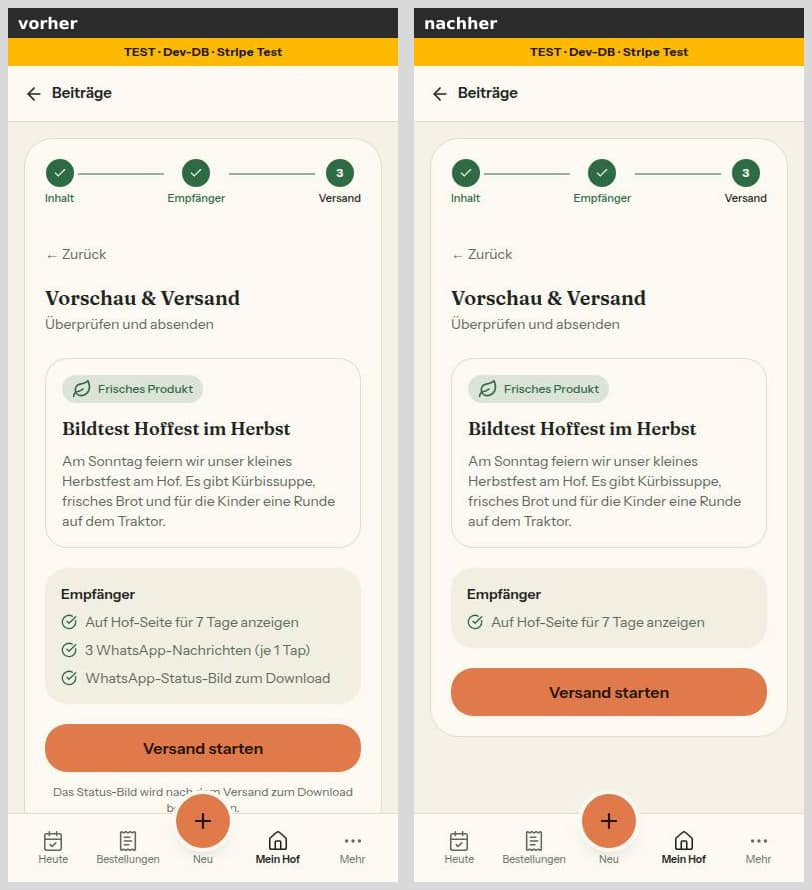
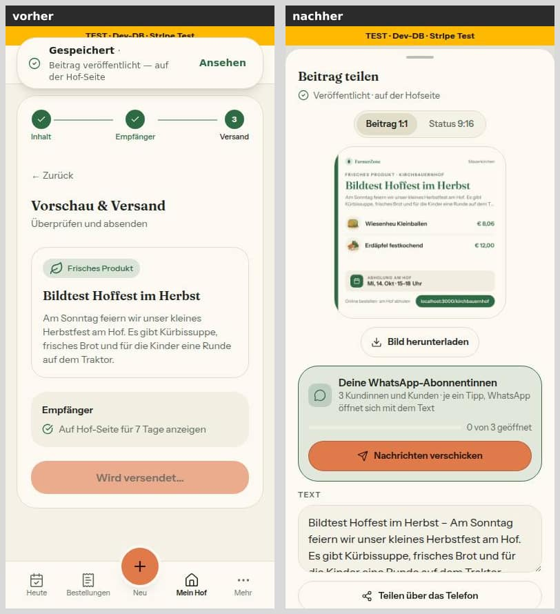
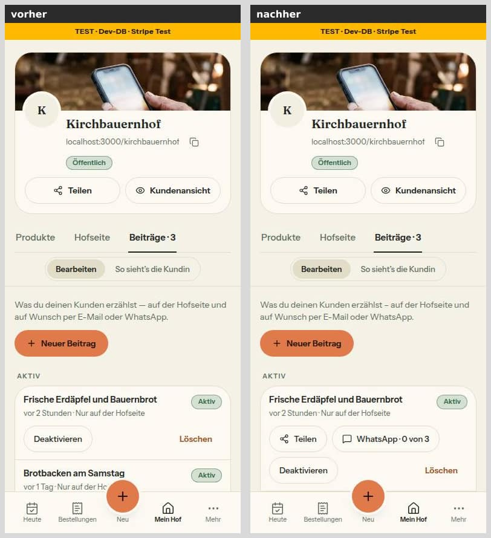
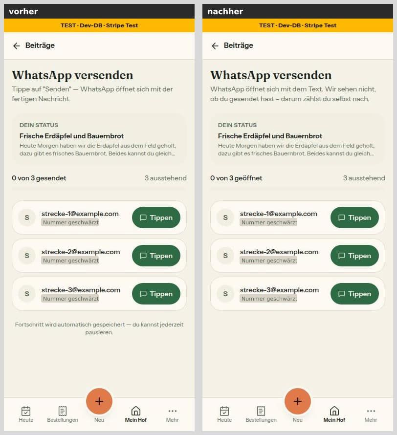
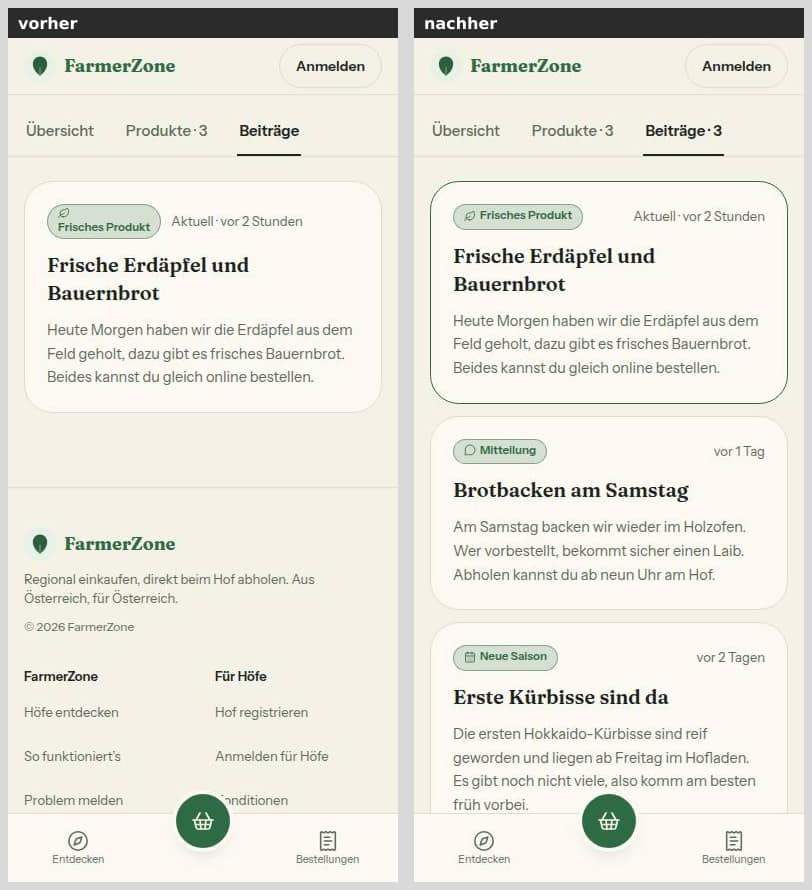
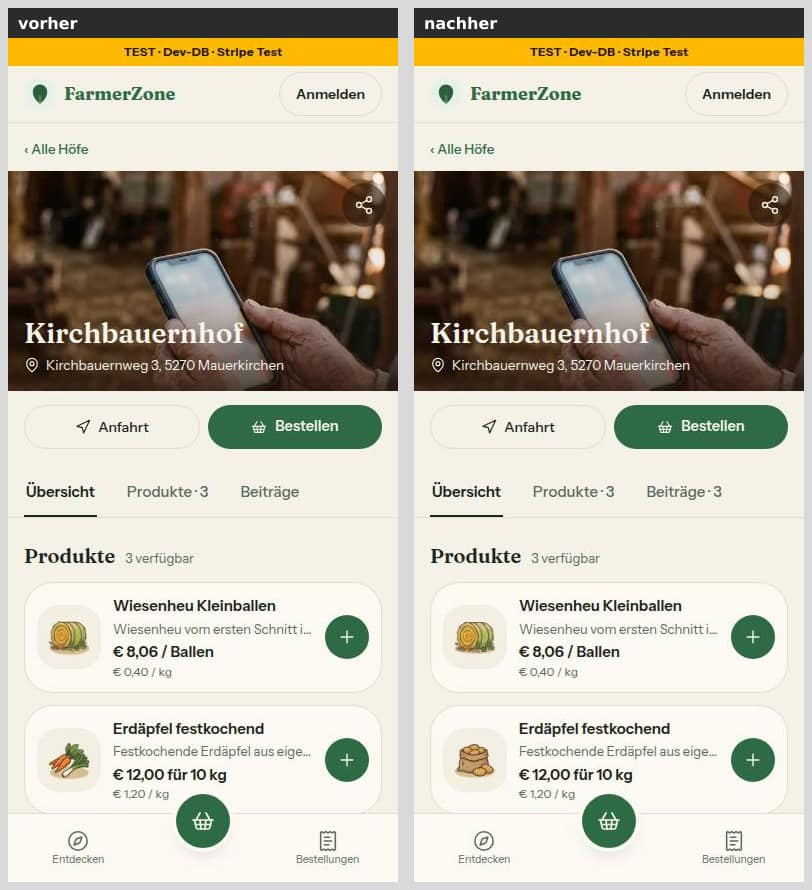
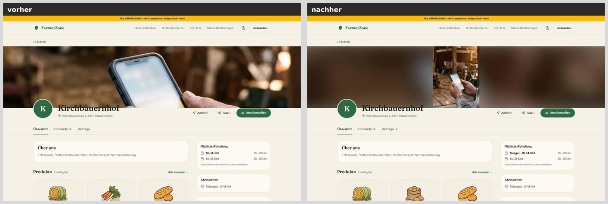
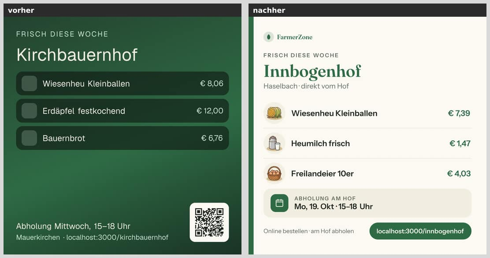
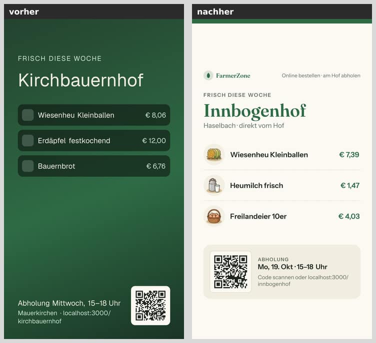
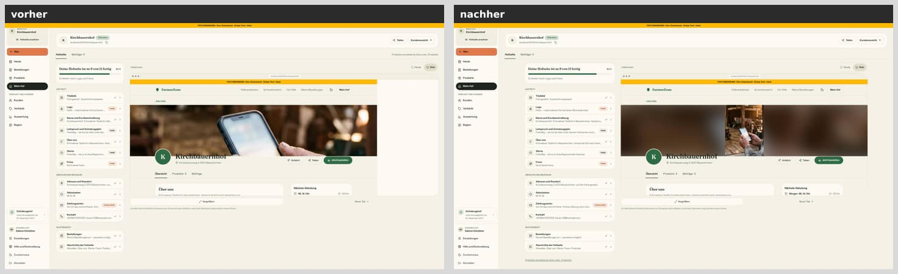

# Morgenbericht Nachtlauf 11 (12.10.2026)

Freigabe: `docs/nachtlauf/freigabe.md` §15 (im Chat erteilt am 12.10.2026). Dirigent nach `docs/nachtlauf.md`, Tempo nach Abschnitt 4a und §0 der Freigabe.

**Kurz:** Alle neun Nummern und der Doku-PR sind fertig, keine ist ein Entwurf, keine blieb liegen. Der Sammel-PR **#261** ist auf dem Gesamtstand grün: typecheck, **lint 0 Fehler** (6 Warnungen, main 7), 349 Testdateien / 7043 Tests, Integration 45 Dateien / 411 Tests. Einzige Migration: Nr. 66, genau wie freigegeben. Vor dem Start fehlten die sechs Mockups; nach deinem „weiter" lagen sie auf main (dc89213).

## 1. PRs

| Nr | Thema | PR | Basis | Migration | Runden | Vorschau |
|---|---|---|---|---|---|---|
| Doku | Freigabe §15, Register W1/T5/T6/F8/N6/N7/I1, Mockups, Status | #251 | main | nein | – | [Vorschau](https://farmer-zone-git-docs-lauf11-bierbaron.vercel.app) |
| 70 | Produktseite ohne Kontaktdaten, Port in der Host-Prüfung (E8, S16) | #252 | main | nein | 0 | [Vorschau](https://farmer-zone-git-nacht-2026-10-1270-produktseite-port-bierbaron.vercel.app) |
| 71 | Nachbestell-Link: alle Produkte in den Korb | #253 | main | nein | 0 | [Vorschau](https://farmer-zone-git-nacht-2026-10-1271-nachbestell-korb-bierbaron.vercel.app) |
| 66 | WhatsApp an Abonnentinnen: ehrlich, je Person (W1) | #255 | main | **ja** | 1 (1 Blocker), 2 volle Durchgänge | [Vorschau](https://farmer-zone-git-nacht-2026-10-1266-whatsapp-geoeffnet-bierbaron.vercel.app) |
| 69 | Teilen-Bild neu: Marktkarte, Foto-Held, QR nur in der Story (T6) | #254 | main | nein | 0, 2 volle Durchgänge | [Vorschau](https://farmer-zone-git-nacht-2026-10-1269-teilen-bild-bierbaron.vercel.app) |
| 73 | Mein Hof am breiten Bildschirm (N7) | #257 | main | nein | 1 (Freigabe-Punkt, Grenze) | [Vorschau](https://farmer-zone-git-nacht-2026-10-1273-mein-hof-breit-bierbaron.vercel.app) |
| 68 | Hofseite: alle aktiven Beiträge (F8) | #256 | 66 (#255) | nein | 0 | [Vorschau](https://farmer-zone-git-nacht-2026-10-1268-hofseite-beitraege-bierbaron.vercel.app) |
| 67 | Beitrag teilen = ein Fenster (T5) | #260 | 69 (#254), mit 66 | nein | 1 (Blocker der Kette 67/69), 2 volle Durchgänge | [Vorschau](https://farmer-zone-git-nacht-2026-10-1267-beitrag-teilen-bierbaron.vercel.app) |
| 72 | Titelbild im Hochformat (N6) | #258 | 68 (#256) | nein | 0 | [Vorschau](https://farmer-zone-git-nacht-2026-10-1272-titelbild-h-6b284e-bierbaron.vercel.app) |
| 74 | Illustrationen verdrahten (I1) | #259 | 69 (#254) | nein | 1 (Blocker der Kette) | [Vorschau](https://farmer-zone-git-nacht-2026-10-1274-illustrationen-bierbaron.vercel.app) |
| Sammel | alle oben, `pnpm bausteine` | #261 | main | **ja** (aus 66) | – | [Vorschau](https://farmer-zone-git-integration-lauf11-bierbaron.vercel.app) |

**Merge-Empfehlung:** Nur **#261** mergen, per **Merge-Commit** (nicht Squash); die Einzel-PRs gelten danach als gemergt. Einzeln in dieser Reihenfolge, jeweils per Merge-Commit:
1. #251, #252, #253, #257, #255, #254
2. #256 (auf #255) und #260 (auf #254, enthält #255)
3. #258 (auf #256) und #259 (auf #254)

GitHub-Prüfungen (`ci`, `integration`) laufen nur für PRs auf `main`; dort sind sie grün. Den Stand der gestapelten PRs prüft #261.

**Was die Runden fanden:**
- **66:** Der Knopf „WhatsApp · n von m" hing zusätzlich am Häkchen beim Veröffentlichen. Mit 67 wäre er bei keinem neuen Beitrag mehr erschienen. Jetzt erscheint er, solange m > n (Wortlaut der Freigabe).
- **67:** Im Beitrag-Modus nahm die Bildroute die verknüpften Produkte vor `p`. Das Fenster zeigte damit eine andere Auswahl als Bild, Download und Kanäle. Jetzt gilt `p` zuerst, ohne `p` die verknüpften (Entscheidung des Dirigenten, Abweichung vom Wortlaut „69").
- **74:** Die Karte „So sehen Käufer dein Produkt" im Produktdialog zeigte das Kategoriebild, die Hofseite das Bild der Unterkategorie. Jetzt zeigen beide dasselbe.
- **73:** Der Hinweis „Produkte verwaltest du links" stand nicht in `seitenkopf.tsx` (wie die Freigabe sagt), sondern in `reiter-leiste.tsx`, also doppelt. Er steht jetzt nur noch am Listenende.

**Ebenfalls über eine Nummer behoben:** Der Cache-Befund aus 69 wurde in 67 behoben (Datei von 67): Bei Höfen mit Produktfotos passte die Version der Metadaten nicht zur Route, deshalb gab es nur 60 s Cache. Drei Sollte-Punkte aus 69 erledigte 74, weil es die Datei ohnehin anfasste.

## 2. Sammel-PR #261

Reihenfolge: Doku-PR, 70, 71, 73, 66, 69, 68, 67, 72, 74 (`--no-ff`). Danach `pnpm bausteine` als eigener Commit (599aac5).

**Konfliktauflösungen:**
- **Code:** keine Konflikte.
- **`DEVELOPMENT.md`:** Die Merges 71, 73, 66, 67, 72 und 74 hängen je einen neuen Abschnitt an dieselbe Stelle; die Basis war jeweils leer. Beide Seiten sind vollständig behalten, in Merge-Reihenfolge.
- **`docs/ai/BAUSTEINE.md`:** Konflikt beim Merge 67. Im Zwischenstand blieb die eigene Seite stehen, am Ende wurde die Datei neu erzeugt.
- **Automatisch gemergte Doku:** Per Skript geprüft, dass jede Zeile, die eine Nummer eingefügt hat, im Ergebnis steht. Fehlend: keine.
- Der Doku-Branch (Morgenbericht, Status) wird zum Schluss noch einmal hereingeholt.

## 3. Nicht begonnene Nummern

Keine.

## 4. Tempo

| Nr | Beginn | Ende (PR) | Runden | volle Testläufe | Bilder |
|---|---|---|---|---|---|
| Doku | 20:22 | 20:40 | – | 1 (+5 für Status-Commits) | 0 |
| 70 | 20:32 | 20:57 | 0 | 1 | 0 |
| 66 | 20:32 | 21:59 | 1 | 2 (+ Integrationsdatei) | 3 |
| 69 | 20:32 | 21:59 | 0 | 1 (+ lokaler Build durch den Dirigenten) | 6 erzeugte Bilder |
| 71 | 20:44 | 21:29 | 0 | 1 | 0 |
| 73 | 21:05 | 22:09 | 1 | 3 | 4 |
| 68 | 21:10 | 21:59 | 0 | 2 (davon 1 nach dem Merge der Runde 66) | 4 |
| 67 | 21:23 | 22:31 | 1 | 3 (davon 1 für den Merge 69+66) | 8 |
| 72 | 21:37 | 22:09 | 0 | 1 | 8 |
| 74 | 21:37 | 22:29 | 1 | 3 (+ lokaler Build) | 0 |
| Sammel | 22:31 | 22:40 | – | 1 (mit Integration) | 10 Paare (Strecke) |

Zeiten UTC. Vom Start bis zum grünen Sammel-PR rund 2 Stunden 20 Minuten (Lauf 10: 5 Stunden).

**Was aus 4a nicht einzuhalten war, und warum:**
- **Höchstens drei Umsetzer:** Kurzzeitig liefen vier, weil Runde 1 von 66 parallel zu 73, 68 und 67 lief.
- **Zeitüberschreitungen unter Last:** Die Last lag bis 14 auf 4 Kernen, deshalb liefen in vollen Läufen drei Laufzeit-Tests in ihre Grenze (`keine-emojis`, `bestellsummen-cent`, `sentry-hygiene-felder`). Jedes Mal einzeln wiederholt und grün (Rahmen-Regel); zwei Status-Commits danach.
- **pruefer am Schrittlimit:** Der pruefer hat ein hartes Limit von 25 Schritten. Bei 69 (beide Durchgänge) stoppte er ohne Bericht und lieferte nach kurzer Nachricht. Danach bekam jeder Aufruf höchstens 22 Schritte.
- **Runden nur für Blocker:** Der Dirigent stufte zwei Befunde als Blocker der Kette ein, beide nach dem Muster „die Oberfläche zeigt X, geteilt oder gezeigt wird Y": 67 (Auswahl im Fenster gegen Bild) und 74 (Käufer-Vorschau gegen Hofseite). 73 bekam eine Runde für einen offenen Punkt der Freigabe (doppelter Hinweis). „Sollte" lösten nie eine Runde aus.
- **`test:integration`:** Die ganze Suite lief nur im Sammel-PR. 66 und 68 ließen nur ihre eigenen neuen Integrationsdateien laufen.
- **Berichte ≤ 60 Zeilen:** nach Runde 1 bei 66 71 Zeilen, wie im Rundenauftrag erlaubt.
- **Status sparsam:** 6 Status-Commits, jeder mit vollem Lauf.

## 5. Bilderstrecke „Handy vorher/nachher" (390 px, hell)

Vorher `main` (dc89213), nachher `integration/lauf11` (599aac5). Beide lokal gegen die Test-Datenbank mit erfundenen Seed-Daten: Hof „Kirchbauernhof", drei Beiträge, drei WhatsApp-Abos, ein Hochformat-Titelbild. Die Testdaten sind danach entfernt. Auf der Tipp-Liste sind die erfundenen Nummern geschwärzt.

**Neuer Beitrag, letzter Schritt:** Die Häkchen „Per WhatsApp an Abonnenten" und „Als WhatsApp-Status-Bild teilen" sind weg. Übrig bleibt „Auf der Hofseite", E-Mail nur mit Abonnentinnen (67).

**Nach dem Veröffentlichen:** Statt Meldung und Wechsel in den Reiter öffnet sich das Blatt „Beitrag teilen" (67, 69). Es zeigt:
- das Bild aus dem Beitrag,
- die Karte „Deine WhatsApp-Abonnentinnen" mit „0 von 3 geöffnet" und dem orangen Knopf „Nachrichten verschicken",
- den vorbelegten Text,
- den Knopf „Teilen über das Telefon".

**Mein Hof › Beiträge:** Je aktivem Beitrag „Teilen" und „WhatsApp · 0 von 3", auch ohne das alte Häkchen (66, 67).

**Tipp-Liste:**
- „0 von 3 geöffnet" statt „gesendet".
- Der Zählhinweis sagt ehrlich, dass die App das Senden nicht sieht.
- „Fortschritt wird automatisch gespeichert" entfällt.
- Geöffnet wird erst beim Zurückkommen aus WhatsApp; je Person gibt es „Zurücksetzen" (66).

**Hofseite, Reiter Beiträge:** Alle drei aktiven Beiträge, der neueste mit „Aktuell"; der Reiter heißt „Beiträge · 3" (68). Vorher stand dort nur der neueste.

**Hofseite mit Hochformat-Titelbild, 390 px:** Am Handy unverändert, Beschnitt mit Fokuspunkt (N6).

**Dieselbe Seite bei 1440 px:** Das ganze Bild steht mittig vor einer unscharfen, abgedunkelten Kopie, statt eines schmalen Streifens (72).

**Teilen-Bild 1:1 und Story:** Marktkarte statt grünem Verlauf, mit Fraunces und Instrument Sans. Die Story hat den QR-Code, das 1:1 keinen (69).
- Vorher zeigt den Kirchbauernhof, nachher das Abnahmebild aus 69 (Innbogenhof); es ist ein Stilvergleich.
- Alle sechs Bilder (mit und ohne Foto, Beitrag-Modus) stehen im Bericht 69.

**Mein Hof bei 2560 px:** Der Editor ist auf 2 000 px begrenzt und zentriert, die Vorschau ist 1 440 px breit, die Liste 528 px (73). Der Kopf mit den Reitern bleibt volle Breite (Entscheidung offen, siehe unten).

Zeitabhängig sind nur die Angaben „vor …" und die Abholtermine. Beim Hofnamen ragt ab 768 px die Schrift ein paar Pixel in den Rand des Titelbilds, wie vorher.

## 6. Entscheidungen des Dirigenten (bitte bestätigen oder ändern)

- **Register-Kennungen:** F7 aus der Freigabe heißt im Register **F8**, B2 heißt **N6**, D3 heißt **N7**.
  - Grund: F7 und B2 sind vergeben; B steht für Bezahlung, D für Direktverkauf; N6/N7 stehen neben N4/N5 (Hofseite, Mein Hof).
  - Jeder dieser Einträge nennt die Kennung aus der Freigabe.
- **Schriftquelle 69:** Die Adresse `github.com/googlefonts/instrument-sans` gibt es nicht. Instrument Sans kommt deshalb aus dem offiziellen Repo `github.com/Instrument/instrument-sans` (so steht es in den Metadaten von Google Fonts), Commit 7fa2230. Fraunces kommt aus `undercasetype/Fraunces`, Commit 7ccdec3. sha256 und OFL-Dateien im Bericht 69.
- **Prisma-Client:** Der Client in `node_modules` stammte von vor Lauf 10. `prisma generate` lief im Hauptordner und in jedem Worktree (nur ignorierte Dateien).
- **Grenzerweiterungen** (jeweils keine andere Nummer an der Datei, oder gestapelt):
  - 66: `server/queries/status-posts.ts` (`StatusPostSummary`/`getStatusPostsForFarm`, neu `zaehleWhatsAppAbonnentinnen`)
  - 68: `components/farm/farm-page-view.tsx` (3 Zeilen)
  - 73: `components/mein-hof/reiter-leiste.tsx` statt `seitenkopf.tsx`, dazu ein Kommentar in `bauern-navigation.ts`
  - 67: die neuen Dateien `server/actions/teilen-fenster.ts` und `components/teilen/beitrag-teilen.tsx`, eine Zeile in `schemas/status-post.ts` (Freigabe: „Schema anpassen“), für Runde 1 `route.tsx:92`
  - 74: `server/queries/products.ts`, `farm.ts`, `components/products/produkt-preis.ts`, zwei Tests, der Glob in `next.config.ts`, für Runde 1 die Übergabe in `lebensmittel-vorschau.tsx` und `product-dialog.tsx`
- **Bundle-Belege:** Lokaler `next build` (Turbopack) bei 69 und 74. Die Bildroute enthält Schriften, Illustrationen und sharp; die Routen, die `categoryImagePath` zur Laufzeit aufrufen, enthalten alle Illustrationen.
- **Vorher-Bilder** auf einem eigenen Seed-Hof (kirchbauernhof), damit sie den Umsetzern nicht in die Quere kamen; danach aufgeräumt.

## 7. Nacharbeit („Sollte"), gesammelt

- **70:**
  - In DEVELOPMENT.md Nr. 70 stimmt „sichtbar waren sie dort nie" nicht; richtig wäre „sichtbar seit Nr. 60 nicht mehr".
  - TESTING_GUIDELINES §2 nennt `telefon-nach-kauf.test.ts` als Vorbild für die verschachtelte Suche; Vorbild ist `produktdetail-seite.test.ts`.
  - Namen ohne Verb im Test; `findeElement` doppelt.
- **71:**
  - `aktuelleItems` → `aktuellePositionen`.
  - Test für `updateQuantity`/`removeItem` aus einem alten Render fehlt.
  - Satz in ARCHITECTURE zu `clearCart` ungenau.
  - `useCart().total` rechnet weiter als Zahl (Bericht 63).
- **66:**
  - Ein geworfener Fehler beim Speichern (Netzabbruch) landet auf der Fehlerseite; danach stehen gespeicherte Personen wieder auf „offen". Abfangen wie `speichernOhneWurf`.
  - Veralteter Blockkommentar in `actions/status-posts.ts:191-194`.
  - Render-Test der Rückkehr-Erkennung fehlt.
  - `BEITRAG_WHATSAPP_MAX` ohne Nutzer.
  - Kein `revalidatePath` nach dem Setzen.
  - Altlasten: `APP_URL` aus `window.location`, handgebauter Fortschrittsbalken, E-Mail als Name ohne Bestellung, `customerPhone: { not: null }` lässt leere Nummern durch, Zählung in `status/new/page.tsx` ohne Telefonbedingung.
- **69:**
  - Prisma-Abfragen direkt in `route.tsx` statt über `ladeTeilenBildQuelle` (ARCHITECTURE nachziehen; `route.tsx:152` liest die Fotos doppelt).
  - Variante B lädt die Kandidaten nacheinander unter gemeinsamer Frist: Hängt das Beitragsfoto, bekommt das geladene Produktfoto 0 ms.
  - Die Ersatz-Illustration startet erst nach der Fotofrist.
  - `FOTO_MAX_PIXEL` 25 MP statt rund 5,8 MP.
  - Der Satori-Daten-URI-Cache (500 Einträge, Schlüssel ist die ganze URI) kann je Prozess viel Speicher halten.
  - Fehlende Illustration ergibt einen leeren Kreis mit langem Cache.
  - Texte ohne Quelle in `src/lib` („Online bestellen · am Hof abholen", „Code scannen oder …", „Abholung am Hof", „· direkt vom Hof", „Regional einkaufen und am Hof abholen.").
  - Anlass-Wörter in fünf Dateien; Beitragsregel doppelt und ohne die Fünfer-Grenze von F8.
  - Altlast: 404 ohne no-store bei ungültigem Slug.
- **68:**
  - BAUSTEINE beschreibt `status-posts.ts` mit dem Text von `getActiveStatusPosts` (Kopfkommentar fehlt).
  - Grenze 5 nur im Integrationstest geprüft.
  - `StatusBadge` setzt Symbole über das Wort.
- **67:**
  - Verhaltenstest des Veröffentlichen-Flusses statt Regex.
  - Doppelte Erwartung in `beitraege-hilfe.test.ts`.
  - `linkMitKanal` baut `?k=` neben `teilenLink` nach; `meldeGescheitertesLaden` ist eine Kopie.
  - Kopfkommentar von `teilenBildAuswahl` nennt die alte Reihenfolge.
  - Ein noch nicht freigeschalteter Hof sieht „Teilen" und bekommt dann einen unpassenden Satz.
  - Fehler der Action nach dem Veröffentlichen ohne Brotkrume oder Sentry.
- **72:**
  - Kommentar in `titelbild.tsx:66` begründet die Reihenfolge falsch (Stapelreihenfolge).
  - Überflüssige Prüfung `quelle !== null` (Z. 32).
  - „Eine Bildanfrage" nur bei 390 gemessen.
- **73:**
  - SSR-Test prüft Layout-Klassen (besser eine Quelltext-Wache); Literal `gap:32px`.
  - `useElementGroesse` liegt in einer Komponenten-Datei statt in `src/lib/use-*.ts`.
  - Der `.vorschau`-Wache fehlt eine Wortgrenze.
  - Alte Ortsangaben des Hinweises in `bauern-navigation.ts:140-144`, im Kopf von `mein-hof-umschalter.test.ts` und in `docs/entwicklung/hofseite-editor-browser.md`.
  - `EDITOR_LISTE_WEB_MAX` (560) greift nie.
- **74:**
  - Ein Dekodierfehler im Prüfskript bricht ohne FEHLER-Zeile ab.
  - Der Test „jede L2" läuft über die zugeordneten statt über alle Unterkategorien.
  - Kommentar in `product-grid.tsx:176` („Kategoriebild").
  - Erwartung im Bericht nicht konkret (Milch/Käse → `/categories/milch/kaese.webp`).

## 8. Regelvorschläge, gesammelt (Prüfung vor Textregel; eingetragen erst nach deiner Freigabe)

- **70:** umgesetzt – je öffentlicher Seite ein Test auf die Props ihrer Client-Komponente (TESTING_GUIDELINES §2).
- **71:** Jeder `use-*`-Hook, der nach einem `await` Zustand ändert, bekommt einen Prüfstand-Test „zwei Aufrufe aus demselben Render“ (TESTING_GUIDELINES §2, ARCHITECTURE State-Regeln).
- **66:** Die Quelltext-Wache aus `whatsapp-versand.test.ts` (keine Zeitschaltung, keine Zustell-Sätze, keine Action im setState-Updater) auf alle Client-Komponenten unter `src/app/(hof)` ausweiten.
- **69:** umgesetzt – ein Test, dass der Lader aus WebP ein JPEG macht, und die Regel in TECH_STACK (Satori zeichnet kein WebP).
- **68:** `StatusBadge` bekommt ein optionales `symbol` (Symbol und Wort in einer Zeile) plus Rendertest.
- **67:** Prüfsummen nur über die echte Route testen (TESTING_GUIDELINES §2).
- **72:** umgesetzt – Rendertest, dass das vordere Bild `onLoad` trägt.
- **73:** Beim Schreiben einer Freigabe je Textkonstante und je neuem Bezeichner einmal `grep -rn` über `src/` und `tests/`; alle Fundstellen gehören in die Dateigrenzen.
- **74:** CI-Schritt nach dem Build, der in der Trace-Datei der Hofseite eine Unterkategorie-Datei sucht (sonst fehlen Illustrationen in Produktion still, wenn `assetExists` umgebaut wird).

## 9. Für dich zu tun

- [ ] **#261 mergen** (Merge-Commit). Die Punkte unten sind keine Merge-Hindernisse, außer du entscheidest bei den Teilen-Bildern anders.
- [ ] **Vor dem Merge in der Vorschau** von #261:
  - `/<slug>/opengraph-image` und `?format=story` abrufen. Ein Bild muss kommen; ein 503 hieße, dass Schriften fehlen.
  - Einen Hof-Link mit Produktfoto in WhatsApp teilen. Die Bilder mit Foto sind PNG mit 1,2–1,4 MB, und WhatsApp zeigt Vorschaubilder über etwa 300 KB womöglich nicht an. Ausweg wäre eine JPEG-Ausgabe über sharp, als eigener Auftrag.
- [ ] **Migration 66 beim Merge beobachten:**
  - Greift `lock_timeout` (5 s), bricht `vercel-build` ab, und der alte Code läuft weiter.
  - Dann `prisma migrate resolve --rolled-back 20261012200000_whatsapp_getippt` und erneut deployen; ein zweiter Lauf ist durch `IF NOT EXISTS` gefahrlos.
- [ ] **Nach dem Merge** den ersten echten Beitrag eines Testhofs veröffentlichen.
  - Das Blatt bzw. Fenster „Beitrag teilen“ ansehen.
  - Das Bild in WhatsApp und als Story ansehen.
  - Am Handy die Tipp-Liste einmal echt durchgehen: WhatsApp öffnen, zurück in den Browser, die Person steht auf „geöffnet“.
- [ ] **Achtung, bestehende Beiträge:** Nach dem Merge zeigt jeder bestehende veröffentlichte Beitrag „WhatsApp · 0 von m“, auch wenn im alten Ablauf schon allen geschrieben wurde. Laut W1 gibt es keine Zahl mehr aus `whatsappSentCount`. Beim Pilothof bitte nicht ein zweites Mal schicken.
- [ ] **Freigaben / Mockup-Abweichungen** (je mit Bild in den Berichten):
  - **66:** Die Tipp-Liste hat kein Mockup. Neu: Zählhinweis unter der Überschrift, geöffnete Zeilen ohne Abblenden, „automatisch gespeichert“ entfällt, Fertig-Zustand mit Liste darunter. Außerdem bekommt ein vergangener Beitrag den WhatsApp-Knopf, solange m > n (das Mockup zeigt dort keinen).
  - **69:** Tokens statt der Mockup-Werte (Grün, Linien, Kreise, Farben von Variante B), Termin als „Mo, 19. Okt · 15–18 Uhr“. Der Titel von B lautet „Frisch diese Woche“, der Hofname steht in der Vorzeile. Verlauf und Schatten auf dem Foto sind dichter, die Abstände im 1:1 etwas enger.
  - **68:** Reiter als unterstrichene Links (Bestand), Kartenmaße, `border-accent` statt eines Hexwerts, Titelbild und rechte Spalte um die Liste, kleine Abstände in der Karte.
  - **67:** „Abonnentinnen“, Kamera-Symbol und Foto-Satz (Freigabe), „1 Person“ im Singular, „WhatsApp“ in der Zeile erst ab einem getippten Eintrag.
  - **72 und 73 haben kein Mockup:** Die Bilder in den Berichten sind die Vorlage.
- [ ] **Entscheidungen aus diesem Lauf:**
  - **66:** Die Zahl n im Knopf zählt auch inzwischen Abgemeldete mit, die Liste nicht. Beim Setzen wird nur der Hof geprüft, nicht `optInWhatsApp`.
  - **67:**
    - „Bis zu drei passen ins Bild.“ stimmt im Beitrag-Modus nicht, die Marktkarte zeigt dort zwei Zeilen; die Mockups widersprechen sich.
    - Die E-Mail-Fußnote steht auch, wenn keine Mail ging.
    - Altbeiträge mit dem alten WhatsApp-Häkchen verlieren „WhatsApp“ in der Zeile.
    - Bestätigen: `p` vor den verknüpften Produkten. Werden alle Chips abgewählt, zeigt das Bild die verknüpften Produkte.
  - **68:** Die Zahl im Reiter ist die Zahl der gezeigten Karten (höchstens fünf). Mein Hof schreibt „Nur auf der Hofseite“ auch an aktive Beiträge ab dem sechsten.
  - **72:** Der Satz zum Hochformat steht, solange das Foto hoch ist, nicht nur nach dem Hochladen. Die Maße beim Hochladen zu speichern (dann ohne Wechsel nach dem Laden) braucht eine Migration und eine eigene Freigabe; vorgemerkt für Lauf 12.
  - **73:**
    - Nach dem Wortlaut fehlt der Hinweis „Produkte verwaltest du links“ jetzt auf dem Reiter Beiträge (ab md) und auf der Hofseite zwischen md und lg.
    - Der Kopf bleibt bei 2560 px volle Breite. Vorschlag: `farm-page/page.tsx` Z. 72/114 `lg:mx-auto lg:max-w-[2000px]`.
  - **74:** Ein Produkt ohne Kategorie zeigt jetzt die Sonstiges-Illustration statt des Platzhalters. Das Teilen-Bild bleibt bei der Kategorie, weil die Route keine Unterkategorie liest.
  - **Doku:**
    - O8 („Bau in Gate 8 / Lauf 11“) ist in Lauf 11 nicht eingeplant.
    - Der Kopf von `docs/nachtlauf.md` §4a nennt noch „freigabe.md §14 §0“.
    - Die Mockup-Zeile zu mobil-h4-beitraege-teilen-je-beitrag nennt die Route `/mein-hof`; im Code heißt sie `/farm-page`.
- [ ] **Offen aus der Freigabe (nicht in diesem Lauf):**
  - E-Mail-Pflicht nach FAGG
  - „Produkte im Shop“ je Verkaufsgröße oder Familie
  - Gründungszusage bei Rücknahme der Freischaltung
  - Grundlage des Kundinnen-Status
  - OSM-Auszug für die Karte
  - CI-Lint blockierend
  - SEPA-Weg, Rechnung und USt der Grundgebühr, Rücklastschriften, Admin-Protokoll (S12)
- [ ] **Backlog Illustrationen:** Bögen in höherer Auflösung (2K/4K) neu erzeugen und mit dem Schneideskript ersetzen, sobald Kacheln größer als 260 px gezeigt werden; Schwarzweiß-Fassung für Plakat und dunkles Theme nutzen. Das Prüfskript `pnpm illustrationen` (74) prüft neue Dateien.
- [ ] **Als letzter Schritt:** die Live-Schaltung samt `STRIPE_LIVE_AB` (kein Lauf schaltet um).

## 10. Wo die Bilder liegen

Je Nummer unter `docs/nachtlauf/berichte/bilder/<nr>/` (in den Einzel-PRs; bei 69 die sechs erzeugten Teilen-Bilder). Die Strecke liegt unter `docs/nachtlauf/berichte/bilder/lauf11-handy/`.
