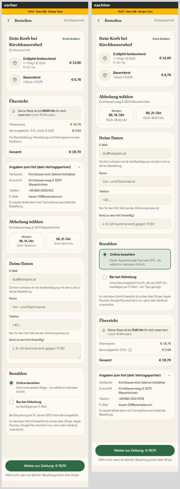
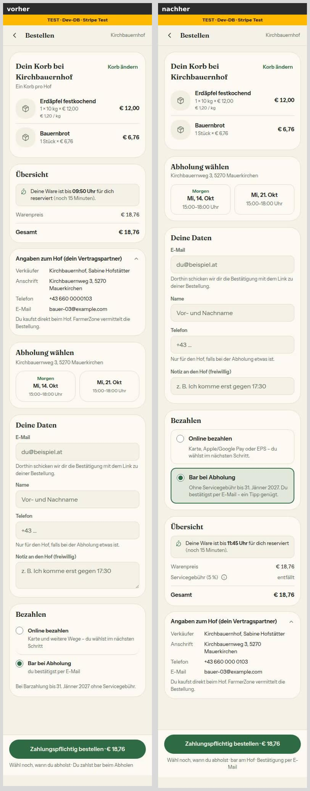
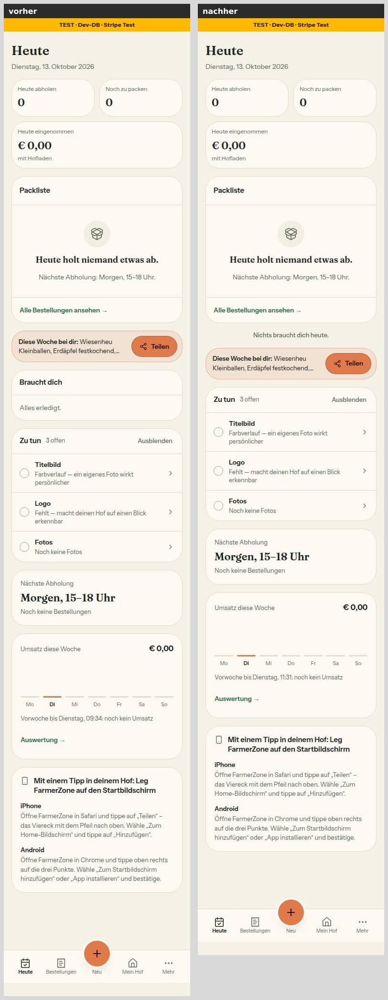
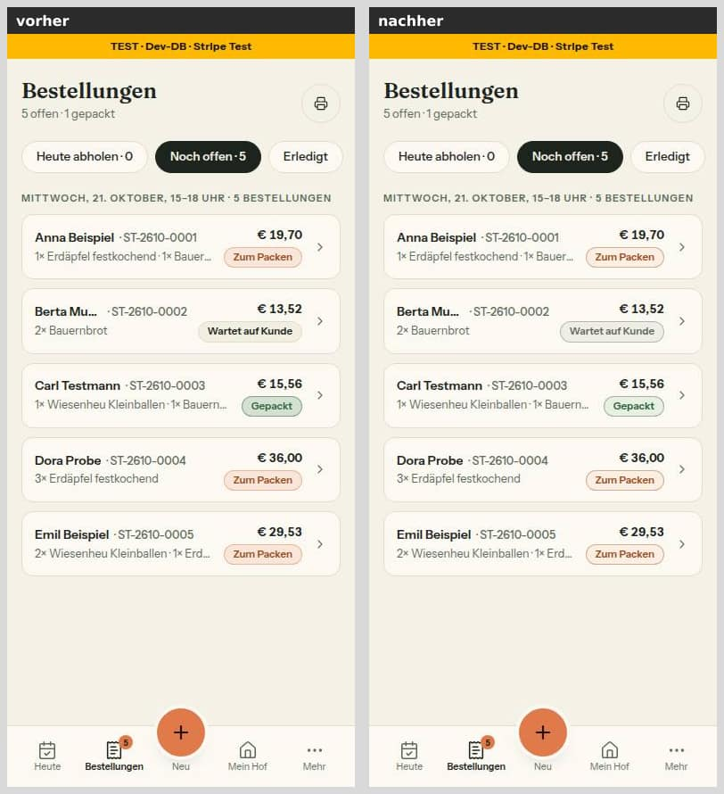
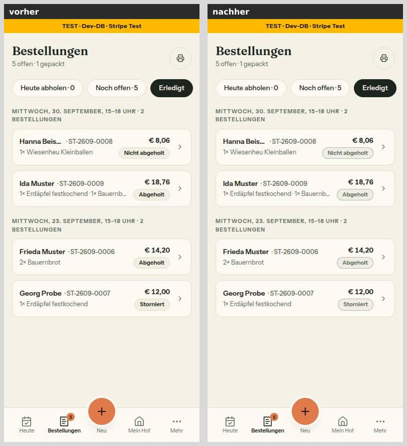
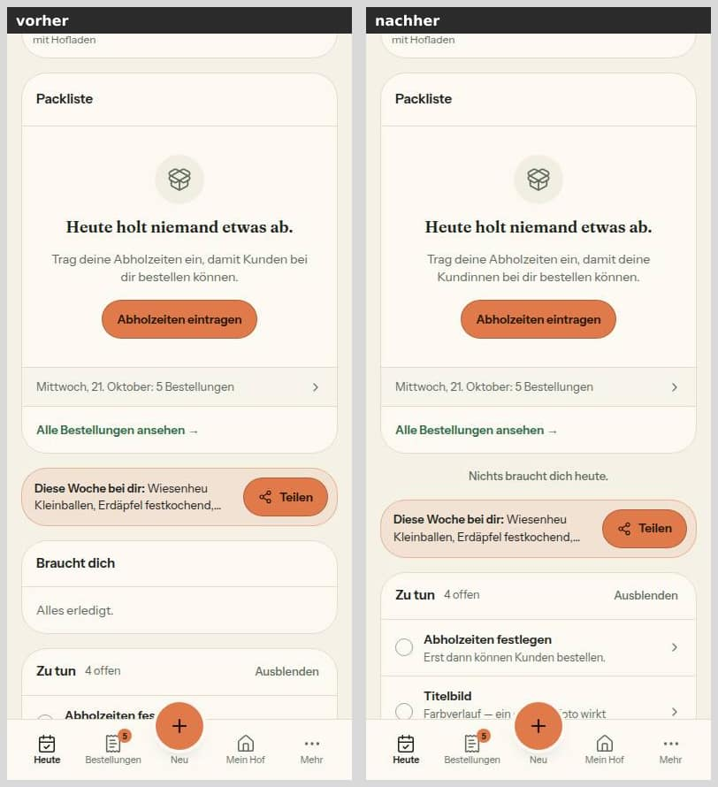
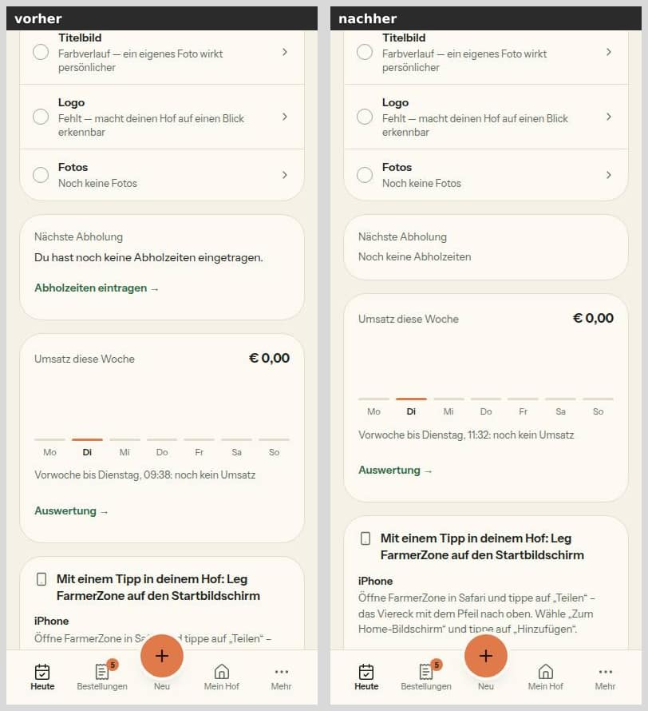

# Morgenbericht Nachtlauf 12 (13.10.2026)

Freigabe: `docs/nachtlauf/freigabe.md` §16 (im Chat erteilt am 13.10.2026). Dirigent nach `docs/nachtlauf.md`, Tempo nach Abschnitt 4a und §0 der Freigabe.

**Kurz:** Alle neun Nummern (75–83) und der Doku-PR sind fertig. Keine ist ein Entwurf, keine blieb liegen, keine Migration ist entstanden. Der Sammel-PR **#272** ist auf dem Gesamtstand grün:
- typecheck,
- **lint 0 Fehler** (6 Warnungen wie main),
- 358 Testdateien / 7229 Tests, darunter die Wortliste (N8) und die Hex-Wache (G5),
- Integration 45 Dateien / 413 Tests,
- `pnpm illustrationen` 114/114.

Auf GitHub sind `ci` und `integration` für alle PRs auf `main` grün, alle elf Vorschauen sind gebaut, alle PRs ohne Konflikt.

## 1. PRs

| Nr | Thema | PR | Basis | Migration | Runden | Vorschau |
|---|---|---|---|---|---|---|
| Doku | Freigabe §16, Register N8–N11/G5/T7, Regelvorschläge 71/66/67/74/73, Mockups, Status | #262 | main | nein | – | [Vorschau](https://farmer-zone-git-docs-lauf12-bierbaron.vercel.app) |
| 75 | Nacharbeit Lauf 11: Bildroute und WhatsApp-Liste absichern | #266 | main | nein | 0, 2 volle Durchgänge | [Vorschau](https://farmer-zone-git-nacht-2026-10-1375-nacharbeit-lauf11-bierbaron.vercel.app) |
| 77 | Wortliste mit Test (N8) | #264 | main | nein | 0 | [Vorschau](https://farmer-zone-git-nacht-2026-10-1377-wortliste-bierbaron.vercel.app) |
| 76 | Teilen-Bild als JPEG (T7) | #263 | main | nein | 0 | [Vorschau](https://farmer-zone-git-nacht-2026-10-1376-teilen-bild-jpeg-bierbaron.vercel.app) |
| 78 | Begriffe nach der Wortliste (N8) | #265 | 77 (#264) | nein | 0 | [Vorschau](https://farmer-zone-git-nacht-2026-10-1378-begriffe-bierbaron.vercel.app) |
| 82 | Kasse glätten (N10) | #267 | main | nein | 0, 2 volle Durchgänge | [Vorschau](https://farmer-zone-git-nacht-2026-10-1382-kasse-glatt-bierbaron.vercel.app) |
| 79 | Bedeutungsfarben als Tokens, Baustein Marke (G5) | #268 | main | nein | 0 | [Vorschau](https://farmer-zone-git-nacht-2026-10-1379-bedeutungsfarben-bierbaron.vercel.app) |
| 80 | Leerzustände aus EmptyState (N9) | #269 | 78 (#265) | nein | 1 (Blocker vom Dirigenten hochgestuft) | [Vorschau](https://farmer-zone-git-nacht-2026-10-1380-leerzustaende-bierbaron.vercel.app) |
| 81 | Telefonnummern einheitlich anzeigen (N8) | #271 | 75 (#266) | nein | 2 (Blocker vom Dirigenten hochgestuft, Rest in Runde 2) | [Vorschau](https://farmer-zone-git-nacht-2026-10-1381-telefon-anzeige-bierbaron.vercel.app) |
| 83 | Heute: Braucht dich vor Teilen, leer als Zeile (N11) | #270 | 80 (#269) | nein | 0 (Runde 1 von 80 hereingeholt) | [Vorschau](https://farmer-zone-git-nacht-2026-10-1383-heute-reihenfolge-bierbaron.vercel.app) |
| Sammel | alle oben, `pnpm bausteine` | #272 | main | nein | – | [Vorschau](https://farmer-zone-git-integration-lauf12-bierbaron.vercel.app) |

**Merge-Empfehlung:** Nur **#272** mergen, per **Merge-Commit** (nicht Squash); die Einzel-PRs gelten danach als gemergt. Einzeln in dieser Reihenfolge, jeweils per Merge-Commit:
1. #262, #266, #264, #263, #267, #268
2. #265 (auf #264) und #271 (auf #266)
3. #269 (auf #265), danach #270 (auf #269)

GitHub-Prüfungen (`ci` mit dem neuen Trace-Schritt aus 75, `integration`) laufen nur für PRs auf `main`; dort sind sie grün. Den Stand der gestapelten PRs (#265, #269, #270, #271) prüft #272.

**Was die Runden fanden:**
- **80:** Bei einem Hof ohne Abholzeit standen auf Heute derselbe Satz und derselbe orange Knopf „Abholzeiten eintragen" zweimal untereinander (Packliste und Karte „Nächste Abholung"). Jetzt stehen Satz und Knopf einmal in der Packliste; die Karte zeigt nur „Noch keine Abholzeiten" (Bild 4b unten).
- **81, Runde 1:**
  - Im Bestell- und Kundendetail stand die Nummer nur noch im Anruf-Link. Ohne lesbare Nummer sah der Hof die Eingabe der Kundin gar nicht mehr. Jetzt steht sie dann als Text; WhatsApp gibt es nur mit lesbarer Nummer.
  - `telefonLink` liefert ohne lesbare Nummer keinen Link mehr. Vorher wählte „0660 0000000 ab 18 Uhr" die Uhrzeit mit.
  - Alle Testnummern sind genullt.
- **81, Runde 2:** zwei Beispielnummern in einem Kommentar und in `DEVELOPMENT.md` genullt. Ein Suchskript über den ganzen Diff der Nummer (mit Gegenprobe) findet keine weitere.

**Zweite volle Prüfdurchgänge** (75 und 82, laut Freigabe): beide ohne Blocker und ohne neue Sollte.
- **75:**
  - Zod an der Grenze; Hof, Beitrag und Abo samt WhatsApp-Regel stehen im WHERE/EXISTS.
  - Keine Nummern in SQL oder Sentry.
  - Fotos nur vom eigenen Host, `redirect: 'error'`, 1,5 MB und 6 MP.
- **82:**
  - Kaufweg Ende zu Ende geprüft. Beim Wechsel Online ↔ Bar folgen Beträge, Gebührenzeile, Unterzeile und Stripe-Satz derselben Zahlart; der Knopfbetrag ist das Gesamt.
  - Fehlerpfade, Schema, `/api/checkout`, Reservierung und die Vorbelegung `zahlarten[0]` sind unverändert.

**Über eine andere Nummer erledigt:**
- 83 hat Runde 1 von 80 hereingeholt (e813eb7). Damit ist der Sollte-Befund aus 83 erledigt („DESIGN_SYSTEM verallgemeinert N11").
- Die grüne StatusBadge lag hell auf dem Seitengrund bei 4,37:1, also unter 4,5. Seit 79 zeichnet sie über `Marke`; damit sind alle ihre Aufrufer behoben.
- `docs/ai/CODING_STANDARDS.md` §7 widersprach G5 (Sollte aus 79, Datei außerhalb seiner Grenze). Der Dirigent hat den Abschnitt im Doku-PR auf G5 umgeschrieben.

## 2. Sammel-PR #272

Reihenfolge: Doku-PR, 75, 77, 76, 78, 82, 79, 80, 81, 83 (`--no-ff`). Danach `pnpm bausteine` als eigener Commit (e692cf7). Zum Schluss kommt der Doku-Branch mit diesem Bericht, der Bilderstrecke und dem Status noch einmal herein.

**Konfliktauflösungen:**
- **Code:** keine Konflikte. Was sich zwei oder mehr Nummern teilen, ist automatisch zusammengeführt; Typecheck und Tests auf dem Gesamtstand sind grün.
  - `opengraph-image/route.tsx` und `tests/teilen-bild.test.ts` (75 und 76): Lader und 404 aus 75, JPEG-Antwortblock und Import aus 76.
  - Tipp-Liste `whatsapp-tap-client.tsx`: Fehlerbehandlung aus 75, Z. 124 aus 78, leere Liste aus 80, Anzeige der Nummer aus 81. Dazu `lib/whatsapp-versand.ts`: `nichtGespeichert` aus 75, `leer` aus 80.
  - `product-grid.tsx`: Kommentar Z. 176 aus 75, Z. 420/442 aus 78. `bauern-navigation.ts`: Kommentar Z. 140–144 aus 75, Beschriftungen aus 78.
- **`docs/ai/DESIGN_SYSTEM.md`, Merge 79:** 79 fügt den Absatz „Marke (Register G5)" vor „Unterseiten-Kopf" ein, 78 ändert in „Unterseiten-Kopf" ein Wort („Problem melden"). Beide Seiten bleiben.
- **`docs/ai/DESIGN_SYSTEM.md`, „Leerzustände"** (im Branch von 83, Merge der Runde 1 von 80): Die Fassung aus 80-R1 bleibt; darin steht die leise Zeile für das leere „Braucht dich" als benannte Ausnahme (N11).
- **`DEVELOPMENT.md`:** Die Merges 77, 76, 78, 82, 80, 81 und 83 hängen je einen Abschnitt an dieselbe Stelle (Basis leer). Beide Seiten sind vollständig behalten, in Merge-Reihenfolge.
- **`docs/ai/BAUSTEINE.md`:** In den Zwischenständen blieb die eigene Seite stehen, am Ende wurde die Datei neu erzeugt.
- **Doku-Zeilen per Skript geprüft:** Jede Zeile, die eine Nummer seit `main` in `docs/` oder `DEVELOPMENT.md` eingefügt hat, steht im Ergebnis. Ausnahme ist nur der eine Absatz aus 80, der im Branch von 83 bewusst zusammengeführt wurde (siehe oben).

## 3. Nicht begonnene Nummern

Keine. Keine Nummer ist ein Entwurf; kein Branch dieses Laufs ändert `prisma/`.

## 4. Tempo

| Nr | Beginn | Ende (PR) | Runden | volle Testläufe | Bilder |
|---|---|---|---|---|---|
| Doku | 07:08 | 07:20 | – | 1 (+2 für Status-Commits) | 0 |
| 75 | 07:17 | 08:28 | 0 | 2 (+ eigene Integrationsdatei 11/11) | 0 |
| 77 | 07:17 | 07:51 | 0 | 1 | 0 |
| 76 | 07:17 | 07:44 | 0 | 1 | 6 erzeugte Bilder |
| 82 | 07:34 | 08:46 | 0 | 2 | 8 |
| 78 | 07:41 | 08:14 | 0 | 2 | 0 |
| 79 | 08:03 | 08:46 | 0 | 1 | 6 |
| 80 | 08:06 | 09:13 | 1 | 2 | 5 (eines in Runde 1 ersetzt) |
| 81 | 08:15 | 09:22 | 2 | 3 | 0 |
| 83 | 08:35 | 09:14 | 0 | 2 (davon 1 nach dem Merge 80-R1) | 1 |
| Sammel | 08:52 | 09:29 | – | 1 (mit Integration und `pnpm illustrationen`) | 7 Paare (Strecke) |

Zeiten UTC. Vom Start bis zum grünen Sammel-PR 2 Stunden 21 Minuten, so lang wie Lauf 11 bei gleich vielen Nummern.

**Was aus 4a nicht einzuhalten war, und warum:**
- **sichter:** Den Subagenten gibt es in dieser Umgebung nicht.
  - Nach 4a Punkt 6 b machten die Umsetzer ihre Bilder selbst (79, 80, 82, 83; bei 76 die sechs erzeugten Bilder).
  - Die Bilderstrecke machte ein eigener Agent auf einem eigenen Seed-Hof: „vorher" neben der ersten Welle, „nachher" nach dem Sammel-PR.
- **Runden nur für Blocker:** Formal meldete kein pruefer einen Blocker. Der Dirigent stufte drei Sollte hoch, je mit Grund:
  - 80, einen: N9 „kein Zustand hat zwei Fassungen", die Freigabe nennt die Stelle ausdrücklich („ein Satz, eine Aktion").
  - 81, zwei: „nie leer" aus der Freigabe; CLAUDE.md §2 (keine möglicherweise echten Nummern im öffentlichen Repo).
  - 81 brauchte eine zweite Runde für den Rest desselben Blockers.
- **Erster voller Lauf rot:**
  - 78: `keine-emojis` lief unter Last in die 5-s-Grenze; einzeln 2/2 grün, der zweite volle Lauf ohne Fehler.
  - 75 und 82: je ein echter Befund, beide vor dem Commit behoben. Bei 75 hatte ein Quelltext-Test den alten Ort des Hooks; bei 82 stand `cursor-pointer` doppelt.
- **Bilder einmal:** Das Bild „WhatsApp ohne Abonnentin" in Bericht 80 zeigt noch den Satz vor Runde 1. Ersetzt wurde nur das Heute-Bild, um das es in der Runde ging.
- **Eingehalten:**
  - höchstens drei Umsetzer gleichzeitig (der Bild-Agent ist kein Umsetzer);
  - pruefer mit höchstens 22 Schritten je Aufruf;
  - `test:integration` ganz nur im Sammel-PR, bei 75 nur die eigene Datei;
  - Berichte 34–59 Zeilen;
  - zwei Status-Commits, je mit vollem Lauf.

## 5. Bilderstrecke „Handy vorher/nachher" (390 px, hell)

Vorher `main` (f367433), nachher `integration/lauf12` (e692cf7). Beide lokal gegen die Test-Datenbank, Hof „Kirchbauernhof" aus dem Seed, nur erfundene Daten:
- neun Bestellungen,
- ein Beitrag (damit „Braucht dich" leer ist),
- eine erfundene Stripe-Kennung, damit „Online bezahlen" erscheint (kein Aufruf an Stripe).

Danach ist alles zurückgesetzt und per Abfrage belegt. Der gelbe Streifen „TEST · Dev-DB · Stripe Test" gehört zur lokalen Umgebung. Zeitabhängig sind nur die Uhrzeiten (Reservierung, „Vorwoche bis …").

**Kasse, Online gewählt (82, 81):**
- Am Handy geht die Kasse jetzt von oben nach unten: Korb, Abholung, Deine Daten, Bezahlen, Übersicht, Angaben zum Hof. Vorher standen Übersicht und Angaben direkt unter dem Korb.
- Die Zahlarten sind Karten; die gewählte ist grün gerahmt und getönt. Online sagt „Karte, Apple/Google Pay oder EPS – du wählst im nächsten Schritt."
- Die Gebühr steht als „Servicegebühr (5 %)" mit (i)-Knopf statt mit Mindestbetrag und Erklärsatz. Die Beträge sind gleich (19,70).
- Die Nummer des Hofs steht als „+43 660 000 0103" (81).
- Die Notiz wächst mit dem Text, statt einen Ziehgriff zu haben.

**Kasse, Bar gewählt (82):**
- Die Bar-Karte trägt „Ohne Servicegebühr bis 31. Jänner 2027. Du bestätigst per E-Mail – ein Tipp genügt."
- In der Übersicht steht „Servicegebühr (5 %) … entfällt" statt keiner Zeile; das Gesamt bleibt 18,76.
- Unter dem Knopf steht „bar am Hof · Bestätigung per E-Mail".

**Heute, ohne Bestellungen (83):** Die Karte „Braucht dich" mit „Alles erledigt." ist weg. Leer steht „Nichts braucht dich heute." als leise Zeile vor der Teilen-Zeile (N11); mit Einträgen steht die Karte dort.

**Bestellliste, hell (79):** Die Marken zeichnet jetzt der Baustein `Marke`; Schrift und Fläche kommen aus den Bedeutungs-Tokens. „Wartet auf Kunde" ist grau und leiser.
- Sichtbar ist der Unterschied klein. Die Liste zeichnete schon vorher über StatusBadge mit Theme-Tönen. Die Hexwerte mit 2,3:1, die die Freigabe nennt, nutzte keine Oberfläche mehr.
- Gemessen (hell): Die grüne Marke hatte vorher 4,37:1. Jetzt: läuft 6,38:1, tun 5,27:1, erledigt 4,88:1.

**Zusatz: Filter „Erledigt":** „Nicht abgeholt", „Abgeholt" und „Storniert" sind neutral (Art „erledigt"). Rot für „Storniert" kommt erst mit der Umstellung der Ton-Lieferanten (Lauf 13, siehe Nacharbeit 79).

**Leerzustand: Heute ohne Abholzeiten (80, 83, 78):**
- Satz und Knopf stehen einmal, in der Packliste. Der Satz sagt „… damit deine Kundinnen bei dir bestellen können." (N8).
- Darunter steht „Nichts braucht dich heute.".
- Der Zu-tun-Eintrag „Abholzeiten festlegen – Erst dann können Kunden bestellen." ist eine dritte Fassung desselben Zustands (außerhalb der Grenze, Nacharbeit 80).

**Zusatz: Karte „Nächste Abholung" im selben Zustand (80, Runde 1):** nur noch „Noch keine Abholzeiten", statt eines zweiten Satzes mit Link.

**Die sechs Teilen-Bilder als JPEG (76):** Sie sind aus der Route bei 1080 px erzeugt, mit Qualität 82 und mozjpeg. Alle mit Foto liegen unter dem Ziel von 300 KB:

| Bild | JPEG | PNG in Nr. 69 |
|---|---|---|
| [quadrat-ohne-foto](berichte/bilder/76/quadrat-ohne-foto.jpg) | 58 KB | 136 KB |
| [quadrat-mit-foto](berichte/bilder/76/quadrat-mit-foto.jpg) | 107 KB | 1,44 MB |
| [story-ohne-foto](berichte/bilder/76/story-ohne-foto.jpg) | 83 KB | 206 KB |
| [story-mit-foto](berichte/bilder/76/story-mit-foto.jpg) | 118 KB | 1,39 MB |
| [quadrat-beitrag](berichte/bilder/76/quadrat-beitrag.jpg) (ohne Foto) | 62 KB | 130 KB |
| [story-beitrag](berichte/bilder/76/story-beitrag.jpg) (Beitragsfoto) | 110 KB | 1,16 MB |

Der QR-Code im Story-Bild ist maschinell geprüft: In allen drei Story-Bildern weicht keines der 841 Module ab. Der Handy-Scan ist offen (siehe unten). Die Bilder liegen mit #263 unter `berichte/bilder/76/`.

## 6. Wortliste (77, 78)

77 hat die Tabelle in `docs/ai/DESIGN_SYSTEM.md` („Wortliste") und `tests/wortliste.test.ts` gebaut. Ohne die Listen ist der Test rot mit 56 Funden. 78 hat alle 38 Fundstellen der Arbeitsliste umgestellt. Die Liste ist leer, und der Test „Arbeitsliste leer" ist eingeschaltet.

| Wort (nicht) | Fundstellen | jetzt |
|---|---|---|
| Zeitfenster | 4 | Abholtermin 3, „am Hof abholen" 1 |
| Bestand / Lagerstand / Lager | 8 / 1 / 2 | Vorrat 11 |
| Status / Neuigkeit | 5 / 4 | Beitrag 9 |
| Hilfe und Rückmeldung | 5 | Problem melden 4, Meine Meldungen 1 |
| Fehler melden | 1 | entfällt (der Satz nennt nur „Problem melden") |
| Käufer / Käufern | 7 / 1 | Kunden 4 (Überschriften), die Kundin / Kundinnen 4 (Sätze) |

Dazu in denselben Zeilen zweimal „Kunden" → „deine Kundinnen" (`product-grid.tsx:420`, `heute.ts:294`).

**Verbliebene Ausnahmen (15, alle aus 77, keine neu):**
- **„Status" in anderem Sinn (11):**
  - „Status prüfen" bei Stripe (Freischaltung des Hofs);
  - Feld „Status" einer Meldung im Admin;
  - drei Spaltenköpfe (Hofliste im Admin, Kundenliste, Produktliste);
  - „Status 9:16" und zweimal „WhatsApp-Status" (die WhatsApp-Funktion, nicht der Beitrag);
  - Filterzeile im Briefkasten-Export;
  - „Unbekannter Status." (Meldung);
  - „Status kann nicht zurückgesetzt werden" (Bestellung).
- **„Post" (2):** der HTTP-Kopf `List-Unsubscribe-Post` (RFC 8058, kein Text für Menschen) und die „Post-Sperre" des Mailversands in einer Meldung an Sentry (Register Z3).
- **„Lager" (1):** Lagerung als Tätigkeit bei der BAES-Registrierung, nicht der Vorrat.
- **„Käufer" (1):** Rechtstext im Impressum, bleibt wörtlich.
- Dazu als erlaubte Wendung „per Post" (Briefpost); heute ohne Treffer.

**Nicht erfasst, Entscheidung offen** (siehe „Für dich"): „Neuigkeiten" in der Mehrzahl (22), „Hof-Seite" (6), „Dashboard" (2 Mails), „Plattformgebühr" (4), „Abholfenster" (1). Die Regel Kundin/Kunden außerhalb der Fundstellen hat 78 nicht angewandt: 2 Beschriftungen „Kundin" und mindestens 13 Sätze mit „Kunden" (Freigabe: kein Massenersatz).

## 7. Entscheidungen des Dirigenten (bitte bestätigen oder ändern)

- **Register-Kennungen** wie in der Freigabe: N8–N11, G5 und T7 waren frei.
- **Drei Sollte zu Blockern hochgestuft** (80 einer, 81 zwei); Gründe in Abschnitt 4.
- **CODING_STANDARDS §7 nach G5 umgeschrieben** (Doku-PR):
  - Zustandsmarken nur über `Marke` mit den Tokens `--fz-zustand-*`.
  - Kein Hexwert in `src/components` und `src/lib` außer den benannten Ausnahmen der Hex-Wache.
  - Palette mit `dark:` nur noch für Bedeutung ohne Marke (Hinweiskasten, Fehlerfläche).
- **Grenzerweiterungen** (jeweils keine andere Nummer an der Datei, oder gestapelt):
  - 75: `server/queries/teilen-bild.ts` (Lader) und `lib/whatsapp-versand.ts` (nur der Toast-Satz). Der Hook lag in `hofseite-vorschau-rahmen.tsx` statt im Editor; dort ist nur die Funktion heraus und der Import hinein.
  - 79: `components/farmer/schild.tsx` und die neue `src/lib/marke-art.ts`. Der Typ liegt in lib, weil die Fachregeln ihn liefern; StatusBadge zeichnet über `Marke`.
  - 82: `tests/bargebuehr.test.ts` (ein `it` mit dem alten Bar-Text).
  - 78: In Dateien anderer Nummern nur die genannten Zeilen (Tipp-Liste Z. 124, `product-grid.tsx` Z. 420/442).
  - 80: neue Variante `titelStufe` am EmptyState; die Freigabe erlaubt eine Variante, wo nötig.
  - 81: Das Kundendetail nutzt `whatsAppLink` aus 75 (gestapelt), ohne die Datei zu ändern.
  - 83: eine Kommentarzeile an `brauchtDich` außerhalb von `heuteAufbau`.
- **Zusammenführung:** Runde 1 von 80 hat der Dirigent in den Branch von 83 geholt (e813eb7). Konflikt nur in DESIGN_SYSTEM „Leerzustände".
- **Bilderstrecke** auf einem eigenen Seed-Hof (kirchbauernhof), damit sie den Umsetzern nicht in die Quere kam. `stripeAccountReady` war nur in der lokalen Test-DB gesetzt, für die Dauer der Aufnahmen, und ist zurückgesetzt.

## 8. Nacharbeit („Sollte"), gesammelt

- **75:**
  - In ARCHITECTURE „Teilen-Bild" fehlen:
    - `ladeTeilenBild` (Beitrag mit `{ id, farmId }`);
    - 404 mit no-store bei ungültigem Slug;
    - „fehlende Illustration = Ersatz, kurzer Cache";
    - der Foto-Zwischenspeicher (sha256, 50).
  - DESIGN_SYSTEM „Breiten am großen Bildschirm" nennt 1 440 px, der Code 1 408 px (Entscheidung unten).
  - Der Integrationstest prüft Prisma- und SQL-Form der Abonnentinnen-Regel nicht an denselben Zeilen.
  - Der LRU-Test belegt das Nach-hinten-Rücken nicht; eine FIFO-Verdrängung bestünde ihn auch.
  - Außerhalb der Grenze:
    - `BEITRAG_WHATSAPP_MAX` in `eingabegrenzen.ts` (ohne Nutzer);
    - Satoris eigener Daten-URI-Speicher (nur über `ArrayBuffer` in `teilen-bild-grafik.tsx` zu umgehen).
  - Hinweise:
    - `toWaPhone` setzt das Präfix vor dem Ziffernfilter. „Tel. 0660 …", „0043 660 …" und „+43 (0) 660 …" ergeben tote Links (Altverhalten, passt zu 81).
    - Eine Person ohne Ziffern zählt in „n von m" mit; „alle geöffnet" wird dann nie erreicht.
    - Die Tipp-Liste meldet an Sentry unter dem Bereich `mein-hof-speichern`.
    - Variante B wandelt die Kandidaten parallel (beobachten).
    - Die Quelltext-Wache erkennt Clients nur an `'use client'` ganz oben.
- **76:**
  - Regelsatz in `ARCHITECTURE.md:199` vor deiner Freigabe (siehe Regelvorschläge).
  - Altlast: `tests/teilen-bild-jpeg.test.ts:78/93` setzt 30 s Zeitlimit, statt in `beforeAll` vorzuwärmen.
- **77:**
  - Bericht Z. 44: richtig ist „8 grün, 1 übersprungen".
  - Altlast: `impressum/page.tsx:64` „Vertragsparterinnen".
- **78:**
  - `startseite-abschnitte.tsx:267` „Kunden bestellen vorab, …" → „Deine Kundinnen bestellen vorab …" (der Test traf die Stelle nicht).
  - Der Kommentar `tests/wortliste.test.ts:182–183` lädt zu Einträgen in die leere Arbeitsliste ein. Eine neue Arbeitsliste geht nur mit Freigabe und `it.skip`.
  - Uneinheitlich: `heute.ts:294` „erzähl deinen Kundinnen" gegen `bauern-navigation.ts:178` „Sag deinen Kunden, …".
  - `tests/unterseiten-kopf.test.ts:161` zitiert Bericht 44 nicht mehr wörtlich.
  - `DEVELOPMENT.md` wiederholt die Kunden-Regel; Regeln stehen nur in docs/ai.
  - Kommentare mit alten Wörtern außerhalb der Grenzen (`hilfe-laden.tsx`, `hilfe-seitenspalte.tsx`, `hof-hilfe.ts`, `meldungen/page.tsx`, `lebensmittel-vorschau.tsx` u. a.); BAUSTEINE.md erbt sie.
  - „Problem melden" steht sechsmal als Literal, obwohl es `PROBLEM_MELDEN` gibt.
  - Altlasten: `product-grid.tsx` inline `#fff`; ESLint-Warnung `product-dialog.tsx:422`.
- **79:**
  - `statusArt` (`order-status.ts`) hat keinen Aufrufer. DESIGN_SYSTEM.md:84 und `tests/marke.test.ts:92–95` nennen sie trotzdem als Hof-Lesart; /orders zeichnet über `bestellMarke` → StatusBadge-Ton. Sie weicht bei PENDING_CONFIRMATION, CONFIRMED und READY ab. Als „ohne Aufrufer bis Lauf 13" kennzeichnen.
  - `SchildFarbe` hat zwei Zuordnungen: `SCHILD_ART` macht rot → abgebrochen, `schildTon` macht rot → offen → tun (live in Mein Hof). `Schild` selbst hat keinen Aufrufer.
  - Hex-Wache:
    - Die Nacharbeitsliste erlaubt Werte je Datei, nicht je Vorkommen.
    - Die Ausnahmen `emails/`, `qr*` und `umgebungs-banner` treffen heute nichts.
    - Hexwerte außerhalb der Grenze stehen in fünf Dateien (`farm-page-view.tsx`, `product-grid.tsx`, `farm-identity-card.tsx`, `farmer-nav.tsx`, `kunden-kopf.tsx`, Lauf 13).
  - Kein DEVELOPMENT.md-Eintrag Nr. 79.
  - `system-farbtokens.html` zeigt die acht Tokens nicht; `Marke` fehlt in `/intern/bausteine`.
  - Der Kommentar `admin-briefkasten.ts:28` nennt noch `STATUS_MARKE_FARBE`.
  - Hinweise:
    - „offen → tun" passt nicht für den Knapp-Hinweis an Kundinnen und für „Stripe Test".
    - „neutral → erledigt" trifft auch „Wartet auf Kunde", „Storniert", „Nicht abgeholt", „Pausiert" und „Entwurf" (`data-art` falsch, Farbe wie vorher).
    - „abgebrochen" (rot) zeichnet noch niemand. Beides gehört zur Umstellung der Ton-Lieferanten (Lauf 13).
- **80:**
  - Der Grund in `OHNE_AKTION` für die Meldungsliste stimmt nicht (`leerzustaende-wache.test.ts:225`); `ausweg` zur Pflicht machen.
  - `ordneTextquellen` erkennt eine Quelle nur an Name und Weg, nicht an `src/lib/`.
  - Der Kommentar `pickup-slot-rules.ts:102–104` beschreibt den Stand vor Runde 1.
  - `erste-schritte.ts:99` „Erst dann können Kunden bestellen." ist eine dritte Fassung desselben Zustands (Bild 4).
  - `auswertung-teile:137` hat die Bauart eines Leerzustands; `finanzen-diagramm.tsx:27` „Noch nichts zu zeigen".
  - Bestehende EmptyStates mit Titel im Aufruf (`ALTLAST_IM_AUFRUF`).
  - Das Bild „WhatsApp ohne Abonnentin" zeigt den Satz vor Runde 1.
- **81:**
  - Rohe Nummern stehen noch:
    - in fünf Mail-Vorlagen (`order-confirmed`, `order-confirmation`, `order-not-ready`, `artikel-fehlt`, `pickup-reminder`);
    - auf der Druckseite der Bestellung;
    - in `hofseite-fortschritt.ts:244`.
  - Den `tel:`-Link in `kunden-ansicht.tsx:220` baut die Datei noch von Hand.
  - `toWaPhone` liest „0043 …" und Eingaben ohne führende 0 anders als die Anzeige. Dasselbe gilt für „Per WhatsApp erinnern" (`server/queries/orders.ts:327`), auch bei unlesbarer Nummer.
  - Zwei kurze Nummern in einem Feld verschmelzen (selten). Land DE: Eine führende 0 wird als +43 gelesen.
  - Ältere Beispielnummern in `DEVELOPMENT.md` (Z. ~4846–4873, frühere Läufe) haben nicht genullte Teilnehmerteile.
  - Die Telefon-Formatregel steht jetzt zweimal in DESIGN_SYSTEM (Wortliste und „Links und Filter").
  - Altlast: ungenutzter Import `Button` in `new-order-notification.tsx`.
- **82:**
  - „entfällt" steht als Literal in `kasse-teile.tsx:295`; gehört als Konstante nach `lib/kasse.ts`.
  - `barHinweis` liefert einen Satz, den kein Bildschirm mehr zeigt, und dieselbe Bedingung steht in `gebuehrZeile`. Besser ein Prädikat, z. B. `barGuenstiger`.
  - TESTING_GUIDELINES §1 nennt die Grenzen des Effekt-Prüfstands nicht: Schlüssel `toString`, `setState` in eine fremde Komponente wird verworfen, keine Abhängigkeiten, kein Aufräumen.
  - Im Bericht fehlen zwei Abweichungen: „… für dich reserviert" (Bestand) gegen das Mockup „… reserviert", und der Platzhalter „gegen 17:30" statt „15:30".
  - `docs/mockups/README.md:41` und `:143` nennen die neuen Kasse-Mockups nicht.
  - Hinweise:
    - Die Notiz wächst nur über CSS `field-sizing`.
    - Der Zahlungsschritt zeigt jetzt auch den (i)-Knopf; davon gibt es kein Bild.
    - `kasse-teile.tsx` nutzt `useState` ohne `'use client'`.
    - Der DOM-Reihenfolge-Test wäre auch auf dem alten Stand grün; am Handy ordnet CSS `order`.
  - Altlasten:
    - „Gerade gibt es keine Abholtermine." (`checkout-form.tsx:638`) meint nach N8 „Abholzeiten".
    - Bei `onlineAus` ohne Bar stehen Stripe-Satz und „Bezahlung sicher über Stripe" unter dem gesperrten Knopf.
- **83:**
  - Die JSDoc von `heuteAufbau` (`heute.ts:645–646`) stimmt nicht mehr: „Zu tun" steht am Handy nach der Hauptspalte.
  - DESIGN_SYSTEM und Bericht nennen die Zeile „13 px, halbfett", der Code setzt `font-medium`.
  - Die JSDoc der Teilen-Zeile (`heute-teile.tsx:209`) und der Kopfkommentar von `dashboard/page.tsx` sagen „direkt unter der Packliste".
  - Der Leertest prüft „ohne Karte", aber nicht „gedämpft".

## 9. Regelvorschläge, gesammelt (Prüfung vor Textregel; eingetragen erst nach deiner Freigabe)

- **75:** „Steht eine Regel als Prisma-Bedingung und als SQL, prüft ein Integrationstest beide an denselben Zeilen" (TESTING_GUIDELINES §2). Der Test dazu prüft laut pruefer noch nicht an denselben Zeilen (Nacharbeit 75).
- **76:** Der Satz „Attrappen für `next/og` liefern ein echtes PNG" steht schon in ARCHITECTURE.md („Vorschaubild und Icons", Z. 199), also vor deiner Freigabe. Als Testregel gehört er nach TESTING_GUIDELINES §2: bitte freigeben (dann verschieben) oder streichen. Die Prüfung gibt es schon: `tests/teilen-bild-jpeg.test.ts` zeichnet ohne Attrappe.
- **77 und 78:** umgesetzt – Wortliste mit `tests/wortliste.test.ts`. Neu aus 78: eine Prüfung für „Kundin" als Beschriftung; sie bräuchte Ausnahmen je Text wie die Wortliste.
- **79:** umgesetzt – Hex-Wache in `tests/design-tokens.test.ts`; §7 ist im Doku-PR auf G5 umgeschrieben.
- **80:** umgesetzt – Leerzustände-Wache (`tests/leerzustaende-wache.test.ts`). Dazu der Vorschlag, `ausweg` am EmptyState zur Pflicht zu machen.
- **81:** umgesetzt – Wache in `tests/telefon-anzeige.test.ts`: kein `tel:`-Link von Hand außer in `telefon-anzeige.ts`, beim BAES und in den gelisteten Dateien. Die Liste darf nur kürzer werden.
- **82:** Steht schon in TESTING_GUIDELINES §1: ein Prüfstand, der jeden Effekt einmal beim Rendern laufen lässt (`tests/kasse-formular.test.ts`). Bitte bestätigen; die Grenzen des Musters fehlen noch (Nacharbeit 82).
- **83:** keiner. Die Reihenfolge ist eine Entscheidung (N11), der Test der Hauptspalte hält sie fest.
- **Dirigent:**
  - Ein Befund, der dem Wortlaut der Freigabe oder eines Register-Eintrags widerspricht (z. B. „nie leer", „kein Zustand hat zwei Fassungen"), ist im pruefer-Rahmen ein Blocker, kein Sollte. Beide Runden dieses Laufs kamen aus solchen Sollte. Ort: `docs/nachtlauf.md` 4a und der Rahmen des pruefers.
  - Eine Wache für Telefonnummern in `src/`, `tests/`, `docs/` und `DEVELOPMENT.md`: Nummern mit nicht genulltem Teilnehmerteil schlagen an (Ausnahmen mit Grund, z. B. die Nummer des BAES). In 81 fand das erst die zweite Runde von Hand; die älteren Stellen in DEVELOPMENT.md hätte sie auch gefunden. Ort: ein Test und ein Satz in TESTING_GUIDELINES.

## 10. Für dich zu tun

- [ ] **#272 mergen** (Merge-Commit). Es gibt keine Migration. Die Punkte unten sind keine Merge-Hindernisse.
- [ ] **Vor dem Merge in der Vorschau** von #272 (Stripe im Testmodus) die Kasse einmal mit Online und einmal mit Bar durchklicken. Die Bilder in Bericht 82 zeigen beide Wege auch bei 1440 px und dunkel.
- [ ] **Nach dem Merge (76):**
  - Einen Hof-Link mit Produktfoto in WhatsApp einfügen; die Link-Vorschau muss das Bild zeigen.
  - Das Story-Bild mit dem Handy scannen; die Hofseite muss sich öffnen.
  - Zeigt ein Dienst das Bild nicht, ist `progressive: false` die erste Stellschraube.
- [ ] **Freigaben / Mockup-Abweichungen** (je mit Bild in den Berichten):
  - **82** (Bilder in Bericht 82):
    - Uhrzeit als „15:00–18:00 Uhr" (vorhandener Formatierer) statt „14–16 Uhr".
    - Der Kaufknopf bleibt am Handy die Pille mit 50 px.
    - Feldbeschriftung und Kartentitel aus den geteilten Bausteinen.
    - Echter Radioknopf statt gezeichnetem Kreis.
    - „… für dich reserviert" statt „… reserviert".
    - Platzhalter der Notiz „gegen 17:30".
    - Der Testbetrieb-Satz ist länger als im Mockup (ohne Bild, siehe unten).
  - **79** (Bilder in Bericht 79): Dunkel deckt die Fläche, statt 8–10 % zu tönen (Kontrast unabhängig vom Untergrund). Neutrale Marken sind leise grau; das Mockup zeigt keine.
  - **78:** Die Mockups tragen noch die alten Wörter, z. B. „Hilfe und Rückmeldung" in 27 Dateien, „Zeitfenster" und „Lagerstand". Sie bleiben unverändert; es gilt N8.
  - **83 hat kein Mockup:** Das Bild in Bericht 83 (und Bild 2 oben) ist die Vorlage.
  - **80:** Kein Mockup zeigt diese Leerzustände; die fünf Bilder in Bericht 80 sind die Vorlage.
- [ ] **Entscheidungen aus diesem Lauf:**
  - **83:** „Nichts braucht dich heute." steht direkt unter „Packliste · 2 offen" mit zwei „Zum Packen" (Bild in Bericht 83). Der Satz ist wörtlich N11, liest sich an einem Packtag aber wie ein Widerspruch. Wortlaut lassen, ändern, oder die Zeile nur zeigen, wenn auch die Packliste leer ist?
  - **82:**
    - `TESTBETRIEB_TEXT.kasse` endet mit „… Bitte wähle Bar bei Abholung." und steht damit quer zu „Online bleibt vorbelegt". Auf den Mockup-Satz kürzen?
    - „Du bestätigst per E-Mail – ein Tipp genügt." (Wortlaut N10): Der Weg braucht zwei Schritte, den Link in der Mail und dann den Knopf.
    - Ein Hof ganz ohne angebotene Zahlart zeigt bei aktiver Gebühr „entfällt" und „bar am Hof" unter dem gesperrten Knopf. Es fließt kein Geld; Vorschlag: nur zeigen, wenn die Zahlart angeboten wird.
  - **75:** Die Web-Vorschau in Mein Hof ist jetzt höchstens 1 408 px statt 1 440 px, damit die Liste ihre 560 px bekommt (N7 erfüllt beides bei 2 000 px nicht). Alternative: Editorbreite 2 032 px.
  - **77/78:**
    - Die Mehrzahl „Neuigkeiten" (22 Stellen, Name der Anmeldung bei einem Hof) steht in DESIGN_SYSTEM.md:114 als Regel ohne Freigabe.
    - Auch offen: „Hof-Seite" (6), „Dashboard" (2 Mails), „Plattformgebühr" (4, intern), „Abholfenster" (1, intern).
    - Die Kundin/Kunden-Regel für die übrigen 2 Beschriftungen und ≥ 13 Sätze braucht eine eigene Freigabe.
  - **79:** Die Ton-Lieferanten auf die vier Arten umstellen (Storniert rot, Knapp-Hinweis und „Stripe Test" nicht „tun") und die Hexwerte der fünf Dateien in Tokens überführen. Vorschlag für Lauf 13.
  - **80:**
    - Hat ein Hof Bestellungen für heute, aber keine aktive Abholzeit, stehen Satz und Knopf nirgends; nur der ausblendbare Zu-tun-Eintrag bleibt.
    - Die Zusage „sofort auf deiner Hofseite" (`produkte-hof.ts:55`, Bestand) stimmt für einen noch nicht freigeschalteten Hof vermutlich nicht.
  - **81:** Rohe Nummern in Mails und auf der Druckseite, `toWaPhone` auf die Lesart der Anzeige stützen: als eigene Nummer in der nächsten Freigabe? Und: Sollen Höfe mit Land DE eine führende 0 als +49 bekommen?
- [ ] **Entscheidungen für Lauf 13** (Freigabe: „nicht in diesem Lauf, nach Entscheidung"):
  - **Warteliste je Produkt:** Heute zeigt ein ausverkauftes Produkt nur „Ausverkauft". Eine Warteliste braucht eine Tabelle (Migration), die Einwilligung der Kundin und eine Mail. Zu entscheiden: ob, für wen sichtbar, wie lange.
  - **Push bei neuer Bestellung:** Heute bekommt der Hof eine Mail (`emails/new-order-notification.tsx`). Der Service Worker (`public/sw.js`) behandelt nur das Teilen-Ziel. Push im Browser bräuchte Schlüssel, eine Tabelle für die Anmeldungen (Migration) und vermutlich ein Paket; beides braucht deine Freigabe.
  - **Nachfrage-Signal:** Im Register steht noch keine Beschreibung. Was soll der Hof sehen, und woraus entsteht es?
  - Ebenfalls „nach Entscheidung": Beitrag per Sprache, Hof merken.
- [ ] **Offen aus der Freigabe (nicht in diesem Lauf):**
  - Kopf mit Reitern bei 2560 volle Breite (73)
  - Titelbild-Maße beim Hochladen speichern (Migration)
  - Contract `whatsappSentCount`/`whatsappRecipientCount`
  - E-Mail-Pflicht nach FAGG
  - Produkte je Verkaufsgröße oder Familie
  - Gründungszusage bei Rücknahme
  - Kundinnen-Status
  - OSM-Auszug
  - CI-Lint blockierend
  - SEPA, Rechnung/USt, Rücklastschriften, Admin-Protokoll (S12)
- [ ] **Als letzter Schritt:** die Live-Schaltung samt `STRIPE_LIVE_AB`. Vorschau und Produktion laufen mit Stripe im Testmodus; kein Lauf schaltet um.

## 11. Wo die Bilder liegen

Je Nummer unter `docs/nachtlauf/berichte/bilder/<nr>/` (in den Einzel-PRs): 76 die sechs JPEG, 79 sechs, 80 fünf, 82 acht, 83 eines. Die Strecke liegt unter `docs/nachtlauf/berichte/bilder/lauf12-handy/`.
