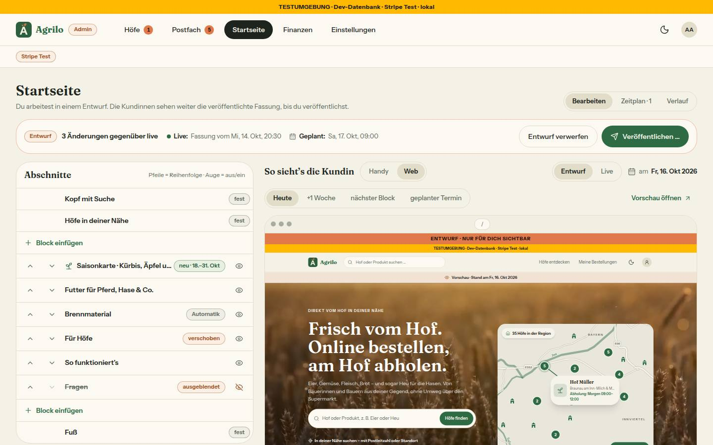
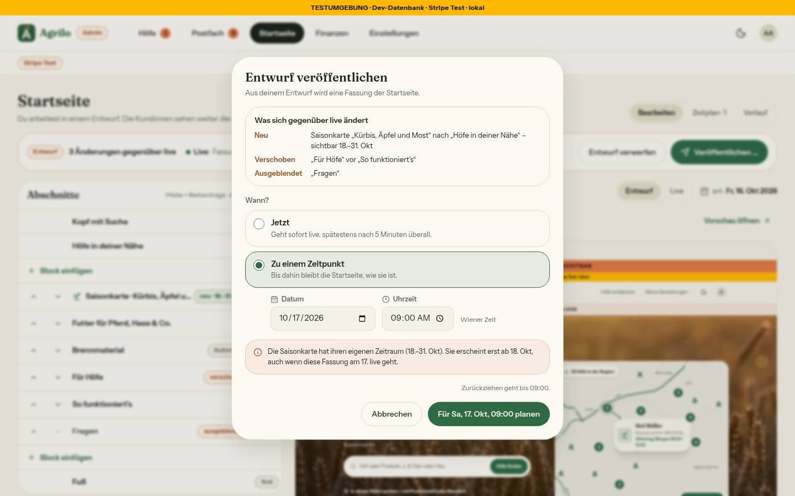
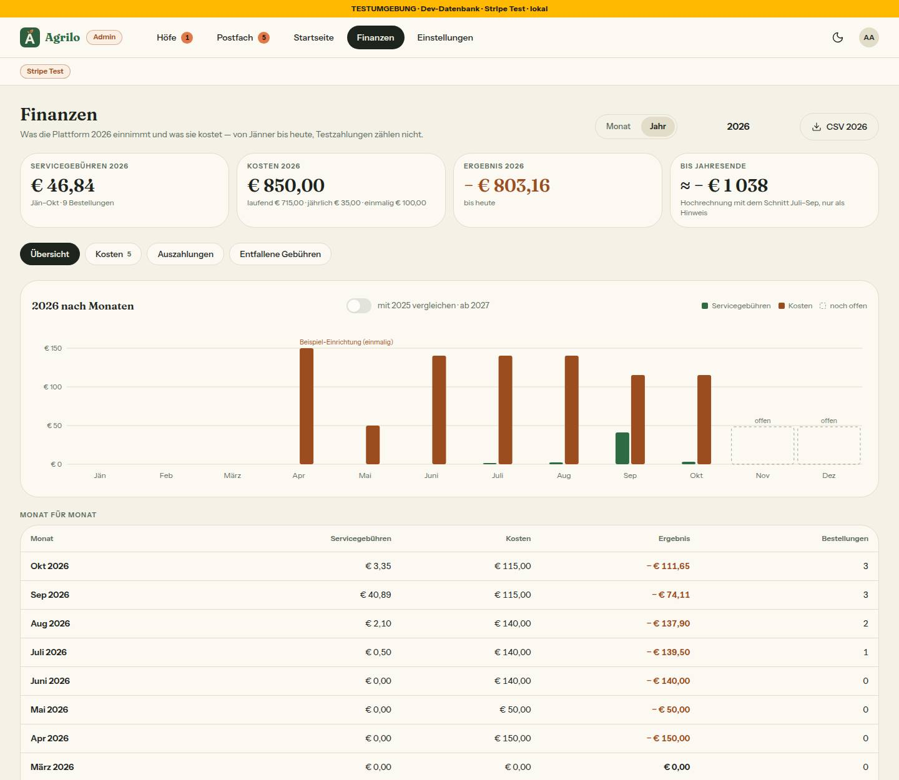
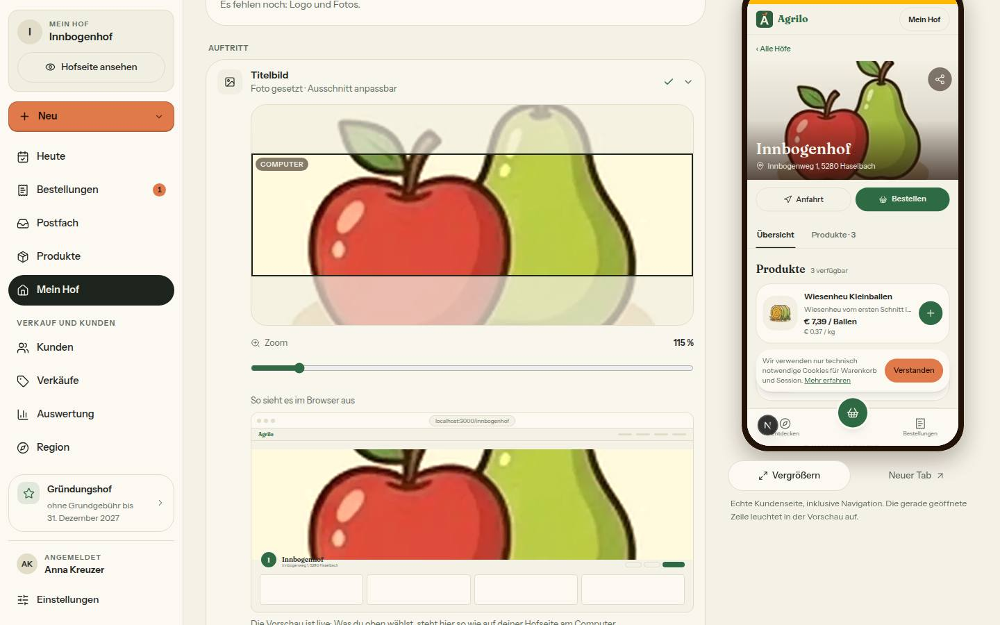
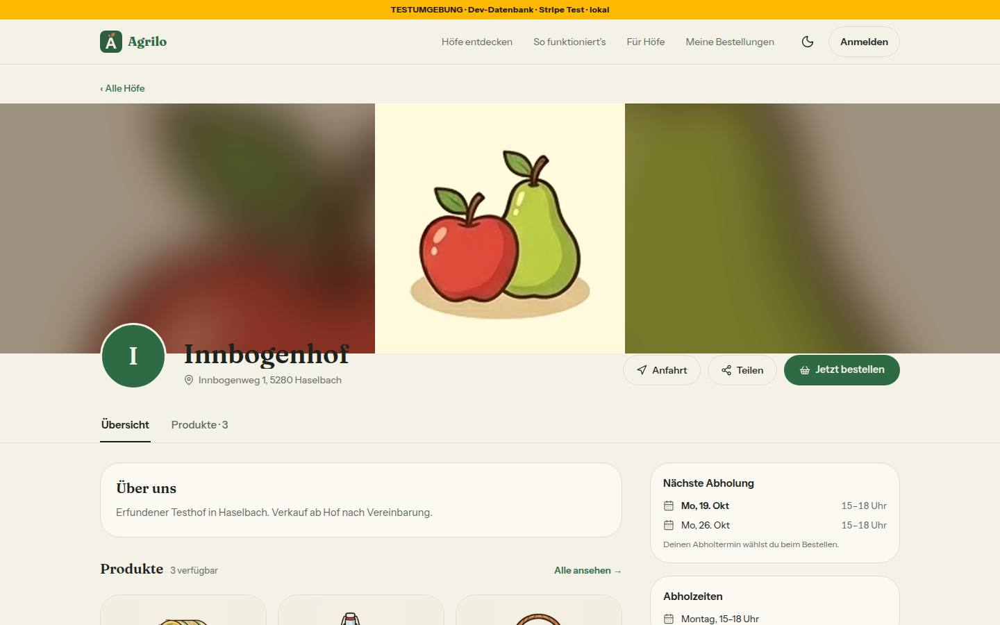
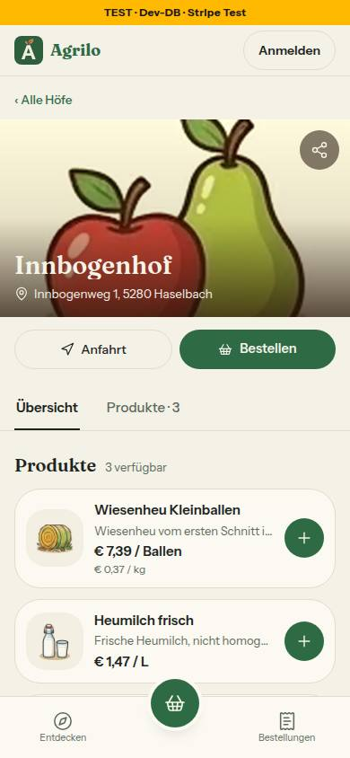
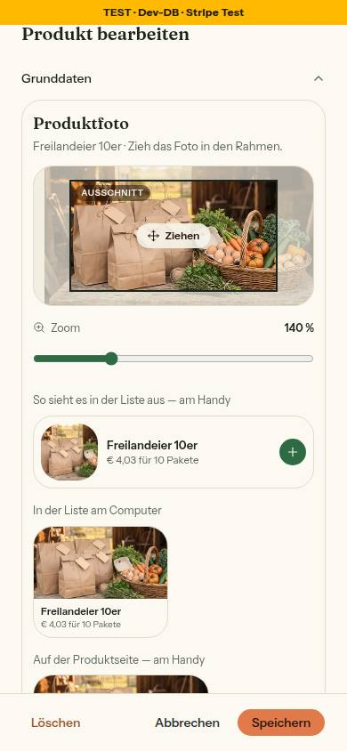

# Morgenbericht Nachtlauf 15 (16.10.2026)

Freigabe: `docs/nachtlauf/freigabe.md` §19 (im Chat erteilt am 15.10.2026). Dirigent nach `docs/nachtlauf.md`, Tempo nach Abschnitt 4a und §0 der Freigabe. Lauf 15 war ein fünfter Lauf: Nach dem Doku-PR kam die Regel-Inventur (Register G4, Abschnitt 4).

**Fehlende Mockups / übersprungene Nummern:** keine. Alle 24 Mockup-Dateien lagen vor (11 schon in `docs/mockups/`, 13 im Wurzelverzeichnis – per `git mv` verschoben); keine Nummer wurde übersprungen.

**Zwei Dinge, die du wissen solltest, bevor du weiterliest:**
1. **`pnpm test` war auf main seit deinem Upload 6010fde rot.** Die Telefonnummern-Wache las eine Ziffernfolge aus einem SVG-Pfad (Hügel im Beispielfoto) in den fünf Bild-Baustein-Mockups als Handynummer ohne 0. Die Mockups sind unverändert; die Wache hat im ersten Commit des Doku-PR je Datei eine Ausnahme mit Grund bekommen. Mit dem Merge von #290 ist main wieder grün.
2. **Der Rechner des Laufs ist dreimal neu gestartet** (gegen 02:20, 02:39 und 03:24). Verloren ging nichts Committetes; betroffen war nur Nr. 98 (Umsetzer zweimal neu begonnen, einmal fortgesetzt) und ein Integrationslauf des Sammel-Stands (wiederholt). Details im Abschnitt Tempo.

**Kurz:** Alle fünf Nummern (99, 101, 100, 97, 98) und der Doku-PR sind fertig; keine ist ein Entwurf, keine blieb liegen. Genau zwei Migrationen sind entstanden (99: `20261016100000_startseite_fassung`, 97: `20261016110000_bild_ausschnitt`), beide nur Expand, in dieser Reihenfolge gestapelt; beide liegen schon in der Entwicklungsdatenbank. Der Sammel-PR **#296** ist auf dem Gesamtstand grün:
- typecheck,
- **lint 0 Fehler** (5 Warnungen, wie main),
- 402 Testdateien / 8042 Tests, darunter Wortliste-, Hex-, Telefonnummern- und Namens-Wache,
- Integration 52 Dateien / 468 Tests (ein Test der 98 brauchte einen Nachtrag, Abschnitt 2),
- `pnpm illustrationen` 114/114,
- frische Datenbank mit allen 26 Migrationen, Schema = Migrationen.

**Vor dem Merge (wegen Nr. 99), bitte:** die Startseite in Produktion lesend prüfen (lassen) – sie muss im Standard stehen: 8 Abschnitte in Standard-Reihenfolge, alle sichtbar, 0 Blöcke. Ab dem Merge liest die Startseite die Live-**Fassung**; ohne Fassung zeigt sie die Standard-Reihenfolge – das ist genau der heutige Stand, also kein sichtbarer Wechsel. Stünde in Produktion etwas anderes (z. B. ein Block), würde die Startseite beim Deploy auf den Standard springen. **Bis zum Merge in Admin › Startseite nichts speichern.**

## 1. PRs

| Nr | Thema | PR | Basis | Migration | Runden · Durchgänge | Vorschau |
|---|---|---|---|---|---|---|
| Doku | Mockups verschoben, README, Freigabe §19, Register N13–N17, Wortliste, Warteschlange, Status (+ Wachen-Ausnahme) | #290 | main | nein | – · 1 Prüfung | [Vorschau](https://farmer-zone-git-docs-lauf15-bierbaron.vercel.app) |
| 99 | Startseite: Entwurf, Vorschau, Veröffentlichen jetzt oder geplant (N16 geändert) | #292 | Doku (#290) | **ja** – `20261016100000_startseite_fassung` | 1 · 2 volle Durchgänge | [Vorschau](https://farmer-zone-git-nacht-2026-10-1699-startseite-fassung-bierbaron.vercel.app) |
| 101 | Postfach › Meldungen: Stand-Band, Ablauf, Wünsche gebündelt, Zusammenfassen (N14 ergänzt) | #293 | Doku (#290) | nein | 2 · 2 volle Durchgänge | [Vorschau](https://farmer-zone-git-nacht-2026-10-16101-meldungen-bierbaron.vercel.app) |
| 100 | Admin › Finanzen: Jahresansicht, Monat für Monat, CSV (N15 ergänzt) | #291 | Doku (#290) | nein | 0 · 1 Durchgang (Export-Route gezielt) | [Vorschau](https://farmer-zone-git-nacht-2026-10-16100-finanzen-jahr-bierbaron.vercel.app) |
| 97 | Bild-Baustein und Titelbild: Ausschnitt, Zoom, füllen/ganz, sechs Filter (N13, N17) | #294 | 99 (#292) | **ja** – `20261016110000_bild_ausschnitt` | 1 · 2 volle Durchgänge | [Vorschau](https://farmer-zone-git-nacht-2026-10-1697-bild-baustein-bierbaron.vercel.app) |
| 98 | Bild-Baustein für Logo, Produktfoto, Galerie, Beitragsfoto (N17) | #295 | 97 (#294) | nein | 2 · 2 volle Durchgänge | [Vorschau](https://farmer-zone-git-nacht-2026-10-1698-bild-fotos-bierbaron.vercel.app) |
| Sammel | alle oben | #296 | main | ja (die zwei) | – | [Vorschau](https://farmer-zone-git-integration-lauf15-bierbaron.vercel.app) |

**Merge-Empfehlung:** Nur den **Sammel-PR** mergen, per **Merge-Commit** (nicht Squash); die Einzel-PRs gelten danach als gemergt. Einzeln in dieser Reihenfolge, jeweils per Merge-Commit: #290, dann #292, #293, #291, dann #294 (auf #292), zuletzt #295 (98, auf #294).

## 2. Sammel-PR

Branch `integration/lauf15` von `main` (6010fde), Merge-Reihenfolge wie in der Freigabe: docs/lauf15, 99, 101, 100, 97, 98, je `--no-ff`. Ein erster Zwischenstand (ohne 98) war um 02:05 grün (400 / 8003); danach kam 98 dazu.

**Konflikte und Auflösung:**
- docs/lauf15 und 99: ohne Konflikt.
- 101: `DEVELOPMENT.md` (beide hängen einen Abschnitt vor „Nützliche Befehle“ an) – beide behalten, 99 zuerst.
- 100: `DEVELOPMENT.md` (dasselbe, 100 nach 101) und `docs/ai/DESIGN_SYSTEM.md` (Admin-Liste): Zeile „Meldung entscheiden“ von 101 (neue Gewichtung der KI-Knöpfe), Zeile „Finanzen“ von 100 (Jahr) – je die geänderte Seite, gegen den Stand von docs/lauf15 geprüft.
- 97: `DEVELOPMENT.md` (97 bringt den Abschnitt von 99 schon mit) – Abschnitt 97 nach 100 angehängt.
- 98: ohne Konflikt.
- `pnpm bausteine` danach: keine Änderung – kein eigener Commit nötig; `tests/bausteine-verzeichnis.test.ts` prüft die Aktualität im vollen Lauf.

**Nachtrag auf 98 (e127d41, vom Dirigenten):** Der ganze Integrationslauf des Gesamtstands fand `hofseite-beitraege.int` rot: `getActiveStatusPosts` liefert seit 98 zusätzlich `fotoAusschnitt` (gewollt – die Hofseite zeigt den Ausschnitt des Beitragsfotos), der Test der erlaubten Felder kannte das Feld nicht. Der Umsetzer von 98 hatte nur seine eigene Integrationsdatei laufen lassen (für 98 war kein Integrationslauf verlangt). Eine Zeile im Test auf dem Branch von 98 (damit auch #295 grün ist), voller Lauf grün, erneut gemergt; danach 52 / 468 grün.

**Prüfungen auf dem Gesamtstand:** typecheck grün; `pnpm lint` 0 Fehler / 5 Warnungen; `pnpm test` 402 Dateien / 8042 Tests; `pnpm test:integration` (lokale Test-DB, unter Sperre) 52 / 468; `pnpm illustrationen` 114/114.

**Migrationen = Schema:** frische lokale Wegwerf-Datenbank (`frisch.sh`): 26 Migrationen sauber eingespielt, `prisma migrate status` „Database schema is up to date!“, zweiter `deploy` „No pending migrations“, `prisma migrate diff --from-config-datasource --to-schema prisma/schema.prisma` leer, RLS auf allen Tabellen, `StartseiteFassung` 0 Zeilen, die fünf Ausschnitt-Spalten vorhanden (Wegwerf-DB gelöscht). Dasselbe je Migration vor dem Push der Nummer (99: 25, 97: 26 Migrationen).

**Vorschau und Migrationen:** Jede Migration lief beim ersten Vorschau-Build ihrer Nummer über `vercel-build` (`prisma migrate deploy`) in die Entwicklungsdatenbank – nachgesehen beim Build von 97 (`dpl_CELdnqnDRiUxxiJQ8TAPBXFW15iJ`): „26 migrations found · Applying migration `20261016110000_bild_ausschnitt` · All migrations have been successfully applied“ (die von 99 lag damit schon vorher dort). **Den `migrate status` des Sammel-PR-Builds konnte ich nicht mehr lesen:** Die Verbindung zu Vercel war gegen Ende des Laufs weg (nach dem dritten Neustart). Erwartet ist „26 migrations found · No pending migrations to apply“ – bitte im Build-Log von #296 kurz nachsehen.

**Seiten auf dem Gesamtstand** (Dev-Server, lokale Test-DB, Seed): `/`, `/innbogenhof`, `/admin/startseite`, `/admin/finanzen?zeitraum=jahr`, `/admin/finanzen/export?jahr=2026`, `/admin/postfach?reiter=meldungen` (als Admin), `/farm-page` (als Hof) antworten mit 200; `/admin/meldungen/meldung-seed-1` mit **308** auf `/admin/postfach?art=meldung&meldung=…`; Serverprotokoll ohne Fehler. Ohne Fassung (0 in der Test-DB) zeigt die Startseite die Standard-Reihenfolge – belegt durch den Test `startseite-live` und den Integrationstest `startseite-fassung.int`.

## 3. Nicht begonnene Nummern

Keine. Alle fünf Nummern der Freigabe sind umgesetzt und geprüft, keine ist ein Entwurf; 98 ist nicht für Lauf 16 liegen geblieben.

## 4. Regel-Inventur (Register G4) – nur Vorschläge, gestrichen ist nichts

Sonnet, nur lesend, 25 von 45 Schritten; Quellen: `CLAUDE.md` §2, `CODING_STANDARDS.md` und `TESTING_GUIDELINES.md` ganz, `ARCHITECTURE.md` und `DESIGN_SYSTEM.md` per Grep nach „Niemals|Nie |Immer|Pflicht|verboten“. Die stärksten zuerst; „(wie Lauf 10)“ heißt: schon in der Inventur von Lauf 10 vorgeschlagen und seither nicht umgesetzt.

Stand der 18 Vorschläge aus Lauf 10: umgesetzt sind (5) Lint im Stop-Hook (`abschluss-pruefen.mjs` ruft `pnpm lint`) und (11) (`ARCHITECTURE.md:47` verweist auf BAUSTEINE). Alles andere ist offen und steht unten mit „(wie Lauf 10)“ oder mit neuen Belegen.

| # | Fundstelle | Grund | Vorschlag |
|---|---|---|---|
| 1 | `CODING_STANDARDS.md:128-130` (§4 Sentry; Z. 129 allein rund 8 400 Zeichen) | doppelt mit dem Kopfkommentar `src/lib/sentry-hygiene.ts:1-40`: die Absätze beschreiben die Mechanik des Moduls, keine Regel für Autoren; geprüft in `tests/sentry-hygiene-felder.test.ts`, `-vergleich`, `-wachstum`, `tests/beobachtbarkeit.test.ts` | zusammenlegen: etwa vier Regelzeilen bleiben (nur Kennungen in tags/extra, nie `cause`, neues Muster = Fall im Test, Mehrfund als letzter Schritt), Mechanik in den Modulkopf (wie Lauf 10) |
| 2 | `CLAUDE.md:75` (nie auf `main` committen) und `:79` (nie `git stash`) | der Hook `.claude/hooks/gefahr-blocken.mjs` kennt beides nicht; `tests/gefahr-blocken.test.ts` hat keinen Fall dafür | in Prüfung überführen: zwei Muster im Hook plus Fälle im Test, im Text je ein Satz (wie Lauf 10) |
| 3 | `CLAUDE.md:51` (nie `pull_request_target`) | nur für eine Datei abgedeckt: `tests/staging-workflow.test.ts` liest nur `staging-nachziehen.yml`; `ci.yml`, `briefkasten.yml`, `briefkasten-fallback.yml` ungeprüft (heute 0 Treffer) | in Prüfung überführen: ein Test über alle `.github/workflows/*.yml` mit Gegenprobe (wie Lauf 10) |
| 4 | `CLAUDE.md:43` (nie blindes `decrement`) | nur pfadweise getestet (`tests/checkout-kritisch.test.ts:445`, `tests/verkauf-vorrat.test.ts:138,153`); `src/` hat genau zwei `decrement`-Stellen, beide in `updateMany` mit `stock: { gte }` | in Prüfung überführen: Quelltext-Wache nach dem Muster von `tests/stripe-pflicht.test.ts`, mit Gegenprobe auf ein nacktes `decrement` |
| 5 | `TESTING_GUIDELINES.md:3-4`, `:163-169`, `:24`, `:245` | überholt: nennt 100 Dateien/~1 600 Tests und 5 Integrationsdateien (heute 388 und 49) und alte Mock-Zahlen; „keine weiteren Unterordner“ und „keine geteilte Fixture“ widersprechen `tests/fixtures/bausteine-beispiel` | Zahlen streichen; Fixture ins tmpdir-Muster oder Ausnahme nennen (wie Lauf 10, Vorschläge 10 und 12) |
| 6 | `CLAUDE.md:62` und §1 „Migration erstellen“; Hooktext `.claude/hooks/gefahr-blocken.mjs:22-24` | widersprüchlich: der Hook rät zu `pnpm db:migrate`, CLAUDE.md verlangt `migrate diff` (Regel 3) und sagt, `db:migrate` scheitere an Supabase; der Hook blockt `db push` überall, der Regeltext nur „gegen Produktion“ | schärfen: Hooktext auf `migrate diff` umstellen; Regel „Niemals `prisma db push` (der Hook blockt jeden Aufruf)“ |
| 7 | `CODING_STANDARDS.md:324` gegen `:254-255` und `CLAUDE.md:70` | widersprüchlich: Z. 254-255 verbieten Palette-Klassen wie `bg-slate-700`, Z. 324 zeigt `bg-amber-50 dark:bg-amber-950/40` als gutes Beispiel; 8 Dateien in `src/` nutzen Palette-Klassen; ESLint prüft nur Hex/rgb/oklch | schärfen: entscheiden, ob Palette für „Bedeutung ohne Marke“ gilt (dann Text anpassen) oder verboten ist (dann Wache mit Bestandsliste der 8 Dateien) |
| 8 | `CLAUDE.md:70`, `CODING_STANDARDS.md:254-257` und `:314-316`, `DESIGN_SYSTEM.md:625` (Hexfarben) | abgedeckt durch ESLint (`no-restricted-syntax` für Hex, `rgb(`, `oklch(` in `src/**`) und `tests/design-tokens.test.ts` (Hex-Wache, Kontrast ≥ 4,5:1 in beiden Modi); der Farbwert in DS:625 steht nirgends mehr in `src/` oder `tests/` | auf Verweis kürzen (wie Lauf 10); den Satz zum alten Farbwert streichen |
| 9 | `TESTING_GUIDELINES.md:117`, `:144-149` (Spuren auch in den anderen `docs/ai/`-Dateien) | widersprüchlich zu `CLAUDE.md` (Verlauf gehört in `DEVELOPMENT.md`): Vermerke wie „Regelvorschlag 71, Lauf 11; freigegeben 13.10.2026“; Zeilen mit „seit Nr.“/„Regelvorschlag“/„Lauf 1x“: TESTING 15, CODING 6, ARCHITECTURE 68, DESIGN_SYSTEM 125 | schärfen: Regeln ohne Herkunftsvermerk, Verlauf ins Tagebuch; Anfang bei Z. 144-149 |
| 10 | `CODING_STANDARDS.md:446-460` (§9 Checkliste) | doppelt mit `.claude/skills/pruefen/SKILL.md:21-54` und `CLAUDE.md` §1; Z. 448-449 mit einer verirrten Zeile | durch Verweis auf `/pruefen` ersetzen (wie Lauf 10) |
| 11 | `CLAUDE.md:66-67` (destruktive Migrationen, Spalte entfernen) | nur teilweise abgedeckt: `tests/migrationen-wache.test.ts` prüft nur NOT NULL; für `DROP COLUMN`, Typänderung und `DROP TABLE` kein Fall | in Prüfung überführen: Wache erweitern, die drei Fälle nur mit Marker `-- EXPAND-CONTRACT:` durchlassen |
| 12 | `CODING_STANDARDS.md:65` (Datums-Verbotsliste) | nur punktuell geprüft (`tests/heute.test.ts:359,381`, `tests/alte-seiten-neues-design.test.ts:402`); `src/` hat heute 0 Treffer für `setHours(0`, `getHours()`, `startOfWeek` | in Prüfung überführen: Selektoren im vorhandenen `no-restricted-syntax`-Block von `eslint.config.mjs` (wie Lauf 10); Z. 65 auf Verweis |
| 13 | `CODING_STANDARDS.md:15` („Verb zuerst“) | widersprüchlich zu den eigenen Beispielen (`wienKalendertag`, `abholtage`, `alsCents`, `bestellSummen`, `bildFormat`); Morgenbericht 10 meldete „Namen ohne Verb“ in vier Nummern | schärfen: Verb für Aktionen, Handler, Hooks; Lese- und Rechenfunktionen dürfen nach ihrem Ergebnis heißen |
| 14 | `CODING_STANDARDS.md:32-35` (§2 Typisierung; auch `:450`) | `any` und `@ts-ignore` abgedeckt durch ESLint (`no-explicit-any`, `ban-ts-comment` als Fehler); „Rückgabetyp explizit“ ist ungeprüft (mindestens 63 exportierte Kopfzeilen ohne Typ, Komponenten eingeschlossen) | Z. 32 auf einen Satz kürzen; Z. 34 schärfen (Komponenten ausnehmen) oder als Lint-Warnung nur für neue Dateien (wie Lauf 10) |
| 15 | `TESTING_GUIDELINES.md:114-117`, `:132-133`, `:136` | doppelt: siebenmal wird „Gegenprobe“ einzeln verlangt; die Wachen halten sie ohnehin (`tests/wortliste.test.ts`, `tests/staging-workflow.test.ts`) | zusammenlegen zu EINER Regel in §4; die langen Prüfstand-Absätze in die Kopfkommentare der Vorbild-Tests |
| 16 | `TESTING_GUIDELINES.md:45`, `:188`, `:227` | widersprüchlich: dreimal eine „einzige“ Ausnahme von „kein Test hängt an der Uhr“ | schärfen: eine Ausnahmenliste in §4, Z. 45 und 188 verweisen darauf |
| 17 | `CLAUDE.md:44-45` | doppelt mit `ARCHITECTURE.md:278` und `:251` | zusammenlegen: Einzeiler bleibt in CLAUDE.md, ARCHITECTURE verweist darauf (Lauf 10 dachte die Gegenrichtung – du entscheidest) |
| 18 | `CLAUDE.md:155-162` („Zwei Hooks“) | doppelt mit §2 und den Hook-Dateien und veraltet: die Aufzählung nennt `rm -rf` nicht, das der Hook blockt | auf Verweis auf die Hook-Konfiguration und `.claude/hooks/*.mjs` kürzen (wie Lauf 10) |
| 19 | `CLAUDE.md:54` (Seed-Konten) und `:55` (nie Claude in Chrome) | abgedeckt: Seed durch die Sperre in `prisma/seed.ts:16-27` und `tests/umgebung.test.ts`; Chrome durch die Sperre in der Projekt-Konfiguration (`deny: mcp__claude-in-chrome__*`) | auf Verweis kürzen, der Satz zu agent-browser bleibt (wie Lauf 10) |
| 20 | `DESIGN_SYSTEM.md:285`, `:189`, `:115`, `:53` | `:285` doppelt mit `:189`; `:189` abgedeckt durch `tests/leerzustaende-wache.test.ts`, `:115` durch `tests/fachwort-wache.test.ts`; `:53` nur teilweise (`tests/bildmarke.test.ts` prüft nur `bildmarke.tsx`) | Z. 285 streichen; Z. 115/189 auf Regel plus Testverweis kürzen; Z. 53 behalten oder globale Inline-SVG-Wache |

**Zu Morgenbericht 14 §8** (nicht freigegeben, nur bewertet)
- **93 (Wache `MAX_GRUENDUNGSHOEFE`/`GRUENDUNG_BIS_STANDARD`):** aufnehmen, als Prüfung (`tests/gruendung-seiten.test.ts`); scharf erst mit der Nacharbeit, sonst rot – oder mit Ausnahmeliste samt Grund nach dem Muster der Leerzustände-Wache.
- **94 (Bilder auf eigener DB-Kopie):** ändern – als Hinweis in `docs/nachtlauf.md` (Rahmen des Laufs), nicht in `docs/ai/`; Kopie nur aus Dev- oder Seed-Daten, nur auf localhost, nie aus Produktion.
- **95 (Admin- und Actions-Wache):** aufnehmen; der erste Teil ist halb da (`tests/admin-seiten-wache.test.ts` prüft sieben Seiten) – auf `route.ts` erweitern; die Wache über `src/server/actions/` braucht eine Ausnahmeliste mit Grund (öffentliche Token-Wege, drei Dateien ohne direkte Sitzung im grep).
- **96 (`sicherheits-header.test.ts`, `.next` löschen):** die Liste „einbettbar mit Parameter“ aufnehmen; „`.next` vor dem Start löschen“ ist Betriebsrahmen für `docs/nachtlauf.md`, keine Regel.
- **Dirigent (1) (ganze Integrationssuite bei Geldpfaden):** aufnehmen, mit fester Dateiliste (`orders.ts`, Webhook, `nach-der-antwort`) und Laufzeitangabe; Ort zusätzlich `.claude/agents/tester.md`.
- **Dirigent (2) (frische DB, `migrate deploy`, `--from-config-datasource`):** aufnehmen; nur gegen lokales Postgres; Regel 3 (`--from-schema`) und `CLAUDE.md` §1 angleichen.
- **Dirigent (3) (Abzweigen vom Umsetzungs-Commit des Vorgängers):** ändern – „nur eigene Dateien“ muss ein Prüfbefehl belegen (`git diff --name-only` der Runde); mit „eine Aufgabe je Branch“ und „gestapelte PRs per Merge-Commit“ abstimmen.

Gelesen: ganz `docs/ai/CODING_STANDARDS.md`, `docs/ai/TESTING_GUIDELINES.md`, `CLAUDE.md`; per Grep `docs/ai/ARCHITECTURE.md`, `docs/ai/DESIGN_SYSTEM.md`. Schritte: 25 von 45 (Sonnet).

## 5. Regelvorschläge aus den Berichten, gesammelt (Prüfung vor Textregel; eingetragen erst nach deiner Freigabe)

- **99:** Ein Client mit automatischem Speichern übernimmt neue Props nach dem ersten Rendern nie still, nur aus einer Action-Antwort (`revalidatePath` auf die eigene Seite hätte offene Eingaben mitten im Speichern zurückgesetzt). Prüfung: Prüfstand-Test „neue Props → Liste bleibt“; Ort ARCHITECTURE §4.
- **101:** Integrationstests räumen Zeilen, die an einer Konto-Kennung hängen, über die gemerkten Kennungen auf (Better Auth vergibt Kennungen ohne `int-`; ein Rundschreiben blieb in der Test-DB liegen). Prüfung: Zählung vor/nach dem Lauf in `raeumeAuf`; Ort TESTING_GUIDELINES §5.
- **100:** Quelltext-Test „kein `<Link>` im `<svg role="img">`“ (Axe `nested-interactive` fiel erst in der Bilderstrecke auf). Ort `tests/`.
- **97:** In Bildprüfungen nur das Fenster scrollen (`window.scrollTo`), nie `scrollIntoView` auf Kinder abgeschnittener Kästen (verschob die Bühne und täuschte einen Layoutfehler vor). Ort: Rahmen „Bilder“ des Laufs.
- **98:** `pnpm exec prettier --write` ohne Projektkonfiguration schrieb eine Datei mit fremden Vorgaben um (700 Zeilen Diff, von Hand zurückgeholt). Gegenmaßnahme: `gefahr-blocken.mjs` blockt `prettier --write`, solange das Projekt keinen Formatierer hat. Ort `.claude/hooks`.
- **Dirigent:** (1) **Workflow-Parallelität:** Ein Workflow lässt auf diesem Rechner (4 Kerne) nur zwei Agenten gleichzeitig laufen – drei parallele Nummern brauchen drei Workflows (eine Nummer je Workflow). Ort: `docs/nachtlauf.md` 4a. (2) **Mockup-Uploads direkt auf main** laufen an der CI vorbei und machten `pnpm test` rot; Vorschlag: die Telefonnummern-Wache überspringt SVG-Pfaddaten (`d="…"`) grundsätzlich (Prüfung statt Ausnahmeliste) – oder Uploads über einen PR. Ort `tests/telefonnummern-wache.test.ts`. (3) **Neustarts des Rechners:** Umsetzer sichern größere Zwischenstände als `WIP:`-Commit (bei 98 rettete das die Arbeit); Ort: Rahmen des Laufs.

## 6. Tempo

Zeiten in Wiener Zeit (15./16.10.2026).

| Nr | Beginn | Ende (PR) | Runden | volle Testläufe | Bilder |
|---|---|---|---|---|---|
| Doku | 23:00 | 23:27 (#290) | – | 3 (+2 für Status-Commits) | 0 |
| Regel-Inventur | 23:28 | 23:33 | – | – | – |
| 100 | 23:47 (erster Start 23:35) | 00:26 (#291) | 0 | 1 | 2 |
| 99 | 23:47 (erster Start 23:35) | 01:06 (#292) | 1 | 2 + ganze Integrationssuite (Dirigent) | 4 |
| 101 | 23:47 (erster Start 23:35) | 01:44 (#293) | 2 | 3 + ganze Integrationssuite (Dirigent) | 5 |
| 97 | 01:05 | 02:17 (#294) | 1 | 2 + ganze Integrationssuite (Dirigent) | 6 |
| 98 | 02:17 (neu 02:25 und 02:46, fortgesetzt 03:27) | 04:18 (#295) | 2 | 3 | 7 |
| Sammel | 02:05 (Zwischenstand), 04:20 | 04:35 (#296) | – | 2 + ganze Integrationssuite | – |

**Was aus 4a nicht einzuhalten war:**
- **Parallelität:** Der erste Start von Welle 1 (23:35) lief als EIN Workflow mit drei Nummern. Der Workflow lässt auf diesem Rechner (4 Kerne) nur zwei Agenten gleichzeitig laufen – 100 stand in der Warteschlange, und später hätten die Prüfungen von 99 hinter ihr gewartet. Nach rund zehn Minuten gestoppt und als drei Workflows neu gestartet (23:47); die Teiländerungen der ersten Umsetzer von 99 und 101 wurden geprüft übernommen.
- **Neustarts des Rechners** (02:20, 02:39, 03:24; jeweils VM frisch hochgefahren, lokale Datenbank aus): Der Umsetzer von 98 begann zweimal neu (beim zweiten Mal mit geprüfter Übernahme der Teiländerungen), dann sicherte er einen `WIP:`-Commit; nach dem dritten Neustart lief der Workflow aus dem Cache weiter (Umsetzung erhalten, tester und Prüfung neu). Ein Integrationslauf des Sammel-Zwischenstands brach ab und wurde am Ende wiederholt. Um Platz und Last zu sparen, sind die Worktrees von 99/100/101 nach ihren PRs entfernt worden (frei: 8,5 → 15 GB). Committetes ging nicht verloren.
- **Bilder:** Jede Nummer nahm nur ihre Bilder auf (ein Durchgang, hell); eine eigene Strecke auf dem Gesamtstand gab es nicht – die Bilder unten stammen aus den Nummern und zeigen deren geprüften Stand.

## 7. Bilderstrecke (hell)

Aus den Nummern, hell (die Bilder liegen im Sammel-PR unter `docs/nachtlauf/berichte/bilder/<nr>/`):

- **Admin › Startseite mit Entwurf und Statusleiste (1440)** und **Dialog Veröffentlichen (1440)** – 99:  
- **Finanzen › Jahr (1440)** – 100: 
- **Postfach › Meldungen: Ablauf und Wünsche gebündelt (1440), am Handy (390)** – 101:   
- **Hof › Meine Meldungen mit „Bereits bekannt · Behoben“ (390)** – 101: 
- **Titelbild-Baustein am Computer und im Blatt** – 97:  
- **Hofseite mit „Ausschnitt füllen“ und „Ganz zeigen“ (1440) und am Handy (390)** – 97:   
- **Produktfoto im Blatt (390)** – 98: 

Weitere Bilder je Nummer (Zeitplan, Dialog Zusammenfassen, Finanzen am Handy, Produktkarte/-seite, Logo-Baustein) stehen in den Berichten und PRs.

## 8. Für dich zu bestätigen (aus den PRs)

- **99:** (1) Die Quelle der Vorschau (`entwurf|live|fassung:<id>`) steckt im signierten Inhalt statt in einem eigenen Parameter `quelle=` – damit ist sie in die Signatur einbezogen. (2) Eine Planung und das Zurückziehen leeren nur den Datencache (`updateTag`); die Seite holt den neuen Stand mit `revalidate 300`, die Abfrage liest ab dem Termin an der Datenbank vorbei („bis zu 5 Minuten“ hält). (3) „· gespeichert hh:mm“ erscheint erst nach der ersten Speicherung der Sitzung (ohne zweite Schema-Änderung gibt es keinen Zeitstempel für den Entwurf). (4) Der 17.10.2026 ist ein Samstag; Mockup und Freigabe schreiben „Fr“ – die Seite schreibt den echten Wochentag.
- **101:** (1) Bescheid an die Höfe braucht eine Antwort (der Text der Nachricht); ohne Antwort bleibt nur „Niemanden“. (2) Ablegen verlangt die Antwort im Dialog; `triageMeldungAction` bleibt laut Freigabe unverändert und prüft das nicht. (3) Grenzerweiterung Doku: der Postfach-Absatz in DESIGN_SYSTEM ist neu geschrieben (sonst stünde dort, `?reiter=meldungen` leite in den Eingang).
- **100:** Die Regel-Zeile sagt „jährliche sind auf die zwölf Monate umgelegt“ statt (Mockup) „jährliche und einmalige in ihrem Monat“ – `kostenImMonat` legt Jahresposten um, und die Freigabe verlangt dieselben Funktionen wie im Monat. Mockup-Satz anpassen oder Rechnung ändern (eigener Auftrag)?
- **97:** (1) Die Browser-Vorschau steht auch am Computer in der Zeile – die große Vorschau rechts (iframe) zeigt den Ausschnitt erst nach dem Speichern. (2) „Zurücksetzen“ stellt auch die Wahl füllen/ganz auf „ohne Wahl“. (3) `updateBannerFocusAction` ist ohne Aufrufer und zum Löschen vorgemerkt; Contract von `Farm.bannerFocusY` später (eigene Freigabe).
- **98:** (1) Der Baustein steht im Fotofeld des Produktdialogs statt in einem eigenen Blatt – der Dialog ist am Handy schon das Blatt, ein zweites würde Name und Preis verdecken. (2) Im Produktdialog heißt der Knopf im Baustein „Übernehmen“; gespeichert wird mit dem Produkt. (3) Galerie-Serie: der Baustein öffnet einmal, für das erste Foto. (4) Der Fotostreifen auf /hoefe (Titelbild, Galerie, Produkt gemischt) bleibt Rohfoto.
- **Doku-PR:** Zwei Wortlisten-Beispiele stammen aus der Freigabe statt aus dem Mockup („Ausschnitt anpassen“, „Im Entwurf gespeichert · 20:41“) – die Nummern bauen genau diese Texte.
- **Dirigent – Grenzerweiterungen:** 101 schrieb den Postfach-Absatz in DESIGN_SYSTEM neu (Doku); 98 bekam vier Dateien dazu (`mein-hof/abschnitt-inhalt.tsx`, `hofseite/bildansicht.tsx`, `products/lebensmittel-vorschau.tsx`, `shared/bild-ausschnitt.tsx` aus Nr. 97 – runder Logo-Rahmen, „Passt so“, Vorschau-Paare; dazu neu `src/lib/bild-rahmen.ts` und Typzeilen in `bereiche-anzeige.ts`/`hofuebersicht.ts`). Keine andere Nummer berührte diese Dateien.

## 9. Nacharbeit („Sollte“/„Kann“), gesammelt

- **99:** zwei Unit-Tests und drei Stellen im Integrationstest hängen an der Systemuhr (`Date.now()`) → `vi.setSystemTime` mit festem Datum; der Komponententest prüft Hook und Text, nicht die gerenderte Statusleiste; der Zeitplan liest höchstens 50 Fassungen (bei 50 künftigen Planungen fiele die Live-Fassung aus dem Vergleich); das Band der Startseite selbst („Vorschau · Stand am …“, `page.tsx`) nennt die Quelle nicht; Axe 1440 mit Vorschau-Rahmen: 1 moderat `landmark-unique` (die eingebettete echte Startseite bringt eigene Landmarken mit).
- **101:** `setzeBuendelStandAction` – scheitert das Rundschreiben nach der gespeicherten Transaktion, fehlen `revalidatePath` und die Kundinnen-Mail; die Fremdtext-Wache prüft nur die Dateien der Nummer (nicht `src/server/actions/meldung.ts`, `/api/triage/status`); Stand-Band am Handy mit Karte und Summe statt nur Balken und Legende; Kette Duplikat → Duplikat nur vor dem Schreiben geprüft; erneutes Speichern eines Bündels setzt die 90-Tage-Uhr neu, `sprintName` bleibt bei Rückstufung stehen; Cast in `meldungenAnsichtAus`; `ersterWert` doppelt; `BriefkastenLaden`/`MeldungLaden` ohne Aufrufer; schmale Action „Ablegen“ mit Pflicht-Antwort (Folgeauftrag).
- **100:** zwei Tests rechnen Erwartungswerte mit `Number(…) * 100` bzw. `toNumber() * 100` statt ganzzahlig; Obergrenze des Jahres zusätzlich zu Zod in `jahrImBereich`; Testzahlungs-Hinweis berücksichtigt das Vorjahresfenster auch ohne Vergleich; `csvBetrag` nach `format.ts`; vorbestehend: Axe `aria-progressbar-name` am Fortschrittsbalken der Monatsansicht.
- **97:** DESIGN_SYSTEM Titelbild nennt für die Kopie noch `blur-[28px]` und „denselben Fokuspunkt“; Pfeiltasten verschieben auch auf einer Achse ohne Spiel (unsichtbar bis zum Zoomen); `useBildmasse` liegt in der Hofseiten-Komponente.
- **98:** Beitrag – wird bei offenem Baustein ein neues Foto hochgeladen, bleibt die alte Wahl stehen (`key={photoUrl}`); der Platz-Test rechnet mit 96 px Mindestbreite, die Listen-Zeile braucht 132 px (im Bild ist der Name in der Handy-Liste der Vorschau abgeschnitten); das kleine Logo in der Titelbild-Vorschau von Mein Hof ohne Ausschnitt; Kommentar „nur das Titelbild frei“ in `src/schemas/bild-ausschnitt.ts` veraltet, `BILD_AUSSCHNITT_TEXT.nochNicht` ohne Verwendung; nach „Passt so“ ein zweiter Toast beim Logo; neues Logo setzt den Ausschnitt in einem zweiten Aufruf zurück (im selben Update in `updateFarmLogoAction` wäre es atomar).
- **Doku-PR / Dirigent:** Code-Kommentare mit Namen gelöschter Mockups (Liste aus Lauf 14) stehen weiter; Contract `Farm.bannerFocusY`; `updateBannerFocusAction` löschen.

## 10. Für dich zu tun

**Vor dem Merge (wegen 99):** Startseite in Produktion lesend prüfen (lassen): 8 Abschnitte, alle sichtbar, 0 Blöcke. Bis zum Merge in Admin › Startseite nichts speichern.

**Abnahme in der Vorschau, je Nummer** (aus „Fertig, wenn“; die Vorschauen teilen sich die Entwicklungsdatenbank – beide Migrationen sind dort schon eingespielt):
- **99** (`/admin/startseite`): Auge bei „Fragen“ aus → Statusleiste „1 Änderung“; Vorschau „Entwurf“ ohne Fragen, „Live“ und die echte Startseite (anderer Browser) mit Fragen. „Veröffentlichen …“ → Zu einem Zeitpunkt, in 10 Minuten → bis dahin unverändert, danach (≤ 5 min) ohne Fragen. Eine zweite Planung → Zeitplan → Zurückziehen → bleibt aus. Verlauf → frühere Fassung „Als Entwurf übernehmen“ → Entwurf = alte Reihenfolge. Am Handy (375 px) dieselben Schritte über die Leiste unten.
- **100** (`/admin/finanzen?zeitraum=jahr`): Jahr 2026 = Summe der Monate (zwei Monate von Hand nachrechnen; im PR stehen September und Oktober nachgerechnet); „CSV 2026“ in Excel öffnen – Umlaute, Beträge mit Komma; Klick auf einen Balken öffnet den Monat; am Handy stapeln die Kennzahlen, die Tabelle scrollt im Kasten.
- **101** (`/admin/postfach?reiter=meldungen`): „Ja, ein Wunsch“ → Karte unter Gesammelt, im Toast „Rückgängig“ → zurück. Zwei Meldungen zusammenfassen → Duplikat verschwindet aus Neu, Bündel zählt eine Stimme mehr, der Hof sieht „Bereits bekannt“; Hauptmeldung auf Erledigt → der Hof des Duplikats sieht „Bereits bekannt · Behoben“. Wünsche gebündelt → Bündel auf „Geplant · Nr. 97“ mit Bescheid → je Testhof eine Nachricht im Hof-Postfach. Am Handy Chips statt Spalten.
- **97** (`/farm-page` als Hof mit quadratischem Titelbild): „Ausschnitt anpassen“ → ziehen, Zoom, Filter, „Ausschnitt füllen“, Speichern → Hofseite am Computer füllt die Breite im gewählten Ausschnitt, am Handy derselbe Fokus; „Ganz zeigen“ → wie heute; ein Hof ohne Wahl → unverändert. Am Handy im Blatt ziehen, zoomen, filtern mit dem Finger.
- **98:** (`/products` als Hof, am Handy 375 px und am Computer): Produktfoto hochladen → der Baustein öffnet einmal von selbst („Passt so“ speichert wie heute) → Ausschnitt und Filter wählen, „Übernehmen“, Produkt speichern → Produktkarte, Produktseite und Hofseite zeigen es so, Warenkorb und Kasse das Rohfoto; Logo: runder Rahmen, keine Filterwahl, rund überall auf Hofseite, Mein Hof und /hoefe; Galerie-Kachel mit Ausschnitt, die große Bildansicht zeigt das ganze Foto mit Filter; Beitrag mit und ohne Ausschnitt (ohne: ganz wie bisher).

**Entscheidungen für Lauf 16:**
- Offen aus Morgenbericht 14 §9: Zusagen je Hof festschreiben und Aufrufer umstellen (eine Migration); Link `/settings/konditionen` statt `/konditionen` (93); Aufgabe „Erstattung offen“ – Knopf „Erstattung erledigt“ oder offenen Betrag speichern (95); Drossel für die Mail „Ein Hof hat geantwortet“ (95); Satz für zu kleine Bilder in `image-upload.tsx` (96); Inhalte für „Auszahlungen“ und „Entfallene Gebühren“ (94); K3-Messfühler „Frage per E-Mail“; SEPA-Monatsabrechnung ab 1.2.2027. (Erledigt seit Lauf 14: K2-Fußnote und Zusage-Wortlaut mit #289, README-ADMIN-Absatz mit dem Doku-PR.)
- **Folgefrage aus 101 Punkt 10:** KI-Vorschläge „Duplikat“ und „kein Fehler“ samt Antwortentwurf, Bündel-Stichwort und Bündel-Zusammenfassung brauchen ein Feld für den Vorschlag (Vorschlag `Meldung.kiVorschlag Json?`, Expand) und eine Änderung am kurator (WRITE-Token, nur vorschlagen); angewandt per Klick – eigene Nummer?
- Die Regel-Inventur (Abschnitt 4) und die Regelvorschläge (Abschnitt 5): welche freigeben?
- Contract `Farm.bannerFocusY` und Löschen von `updateBannerFocusAction` (97).

## 11. Wo die Bilder liegen

Je Nummer unter `docs/nachtlauf/berichte/bilder/<nr>/` (im Sammel-PR alle zusammen): 99 (4), 100 (2), 101 (5), 97 (6), 98 (7).
