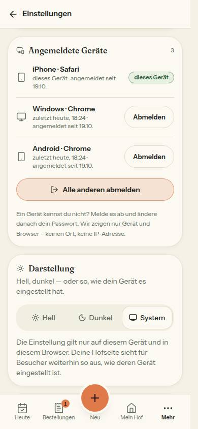
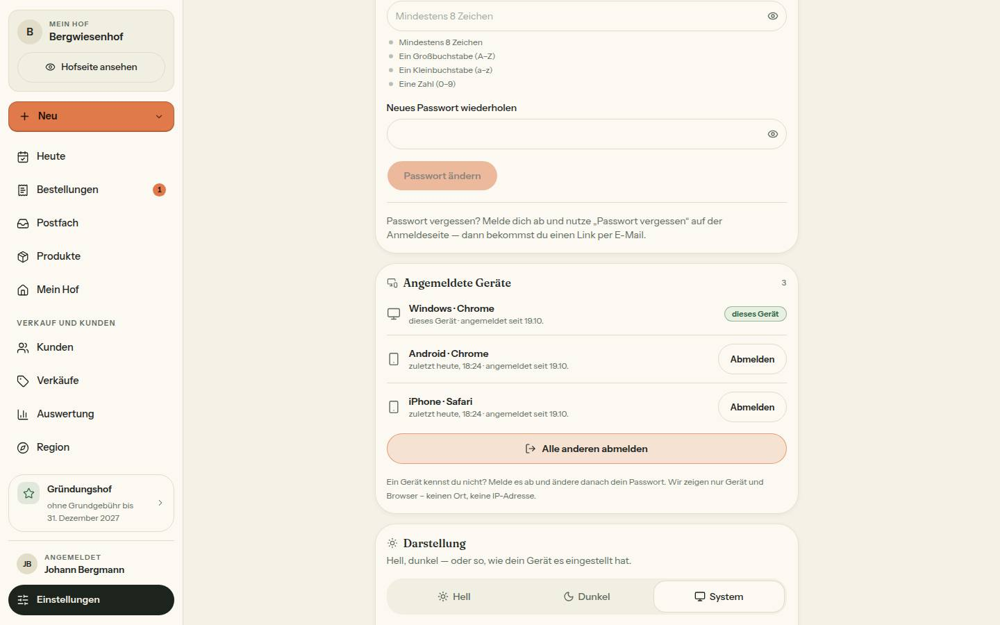
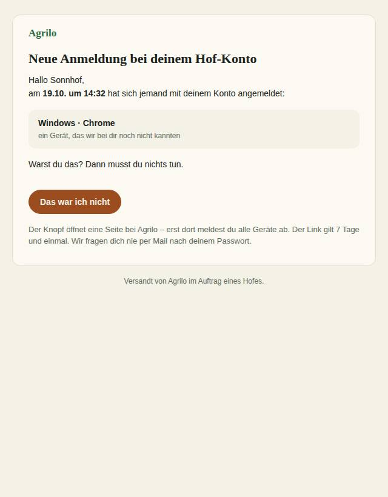
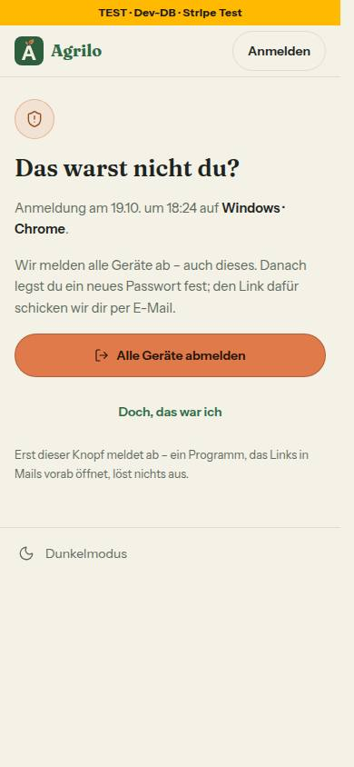
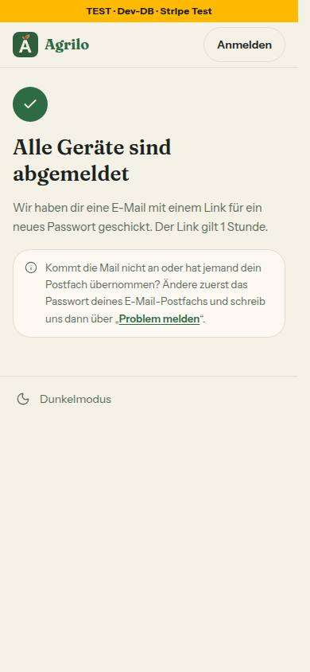
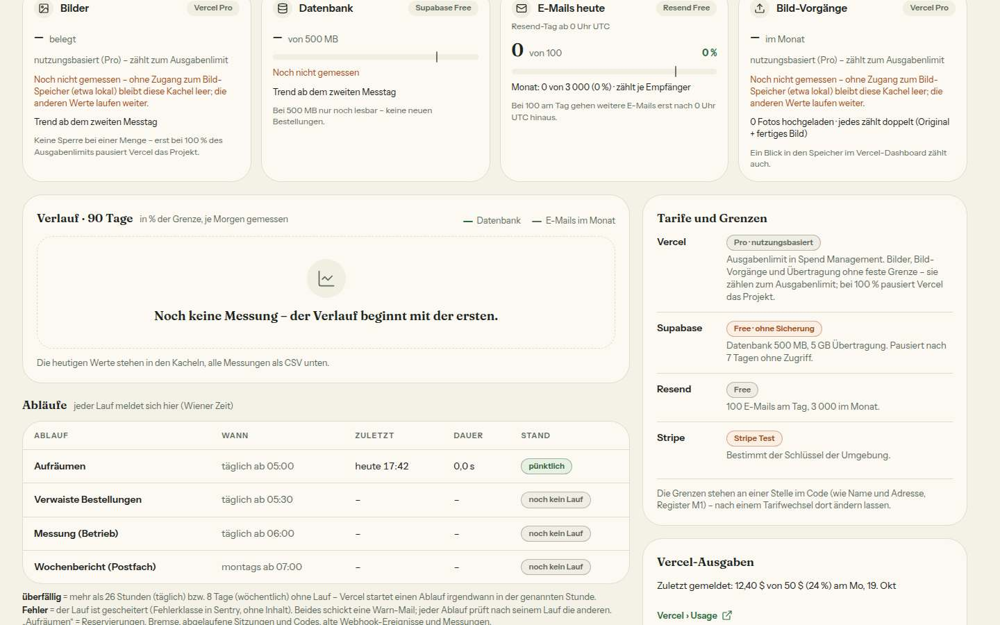

# Morgenbericht Nachtlauf 17 (19.10.2026)

Freigabe: `docs/nachtlauf/freigabe.md` §21 (im Chat erteilt am 19.10.2026). Dirigent nach `docs/nachtlauf.md`, Tempo nach Abschnitt 4a und §0 der Freigabe. Lauf 17 war kein fünfter Lauf (keine Regel-Inventur).

**Fehlende Mockups / übersprungene Nummern:** Keine Mockups fehlen. Alle vier Dateien des Uploads lagen schon in `docs/mockups/` (kein Verschiebe-Commit). **111 entfiel:** Der Fix „Filter-Falle auf /hoefe“ lief vorher allein (#307, gemergt 19.10.), `src/app/robots.ts` war auf main und /hoefe ohne `force-dynamic` – 117 zweigte deshalb von `docs/lauf17` ab. **115 gestoppt** (Entwurf, für Lauf 18): `pnpm install` für `@better-auth/passkey` hat der Berechtigungsfilter dieser Sitzung abgelehnt („Untrusted Code Integration“) – genau der STOPP-Fall der Freigabe. Nicht wiederholt, nicht umgangen; keine Migration `20261019220000_admin_passkey` angelegt oder gepusht.

**Kurz:** 112, 113, 114, 116, 117, 118 und der Doku-PR sind fertig, keine davon ist ein Entwurf. Zwei der drei geplanten Migrationen sind entstanden, beide nur Expand, ohne Seed, ohne Datenänderung: `20261019200000_gruendung_aktion` (116) und `20261019210000_geraete` (114). Beide liegen schon in der Entwicklungsdatenbank (Vorschau-Builds). Kein neues Paket. Der Sammel-PR **#315** ist auf dem Gesamtstand grün:
- typecheck,
- **lint 0 Fehler** (5 Warnungen, wie main),
- 454 Testdateien / 8836 Tests,
- Integration 60 Dateien / 533 Tests (ganzer Lauf),
- `pnpm illustrationen` 114/114,
- frische Datenbank mit allen 30 Migrationen, Schema = Migrationen.

## 1. PRs

| Nr | Thema | PR | Basis | Migration | Paket | Runden · Durchgänge | Vorschau |
|---|---|---|---|---|---|---|---|
| Doku | Freigabe §21, Register E7/K2/N20 (N19 stand schon), Wortliste, Mockup-README, Warteschlange, Status | #308 | main | nein | nein | – · 1 Prüfung | [Vorschau](https://farmer-zone-git-docs-lauf17-bierbaron.vercel.app) |
| 112 | Code- und Passwort-Raten je Adresse bremsen (E7) | #310 | Doku | nein | nein | 3 + Nachtrag Dirigent · 2 volle Durchgänge, Integration | [Vorschau](https://farmer-zone-git-nacht-2026-10-19112-code-bremse-bierbaron.vercel.app) |
| 116 | Aktion „100 Gründungshöfe“ und Abzeichen (K2) | #311 | Doku | **ja** – `20261019200000_gruendung_aktion` | nein | 3 · 2 volle Durchgänge, Integration | [Vorschau](https://farmer-zone-git-nacht-2026-10-19116-gruendung-aktion-bierbaron.vercel.app) |
| 117 | SEO-Grundlagen und echte 404 | #309 | Doku | nein | nein | 2 · 1 Durchgang (gezielt) + sichter zweimal | [Vorschau](https://farmer-zone-git-nacht-2026-10-19117-seo-404-bierbaron.vercel.app) |
| 113 | Betrieb: Lebenszeichen von außen, Vercel Pro, Vercel-Ausgaben (N18) | #312 | Doku | nein | nein | 1 · 1 Durchgang (gezielt) | [Vorschau](https://farmer-zone-git-nacht-2026-10-19113-lebenszeichen-bierbaron.vercel.app) |
| 114 | Angemeldete Geräte, frische Sitzung, Mail bei neuem Gerät (E7) | #313 | 112 (#310) | **ja** – `20261019210000_geraete` | nein | 1 · 2 volle Durchgänge, Integration | [Vorschau](https://farmer-zone-git-nacht-2026-10-19114-geraete-bierbaron.vercel.app) |
| 115 | Admin nur mit Passkey (N20) | – (Entwurf) | 114 | nein (nicht angelegt) | gesperrt | – | – |
| 118 | Reste aus 110, freigegebene Regelvorschläge, Kleinkram | #314 | Zwischenstand `integration/lauf17` | nein | nein | 2 + 2 Nachträge Dirigent · 1 Durchgang | [Vorschau](https://farmer-zone-git-nacht-2026-10-19118-reste-bierbaron.vercel.app) (Tests, Hook, Lint, Doku, ein Knopf) |
| Sammel | alle oben außer 115 | #315 | main | ja (die zwei) | nein | – | [Vorschau](https://farmer-zone-git-integration-lauf17-bierbaron.vercel.app) |

Alle Einzel-PRs waren in der CI grün (ci, integration, Vercel-Vorschau). Zwei Besonderheiten:
- **#314 (118) zeigt GitHub als „gemergt“**: Sein Kopf-Commit steckt seit dem Merge in `integration/lauf17` (e64abd6) – der Branch ist die Basis von #314. Es ist nichts auf main gelandet; 118 kommt mit dem Sammel-PR.
- **#313 (114) meldet einen Konflikt mit seiner Basis**: 112 bekam nach dem Abzweig von 114 noch Runde 3 und den Nachtrag; beide ändern denselben Punkt in `docs/ai/ARCHITECTURE.md`. Im Sammel-PR ist das gelöst (ded831e). Wichtig nur, wenn du einzeln mergst.

**Merge-Empfehlung:** Nur den **Sammel-PR #315** mergen, per **Merge-Commit** (nicht Squash); die Einzel-PRs gelten danach als gemergt. Einzeln ginge es nur in dieser Reihenfolge, jeweils per Merge-Commit: #308, dann #310, #311, #309, #312, dann #313 (auf #310, nach Lösen des ARCHITECTURE-Konflikts), zuletzt 118 (liegt auf dem Zwischenstand aller anderen). 115 gehört in keinen Merge.

## 2. Sammel-PR

Branch `integration/lauf17` von `docs/lauf17` (91dea05), Merge-Reihenfolge je `--no-ff`: 112, 116, 117 (18:51), Nachträge des Dirigenten (1ba0fde), 113 (19:08), 114 (19:28), Bausteinverzeichnis (2044c03 – Zwischenstand, von dem 118 abzweigte), angepasste Integrationstests (89e07d0, b3f0c75), zuletzt 118 (e64abd6, 21:25).

**Konflikte und Auflösung:**
- 112, 116, 117: `DEVELOPMENT.md` (angehängte Abschnitte) – beide Seiten in Merge-Reihenfolge.
- 113: `docs/ai/ARCHITECTURE.md` – mit `git show --cc` angesehen (Regel Dirigent (2)), von Hand gelöst: die neue Zeile von 113 und die Fassung der Gründungs-Absätze von 116. 113 ändert dort nur seine eine Zeile.
- 114: `docs/ai/ARCHITECTURE.md` – Fassung „Fehlversuche je Adresse“ aus 112 (Runde 3) behalten, dazu der neue Punkt „Sitzung frisch“ von 114.
- `docs/ai/BAUSTEINE.md` – nie von Hand, `pnpm bausteine` nach 114 (2044c03); nach 118 erneut erzeugt, ohne Änderung.
- 118: ohne Konflikt.

**Was erst zusammen rot war (ohne Textkonflikt), behoben im Sammel-PR:**
- 1ba0fde: `hofName={farm.name}` an `<Titelbild>` in `hofseite-kunde.tsx` (Alt-Text „Titelbild von …“ aus 117 – der Kopf der Datei gehörte 116); `seo.ts` nimmt `IM_SHOP_WHERE` aus 116 statt einer eigenen Kopie (eine Quelle für „im Shop“); das Test-Beispiel in `tests/hofseite-404.test.ts` um die neuen Felder aus 116. Nach dem Merge von 116 musste der Prisma-Client neu erzeugt werden.
- 89e07d0: Der **ganze** Integrationslauf auf dem Zwischenstand hatte 5 rote Tests. `account-adresse` und `email-bestaetigung` setzten einen veralteten Sitzungs-Zwischenspeicher im Cookie voraus, den 114 abschaltet (jetzt: frische Sitzung, die Prüfung bleibt gleich streng); `betrieb.int` nahm die Warnstufe der Bilder, die unter Vercel Pro (113) keine Grenze mehr haben (jetzt: die Grenze der Datenbank). Danach 60 / 533 grün.

**Prüfungen auf dem Gesamtstand (e64abd6 und der Stand mit diesem Bericht):** typecheck grün; `pnpm lint` 0 Fehler / 5 Warnungen; `pnpm test` 454 Dateien / 8836 Tests; `pnpm test:integration` (lokale Test-DB, unter Sperre) 60 / 533; `pnpm illustrationen` 114/114. Der pruefer hat den letzten Nachtrag zu 118 (d323058) ohne Blocker abgenommen (jede Hook-Regel mindestens so streng wie auf dem Zwischenstand 2044c03).

**Migrationen = Schema (Regel 3):** frische lokale Wegwerf-Datenbank: 30 Migrationen in Namensreihenfolge sauber eingespielt, `prisma migrate status` „Database schema is up to date!“, zweiter `deploy` „No pending migrations“, `prisma migrate diff … --exit-code` leer, RLS auf allen Tabellen (neu `BekanntesGeraet`, `EinmalLink` mit RLS); Wegwerf-DB gelöscht. Dasselbe je Migration vor dem Push der Nummer (116: 29, 114: 29 Migrationen, jeweils auf ihrem Zweig).

**Vorschau und Migrationen (`prisma migrate status` der Vorschau):** Build des Sammel-PR (`dpl_6119qXTrya8wrztPxJHnTQzX4D6e`, e64abd6): „30 migrations found in prisma/migrations · No pending migrations to apply.“ Beide Migrationen lagen also schon aus den Vorschau-Builds von 116 und 114 in der Entwicklungsdatenbank; die Reihenfolge machte keine Probleme.

## 3. Messungen und Wege

- **111 – Cache-Treffer bei /hoefe mit Parametern: ja, gemessen.** In der Produktion nach dem Merge von #307: zweiter Abruf von `/hoefe?kat=EIER` mit `x-vercel-cache: HIT`; robots.txt ohne Allow-Zeile, Canonical `/hoefe`.
- **117 – Statuscodes, gemessen** am lokalen Produktions-Build (b8ebf26, Test-DB), je Standard-Kennung und Googlebot, **26 von 26 wie erwartet**:

| Pfad | Status (beide Kennungen) |
|---|---|
| /gibt-es-nicht.php · /unbekannter-hof · /unbekannter-hof?utm_source=x · /unbekannter-hof?vorschau=1 | 404 |
| /hof-sonnleiten · /hof-sonnleiten?bereich=futter | 200 |
| /hof-sonnleiten/produkt/prod-a-aepfel (aus der Sitemap) | 200 |
| /hof-sonnleiten/produkt/gibt-es-nicht | 404 |
| /robots.txt (text/plain) · /sitemap.xml (application/xml) | 200 |
| /hoefe · /fuer-hoefe · / (die letzten zwei mit og:locale de_AT) | 200 |

  Die 404 der Hof- und Produktadressen kommt als Fehlerhülle von Next (HTML ohne Inhalt, der Browser zeichnet die Seite aus den mitgelieferten Daten) – Status 404 gibt es nur so. Im Browser (agent-browser, 390 und 1440, hell) erscheint sie vollständig: Überschrift, Text, „Höfe entdecken“ und „Zur Startseite“, keine Fehlermeldung. Sitemap: 151 Adressen = Abgleich mit der Test-DB, keine private Adresse, keine mit `?`; Adressen in falscher Form kosten keine Datenbankabfrage.
- **115 – Weg der frischen Bestätigung:** keiner gewählt. Das Plugin war nicht installiert, also konnte niemand nachlesen, was es bietet; die Wahl steht in Lauf 18 an (Bericht `berichte/115.md`).

## 4. Nicht begonnene bzw. gestoppte Nummern

- **115 Admin nur mit Passkey (N20) → für Lauf 18.** Stand: Branch `nacht/2026-10-19/115-admin-passkey` mit einem WIP-Commit (3bc8634), der nur den Bericht enthält: „Entwurf – nicht umgesetzt“, Grund (Installation gesperrt) und was fehlt (alle Punkte 1–11 der Freigabe: Paket, Client, Migration, Hooks, /login/admin, Pflichtseite, Einstellungen › Anmeldung, /admin/bestaetigen, Ersatzcodes, frische Bestätigung, 12-Stunden-Sitzung, Mails, Tests, Bilder, Doku). Vor dem Commit lief der volle Lauf auf dem unveränderten Stand von 114 (grün: 438 Dateien / 8488 Tests); deshalb ist der Commit gepusht. Lesemappe, Hinweise und die Übergabe von 112 und 114 liegen beim Dirigenten bereit. **Zum Start nötig:** `pnpm install` für das eine Paket erlauben (Berechtigung der Sitzung) oder selbst ausführen – siehe „Für dich zu tun“.
- Sonst keine: 111 entfiel (siehe oben).

## 5. Regelvorschläge aus den Berichten, gesammelt (Prüfung vor Textregel; eingetragen erst nach deiner Freigabe)

- **112:** Integrationstests mit `vi.setSystemTime` in der Zukunft lösen das Aufräumen von Better Auth gegen die geteilte Test-DB aus (es löschte einmal kurzlebige Zeilen anderer Nummern). Gegenmaßnahme: feste Uhr in `tests/integration/` nur in der Vergangenheit. Prüfung: Wache, die `setSystemTime` dort nur mit einem Zeitpunkt vor jetzt erlaubt; Ort TESTING_GUIDELINES §1 „Zeit in der Integrationsschicht“.
- **113:** Erfundene Tokens in Tests aus Buchstaben (ein Token mit zehn Ziffern am Stück schlug erst im vollen Lauf in der Telefonnummern-Wache an). Die Wache besteht schon; Satz in TESTING_GUIDELINES §5 „Testdaten“.
- **114:** Token-Actions ohne `revalidatePath` (sonst findet die Seite den Link danach verbraucht und zeigt „gilt nicht mehr“ statt „erledigt“). Satz steht schon in ARCHITECTURE §5, der Integrationstest prüft es. Dazu der neue Kopfsatz der `actions-sitzung-wache` (neue Einträge nur für Token-Wege aus einer Freigabe) – steht schon im Test.
- **116:** Dateigrenzen je Nummer aus `git grep` der genannten Funktionen ableiten (Aufrufer + Schema) – Schalter und Liste lagen in Nachbardateien, daraus wurden sechs Grenzerweiterungen. Ort `docs/nachtlauf.md`, Abschnitt Freigabe/Lesemappe.
- **117:** Keine Ladeansicht über einer Seite mit `notFound()` (sie macht aus der 404 eine 200). Prüfung schon gebaut (`tests/ladeansichten.test.ts`), Satz in ARCHITECTURE §4 – nur noch freigeben.
- **118:** Eine Ausnahme in einer Sicherheitsprüfung braucht vorher die Liste der Fälle, die weiter blocken müssen (Pfad, Variable, Interpreter, Ersetzung). Die Fälle stehen jetzt als „blockt“ in `tests/gefahr-blocken.test.ts`; kein Textsatz nötig.
- **Dirigent:** (1) **Nummern, die eine globale Annahme ändern** (hier: Sitzungs-Zwischenspeicher im Cookie aus, Vercel-Tarif), laufen den GANZEN Integrationslauf, nicht nur ihre eigenen Dateien – die fünf roten Tests tauchten erst im Sammel-Stand auf. Ort `docs/nachtlauf.md` 4a (Integrationstests). (2) **Erlaubte Pakete vor dem Lauf proben:** Verlangt eine Freigabe eine Installation, prüft der Dirigent bei „Stand – vor dem Start“, ob die Sitzung `pnpm install` überhaupt ausführen darf (ohne zu installieren, z. B. die Berechtigung der Sitzung nachlesen) – sonst steht die Nummer erst mitten im Lauf. Ort: Abschnitt „Stand“ der Freigabe-Vorlage bzw. `docs/nachtlauf.md` §4 Schritt 1.

**Was von 118 offen blieb (für Lauf 18):**
- **Fehlalarm des Hooks bei Here-Documents (aus 110) bleibt.** Drei Anläufe, ihn mit einer Ausnahme zu lösen, öffneten je eine neue Lücke (zuletzt ließ eine Nachricht mit `<<'EOF'` in Anführungszeichen den Befehl danach durch). Nach zwei Runden (4a) habe ich die Ausnahme zurückgenommen: Der Hook liest Here-Documents wieder mit wie vor 118, die Lückenfälle stehen als „blockt“ im Test. Ebenso offen (in §8 genannt): zwei Klammern nebeneinander trennt der Hook noch nicht.
- 106 „Blatt beginnt oben“ am Handy (braucht einen Merker und eine Prüfung im Browser).
- Bestand der Wache 105: 8 Seiten mit Filtern in der Adresse zeigen pro Klick das Skelett (`analytics`, `farm-page`, `orders`, `orders/[orderId]`, `postfach`, `region`, `admin/einstellungen`, `admin/finanzen`) → Ladepunkt + `aria-busy` wie im Postfach.
- Vier doppelte Absätze in `DESIGN_SYSTEM.md` (als Bestand in `doku-doppelte-absaetze`).
- 42 statt 44 px bei Chips mit Rahmen in `teilen-fenster.tsx`, `entdecken-teile.tsx` (2×), `produkt-abschnitte.tsx`; `KNOPF` aus `seitenkopf.tsx` exportieren; `mb-0` unter lg im Seitenkopf.
- Rest aus Morgenbericht 16 §9 außerhalb von Punkt 5: 105 Grenze 500 doppelt, Drossel ohne Frist, Knopf „Erstattung erledigt“, JSDoc von `triageMeldungAction`, zweiter Hinweissatz Rundschreiben; 107 „wischen blättert“; 106 Rahmen-Titel, `landmark-unique`; 108 `bisherigesTitelbild`, „Fokuspunkt“; 110 Actions-Wache nur bis `getSession`.
- Schon erledigt durch andere Nummern und deshalb nicht noch einmal gebaut: „Jetzt messen“ über `nachDerAntwort`, 10-Minuten-Regel atomar, CSV-Route mit Fehlerpfad, Warn-Mail mit Bildern ohne Verwendung (113); `speichereGruendungEinstellung` unter Sperre und die Aufrufer der Gründungs-Konstanten (116); Vorschlag 109 (Wache von 116).

## 6. Tempo

Zeiten in Wiener Zeit (19.10.2026). Freigabe kam 15:23.

| Nr | Beginn | Ende (PR) | Runden | Durchgänge (pruefer voll) | Integration | Bilder |
|---|---|---|---|---|---|---|
| Doku | 15:35 | 15:45 (#308) | – | 1 | – | 0 |
| 117 | 15:48 | 18:18 (#309) | 2 | 1 (gezielt) + sichter zweimal | – | 0 (5 Browserbilder des sichters, nicht im Repo) |
| 112 | 15:48 | 18:48 (#310) | 3 + Nachtrag | 2 | eigene Dateien | 1 |
| 116 | 15:48 | 18:50 (#311) | 3 | 2 | eigene Dateien | 8 |
| 113 | 17:10 | 19:08 (#312) | 1 | 1 (gezielt) | – | 2 |
| 114 | 17:52 | 19:28 (#313) | 1 | 2 | eigene + 112 | 6 |
| 115 | 19:07 | 21:19 (WIP, kein PR) | – (STOPP beim Paket) | – | – | 0 |
| 118 | 19:33 | 21:25 (#314) | 2 + 2 Nachträge | 1 | – | 0 |
| Sammel | 18:51 (erste Merges) | 21:33 (#315), Bericht danach | – | pruefer auf dem Nachtrag zu 118 | ganz, zweimal | – |

**Was aus 4a nicht einzuhalten war bzw. anders lief:**
- **Ein Workflow je Nummer** hat getragen: 112, 116, 117 liefen gleichzeitig; frei werdende Plätze gingen an 113, dann 114 (nach Runde 2 von 112), dann 115 (nach 114), zuletzt 118 vom Zwischenstand.
- **115 stand beim ersten Schritt** (Paket gesperrt). Den Branch habe ich auf deine Anweisung als WIP mit Bericht gesichert, statt ihn leer zu lassen.
- **118 brauchte am Hook mehr als zwei Runden** – deshalb der Nachtrag des Dirigenten mit Rücknahme statt einer dritten Runde (Abschnitt 5).
- **Ganzer Integrationslauf auf dem Zwischenstand** (vor 118), nicht erst am Ende – so kamen die fünf roten Tests vor dem letzten Merge ans Licht.
- **Grenzerweiterungen durch den Dirigenten** bei 112, 113, 115 (vorbereitet, nicht genutzt), 116, 117, 118 (Abschnitt 8).

## 7. Bilderstrecke (hell)

Aus den Nummern, hell (die Bilder liegen im Sammel-PR unter `docs/nachtlauf/berichte/bilder/<nr>/`):

- **/hoefe mit geteiltem Filter (390)** – 111 entfiel, kein Bild in diesem Lauf (der Cache-Treffer ist gemessen, Abschnitt 3).
- **Konto und Sicherheit mit Geräten (390, 1440)** – 114:  
- **Mail „Neue Anmeldung“ und Seite „Das war ich nicht“ vorher/nachher (390)** – 114:   
- **/login/admin und Pflichtseite (1440)** – 115 gestoppt, keine Bilder.
- **Hofseite mit Abzeichen und Blatt (390), Sprechblase (1440)** – 116:  
- **Höfe-Liste mit Abzeichen (390)** – 116: 
- **Admin › Einstellungen › Gründungshöfe (1440)** – 116: 
- **Admin › Betrieb mit Vercel-Ausgaben (1440)** – 113: 

Weitere Bilder je Nummer (Code-Anmeldung mit „Zu viele falsche Codes“, Blatt „Alle anderen abmelden?“, Höfe-Liste 1440, Konditionen mit Schalter, Startseite und /fuer-hoefe mit den neuen Sätzen, Betrieb 390) stehen in den Berichten.

## 8. Für dich zu bestätigen (aus den PRs)

- **112:** Die Bremsen gelten in jeder Umgebung (Merkmal ist die Adresse, keine IP) – auch in der Vorschau und lokal. Das Mockup nennt andere Pausen (1 h, dann 4 h; 15 min beim Passwort); gebaut ist die Freigabe/E7 (Ende der Stunde bzw. des Tages). Bekannte Grenze aus E7: Wer eine Adresse kennt, kann ihre Anmeldung jede Stunde neu pausieren. „Bestellungen finden“ sagt in der Pause einen eigenen Satz ohne Mail-Zusage (dort fragen meist Gäste ohne Konto; Nachtrag des Dirigenten).
- **113:** Der Workflow „Lebenszeichen“ scheitert jeden Tag, bis das Secret gesetzt ist (bewusst). Ohne Variable antwortet `/api/lebenszeichen` mit 503, mit Variable ohne Token mit 401 – in der Vorschau also 503. Bei 100 % pausiert Vercel das Projekt; dann hilft nur Vercels eigene Mail.
- **114:** Mockup-Abweichungen: am Computer steht die Geräteliste unter dem Passwort statt daneben (die Seite ist einspaltig); Kopf von „Das war ich nicht“ mit „Anmelden“ statt Menü. Jede Prüfung der Sitzung kostet jetzt 2 Datenbankabfragen (im Hofbereich 4 je Seitenaufruf, vorher innerhalb von 5 Minuten 0) – das ist der Preis für „Abmelden wirkt sofort“.
- **116:** Die „Heute-Karte“ (Baustein 5) gibt es im Code nicht – nicht gebaut, Entscheidung bei dir. Wert im Hausformat „€ 456“. Vor dem Festschreiben bleiben die bisherigen Sätze sichtbar (der Deploy ändert nichts). Das Menü ⋯ in Admin › Höfe kennt den Stichtag nicht (die Actions prüfen ihn). Mockup-Abweichungen: kein „Du hast selbst einen Hof?“ im Blatt (unter 10 vergeben), Schalter ohne „Gründungshof Nr. 5“.
- **117:** Titel von Hof- und Produktseite ohne Marke (`title.template` ist `'%s'`) – so lassen oder „— Agrilo“ anhängen? Die 404 kommt als Fehlerhülle von Next (Abschnitt 3).
- **118:** Druckseiten zeigen das Datum jetzt lang („Eingang: 19. Oktober 2026“ statt „19.10.2026“), immer in Wiener Zeit. Knopf „Kundenansicht“ auf /products am Handy unter den Reitern, volle Breite – ein Mockup zeigt ihn dort nicht.
- **Sammel-PR:** Drei Integrationstests an 114 und 113 angepasst (Abschnitt 2), keiner schwächer.
- **Dirigent – Grenzerweiterungen** (je keine andere Nummer an der Datei): 112 `src/server/actions/bestellungen-finden.ts`, `src/lib/bestellungen-finden.ts`; 113 `formatDollar` in `src/lib/format.ts`; 116 `src/components/teilen/teilen-bild-grafik.tsx`, `src/lib/teilen-bild.ts`, `src/server/queries/teilen-bild.ts`, `src/app/admin/page.tsx` (ein Aufruf), dazu aus dem Bericht `src/app/admin/einstellungen/page.tsx`, `src/schemas/{gruendung,plattform-einstellung}.ts`, `konditionen-ansicht.tsx`, `fuer-hoefe-abschnitte.tsx`, `admin-hoefe.ts` (Typen); 117 `src/lib/robots.ts` (nur `/sicherheit`), `infoseite-stil.ts` und `ansichts-modus.ts` (nur Kommentare), `src/app/page.tsx` und `fuer-hoefe/page.tsx` (je eine Zeile `locale`), `tests/hofseite-einmal.test.ts`; 118 `docs/nachtlauf.md` §4 Schritt 8 (zwei Sätze), `betrieb-bilder.ts` (BOM als Escape); 115 `src/lib/bremse-datenbank.ts` (erteilt, nicht genutzt).
- **Dirigent – Nachträge:** 112 Satz bei „Bestellungen finden“ ohne Mail-Zusage (336c08b); 118 Here-Document-Ausnahme zurückgenommen, Blockierfälle im Test, Doku ehrlich (129791b, d323058); Sammel 1ba0fde, 89e07d0, b3f0c75 – je mit vollem Lauf vor dem Commit.

## 9. Nacharbeit („Sollte“/„Kann“), gesammelt

- **Doku-PR:** „Session“ steht nicht in der Spalte „nicht“ der Wortliste (4 Fundstellen in `src/`); die README-Zeile zu `system-k2-titelbild-computer` fehlt.
- **112:** keine offene. Hinweis für Tests: zwei gleichzeitige dynamische Importe eines gemockten Moduls luden in Vitest einmal das echte Modul – Nachlauf in Tests nacheinander abarbeiten.
- **113:** Integrationstest für `beginneMessung` (zwei gleichzeitige Klicks → ein Beginn) und `verbucheVercelAusgaben` (zwei gleichzeitige Meldungen → eine Mail).
- **114:** `code-bremse.int.test.ts` „20 gleichzeitig“ war unter Last einmal rot (Zeitlimit, fail-closed) – im ganzen Lauf des Sammel-PR zweimal grün, weiter beobachten; `geraetKurz` auf die Teile von `geraetName`; „1 Stunde“ und `resetPasswordTokenExpiresIn` aus einer Konstante (nach 115).
- **116:** tote Prop `vergebenePlaetze` (braucht `hoefe-ansicht.tsx`, `postfach-aufgabe-hof.tsx`); zwei Wortlaute „Alle n Plätze …“/„Alle n Gründungsplätze …“ aus einer Quelle; `ladeHoefeFuerGruendung` liest eine Zeile mehr je Seite des Hofbereichs.
- **117:** doppeltes robots-Meta auf der 404 kommt von Next (auch auf anderen 404) – nichts zu tun.
- **Sammel:** Seit 114 ist das doppelte frische Lesen von `emailVerified` (`kunden-adresse.ts`, Upload-Token, E-Mail-Bestätigung, Abos, Profil) überflüssig, und die Kommentare zum 5-Minuten-Zwischenspeicher sind veraltet.
- **118:** siehe Abschnitt 5 („offen“).

## 10. Für dich zu tun

**Abnahme in der Vorschau, je Nummer** (aus „Fertig, wenn“; die Vorschauen teilen sich die Entwicklungsdatenbank – beide Migrationen sind dort schon):
- **112:** /account/login → „Ich kaufe ein“, Test-Adresse mit Konto → 10 falsche Codes → „Zu viele falsche Codes … bis hh:00 pausiert …“ und eine Mail (bzw. im Log-Modus eine Zeile); mit einer erfundenen Adresse dieselbe Meldung, keine Mail. /login als Hof: 10 falsche Passwörter → Satz mit Uhrzeit, „Passwort vergessen“ geht.
- **113:** Admin › Betrieb: Pro ohne Prozent bei den Bildern, Karte „Vercel-Ausgaben“ („Unter 50 % …“); `curl -i <vorschau>/api/lebenszeichen` → 503 ohne Variable (401 mit Variable, ohne Token).
- **114:** Testhof in zwei Browsern anmelden → Konto und Sicherheit zeigt zwei Geräte; „Alle anderen abmelden“ → der zweite Browser landet beim nächsten Klick auf /login; im neuen Browser kommt die Mail „Neue Anmeldung“ (bzw. Log-Zeile), der Link öffnet die Seite, erst der Knopf meldet ab; den Link noch einmal → „Dieser Link gilt nicht mehr.“
- **116:** Admin › Einstellungen › Gründungshöfe: Plätze 100, Monate 24, Aktion bis 31.3.2027 → „Zusagen festschreiben“ → Liste stimmt; Startseite und /fuer-hoefe zeigen den Satz ohne Zahl; Testhof ohne Produkt lässt sich nicht freischalten, mit Produkt schon → Nummer und Ende in der Nachricht; Hofseite und Höfe-Liste zeigen das Etikett, Blatt bzw. Sprechblase öffnen; Schalter aus → Etikett sofort weg, auch in der Höfe-Liste.
- **117:** /sitemap.xml nur echte Hofseiten mit Produkt; /unbekannter-hof und /gibt-es-nicht.php → 404 mit fertiger Seite; /robots.txt endet mit `Sitemap: https://…/sitemap.xml`.
- **118:** am Handy /products → „Kundenansicht“ unter den Reitern → Vollbild, „Fertig“ schließt; Druckseiten mit Datum in Wiener Zeit.

**Nach dem Merge, in dieser Reihenfolge:**
1. ~~`adminSeit` setzen und Passkey einrichten~~ – **entfällt in diesem Lauf**: 115 ist nicht gebaut, die Spalte `adminSeit` und die Passkey-Tabelle gibt es noch nicht. Der Admin-Bereich bleibt wie heute (Anmeldung wie bisher). Die Notfall-Anweisung mit dem Tabellennamen kommt mit 115 in Lauf 18.
2. Vercel → Settings → Environment Variables (Production): `LEBENSZEICHEN_TOKEN` (ein langer Zufallswert, z. B. `openssl rand -hex 24`) und nach Schritt 3 `VERCEL_AUSGABEN_SECRET`; GitHub → Settings → Secrets → Actions: `LEBENSZEICHEN_TOKEN` mit demselben Wert; danach in GitHub den Workflow „Lebenszeichen“ einmal von Hand starten.
3. Vercel → Settings → Billing → Spend Management → Webhook: `https://agrilo.at/api/webhooks/vercel-ausgaben`, das angezeigte Geheimnis als `VERCEL_AUSGABEN_SECRET` eintragen, neu deployen.
4. Admin › Einstellungen › Gründungshöfe: Plätze 100, Monate 24, Aktion bis 31.3.2027, dann „Zusagen festschreiben“. Bis dahin ändert sich in der Produktion nichts Sichtbares.
5. Vor der Sitemap bei Google: die Testhöfe in Admin › Höfe ausnehmen oder stilllegen, dann Search Console einrichten und /sitemap.xml einreichen.
6. Datenschutzerklärung um Gerätename und Geräte-Kennung (114) ergänzen – mit dem offenen Datenschutz-Fix. Inhalt laut Bericht 114: je Hof- und Admin-Konto Gerätename und gehashte Geräte-Kennung je Gerät mit erster/letzter Anmeldung; je Mail ein gehashter Einmal-Link (7 Tage); kein Ort, keine IP; Cookie technisch notwendig, 400 Tage.

**Damit 115 in Lauf 18 starten kann:** `pnpm install` für `@better-auth/passkey` 1.6.23 in der Sitzung erlauben (Berechtigung) oder selbst ausführen: in `package.json` unter `dependencies` `"@better-auth/passkey": "1.6.23"`, dann `pnpm install` mit pnpm 10.33.0 und `git diff --stat pnpm-lock.yaml` (nur das Paket und `@simplewebauthn/*` dürfen dazukommen).

**Entscheidungen für Lauf 18:**
- 115 neu starten (nach der Freigabe des Pakets) – mit dem Weg der frischen Bestätigung, den das Plugin wirklich bietet.
- SMS-Anbieter und Anmeldung der Höfe ohne Passwort; Hof- und Produktseiten zwischenspeichern (wann sonst Reservierungen freigegeben werden); SEPA und Stichtag B1; Stripe-Gebühren und Stornoquote; Löschen der Bilder ohne Verwendung; Teil b von 110 und Vorschlag 9.
- Aus diesem Lauf: Heute-Karte für die Gründungs-Aktion (116), Titel ohne Marke (117), die Reste aus 118 (Abschnitt 5) samt Fehlalarm des Hooks, die Regelvorschläge aus Abschnitt 5: welche freigeben?

## 11. Wo die Bilder liegen

Je Nummer unter `docs/nachtlauf/berichte/bilder/<nr>/` (im Sammel-PR alle zusammen): 112 (1), 113 (2), 114 (6), 116 (8). 117, 118 und 115 ohne Bilder.
