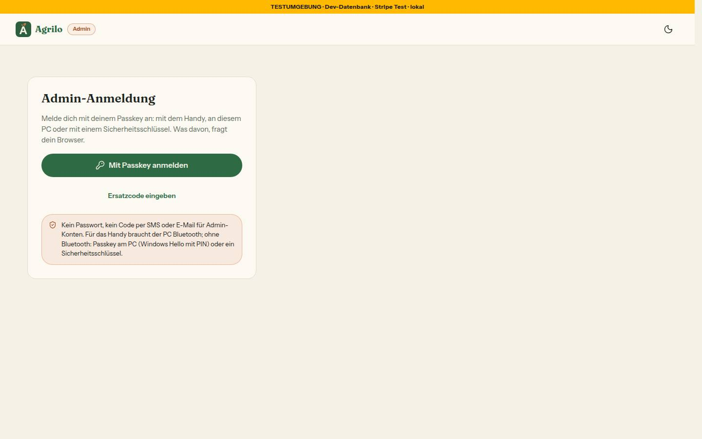
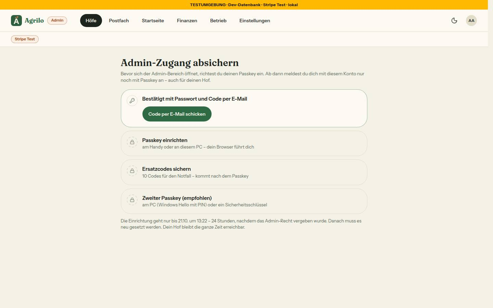
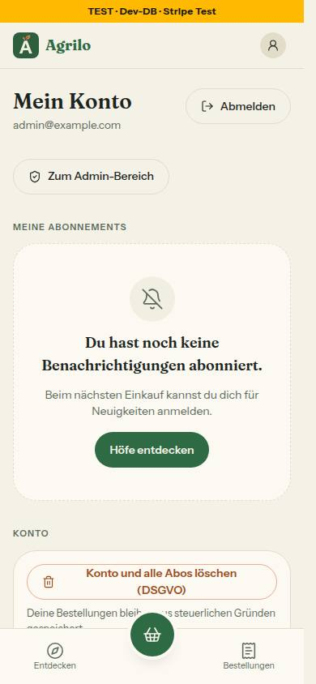
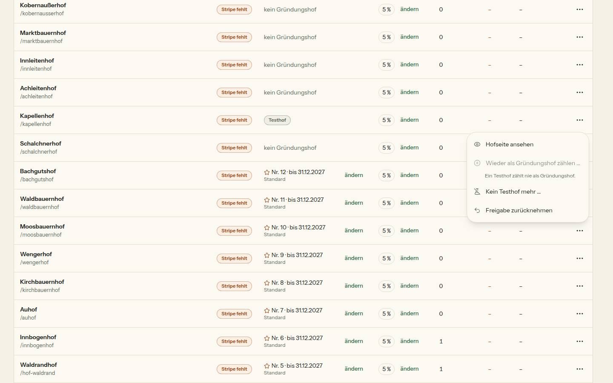
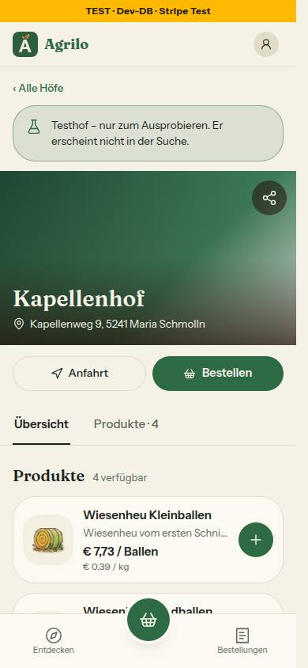

# Morgenbericht Nachtlauf 18 (20.10.2026)

Freigabe: `docs/nachtlauf/freigabe.md` §22, im Chat erteilt (Text vom 19.10.2026). Der Dirigent arbeitet nach `docs/nachtlauf.md`, das Tempo richtet sich nach 4a und §0 der Freigabe. Lauf 18 ist kein fünfter Lauf; die nächste Regel-Inventur kommt in Lauf 20.

**Der Paket-PR war da:** main 9a000c9 enthält #317 mit `@better-auth/passkey` 1.6.23, `minimumReleaseAge: 20160` und G6. `pnpm install --frozen-lockfile` lief in einem frischen Worktree durch. Damit konnte 115 laufen; dieser Lauf hat nichts installiert.

**Mockups:** Keines fehlt. Die vier Dateien des Uploads lagen schon in `docs/mockups/` (60bd1ae), ein Verschiebe-Commit war nicht nötig. **Keine Nummer übersprungen.**

**Kurz:** Doku-PR, 115, 119, 120 und 121 sind fertig, keine davon ist ein Entwurf.
- Genau die zwei freigegebenen Migrationen sind entstanden, beide nur Expand, ohne Seed und ohne Datenänderung: `20261020100000_testhof` (119) und `20261020110000_admin_passkey` (115).
- Kein Paket.
- Stand des Sammel-PR #323 (`integration/lauf18`):
  - typecheck grün;
  - **lint 0 Fehler** (5 Warnungen, wie main);
  - 472 Testdateien / 9049 Tests (Grundstand 455 / 8843);
  - Integration 64 Dateien / 575 Tests, ganzer Lauf;
  - frische Datenbank mit allen 32 Migrationen, `migrate diff --exit-code` = 0.

## 1. PRs

| Nr | Thema | PR | Basis | Migration | Paket | Runden · Durchgänge | Vorschau |
|---|---|---|---|---|---|---|---|
| Doku | Freigabe §22, Register N20/N21/N22/K2/G4/G7, Wortliste, Mockup-README, Status | #318 | main | nein | nein | – · 1 Prüfung | [Vorschau](https://farmer-zone-git-docs-lauf18-bierbaron.vercel.app) |
| 119 | Datenqualität: Testhof, Kartenpunkt-Hinweis, Satz beim Festschreiben (N21, K2) | #319 | Doku | **ja** – `20261020100000_testhof` | nein | 0 im Workflow + 1 Nachrunde + Nachtrag Dirigent · 2 volle Durchgänge, Integration ganz | [Vorschau](https://farmer-zone-git-nacht-2026-10-20119-testhof-bierbaron.vercel.app) |
| 115 | Admin nur mit Passkey (N20, Ergänzung Lauf 18) | #321 | Doku | **ja** – `20261020110000_admin_passkey` | nein | 2 im Workflow + Runde 3 des Dirigenten · 2 volle Durchgänge, sichter dreimal, Integration ganz | [Branch-Adresse](https://farmer-zone-git-nacht-2026-10-20115-admin-passkey-bierbaron.vercel.app) |
| 120 | Entdecken v2 auf /hoefe (N22) | #320 | 119 (#319) | nein | nein | 0 im Workflow + 2 Nachrunden · 2 volle Durchgänge, Integration der Abfrage | [Vorschau](https://farmer-zone-git-nacht-2026-10-20120-entdecken-v2-bierbaron.vercel.app) |
| 121 | Regelvorschläge aus Lauf 17, Vorschau ohne WIP, Reste und Nacharbeit (G4, G7) | #322 | Zwischenstand `integration/lauf18` | nein | nein | 0 + Nachtrag Dirigent · 1 Durchgang | [Vorschau](https://farmer-zone-git-nacht-2026-10-20121-reste-bierbaron.vercel.app) |
| Sammel | alle oben | #323 | main | ja (die zwei) | nein | – | [Vorschau](https://farmer-zone-git-integration-lauf18-bierbaron.vercel.app) |

- **CI:** Der Workflow `ci.yml` (Jobs `ci` und `integration`) läuft nur für PRs auf `main`. Deshalb haben nur #318 und der Sammel-PR #323 die CI; #318 ist grün. Die gestapelten PRs #319–#322 haben nur die Vercel-Vorschau, und die ist grün. Ihre Tests liefen lokal: voller Lauf und Integration, Zahlen je PR.
- **Merge-Empfehlung:** Nur den **Sammel-PR #323** mergen, per **Merge-Commit** (nicht Squash). Die Einzel-PRs gelten danach als gemergt.
- **Einzeln mergen** ginge nur in dieser Reihenfolge, jeweils per Merge-Commit: #318, #319, #321, #320, #322. Dann fehlt aber der Nachtrag aus dem Sammel-PR (Abschnitt 2).

## 2. Sammel-PR

Branch `integration/lauf18` von main 9a000c9. Merge-Reihenfolge, jeweils mit `--no-ff`:
1. Doku-PR (9c88d7f), 119 (5f3941e, baumgleich mit dem 119-Branch);
2. 115 Runde 2 (de7f21d), 120 (d9507d9);
3. Nachtrag (6e9e68e), 115 Runde 3 (cdc5782), ARCHITECTURE-Satz (5ce0547 – der Zwischenstand, von dem 121 abzweigte);
4. 121 (b63070b, baumgleich mit dem 121-Branch);
5. danach dieser Bericht.

**Konflikte und Auflösung:**
- 115 und 120: `DEVELOPMENT.md` (angehängte Abschnitte) – beide Seiten in Merge-Reihenfolge.
- Sonst keine Textkonflikte, auch nicht in `docs/ai/*`.
- `docs/ai/BAUSTEINE.md` wurde nie von Hand geändert: Nach jedem Merge habe ich `pnpm bausteine` erzeugt, es kam ohne Unterschied heraus.

**Was erst zusammen rot war, ohne Textkonflikt, behoben im Sammel-PR:**
- **6e9e68e – frische Bestätigung in den Testhof-Actions (115 × 119), wie die Freigabe es dem Sammel-PR zuweist.**
  - `markiereAlsTesthof` und `nimmTesthofZurueck` rufen zuerst `verlangeFrischeBestaetigung()`, nach dem Muster der drei Gründungs-Actions aus 115.
  - `testhof-dialog.tsx` nutzt `useFrischBestaetigt`, mit Texten nur aus `FRISCH_TEXT`.
  - Nach dem Merge von 115 waren `tests/testhof-actions.test.ts` (10 Fälle; die Attrappen-Sitzung kannte `createdAt`/`passkeyAm` nicht) und `tests/integration/testhof.int.test.ts` (5 Fälle: „Richte zuerst deinen Passkey ein.“) rot.
  - Beide nutzen jetzt die Passkey-Attrappen bzw. `machePasskeyAdmin` wie alle Tests seit 115. Dazu kommen zwei neue Fälle „ohne frische Bestätigung: nichts gelesen, nichts geschrieben“ mit Gegenprobe. Die Wache `frisch-bestaetigung-wache` kennt beide Actions und den Dialog.
  - tester grün, pruefer ohne Befund.
- **5ce0547 – nur Doku:** ARCHITECTURE nennt bei den Gründungs- und Testhof-Actions jetzt auch die frische Bestätigung.

**Prüfungen auf dem Gesamtstand:**
- typecheck grün;
- `pnpm lint` 0 Fehler / 5 Warnungen;
- `pnpm test` 472 Dateien / 9049 Tests;
- `pnpm test:integration` (lokale Test-DB, unter Sperre) ganz: auf dem Zwischenstand 5ce0547 63 / 570, nach dem Merge von 121 64 / 575.

**Migrationen = Schema (Regel 3):**
- Frische lokale Wegwerf-Datenbank: 32 Migrationen in Namensreihenfolge eingespielt, `testhof` vor `admin_passkey`.
- `prisma migrate status`: „Database schema is up to date!“; zweiter `deploy`: „No pending migrations to apply.“
- `prisma migrate diff --from-config-datasource --to-schema prisma/schema.prisma --exit-code`: 0.
- RLS ist auf allen Tabellen an.
- Je Nummer vorher: `migrate diff --from-schema` mit dem Schema von 9f7044b ergibt dieselben Anweisungen wie die Migrationsdatei. Ergänzt sind nur `IF NOT EXISTS`, `DO`-Blöcke, `lock_timeout` und RLS.

**Vorschau und Migrationen (`prisma migrate` der Vorschau-Builds) – Reihenfolge in der Entwicklungsdatenbank: erst 119, dann 115.**

| Vorschau | Commit | Ausgabe |
|---|---|---|
| 119 (`dpl_3Jhc4WZQC6AJbSQXALEXba9cKAcS`) | 3e6e7a9, gepusht 12:09 | „31 migrations found · Applying migration `20261020100000_testhof` · All migrations have been successfully applied.“ |
| 115 (`dpl_7qQ7FssZHYq2LFx6UXmH8SzJqbj6`) | 65215e2, gepusht 14:34 | „31 migrations found · Applying migration `20261020110000_admin_passkey` · All migrations have been successfully applied.“ |
| Sammel (`dpl_GfRFs7MZnJEVwXovdmoyigoERK7k`) | 5ce0547 | „32 migrations found · No pending migrations to apply.“ |

## 3. Messungen und Wege

**115 – frische Bestätigung:**
- Sie ist eine erneute Anmeldung mit Passkey (`signIn.passkey()` im Dialog bzw. auf `/admin/bestaetigen?weiter=…`, nur relative Pfade unter /admin).
- Ein `hooks.before` auf `/passkey/verify-authentication` prüft, ob der Passkey zum angemeldeten Konto gehört.
  - **Bestätigung durch ein fremdes Konto abgewiesen: ja, gemessen** in `tests/integration/admin-passkey.int.test.ts`: 401 „Dieser Passkey gehört zu einem anderen Konto.“, kein Sitzungs-Cookie, die alte Sitzung bleibt, beim fremden Konto entsteht keine Sitzung.
  - Mit dem eigenen Passkey entsteht eine neue Sitzung mit `passkeyAm`, und die alte desselben Kontos wird gelöscht (`userId` im WHERE).
  - Im Browser (sichter, virtueller Authenticator über CDP) gingen beide Wege: Export (303 → bestätigen → CSV) und Dialog („Neue erstellen“).
- **Passkeys ohne Nutzerprüfung abgewiesen: ja.**
  - Beide `afterVerification` werfen ohne `userVerified`. Im Integrationstest antwortet die Anmeldung mit 401 und die Einrichtung mit 403.
  - Im Browser bricht schon Chromium ab, wenn die Nutzerprüfung fehlt; die Sperre im Server ist deshalb nur im Test belegt.
- **Zusätzlich (zweiter Durchgang, Runde 2 und 3):**
  - Der Admin-Bereich öffnet nur in einer Sitzung mit `passkeyAm`.
  - Eine Passwort-Sitzung von vor dem ersten Passkey (anderes Gerät oder von vor dem Deploy) landet auf /login/admin und sieht keinen Admin-Inhalt. Die Sitzung bleibt bestehen, der Hof bleibt erreichbar.
  - Die Pflichtseite öffnet nur bei offener Pflicht oder in einer Sitzung mit Passkey.
  - Belegt im Integrationstest und von einem sichter mit zwei getrennten Browser-Sitzungen.

**119 – alle Abfragen mit `IN_LISTEN_SICHTBAR`** (= `OEFFENTLICH_SICHTBAR` + `istTesthof: false`):

| Abfrage | wofür |
|---|---|
| `farm.ts` `getOeffentlicheHoefe` | Produktzeilen und Höfe: /hoefe, Produktsuche, Startseite, Karte |
| `startseite.ts` `hofSlugs` | Startseiten-Blöcke |
| `startseite.ts` `ladeStartseiteAdmin` | Auswahl |
| `actions/startseite.ts` `speichereEntwurf` | Speichern der Auswahl |
| `umfeld.ts` `getUmfeld` | Region |
| `futter-kaufen.ts` `getFutterKaufen` | Futter kaufen |
| `seo.ts` `SITEMAP_HOF` | Sitemap |

Dazu kommt `istTesthof: false` in der Zählung der wartenden Höfe (`plattform-einstellung.ts` `zaehleGruendungSeiten`, Unit-Test hält das `where` exakt fest).

`OEFFENTLICH_SICHTBAR` allein gilt nur noch für direkte Links: `getPublicFarm`, `hofIstOeffentlich`, `produktIstOeffentlich`, `ladeTeilenBildQuelle`, `getPlakatDaten`, `zaehleBesuchFuerSlug`. Die Wache `tests/testhof-sichtbarkeit-wache.test.ts` hat eine Gegenprobe. Integrationstests zeigen: Ein Testhof fehlt in /hoefe, Futter kaufen, im Höfe-Block der Startseite, in Region und Sitemap; ein gleich gebauter Nachbar steht drin.

**120 – Cache-Treffer bei `/hoefe?abholung=heute`: ja, gemessen** in der Vorschau von 120 (e963d3c):
- Erster Abruf: `x-vercel-cache: PRERENDER` (`x-matched-path: /hoefe`, `x-nextjs-prerender: 1`).
- Zweiter Abruf: **`x-vercel-cache: HIT`** (age 16).
- Build: `├ ○ /hoefe 5m 1y`.

## 4. Nicht begonnene bzw. gestoppte Nummern

Keine. 102 bleibt für die Sammelbestellung reserviert.

## 5. Regelvorschläge aus den Berichten, gesammelt (Prüfung vor Textregel; eingetragen erst nach deiner Freigabe)

| Herkunft | Ursache | Gegenmaßnahme | Ort |
|---|---|---|---|
| 115 | `vi.mock` eines Pakets erreicht Abhängigkeiten nicht, die außerhalb von Vite laden. Eine Attrappe von `@simplewebauthn/server` wäre wirkungslos geblieben. | Bibliotheksgrenzen mit echten Daten prüfen (hier ein Software-Authenticator) oder per `server.deps.inline`. Dazu ein Test, der zeigt, dass die Attrappe wirklich gerufen wird. | TESTING_GUIDELINES §3 „Mocking“ |
| 119 | `PublicFarm`/`HofRohdaten` bekamen ein Pflichtfeld, elf Testdateien mit eigenen Fixtures mussten nachziehen (Konfliktfläche mit parallelen Nummern). | Je Typ EINE Fixture-Fabrik in `tests/`; die Tests überschreiben nur, was sie prüfen. | TESTING_GUIDELINES §5 |
| 120 | Eine Zeitangabe auf einer statischen Seite (5 min Cache) stimmt mit der Server-Uhr nicht. | Wache: in `src/components/hoefe/**` kein `new Date()`/`Date.now()` außer in `use-uhr.ts`. | `tests/karte-wache.test.ts` oder neue `uhr-wache` |
| 121 | Die neue Uhr-Wache prüft `setSystemTime` und `useFakeTimers({ now })`, aber nicht `vi.advanceTimersByTime`. | Diese Aufrufe in Dateien mit Better Auth mitprüfen. | `tests/integration-uhr-wache.test.ts` |
| Dirigent | Gestapelte PRs haben keine CI (`ci.yml` nur für PRs auf main); Fehler aus dem Zusammenspiel zeigen sich erst im Sammel-PR. | Den ganzen Integrationslauf auf dem Zwischenstand machen, bevor die letzte Nummer abzweigt; so lief es in Lauf 17 und 18. Oder `pull_request` auch für `integration/**` und `docs/**` als Basis. | `docs/nachtlauf.md` §4 bzw. `ci.yml` (Entscheidung) |

**Umgesetzt aus Lauf 17 (Nr. 121):**

| Vorschlag | Prüfung (Datei) | Gegenprobe | Satz (Ort) |
|---|---|---|---|
| 112: Uhr in tests/integration nur in der Vergangenheit | `tests/integration-uhr-wache.test.ts` | Zukunft, Variable bzw. Schritt von der echten Uhr in einer Datei mit Better Auth → rot; Vergangenheit bzw. Datei ohne Better Auth → grün | TESTING_GUIDELINES „Zeit in der Integrationsschicht“ |
| 113: Tokens aus Buchstaben | Telefonnummern-Wache (besteht); neu aus 115: `code-testwerte-wache` | besteht | TESTING_GUIDELINES §5 |
| 114: Einmal-Token ohne `revalidatePath` | `geraete.int`, `actions-sitzung-wache` (bestehen) | besteht | ARCHITECTURE §5 |
| 116: Grenzen aus `git grep` | Prozess | – | `docs/nachtlauf.md` 4a Punkt 1 |
| 117: Vermerk | `ladeansichten.test.ts` (besteht) | besteht | ARCHITECTURE §4 |
| Dirigent (1): ganzer Integrationslauf bei Annahmen für alle | Prozess | – | `docs/nachtlauf.md` 4a Punkt 2, §4 Schritt 5 |
| Dirigent (2): `pnpm install` vorher prüfen | Prozess | – | `docs/nachtlauf.md` §4 Schritt 1 |
| G7: kein WIP-Commit als letzter | `tests/vercel-ignore.test.ts` + `scripts/vercel-ignore.sh` | Skript sabotiert → rot | `docs/nachtlauf.md` 4a Punkt 2 |

**Was von 121 offen blieb (→ Lauf 19):**
- Ladepunkt für `(hof)/farm-page`, `(hof)/orders/[orderId]` und `(hof)/region`. Die drei Seiten stehen mit Grund im Bestand der `loading-filter-wache`, der von 8 auf 3 gesunken ist.
- `code-bremse.int.test.ts` auf feste Daten umbauen; die Datei steht im Bestand der Uhr-Wache.
- Das Band „Entwurf/Live“ der Startseiten-Vorschau folgt weiter sofort der Wahl.
- Doppeltes frisches Lesen von `emailVerified` (eigener Auftrag).

## 6. Tempo

Zeiten in Wiener Zeit (20.10.2026). Die Freigabe kam gegen 10:30.

| Nr | Beginn | Ende (PR) | Runden | Durchgänge (pruefer voll) | Integration | Bilder |
|---|---|---|---|---|---|---|
| Doku | 10:40 | 11:08 (#318) | – | 1 | – | 0 |
| 119 | 11:10 | 12:40 (#319) | 0 + 1 Nachrunde + Nachtrag | 2 | ganz | 3 |
| 115 | 11:10 | 14:58 (#321) | 2 + Runde 3 des Dirigenten | 2 + sichter dreimal | ganz (nach jeder Runde) | 5 |
| 120 | 12:13 | 14:21 (#320) | 0 + 2 Nachrunden | 2 | Abfrage | 10 (von 11 verlangten) |
| Sammel | 14:40 (erste Merges) | 16:20 (#323), Bericht danach | Nachtrag 115 × 119 | pruefer auf dem Nachtrag | ganz, zweimal | – |
| 121 | 15:07 | 16:10 (#322) | 0 + Nachtrag | 1 | eigene Datei | 0 |

**Was aus 4a anders lief:**
- **Ein Workflow je Nummer** hat getragen: 115 und 119 liefen gleichzeitig, 120 startete vom 119-Stand, während die 119-Nachrunde lief. Den Endstand von 119 habe ich danach in 120 gemergt (3ba85d3, ohne Konflikt).
- **Eine Entscheidung des Dirigenten musste ich zurücknehmen (120):**
  - Runde 1 nahm die doppelten Wege aus dem Fuß der Startseite.
  - Die Nachprüfung zeigte dann: Der Fuß steht auch auf Hof- und Produktseite, und am Handy fehlte danach auf der Produktseite jeder Weg nach /hoefe.
  - Runde 2 stellte die Spalte zurück und verbirgt sie nur am Computer, wo der Seitenfuß dieselben Wege zeigt.
- **115 brauchte eine dritte Runde außerhalb des Workflows.** Die Grenze von zwei Runden war erreicht, und der sichter fand nach Runde 2 noch ein „Sollte“: Die Pflichtseite war für eine fremde Passwort-Sitzung sichtbar. Weil es um den Admin-Zugang geht, lief eine gezielte Runde des Dirigenten; die Nachprüfung danach fand nichts.
- **Ganzer Integrationslauf auf dem Zwischenstand**, bevor 121 abzweigte, und noch einmal am Ende.

## 7. Bilderstrecke (hell, wo nicht anders genannt)

Die Bilder liegen im Sammel-PR unter `docs/nachtlauf/berichte/bilder/<nr>/`.
- **/login/admin (1440)** – 115: 
- **Pflichtseite (1440)** – 115: 
- **Mein Konto mit „Zum Admin-Bereich“ (390)** – 115: 
- **Admin › Höfe mit Testhof (1440)** – 119: 
- **Hofseite eines Testhofs (390), Hinweiskarte neutral** – 119: 
- **/hoefe Liste (390), hell und dunkel** – 120:  
- **/hoefe mit „Heute“ (390)** – 120: 
- **Splitscreen mit Pin-Vorschau (1440)** – 120: 
- **Seitenfuß (390)** – 120: 

## 8. Für dich zu bestätigen (aus den PRs)

**Grenzerweiterungen durch den Dirigenten:**
- 119: `TESTHOF_HINWEIS` steht in `src/lib/gruendungshof.ts`.
- 119: `src/components/ui/hinweiskarte.tsx` hat einen dritten Ton `neutral`. Er nutzt nur Tokens; Grün und Orange sind unverändert. Die Freigabe verlangt den Hinweis „neutral“, der Baustein kannte keinen solchen Ton.
- 115: neue Datei `src/lib/admin-anmeldung.ts` mit Regeln und Texten für Client und Server.
- 115: Das Schema der Ersatzcode-Anmeldung steht in `src/lib/ersatzcodes.ts` statt in `src/schemas/`.
- 115: In `nicht-ich-karte.tsx` sind zwei Zeilen geändert.
- 121: weitere Dateien für den Ladepunkt und die tote Prop; die Liste steht im PR #322.

**Wortlaute und Entscheidungen des Dirigenten:**
- 119: `HOEFE_SEITE.satz` lautet „Was wartet, steht oben. Gründungshöfe zählen nach der Freischaltung – Testhöfe markierst du im Menü ⋯.“ Vorher stand „… nimmst du aus.“, und „ausnehmen“ ist seit N21 etwas anderes. Das Mockup `admin-hoefe-gruendung-ausnehmen.html` trägt noch den alten Satz.
- 120: Am Computer stehen auf Startseite, Hofseite, Produktseite und /fuer-hoefe **zwei Wortmarken übereinander**, im Fuß der Startseite und im Seitenfuß. Nicht geändert, **deine Entscheidung**: entweder geht der Startseiten-Fuß im Seitenfuß auf, oder die Wortmarke fällt dort am Computer weg. Bild: [seitenfuss-1440-hell](berichte/bilder/120/seitenfuss-1440-hell.jpg).
- 121: Der Hinweis „wischen blättert“ wechselt mit derselben Bedingung wie die Pfeile der Bildansicht (`pointer-fine`), nicht wörtlich mit `(pointer: coarse)`. So nennt er nie Pfeile, die nicht da sind.

**Mockup-Abweichungen 120** (über die freigegebenen hinaus, je mit Bild im Bericht):
- (a) Die Reihe „Abholung“ wischt am Handy waagrecht.
- (b) Im Kartenmodus steht die gewählte Abholung als Marke in der zweiten Zeile.
- (c) Am Handy zeigt der Seitenfuß den bestehenden Umschalter „Dunkelmodus“.
- (d) Am Computer hat der Seitenfuß keine „Darstellung“; der Umschalter steht im Kopf.

**Bild „Noch nicht bestellbar“ fehlt (120):** Im Seed hat jeder freigeschaltete Hof ein kaufbares Produkt und eine Abholzeit. Die Testdaten blieben unverändert, der Zustand ist in den Tests belegt.

## 9. Nacharbeit („Sollte“/„Kann“), gesammelt

- **115:**
  - Doppelte Prüfung `verlangeFrischeBestaetigung` + `verlangeAdminAktion` in den heiklen Actions, auch den zwei Testhof-Actions, und in den drei Exporten. Die `userId` sollte aus dem Ergebnis der frischen Bestätigung kommen.
  - Ein fail-closed-Helfer für `adminBremseVoll` und `einrichtungscodeGebremst`.
  - `15 * MINUTE_MS` statt `EINRICHTEN_SITZUNG_MINUTEN`.
  - `emailSchema()` in `ersatzcodes.ts`.
  - `geraete.ts`: Der Satz „ändere dein Passwort“ gilt nicht für Admins mit Passkey.
  - Im Admin-Bereich fehlt Abmelden; heute führt Abmelden nach /account/login.
  - Tippflächen der Admin-Shell sind 38 px.
  - Zweiter Einrichtversuch auf einem Gerät, das den Passkey schon hat: nur ein allgemeiner Fehlertext.
  - Nach der Bestätigung eines Exports gibt es keinen Hinweis „Download startet“.
  - `next dev` schreibt Argumente von Server-Funktionen ins Dev-Log, darunter den E-Mail-Code der Einrichtung. Das betrifft nur die lokale Entwicklung; der Produktions-Build tut es nicht.
  - „zuletzt benutzt“ je Passkey bräuchte eine Spalte (eigener Auftrag).
- **119:**
  - Zwei veraltete Kommentare (`src/app/sitemap.ts`, `src/lib/umfeld.ts`).
  - Die Bausteine-Vorschau `/intern/bausteine` zeigt den neutralen Ton nicht.
  - Der Satz „Wähle nur freigeschaltete Höfe.“ nennt den Testhof nicht.
  - `gruendungAenderung` mit optionalem `istTesthof`.
- **120:**
  - Volle Abholfenster (`maxOrders`) zählt die Übersicht nicht.
  - In der Produktsuche sind zwei Live-Regionen, eine reicht.
  - `PIN_FOKUS` ist eine zweite Kopie des Pin-Grüns.
  - `unknown[]` in fünf Ausschnitten.
  - `illustrationPfad` in den Produktzeilen ohne Unterkategorie.
  - `HofKurzkarte` als `role=tooltip` mit Link (Region, Lauf 19).
  - jsdom-Test fürs Hydrieren.
- **121:** In der Maus-Fassung des Foto-Hinweises steht „Tippen öffnet …“ statt „Klicken“. Die übrigen offenen Punkte stehen in Abschnitt 5.

## 10. Für dich zu tun

**Abnahme in der Vorschau, je Nummer:**
- **115:** In der **Entwicklungsdatenbank** (nur du) ein Testkonto mit `isAdmin` vorbereiten: `UPDATE "User" SET "adminSeit" = now() WHERE "email" = '<adresse>' AND "isAdmin" = true;`. Danach unter der Branch-Adresse prüfen:
  - mit Passwort anmelden → /admin/einrichten → Code per E-Mail → Passkey → Ersatzcodes → Admin-Bereich;
  - abmelden → /login/admin → „Mit Passkey anmelden“;
  - Passwort-Anmeldung desselben Kontos → „E-Mail oder Passwort falsch“;
  - nach 5 Minuten „Freigabe zurücknehmen“ → Dialog „Bitte bestätige mit deinem Passkey“.
- **119:**
  - /admin?reiter=alle › ⋯ › „Als Testhof markieren …“ → Marke „Testhof“.
  - Der Hof fehlt in /hoefe, Startseite, /region und /sitemap.xml; seine Hofseite zeigt oben den neutralen Hinweis und `noindex`.
  - ⋯ › „Kein Testhof mehr …“ macht es rückgängig.
- **120:**
  - /hoefe am Handy: Reihe „Abholung“, „Heute“ → `?abholung=heute`; zweimal laden zeigt `x-vercel-cache: HIT`.
  - Abends erscheint „Heute holt hier kein Hof mehr ab“ mit „Morgen zeigen“.
  - Karte am Computer: Pins per Tab, Vorschau, Escape.
  - Seitenfuß auf allen Seiten der Kundschaft, nicht in Kasse und Bestätigung.
- **121:** siehe „Nach dem Merge“, Schritt 4.

**Merge:** nur den Sammel-PR #323, per Merge-Commit (nicht Squash).

**Nach dem Merge, in dieser Reihenfolge, ohne Pause dazwischen.** Bis Schritt 2 erledigt ist, gelten die Testhöfe der Produktion noch als normale Höfe und können in der Sitemap stehen.
1. **In Supabase** (Produktion, SQL-Editor) für dein eigenes Admin-Konto: `UPDATE "User" SET "adminSeit" = now() WHERE "email" = '<deine Adresse>' AND "isAdmin" = true;`.
   - Danach abmelden und mit Passwort NEU anmelden: Die Einrichtung verlangt eine Sitzung mit Passwort, höchstens 15 Minuten alt.
   - Innerhalb von 24 Stunden unter /admin den Passkey einrichten und die Ersatzcodes sichern.
   - Bis dahin zeigt /admin die Pflichtseite, dein Hof bleibt erreichbar.
   - **Notfall-Anweisung** (alle Geräte und alle Ersatzcodes verloren, nur durch dich): `DELETE FROM "Passkey" WHERE "userId" = '<deine User-ID>';` und danach `UPDATE "User" SET "adminSeit" = now() WHERE "id" = '<deine User-ID>';`. Dann wie oben mit Passwort neu anmelden und den Passkey neu einrichten. Die Ersatzcodes (`"AdminErsatzcode"`) erstellst du danach unter Einstellungen › Anmeldung neu.
2. **Admin › Höfe:** die Testhöfe mit „Als Testhof markieren“ kennzeichnen, frisch bestätigt mit dem Passkey. Geht das nicht, steht im Bericht von 119 (`docs/nachtlauf/berichte/119.md`) eine SQL-Anweisung mit `<slug>` als Ersatz, ausgeführt nur durch dich. Dein eigener Hof bleibt ausgenommen und kann ab jetzt bei Google erscheinen.
3. **Search Console** einrichten, /sitemap.xml einreichen, die Hofseite deines Hofs über „URL prüfen“ › „Indexierung beantragen“ anmelden.
4. **G7:** Ein Commit „WIP: …“ auf einem Testbranch baut keine Vorschau, der nächste ohne WIP schon.

**Entscheidungen für Lauf 19:**
- Region v2/v3 (nach Abnahme von Entdecken v2).
- AGB §3 für „Noch nicht bestellbar“ eingeklappt.
- Hook-Fehlalarm: Dieser Lauf hat alle Commit-Texte über eine Datei geschrieben (`git commit -F`).
- Datenschutzerklärung (114, Kartenpunkt-Suche).
- Die Liste „Nicht in diesem Lauf“.
- Zwei Wortmarken am Computer (Abschnitt 8).
- CI für gestapelte PRs (Abschnitt 5).

## 11. Wo die Bilder liegen

- In den Berichten der Nummern unter `docs/nachtlauf/berichte/bilder/115/` (5), `…/119/` (3) und `…/120/` (10; die Seitenfuß-Bilder wurden in den Runden ersetzt).
- 121 hat keine Bilder.
- Die Browserbilder des sichters nach Runde 2 von 115 liegen nicht im Repository; sie enthalten keine Codes.
