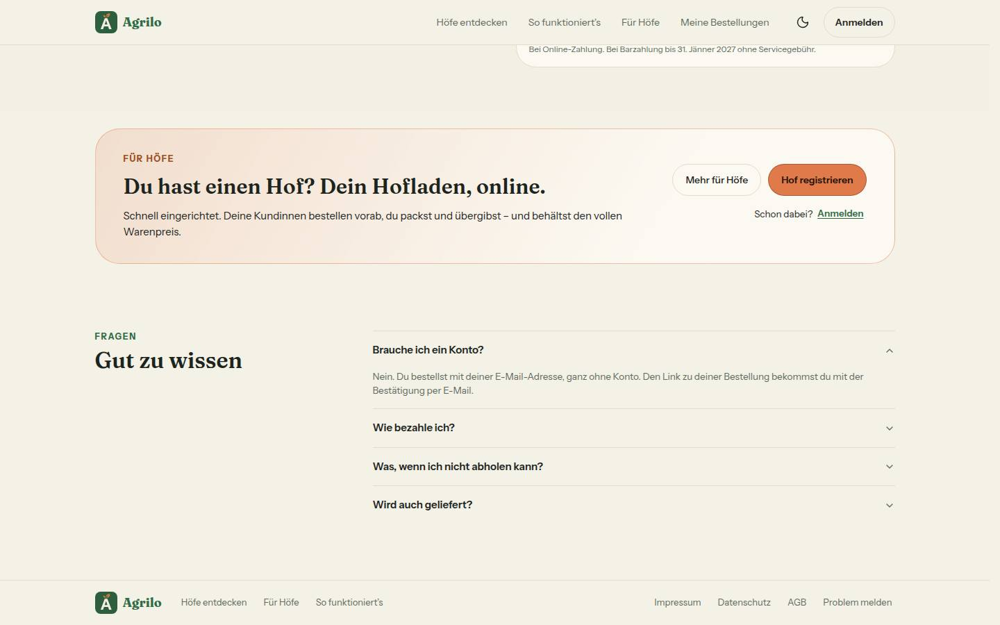

# Morgenbericht Nachtlauf 19 (20./21.10.2026)

- **Sicherheits-PR #324 war gemergt** (next 16.4.2, `poweredByHeader: false`) → 125 lief. **Alle Mockups lagen vor**, keine Nummer entfiel, **keine Nummer übersprungen**. Gestoppt innerhalb einer Nummer: 124 Punkt 3 (Eier je Stück).
- Acht Nummern fertig: 122, 123, 124, 125, 126, 127, 128, 129. Sieben davon im **Sammel-PR [#334](https://github.com/Uttoranger/FarmerZone/pull/334)** (`integration/lauf19`), **124 als eigener PR [#329](https://github.com/Uttoranger/FarmerZone/pull/329)** – erst nach dem Sammel-PR und nach der rechtlichen Prüfung.
- Genau die zwei freigegebenen Migrationen, beide nur Expand: `20261021100000_abholhinweise` (123) und `20261021110000_startseite_neuigkeiten` (129). Kein Paket.
- Stand des Sammel-PR: typecheck grün, **lint 0 Fehler** (5 Warnungen, wie main), 506 Testdateien / 9540 Tests, Integration ganz 69 Dateien / 609 Tests, frische Datenbank mit allen 34 Migrationen, `migrate diff --exit-code` = 0.
- **Neu:** Die CI läuft jetzt auch auf gestapelten PRs (127, G3) – auf #333 grün. **Gefunden, nicht gebaut:** Die CI auf `main` (Push) ist seit dem 16.10. rot (Abschnitt 5).
- **CI des Sammel-PR:** Der erste Lauf war rot – die neue Fabrik-Wache aus 127 lag auf dem Runner über der Zeitgrenze (Abschnitt 2). Behoben in `009555a`; der Lauf darauf ist grün (39548439173, Job `ci` 5:05 min, Job `integration` 4:35 min).
- **Zur Entscheidung (Abschnitt 8):** Die meisten Bilder zeigen die erfundenen Seed-Höfe; der Wortlaut der Freigabe verlangt „Testhof A“, „Testhof B“, „Sonnhof“.

## 1. PRs

| Nr | Thema | PR | Basis | Migration | Paket | Runden · Durchgänge | Vorschau |
|---|---|---|---|---|---|---|---|
| Doku | Freigabe §23, Register, Wortliste, Konzept Umfeld, Status | [#325](https://github.com/Uttoranger/FarmerZone/pull/325) | main | nein | nein | – · 1 Prüfung | [Vorschau](https://farmer-zone-git-docs-lauf19-bierbaron.vercel.app) |
| 122 | Region · gemeinsame Bausteine, Seite in zwei Teilen (N23) | [#326](https://github.com/Uttoranger/FarmerZone/pull/326) | `docs/lauf19` | nein | nein | 0 + Nachrunde Dirigent · 2 volle Durchgänge | [Vorschau](https://farmer-zone-git-nacht-2026-10-20122-region-bausteine-bierbaron.vercel.app) |
| 128 | Beiträge v2 · „Aktuell vom Hof“ (F8, N5, T5) | [#327](https://github.com/Uttoranger/FarmerZone/pull/327) | `docs/lauf19` | nein | nein | 1 + Nachrunde Dirigent · 2 volle Durchgänge | [Vorschau](https://farmer-zone-git-nacht-2026-10-20128-aktuell-vom-hof-bierbaron.vercel.app) |
| 125 | Sicherheit: Login-Bremse über alle Instanzen, CSP zum Beobachten (R1, G8) | [#328](https://github.com/Uttoranger/FarmerZone/pull/328) | `docs/lauf19` | nein | nein | 1 + Nachrunde Dirigent · 2 volle Durchgänge, Integration ganz | [Vorschau](https://farmer-zone-git-nacht-2026-10-20125-sicherheit-bierbaron.vercel.app) |
| 124 | Region · Preise vergleichen (N23) | [#329](https://github.com/Uttoranger/FarmerZone/pull/329) | 122-Branch | nein | nein | 0 + Nachrunde Dirigent (zurückgenommen) · 2 volle Durchgänge | [Vorschau](https://farmer-zone-git-nacht-2026-10-20124-preise-ver-429d22-bierbaron.vercel.app) |
| 123 | Region · Futter kaufen (N23, E9) | [#330](https://github.com/Uttoranger/FarmerZone/pull/330) | 122-Branch | **ja** – `20261021100000_abholhinweise` | nein | 0 + Nachrunde Dirigent (Bericht) · 2 volle Durchgänge, Integration ganz | [Vorschau](https://farmer-zone-git-nacht-2026-10-20123-futter-kaufen-bierbaron.vercel.app) |
| 126 | Admin-Nacharbeit aus 115 (N20) | [#331](https://github.com/Uttoranger/FarmerZone/pull/331) | `docs/lauf19` | nein | nein | 1 + Nachrunde Dirigent · 1 gezielter Durchgang | [Vorschau](https://farmer-zone-git-nacht-2026-10-20126-admin-nacharbeit-bierbaron.vercel.app) |
| 129 | Beiträge v2 · Marke, „Neu bei den Höfen“, „Dein Beitrag“ (N22, N16, E12) | [#332](https://github.com/Uttoranger/FarmerZone/pull/332) | `integration/lauf19` (Abzweig `daa0228`) | **ja** – `20261021110000_startseite_neuigkeiten` | nein | 2 + Nachrunde Dirigent · 2 volle Durchgänge, Integration ganz | [Vorschau](https://farmer-zone-git-nacht-2026-10-20129-beitraege-v2-bierbaron.vercel.app) |
| 127 | Regeln aus Lauf 18, CI für gestapelte PRs, ein Fuß am Computer (G3, G4, N22) | [#333](https://github.com/Uttoranger/FarmerZone/pull/333) | `integration/lauf19` (Abzweig `59292c4`) | nein | nein | 1 + Nachrunde Dirigent · 1 gezielter Durchgang; CI grün | [Vorschau](https://farmer-zone-git-nacht-2026-10-20127-regeln-ci-fuss-bierbaron.vercel.app) |
| Sammel | alle außer 124 | [#334](https://github.com/Uttoranger/FarmerZone/pull/334) | main | ja – `20261021100000_abholhinweise`, `20261021110000_startseite_neuigkeiten` | nein | – | [Vorschau](https://farmer-zone-git-integration-lauf19-bierbaron.vercel.app) |

- **CI:** Bis 127 lief `ci.yml` nur für PRs auf `main` (#325 grün). Mit 127 auch für `integration/**`, `docs/**`, `nacht/**`: #333 grün (Lauf 39545458654). Die übrigen gestapelten PRs haben die Vorschau (alle grün) und die lokalen Läufe, Zahlen je PR.
- **#332 und #333 zeigt GitHub schon als gemergt:** Ihre Basis ist `integration/lauf19`, und der Sammel-PR enthält sie (wie #322 in Lauf 18).
- **Merge-Empfehlung:** Nur den **Sammel-PR #334** mergen, per **Merge-Commit** (nicht Squash). Die Einzel-PRs gelten danach als gemergt. 124 danach, siehe Abschnitt 10.

### `prisma migrate status` der Vorschauen (aus den Build-Logs; aus dem Nachtlauf läuft kein Befehl gegen die Entwicklungsdatenbank)
1. **123** (`12b705b`, 01:52 UTC): „33 migrations found · Applying migration `20261021100000_abholhinweise` · All migrations have been successfully applied.“
2. **129** (`59292c4`, 03:07 UTC): „34 migrations found · Applying migration `20261021110000_startseite_neuigkeiten` · All migrations have been successfully applied.“
3. **Sammel-PR** (Kopf `aa97042`, 04:55 UTC; ebenso schon `a363801`, 04:37 UTC): „34 migrations found · No pending migrations to apply.“

Reihenfolge in der Entwicklungsdatenbank: erst `abholhinweise`, dann `startseite_neuigkeiten` – wie die Zeitstempel der Dateien.

## 2. Sammel-PR

Branch `integration/lauf19` von main `1dbcecf`. Merge-Reihenfolge, jeweils `--no-ff`:
1. Doku-PR (cf65432);
2. 122 (9008f6c), 128 (daa0228) – der Zwischenstand, von dem 129 abzweigte;
3. 125 (5e7d3b3), 123 (de4bb35), Sammelstand-Fix (5907e76), 126 (58918e8);
4. 129 (a363801, baumgleich mit dem 129-Branch `fc5d08a`);
5. 127 (aa97042, baumgleich mit dem 127-Branch `855be6a`);
6. Fix der Fabrik-Wache für die CI (009555a);
7. danach dieser Bericht.

**Konflikte und Auflösung:**
- `DEVELOPMENT.md` (128, 125, 123, 126, beim Hineinholen in 129): angehängte Abschnitte, beide Seiten.
- `src/lib/auth.ts` (126 × 125, Freigabe: mechanisch): nur Importzeilen; übrig bleiben `DB_BREMSEN`, `adressMerkmal`, `adminBremseVoll`, `AUTH_BREMSE_SPEICHER`.
- `docs/ai/BAUSTEINE.md` nie von Hand: nach jedem Merge `pnpm bausteine`.

**Was erst zusammen rot war, ohne Textkonflikt:**
- **5907e76:** 123 macht `abholhinweise` zum Pflichtfeld von `PublicProduct`; zwei Produkt-Testdaten der 128 bekamen `abholhinweise: []`. Nur Testdaten.
- **009555a – erster CI-Lauf des Sammel-PR rot** (Lauf 39546846280, Job `ci`, Schritt „Test“; Job `integration` grün): `tests/fabrik-wache.test.ts` (neu aus 127) las alle Testdateien in einem Test mit dem TypeScript-Parser – einzeln 3 s, im vollen Lauf auf dem Runner über der Zeitgrenze von 5 s. Jetzt mit verlustfreiem Vorfilter (nur Dateien mit einem Typnamen oder einem Feld, das nur der Typ kennt), einem Parse je Datei und 30 s Zeitgrenze wie die übrigen Quelltext-Wachen; ein Test belegt, dass der Vorfilter keinen Fund verliert. Einzeln jetzt 0,8 s.

**Probe „124 lässt sich mergen“** (auf `aa97042`, `git merge --no-commit --no-ff`, dann `--abort`):
- **Nicht konfliktfrei:** `DEVELOPMENT.md`, `docs/ai/BAUSTEINE.md`, `docs/ai/DESIGN_SYSTEM.md` (Doku) und `tests/region-bausteine.test.ts` (je eine Zeile; beide gehören hinein: 124 `getUmfeld(farm.id)` in `preise-reiter.tsx`, 123 `getFutterKaufen(farm.id, jetzt)` in `futter-reiter.tsx`).
- **Dazu ohne Textkonflikt:** Seit 127 ist `subcategory` in `VorschauProdukt` Pflicht; `src/lib/umfeld.ts` (`alsVorschau`, aus 124) setzt es nicht → Typecheck rot. Eine Zeile `subcategory: p.subcategory,` behebt es.
- **Tiefe Probe** im Wegwerf-Worktree mit genau dieser Auflösung: typecheck grün, lint 0 Fehler, 508 Dateien / 9581 Tests grün. Nichts committet, Worktree gelöscht.

**Prüfungen auf dem Gesamtstand:** typecheck grün; lint 0 Fehler / 5 Warnungen; `pnpm test` 506 / 9540 (auf `009555a`); Illustrationen 114 / 114; Integration ganz 69 / 609 unter der Sperre, danach keine Zeile `NEUIGKEITEN`; frische Datenbank: 34 Migrationen, zweiter `deploy` ohne Arbeit, `migrate status` „up to date“, `migrate diff --exit-code` = 0, RLS auf allen Tabellen.

## 3. Zu den Nummern

### 122 · Region, gemeinsame Bausteine – die neuen Bausteine mit Props; /hoefe unverändert

| Baustein | Datei | Props (aus dem Code) | Wofür |
|---|---|---|---|
| `HofKopf` | `src/components/hoefe/hof-kopf.tsx` | `hof: {name, postalCode, city, entfernungKm: number\|null}`, `als?: 'h2'\|'h3'\|'p'` (Standard `p`), `gedaempft?: boolean`, `bild?: {foto: string\|null, illustration: string, kante: 40\|48}`. Ohne `bild` kommen zwei Geschwister zurück. | Name, Entfernung, PLZ und Ort aus einer Quelle für `HofKarte`, Kurzkarte und Region |
| `Vorschaubild` | `src/components/hoefe/hof-vorschaubild.tsx` | `foto: string\|null`, `ausschnitt?: BildAusschnitt\|null`, `illustration: string`, `sizes: string`, `gedaempft: boolean`, `className?` | Foto oder Kategorie-Illustration; aus `entdecken-teile.tsx` herausgelöst |
| `HofKurzkarte` | `src/components/hoefe/hof-kurzkarte.tsx` | Gemeinsam: `hof: KurzkartenHof`, `bereich`, `id`. `art?: 'tooltip'` (Vorgabe) mit `children` oder der alten Kurzform `schaufenster` + `jetzt`. `art: 'region'` mit `children`, `onSchliessen: () => void`, `findePin?: () => HTMLElement\|null`. | Karte am Pin: Tooltip auf /hoefe, Bereich mit „Schließen" und Escape in Region |
| `KurzkartenInhalt` | dieselbe Datei | `hof`, `schaufenster: {produkte}`, `jetzt: string` | Der Inhalt, den /hoefe unter den Kopf stellt (Abholzeile und zwei Produktzeilen) |
| `KmWahl` | `src/components/region/km-wahl.tsx` | `stufen: {km: UmfeldKm, href, aktiv}[]`. `zahlen` und `zahlLabel` gibt es nur zusammen: `zahlen: Partial<Record<UmfeldKm, number>>`, `zahlLabel: string`. | Umkreis 10/25/50 km, 36 px, Zahl je Stufe, Ladepunkt je Stufe |
| `RegionKopf` | `src/components/region/region-kopf.tsx` | `reiter: RegionReiter\|null`, `km: UmfeldKm`, neu `ladePunkt?: boolean` (Standard `false`) | Ladepunkt am Reiter; braucht einen `LadeRahmen` drumherum |
| `ErklaerKnopf` | `src/components/region/erklaer-knopf.tsx` | `titel: string`, `punkte: readonly string[]` | „So rechnen wir": Knopf mit (i) und Dialog, Texte liefern die Reiter |
| `StandortFehlt` | `src/components/region/region-zustaende.tsx` | `eigeneKarte?: {hof: KartenHof, bereich, schaufenster: {produkte, weitere}}\|null`, `jetzt: string`. `null` = Hof nicht in der Liste, `undefined` = Ladefehler. | Leerzustand „Wo liegt dein Hof?" mit Ausweg und eigener Hofkarte |
| `OhneStandort` | `src/app/(hof)/region/ohne-standort.tsx` | `farmId: string` (async Server-Komponente) | Lädt die eigene Hofkarte, in beiden Reitern eingebunden |
| `OhneKartenpunkt` | `src/components/hoefe/entdecken-teile.tsx` | keine; jetzt exportiert | „Nicht auf der Karte" |
| `ohneStandortHinweis` | `src/lib/region.ts` | `(anzahl: number, { kurz = false })` → `string` | Ein Hinweistext für beide Reiter; `umfeld.ts` und `futter-kaufen.ts` nutzen nur ihn |
| `zaehleJeStufe` | `src/lib/region.ts` | `(entfernungenKm: readonly number[])` → `Record<UmfeldKm, number>`; Grenze zählt mit (≤) | Zahlen für `KmWahl` |
| `eigeneListenkarte` | `src/lib/region.ts` | `(eintrag, jetzt: Date)` → `{hof, bereich, schaufenster} \| null` | Eigene Karte wie in der Liste; Hofladen, bei reinem Futterhof Futter |
| `ladeEigenenListeneintrag` | `src/server/queries/region.ts` | `(farmId: string)` → `HofUebersichtEintrag \| null` | Eigener Eintrag mit denselben Selects und demselben Zusammenbau wie /hoefe |

Ergänzung: Zu den Bausteinen gehören auch die Konstanten `OHNE_STANDORT_TEXT`, `STANDORT_ANKER` und `STANDORT_SETZEN_HREF` in `src/lib/region.ts`. In `farm.ts` heißen `UEBERSICHT_ZEILEN_SELECT`, `UEBERSICHT_HOF_SELECT` und `baueHofUebersicht` jetzt so und sind exportiert; der Inhalt blieb gleich.

**Beleg „/hoefe unverändert"**
- **Markup vorher/nachher** (vom Dirigenten gesichert): `HofKarte` (7 Varianten) und `HofKurzkarte` (3 Varianten) sind byte-gleich, `diff` und `cmp` leer, je 35 484 Bytes. Nachher lief `art: 'tooltip'` mit `KurzkartenInhalt`.
- **Code geprüft:** Der Tooltip-Zweig von `HofKurzkarte` ist im Endstand dieselbe Hülle wie in `0cc8b20`. Name und Ort kommen jetzt aus `HofKopf` mit denselben Klassen, „Zum Hof" aus `ZumHof` mit `tabIndex={-1}`. In `hoefe-client.tsx` ändert sich nur der Aufruf. In `hoefe-anzeige.ts` ändert sich nur ein Kommentar.
- **Tests:** Zwischen `0cc8b20` und `3d6d425` ist keine der Dateien `tests/hoefe-*`, `hofuebersicht`, `karte-wache`, `abholzeile` geändert. Laut Bericht laufen sie grün (13 Dateien, 365 Tests); im vollen Lauf des Sammelstands sind sie mit grün.
- **Vergleichsbilder:**   (gegen Lauf 18 aufgenommen, Bericht 122).
- **Nicht belegt:**
  - Der Markup-Vergleich stammt vom Zwischenstand (Dateizeit 22:37), vor dem WIP-Commit und der Nachrunde `3d6d425`. Die Nachrunde ändert nur `KurzkarteBereich` (`art: 'region'`), nicht den Tooltip. Auf dem Endstand wurde der Vergleich nicht wiederholt.
  - Der Vergleichstest wurde gelöscht, es gibt also keinen dauerhaften Markup-Test für /hoefe.

### 123 · Futter kaufen – alle Einstiege mit dem neuen Feld `abholhinweise` (am Code geprüft, Stand `aa97042`)

**Setzen und Ändern**
| Einstieg | Datei |
|---|---|
| Neues Futter anlegen: Auswahl "Abholung" im Formular, jede Größe der Familie übernimmt die Hinweise | `src/components/produkte/futter-formular.tsx` → `legeFutterFamilieAn` in `src/server/actions/produktfamilie.ts` (Z. 99) |
| Futter bearbeiten: Feld im Produktdialog, beim Wechsel weg vom Futter wird die Auswahl geleert | `src/components/products/product-dialog.tsx` (Z. 298, 756, 1917) → `updateProduct` in `src/server/actions/products.ts` über `produktDaten` (Z. 89) |
| Gemeinsame Auswahl-Komponente | `AbholhinweisWahl` in `src/components/produkte/familien-teile.tsx` |
| Prüfung (höchstens 3, keine Doppelten) | `src/schemas/product.ts` (`abholhinweiseSchema`), `src/schemas/produktfamilie.ts` (Z. 105) |
| Einziger Normierer: nur Futtermittel, sonst `[]` | `abholhinweiseDaten` in `src/server/produkte-schreiben.ts` |
| Seed: zwei Futter mit Hinweisen, Feld wird geschrieben | `prisma/seed-daten.ts` (Z. 334, 350), `prisma/seed-lauf.ts` (Z. 183) |
| Spalte und Enum | `prisma/schema.prisma` (Z. 294, 737), Migration `20261021100000_abholhinweise` |

**Lesen und Anzeigen**
- **Produktliste im Hofbereich:** `src/server/queries/products.ts` (Z. 152) liefert das Feld an den Produktdialog.
- **Produktseite:** `src/server/queries/farm.ts` (Select Z. 309, über `...p` im Mapping) → `src/components/produktdetail/produktdetail-kunde.tsx` (Z. 288, unter dem Schild).
- **Futter kaufen (Region):** `src/server/queries/futter-kaufen.ts` (Z. 51, 73) → `abholKennzeichen` in `src/lib/futter-kaufen.ts` (Z. 386, 426) → `src/components/region/futter-karte.tsx` (Z. 66).
- **Zeichnen:** `AbholhinweisZeile` in `src/components/region/futter-abholhinweise.tsx`, Wörter und Symbole in `src/lib/abholhinweise.ts`.
- **Tests:** 18 Testdateien nennen das Feld, dazu die Integrationsdatei `tests/integration/abholhinweise.int.test.ts`.

**Wege, die das Feld nicht kennen**
- **Schreiben, Spalte bleibt auf dem Standard `[]`:**
  - `createProduct` (neues Produkt aus dem Hofladen; Futter wird dort abgewiesen)
  - Brennmaterial-Familie (`produktfamilie.ts` Z. 158)
  - `createOnboardingProducts` (`onboarding.ts` Z. 151)
- **Berühren die Spalte nicht** (nur Bild, Vorrat, Sichtbarkeit, Reihenfolge, Bestand): `bild-ausschnitt.ts`, mehrere Aktionen in `products.ts`, `orders.ts`, `manual-sales.ts`, `unbezahlte-bestellung.ts`, `api/checkout`.
- **Zeigen es nicht an** (kein Treffer im Grep):
  - Hofseite (`components/hofseite/*`)
  - Produktliste im Hofbereich (`produkte-ansicht.tsx`)
  - /hoefe (`hoefe-client.tsx`)
  - Preise vergleichen (`queries/umfeld.ts`)
  - Postfach
  - Warenkorb, Checkout, Bestellung, E-Mails
  - Das ist weder im Bericht noch in den Notizen als Lücke vermerkt. Ob es Absicht ist, ist nicht belegt.
- **Größen einer Familie:** `updateProduct` ändert nur das eine Produkt. Die Hinweise einzelner Größen können dadurch abweichen. Die Karte weist das über `groessen` aus ("Rundballen: Anhänger nötig").
- **Neue Größe zu bestehender Familie:** laut Bericht gibt es dafür keinen Weg. Am Code nicht gesondert geprüft.
- **Offen laut Bericht und Notizen:**
  - Die Hinweise stehen auf der Produktseite unter dem Schild, nicht bei der Abholung.
  - `RegionKopf` reicht `?abholung=` und `?ansicht=` beim Reiterwechsel nicht weiter.

### 124 · Preise vergleichen – die Leitplanken als Liste der Prüfungen (für die rechtliche Prüfung; Stand #329, `5f31341`)

| Nr. | Was sie sichert | Test (Datei, Testname) | Gegenprobe |
|---|---|---|---|
| 1 | Kein Text empfiehlt oder wertet einen Preis. | `tests/umfeld-leitplanken.test.ts`: "in allen Texten von Preise vergleichen steht keines der verbotenen Wörter" | Ja. "Gegenprobe: „Du solltest erhöhen" macht die Wache rot"; "…jedes verbotene Wort schlägt an, auch groß geschrieben, in JSX und in Template-Literalen"; "schlägt nicht an bei Wortteilen, Klassen-Namen und „empfiehlt keine"" |
| 2 | Kein Preis an den Pins; der Preis erscheint erst nach dem Antippen. | `umfeld-leitplanken`: "das serialisierte Ergebnis von baueUmfeldKarte enthält kein „€" — die Zeilen derselben Eingabe schon"; `tests/umfeld-karte.test.ts`: "die Pins tragen ihren Namen (Regel von /hoefe) — und keinen Preis"; `tests/integration/umfeld.int.test.ts`: "die Karte am Pin zeigt die ersten zwei kaufbaren Produkte…" | Ja für die €-Prüfung (dieselbe Eingabe ergibt in den Zeilen „€"). Der Quelltext-Test zum Pin-Aufbau hat keine eigene Gegenprobe. |
| 3 | Keine Sortierung nach Preis: Zeilen, aufgeklappte Zeile, Karte am Pin und Abfrage. | `umfeld-leitplanken`: "die aufgeklappte Zeile bleibt nach Entfernung…"; "die Zeilen bleiben in ihrer Reihenfolge, wenn die Preise zwischen ihnen tauschen"; "die Karte am Pin zeigt die Produkte in der Reihenfolge der Hofseite, nicht nach Preis"; `tests/umfeld-query.test.ts`: "behält die Reihenfolge der Hofseite… nie nach Preis" (zusätzlich "liest den eigenen Hof… in der Reihenfolge der Hofseite", prüft `orderBy` = `PRODUCT_ORDER_BY`); `integration/umfeld.int.test.ts`: dieselbe "Karte am Pin"-Zeile wie bei Nr. 2 (nach `sortOrder`, nicht nach Preis) | Ja. Die Preise sind absichtlich gegenläufig zur Reihenfolge, eine Preissortierung würde die Tests rot machen. |
| 4 | Testhof, pausierter und eigener Hof fehlen in Zählung, Streifen und Karte. | `umfeld-leitplanken`: "der eigene Hof fehlt…", "Testhöfe fehlen: die Abfrage verlangt istTesthof: false", "pausierte Höfe fehlen: die Abfrage verlangt isPaused: false", "den eigenen Hof schließt schon die Abfrage aus"; `umfeld-query`: "nimmt die Sichtbarkeit von /hoefe unverändert, dazu „nicht pausiert" und ohne den eigenen Hof"; `integration/umfeld.int.test.ts`: "ein Testhof mit auffälligem Preis zählt nirgends mit", "ein pausierter Hof zählt nirgends mit", "der eigene Hof steht nur als „Deins" da…" | Ja, durch den Aufbau: Die Tests verlangen den Filter, und die echten Zeilen haben einen Ausreißer von € 99. Ein Lauf "ohne `isPaused: false` rot" ist nur im Bericht behauptet (nicht belegt). |
| 5 | Keine Namen an den Punkten: kein Titel, kein Tooltip, nicht antippbar. | `tests/preis-streifen.test.ts`: "die Punkte tragen keinen Namen, keinen Titel und keinen Tooltip und sind nicht fokussierbar"; "ist role="img" mit dem ganzen Satz…"; "drei Höfe und „Deins" unter der Mitte: Werte ohne Namen…" | Teilweise. Der Satz steht genau einmal da. Es gibt keinen Fall, der die Verbotsliste (`title=`, `tabindex`, `<button`, `<a `) rot sehen lässt. |
| 6 | Nur öffentliche Daten: keine Hof-ID, kein Bestand, keine Bestellungen, kein Umsatz. | `umfeld-query`: "trägt keine Hof-ID, keinen Bestand, keine Bestellungen und keinen Umsatz nach außen — die Produkt-ID schon"; "liest keine Kontaktdaten…"; `integration/umfeld.int.test.ts`: Karte-am-Pin-Test, keine Hof-ID und kein `stock` in den Pin-Daten | Ja. Die Attrappe enthält Hof-ID und Bestand 7, das Ergebnis darf sie nicht enthalten. Die Produkt-ID ist die positive Kontrolle. |

Für die rechtliche Prüfung sind drei Lücken belegt:
- **Wache zu eng:** Sie liest nur `umfeld.ts`, `umfeld-*.tsx` und `preis-streifen.tsx`. Die wiederverwendeten Bausteine, etwa `HofKurzkarte` und `HoefeProduktzeilen`, stehen nicht in der Dateiliste.
- **"günstigstes Angebot":** In "So rechnen wir" Punkt 3 steht "günstigstes Angebot einer Sorte". Es ist eine Zählregel. Die Verbotsliste kennt nur "zu günstig" und "günstiger als", die Wache schlägt hier also nicht an.
- **Preis als Zahl:** Die Pin-Daten tragen den Preis der zwei Produkte als Zahl (`price` aus `alsVorschau`). Die "€"-Prüfung erkennt Zahlen nicht. Dass der Preis erst nach dem Antippen erscheint, steht nur im Bericht. In den geprüften Testdateien fand sich dazu kein Test.

Offene Punkte der 124:
- **Eier je Stück: STOPP.** `unitSize` ist bei Paket die Zahl der Pakete, nicht die Stückzahl. Eier im Paket gelten deshalb als "Preis je Paket, nicht vergleichbar" (`preis-streifen.test.ts`: "Eier im Paket bleiben nicht vergleichbar…"). "So rechnen wir" Punkt 4 sagt "je Kilo oder Liter" ohne "oder Stück". Das widerspricht Register N23 und Konzept Umfeld §3/§4 bis Lauf 20. Vorschlag: Seed-Eier als Stück mit Gebinde 10, oder ein Feld "Stück je Paket" (Schema, Lauf 20).
- **Board-Vorschlag Beschriftung:** Die Nachrunde 36772b3 setzte den Kleinst- und Höchstwert unter die Enden der Spanne. Die Nachprüfung fand darin eine Abweichung vom Board v3 §2, sie ist in 5f31341 zurückgenommen. Der Streifen entspricht jetzt dem Board (Test: "„Deins" über der Spanne: Kleinst- und Höchstwert an den Enden der Spur…"). Vorschlag an dich: das Board ändern, denn der Wert unter "Deins" lässt sich als eigener Preis lesen. Das ist noch nicht entschieden.
- **Reihenfolge beim Merge:** PR #329 erst nach dem Sammel-PR mergen. Vorher muss die Spanne rechtlich geprüft sein (N23). Die Probe auf dem Endstand brauchte eine Zeile `subcategory: p.subcategory,` in `alsVorschau` (`src/lib/umfeld.ts`). Danach waren typecheck und lint ohne Fehler und die Tests grün (508 / 9581).

### 125 · Sicherheit – Allowlist der CSP, Meldungen aus dem lokalen Lauf, zwei Instanzen zählen zusammen

**(a) CSP-Allowlist (Header `Content-Security-Policy-Report-Only`, nur Produktions-Build)**

| Direktive | Host | Quelle / Beleg |
|---|---|---|
| script-src, frame-src | `https://js.stripe.com` | `ORIGIN` in `@stripe/stripe-js` 9.6.0, `dist/index.mjs:23`; `csp.ts:35`, Zeilen 95 und 100 |
| img-src | `https://tile.openstreetmap.org` | `KARTEN_KACHELN.url`, `src/lib/hoefe-anzeige.ts:46`; `csp.ts:44`, Zeile 97 (`tests/csp.test.ts` hält beide gleich) |
| img-src | `https://*.public.blob.vercel-storage.com` | `images.remotePatterns`, `next.config.ts:120-125`; `constructBlobUrl` in `@vercel/blob` 2.8.1 (`dist/chunk-GPSPCQKX.js:355`); `csp.ts:36`, Zeile 97 |
| connect-src | `https://vercel.com` | `defaultVercelBlobApiUrl` in `@vercel/blob` 2.8.1 (`dist/chunk-GPSPCQKX.js:110`, Ziel von `upload()`); `csp.ts:37`, Zeile 99 |
| connect-src | Sentry-Host | Nur der Host aus `NEXT_PUBLIC_SENTRY_DSN` beim Build (`csp.ts:47-55`, `next.config.ts:40`); die Variable ist optional (`env.ts:28`), ohne sie steht kein Host da |
| alle sechs Quell-Direktiven (script-, style-, img-, font-, connect-, frame-src) | `https://vercel.live` | Nur bei `VERCEL_ENV=preview` (`next.config.ts:40`, `csp.ts:38`) |
| connect-src | – (Vercel Analytics) | `/_vercel/insights` liegt unter `'self'` (`csp.ts:26`) |

- Sonst nur `'self'`, `data:`, `blob:`, `'none'` und `'unsafe-inline'` (Kommentar `csp.ts:11-12`: später durch Nonces oder Hashes ersetzt). Das sind Schlüsselwörter, keine Hosts.
- Abweichung vom Auftrag „plus Stripe": In `img-src` und `connect-src` steht kein Stripe-Host. Keiner ließ sich belegen, denn die Stripe-Doku war per Proxy (403) nicht erreichbar. Im Paketquelltext steht nur `js.stripe.com`.

**(b) Meldungen aus dem lokalen Lauf (`VERCEL_ENV=production`, Produktions-Build, agent-browser)**

| Seite | Direktive | Anzahl / Art |
|---|---|---|
| `/`, `/hoefe` (Karte, 12 Kacheln), `/hof-sonnleiten`, Produktseite, Kasse (mit Korb) | script-src | Art: `eval` (Zod 4, Probe `Function('')`); Zod fällt ohne Erlaubnis selbst zurück, also nicht nötig; Anzahl je Seite nicht belegt |
| dieselben Seiten | alle anderen Direktiven | keine Meldung (kein Host fehlt für die OSM-Kacheln) |
| Kasse, Stripe | – | nicht erreicht (nicht abgesendet, Platzhalter-Schlüssel); Stripe lädt erst nach dem Absenden |
| `/region`, Foto-Upload | – | nicht prüfbar (Anmeldung im Produktions-Build lokal 403) |

- Gelesen wurde über `ReportingObserver` (`buffered`), weil die Konsole von agent-browser keine Browser-Meldungen zeigt.

**(c) Messung: zwei Instanzen zählen zusammen (`tests/integration/auth-bremse.int.test.ts`, echtes Postgres)**

| Messung | Ergebnis |
|---|---|
| Instanzen A, A, B, B, A bei Grenze 3 | erlaubt, erlaubt, erlaubt, gesperrt, gesperrt; Tabellenzähler 5 |
| Gegenprobe, nur Arbeitsspeicher je Instanz (Stand vor Nr. 125) | alle fünf erlaubt, die Messung wäre also rot |
| 20 gleichzeitige Versuche (A und B im Wechsel), Grenze 3 | genau 3 erlaubt, Zähler 20 (kein verlorenes Hochzählen) |
| Über Better Auth, zwei geladene auth-Module | 401, 401, 401, 429, 429; `X-Retry-After` im Test zwischen 1 und 10 geprüft |
| Lokal per curl (Seed-Konto, falsches Passwort) | Versuche 1–3 liefern 401, Versuch 4 liefert 429; `X-Retry-After` 8 s; Tabelle: eine Zeile „auth:…", Zähler 4 |

- Die Tabelle speichert nur „auth:" plus gekürzten HMAC, keine IP und keinen Pfad (Test auf Zeile 127).

**Offene Punkte**
- Stripe-Hosts für `img-src` und `connect-src`, `/region` und Foto-Upload sind offen. Sie werden in der Vorschau-Konsole geprüft (Abnahme Schritt 3) und danach mit Quelle aus der Stripe-Doku nachgetragen (eigener Auftrag).
- Ob die Reporting API (`report-to`) im Chromium zugestellt wird, ist nicht belegt. Der headless Chromium stellt sie gar nicht zu, `Reporting-Endpoints` steht daher absolut aus `NEXT_PUBLIC_APP_URL`. Anzahl der Meldungen je Seite ist nicht belegt.
- Nach dem Merge 7 Tage Sentry ansehen (Tag `bereich:csp`; die Gruppe `script-src`/`eval` ist erwartet) und dann über Scharfschalten oder Zod `jitless` entscheiden. Die Datenschutzerklärung wegen der neuen Meldungen an Sentry prüfen lassen (O4, nicht geändert). Die Login-Bremse „3 je 10 s" gilt jetzt über alle Instanzen und ist hinter einer gemeinsamen IP (Mobilfunk) strenger als vorher.

### 126 und 127

**Nr. 126 – Admin-Nacharbeit (N20), PR #331**
- **Gebaut:** Alle acht Punkte aus N20 sind erledigt, ohne Migration und ohne Paket. Beim Umsetzer waren typecheck und lint (0 Fehler) grün, ebenso 482 Dateien / 9210 Tests und der Integrationstest `admin-passkey` (26). Die Vorschau des PR ist grün.
- **Sicherheit:** Die acht heiklen Admin-Actions rufen nur noch `verlangeFrischeBestaetigung` auf. Die Admin-Bremse steht fail-closed an einer Stelle (`adminBremseVoll`). Bei Ersatzcodes gilt eine Adresse mit falschem Format als unbekannte Adresse, es gibt kein 400.
- **Oberfläche:** „Abmelden“ ist neu in der AdminShell. Ab 768 px steht der Knopf neben der Plakette, bis 767 px öffnet die Plakette ein Menü. Die Reiter haben 44 px Trefferfläche. Es gibt eine Admin-Fassung des Geräte-Hinweises und einen eigenen Satz, wenn ein Gerät schon einen Passkey hat. Der Export zeigt einen Download-Hinweis und sperrt den Knopf 3 s.
- **Runden:** Runde 1 hatte einen Blocker: Die Bilder zeigten einen Seed-Hofnamen, der nicht auf der Freigabeliste steht. Die Bilder sind neu aufgenommen, am Code änderte sich nichts. In der Nachrunde des Dirigenten kam `empty:sr-only` statt `empty:hidden` dazu, mit Test und Gegenprobe. Bestätigte Grenzerweiterungen: `admin-konto.tsx` (neu), `angemeldete-geraete.tsx`, die Admin-Seite Anmeldung und `shell-vorschau.tsx`.
- **Offen:**
  - Der Klick auf „Abmelden“ bis /login/admin ist nur per Test und curl geprüft, weil lokal die Herkunft 403 liefert. Die Weiterleitung kann erst die Vorschau prüfen.
  - Axe meldet „region“ am Menü-Portal (Bestand, gilt auch für die HofShell).
  - Der Parametertyp von `passkeyFehlerText` ist offen, die Casts sind Bestand.
  - Ein gemeinsamer Abmelde-Hook mit `hof-shell.tsx` ist für Lauf 20 vorgesehen.
  - `jetzt-messen.tsx` hat noch `empty:hidden` (Bestand).
  - Bei 768 px scrollt die Reiterzeile etwas früher.
- **Abnahme:** Du brauchst ein Testkonto mit Admin-Recht und eingerichtetem Passkey in der Entwicklungsdatenbank. Prüfe in der Vorschau:
  - /admin ab 768 px und am Handy: „Abmelden“ führt nach /login/admin, danach ist /admin gesperrt.
  - Export unter /admin/finanzen/export: Passkey-Karte, danach „Der Download startet …“ und 3 s Sperre.
  - Heikle Aktion nach mehr als 5 Minuten: Der Dialog zur frischen Bestätigung bleibt.
  - /admin/einstellungen/anmeldung: Hinweis „prüf deine Passkeys“.
  - „Passkey hinzufügen“ auf einem Gerät, das ihn schon hat: der neue Satz.

**Nr. 127 – Regeln, CI, ein Fuß (G3, G4, N22)**
- **Gebaut (Regeln):** Zwei neue Wachen, zwei erweitert; Regelsätze (je ein Satz mit Herkunft) in TESTING_GUIDELINES für 115, 119 und 121.
  - neu: `paket-mock-wache` (115)
  - neu: `fabrik-wache` mit den Fabriken `public-farm` und `hof-rohdaten` (119)
  - erweitert: `karte-wache` (120)
  - erweitert: `integration-uhr-wache` (121)
- **Gebaut (CI, G3):** `ci.yml` läuft für PRs auf `integration/**`, `docs/**` und `nacht/**`. Dazu kommen `concurrency` (nur PR-Läufe brechen ab) und `timeout-minutes` 20/15, aufgerundet auf das Dreifache der längsten Läufe von 6,1 und 4,5 min. Zwei Wachen lesen die Datei mit einem YAML-Parser. Der Lauf auf PR #333 (Basis `integration/lauf19`) war grün, ci 3:53 und integration 4:27. Damit ist G3 belegt.
- **Gebaut (Fuß, Reste):**
  - **Ein Fuß (N22):** Am Computer gibt es nur noch einen Fuß, der zweite ist `md:hidden`.
  - **Reste, Punkt 4:** Sitemap-Kommentar, Ton `neutral` und der Satz „… keine Testhöfe.“, `istTesthof` ist Pflicht.
  - **Reste, Punkt 5:** Eine Live-Region für die Trefferzahl, `PIN_GRUEN`, `subcategory` in `VorschauProdukt` (Cache-Schlüssel `v4`) und die Maus-Fassung der Foto-Zeile.
  - **Reste, Punkt 6:** Ein Ladepunkt statt Skelett auf Mein Hof und Bestellung, `code-bremse.int` mit festen Tagen.
- **Stand:** Keine Migration, kein Paket. Der voll geprüfte Sammelstand hatte 506 Dateien / 9538 Tests grün, die Integration lief ganz unter der Sperre mit 69/609 grün. Der volle Durchgang hatte keinen Blocker, aber 6 „Sollte“, die Runde 1 und die Nachrunde des Dirigenten (festes Grenzpaar in `fabrik-wache`) abgearbeitet haben.
- **Was von 127 offen blieb:**
  - **`unknown[]`:** `unknown[]` → `readonly AngebotsZeile[]` ist nicht umgesetzt. `AbholHof` und `KurzkartenHof` tragen auch `FutterAngebot` (122/123), Einengen bräche beide. Vorschlag für Lauf 20: ein eigener Typ „gibt es Angebot“ (nur `length`).
  - **Wackler `code-bremse.int`:** Einmal 11 statt 10, nur im ganzen Lauf. Er ist nicht behoben, die Ursache ist eine Vermutung ohne Beleg. Die Scheinobergrenze ist weg, die Datei war einzeln dreimal grün.
  - **Grenzen der Fabrik-Wache:** Sie erkennt nicht ohne TypeChecker: einen Nachbau ohne Typangabe mit weniger als 9 Feldern, einen ohne ein Feld, das nur der Typ kennt, und ein Objekt nur aus Spreads. Offen ist außerdem die Fabrik für `PublicProduct` (9 Dateien).
  - **Ladepunkt:** Der erste Aufruf von Mein Hof und Bestellung zeigt das Skelett der Gruppe `(hof)` statt der eigenen Form.
  - **Paket `yaml`:** Nur ein Vorschlag (Entwicklungspaket, dann ändert sich nur `tests/yaml-lader.ts`). Bis zu deiner Entscheidung nimmt der Lader `js-yaml` über eslint.
- **Für den Sammel-PR (124):** 124 braucht `subcategory` in `src/lib/umfeld.ts` (`alsVorschau`), eine Zeile. In der Probe im Wegwerf-Worktree ergab das typecheck 0, lint 0 Fehler und 508/9581 Tests grün. Konflikte gab es dort in den Docs und in `tests/region-bausteine.test.ts`. Für den PR-Text (G3): Wird die Basis eines PRs umgestellt, startet die CI nicht neu, also nach dem Umstellen einmal pushen.
- **Abnahme:** Prüfe diese Punkte:
  - Startseite, `/hof-sonnleiten`, Produktseite und `/fuer-hoefe` bei 1440 ganz nach unten: nur ein Fuß, am Handy (390) bleibt der Fuß der Startseite mit zwei Spalten.
  - Mein Hof, Reiter „Beiträge“: Inhalt bleibt, kleiner Punkt am Reiter. Bestellungen, Zeile anklicken: Punkt in der Zeile, kein Skelett.
  - Hofliste nach einem Produkt durchsuchen: Ein Screenreader sagt die Trefferzahl nur einmal an.
  - Foto-Zeile der Hofseite mit der Maus: „Klicken öffnet …“.
  - Welches Testkonto für Mein Hof und Bestellung nötig ist, ist im Bericht nicht belegt.

### 128 · Aktuell vom Hof – alle Einstiege mit Beitrags-Link (am Code geprüft)

- **Link-Form:** `beitragLink(<Hof>, <id>)` ergibt `<Hof>?beitrag=<id>`. `linkMitKanal` hängt `&k=<Kürzel>` an, bei einem Link ohne `?` stattdessen `?k=`.

| Einstieg | Datei | Link-Form |
|---|---|---|
| **Umgestellt** | | |
| Teilen-Fenster nach dem Veröffentlichen | `status-new-client.tsx:206` → `queries/teilen-bild.ts:255` | `/<slug>?beitrag=<id>` (Feld ohne `https://`) |
| „Teilen“ je Beitrag (Mein Hof › Beiträge) | `mein-hof/beitrag-zeile.tsx:67` | wie oben (gleiche Fensterdaten) |
| „Teilen“ in der Karte „Dein Beitrag“ (Heute) | `heute/dein-beitrag.tsx:70` | wie oben (gleiche Fensterdaten; im Bericht nicht genannt) |
| Fenster-Kanal WhatsApp | `lib/teilen-fenster.ts:91` (`kanalZiel`) | `?beitrag=<id>&k=wa` im wa.me-Text |
| Fenster-Kanal Facebook | `lib/teilen-fenster.ts:91` | `?beitrag=<id>&k=fb` |
| Fenster-Kanal Mail (mailto) | `lib/teilen-fenster.ts:91` | `?beitrag=<id>&k=mail` im Mailtext |
| Fenster-Kanäle WhatsApp-Status und Instagram | `lib/teilen-fenster.ts:91` (Bild + Text) | `?beitrag=<id>&k=wa-status` bzw. `&k=ig` |
| „Link kopieren“ | `components/teilen/teilen-fenster.tsx:216` | `?beitrag=<id>&k=link` |
| Teilen-Menü des Telefons | `components/teilen/teilen-fenster.tsx:219` | `?beitrag=<id>&k=link` (das Menü kennt den Kanal nicht) |
| Mail an Abonnentinnen | `emails/status-update.tsx:52`, Kennung aus `actions/status-posts.ts:182` | `/<slug>?beitrag=<id>`, ohne `k=`; ohne „Auf der Hofseite zeigen“ nur `/<slug>` |
| „Ansehen“ in „Dein Beitrag“ (Heute) | `heute/dein-beitrag.tsx:71` | `/<slug>?beitrag=<id>`, ohne `k=` (interner Link, kein Teilen) |
| Startseite „Neu bei den Höfen“ | `startseite/neu-bei-den-hoefen.tsx:78` | `/<slug>?beitrag=<id>`, ohne `k=` (Kundenlink) |
| **Nicht umgestellt** | | |
| WhatsApp-Tipp-Liste (Nachricht je Abonnentin) | `send-whatsapp/whatsapp-tap-client.tsx:108` (`teilenLink(…,'wa')`) | `/<slug>?k=wa`, **ohne** `?beitrag=`. Bericht: „außerhalb der Grenze“ |
| Plakat und QR-Code | `queries/teilen-bild.ts:305`, `[farmSlug]/opengraph-image/route.tsx:123` | `/<slug>?k=qr`, bewusst ohne Beitrag (T5, Kommentar `teilen-fenster.ts:228`) |
| Teilen-Fenster „Hof“ (Heute) | `queries/teilen-bild.ts:199`, Link über `kanalZiel` | `/<slug>?k=<Kanal>`, bewusst Hofseite, kein Beitrag |

- **Offene Lücke:** Nur die Tipp-Liste ist ein echter Beitrags-Einstieg ohne Beitrags-Link. Ihre Nachricht enthält den Beitragstext, der Link führt aber auf die Hofseite.
- **Bewusst ohne Beitrag:** Plakat/QR und das Hof-Fenster; das ist Absicht, kein Rückstand.
- **Zusätzliche Treffer:** Für `dein-beitrag.tsx` und `neu-bei-den-hoefen.tsx` ist nur der Code belegt, nicht der Berichtstext.

### 129 · Beiträge v2 – gespeicherte Fassung rendert unverändert; Marke ohne Warten (gemessen)

**(a) Beleg: gespeicherte Fassung rendert unverändert**
- Aus dem Code gelesen; die Tests laufen im vollen Lauf mit. Die Datei ist `tests/startseite-fassung.test.ts`, Block „Zusatz-Abschnitt „Neu bei den Höfen“ (Nr. 129, N16)“. Es sind reine Unit-Tests ohne Mock.
- Test „eine gespeicherte Fassung von heute bleibt gültig und rendert wie vorher“: Er nimmt eine Fassung wie vor dem Lauf gespeichert (JSON `v: 1`, Hinweisband-Block, Brennmaterial ausgeblendet). Sie läuft durch `fassungInhaltSchema.parse`, `zeilenAusFassung` und `zuRendern`. Verglichen wird die gerenderte Reihenfolge (Art, bei Blöcken die Kennung) mit einer festen Liste aus 8 Einträgen.
- Test „der Entwurf aus den acht Zeilen der Migration bleibt gültig und rendert gleich — mit und ohne Block“: Er nimmt `STANDARD_REIHENFOLGE` (KOPF bis FUSS), einmal ohne und einmal mit Block, durch `fassungAusEntwurf`, Schema, `zeilenAusFassung` und `zuRendern`. Verglichen wird mit der Standard-Reihenfolge und mit „Block direkt nach HOEFE“.
- Grundlage ist, dass `NEUIGKEITEN` bewusst nur in `ZUSATZ_ARTEN` steht und fehlen darf, nicht in `STANDARD_REIHENFOLGE`. Dazu gehören zwei weitere Tests: Der Zusatz an seiner Stelle wird gerendert und ausgeblendet nicht. Doppelt oder vor den Höfen ist ungültig.
- Der Integrationstest `tests/integration/startseite-gestalten.int.test.ts` belegt die acht Zeilen der Migration. Auf frischer Datenbank gab es 34 Migrationen und keine Zeile `NEUIGKEITEN`.
- Grenze: Verglichen wird Auswahl und Reihenfolge der Abschnitte, nicht das HTML der Seite. Die Sollwerte sind fest geschrieben. Ein Vorher/Nachher-Abzug der Startseite mit altem Code ist nicht belegt.
- Die Tests sind laut Berichten grün (Sammelstand 506 Dateien / 9538 Tests).

**(b) Messung „Marke ohne Warten“**
- Das war ein lokaler Produktions-Build (`pnpm build` + `next start`) mit Test-Datenbank auf Stand fc5d08a. Es war kein Vorschau- oder Produktionssystem.
- /hoefe war als statische Seite um 04:16:38 gebaut und bis 04:21:38 gültig. Der Grundstand war 2× HTTP 200 ohne Marke.
- Gegenprobe: Ein Beitrag per psql ohne `updateTag` (04:19:25) für `hof-sonnleiten` blieb sofort unsichtbar. Der Zwischenspeicher wirkt also.
- Veröffentlichen über die App (Klick „Versand starten“): t0 = 04:19:43.097, erster Abruf t1 = 04:19:44.027, also **0,93 s**. Die Marke „Neu · heute“ stand schon im ersten Abruf. Die Seite war neu gebaut, nicht durch Zeitablauf, denn die 5 Minuten liefen erst 04:21:38 ab.
- Die sichtbare Marke gehört zum Beitrag der Gegenprobe (`hof-sonnleiten`). Das `updateTag` der App-Aktion hat das ganze Etikett geleert.
- Einschränkung: Der Hof des App-Beitrags (`hof-bergwiese`) ist ein reiner Futterhof. In der Hofladen-Ansicht steht er nicht, unter „Futtermittel“ gibt es nur Angebotszeilen. Dort ist `neuerBeitrag` nur in den Seitendaten belegt, nicht als sichtbare Marke.
- Für einen sichtbaren Beleg mit einem Beitrag aus der App braucht es einen Hof mit Hofladen-Produkten (z. B. `hof-sonnleiten`). Ob Futterhöfe auf /hoefe eine Marke tragen sollen, ist eine offene Produktfrage.
- Aufgeräumt: Beide Beiträge sind gelöscht, die Zählung ist vorher = nachher (0). Der Server ist beendet.
- Die Messung lief auf dem 129-Stand `fc5d08a`; der Sammelstand `a363801` ist baumgleich. 127 ändert an der Liste von /hoefe nur `subcategory` und den Cache-Schlüssel, nicht den Weg über `updateTag`.

**(c) Rückweg**
- Die Migration fügt nur `ALTER TYPE "StartseiteArt" ADD VALUE IF NOT EXISTS 'NEUIGKEITEN'` hinzu, ohne Zeile und ohne Datenänderung. Den Code zurückzusetzen ist unkritisch, solange niemand den Abschnitt hinzugefügt hat. PostgreSQL kennt kein `DROP VALUE`, der Wert bleibt also.
- Steht der Abschnitt schon in einer veröffentlichten Fassung, kann alter Code sie nicht lesen (Live fällt auf den Standard), und eine Entwurfszeile wirft beim Lesen. Vorher die Zeile „Neu bei den Höfen“ aus dem Entwurf nehmen und eine Fassung ohne sie veröffentlichen. Blende den Abschnitt erst ein, wenn der Lauf stabil in Produktion ist.

## 4. Nicht begonnene bzw. gestoppte Nummern
- Keine Nummer nicht begonnen. **Gestoppt innerhalb einer Nummer:** 124 Punkt 3 (Eier je Stück) – `unitSize` heißt im Formular „Zahl der Pakete“, eine Regel „je Stück“ darauf wäre falsch (Abschnitt 3, 124).

## 5. Regelvorschläge aus den Berichten, gesammelt (Prüfung vor Textregel; eingetragen erst nach deiner Freigabe)

| Herkunft (Nr.) | Ursache | Gegenmaßnahme (Prüfung vor Textregel) | Ort |
|---|---|---|---|
| 122 | Die Dateigrenze „nur Exporte“ passte nicht zu Teilen einer Abfrage, die inline im Code standen. | **Prüfung:** Integrationstest, der beide Wege (inline und benannt) gleichsetzt. In 122 vorhanden, benannt sind `UEBERSICHT_ZEILEN_SELECT`, `UEBERSICHT_HOF_SELECT` und `baueHofUebersicht`. **Textregel:** „Teile exportieren“ heißt „unverändert benennen und exportieren“. | `docs/nachtlauf.md`, Regeln zu Dateigrenzen (Vorschlag 116) |
| 123 | Die Dateigrenze nannte `seed-daten.ts`, aber nicht `seed-lauf.ts`, den Schreiber der Seed-Felder. | **Prüfung:** nicht belegt, der Bericht nennt nur die Textregel. **Textregel:** Bei Seed-Feldern nennt die Grenze beide Dateien (Daten und `produkt()` in `seed-lauf.ts`). | `docs/nachtlauf.md`, Regeln zu Dateigrenzen |
| 124 | Die Freigabe setzte für Eier „Preis ÷ `unitSize`“ voraus. Das Formular meint bei „Paket“ aber die Zahl der Pakete, nicht die Stückzahl (Punkt 3 endete deshalb mit STOPP). | **Prüfung:** Vor einer Fachregel über ein Feld hält ein Test dessen Bedeutung im Formular fest (`preisFeldLabel`). **Textregel:** zusätzlich als Schritt in der Vorbereitung der Freigabe. | `docs/nachtlauf.md`, Vorbereitung der Freigabe |
| 125 | Ein Modul, das `next.config.ts` lädt, brach den Build wegen eines verschachtelten `@/`-Imports, obwohl alle Tests grün waren. | **Prüfung:** Wache, dass von `next.config.ts` aus erreichbare Dateien nur relativ importieren. Im Stand `integration/lauf19` nicht gefunden, also nur ein Vorschlag. Eine Textregel ist nicht genannt. | `tests/sicherheits-header.test.ts` oder eigene Wache |
| 127 | Eine Wache, die Quelltext nach Mustern prüft, zählt Kommentare und Zustände mit, die zur Laufzeit anders sind (`print:hidden` gegenüber `hidden`). | **Prüfung:** Klassen als Wörter vergleichen, nie als Teilstring. Laut Bericht umgesetzt, eine Textregel ist nicht nötig. | `tests/shells.test.ts`, `tests/startseite.test.ts` |
| 127 (G3) | Wird die Basis eines PRs umgestellt, startet die CI nicht neu. | **Prüfung:** keine genannt. **Text:** Satz für den PR-Text „Nach dem Umstellen der Basis einmal pushen“. | PR-Text (G3; steht in den PR-Texten von #333 und #334). In `docs/nachtlauf.md` steht er nicht (dort nur die zwei G3-Sätze der Freigabe); Vorschlag: §4 Schritt 5, nach deiner Freigabe. |
| 128 | Ein zweiter `useCart` hätte still einen zweiten Korb geführt. | **Prüfung:** Quelltext-Wache „`useCart(` nur in `product-grid.tsx`, `kasse`, Kopfzeile“ mit Gegenprobe. Im Stand `integration/lauf19` nicht gefunden, also nur ein Vorschlag. **Textregel:** zusätzlich in ARCHITECTURE §4. | `tests/` (neue Wache); `docs/ai/ARCHITECTURE.md` §4 |
| 129 | Die Grenze nannte Komponenten, nicht die Seite, die ihnen Daten gibt. Das führte zu fünf Grenzerweiterungen: `farm-page/page.tsx`, `hofseite-editor.tsx`, `lib/startseite.ts`, `hoefe-in-der-naehe.tsx` und `src/app/page.tsx`. | **Prüfung:** nicht belegt. **Textregel:** Beim Ableiten der Grenzen (Vorschlag 116) kommt auch die rendernde Seite jeder genannten Komponente hinein. | `docs/nachtlauf.md`, Lesemappe 4a |
| Fund CI auf `main` (Dirigent) | `tests/gefahr-blocken.test.ts` ruft den Hook ohne eigenes Verzeichnis auf. Der Hook prüft den Branch des Arbeitsverzeichnisses, und beim Push steht der Checkout auf `main`, also Exit 2. In PRs (losgelöster Merge-Stand) ist der Test grün. Alle Push-Läufe von `ci.yml` auf `main` sind seit dem 16.10. 22:22 UTC rot, Schritt „Test“. | **Prüfung:** Die erlaubten Commit-Fälle laufen mit einem Temp-Repo auf einem Feature-Branch als Arbeitsverzeichnis, wie die Fälle „Commit auf main“. Probe: Testlauf mit ausgechecktem `main` ist grün. Es ist keine Textregel nötig. Nicht gebaut, weil kein Auftrag vorlag. | `tests/gefahr-blocken.test.ts` (Fälle „lässt durch: git commit -m …“, Z. 131, 162, seit Nr. 118 auch Z. 330); Lauf 20 oder `/fix` |
| Fund CI des Sammel-PR (Dirigent) | Die neue `fabrik-wache` (127) las alle Testdateien in einem Test mit dem TypeScript-Parser: einzeln 3 s, im vollen Lauf auf dem CI-Runner über der Zeitgrenze von 5 s. Lokal fiel das nicht auf. | **Prüfung:** eine Wache, dass jeder Test, der alle Testdateien liest (`readdirSync` über `tests/`), eine eigene Zeitgrenze trägt (wie die übrigen Quelltext-Wachen `30_000`); dazu Vorfilter vor dem Parsen. Im Sammel-PR behoben (Vorfilter, ein Parse, 30 s). | `tests/` (neue Wache); `docs/ai/TESTING_GUIDELINES.md` |

- **Stand:** Umgesetzt ist nur die Gegenmaßnahme aus 127 (Klassen als Wörter vergleichen). Alles andere sind Vorschläge. Nach `docs/nachtlauf.md` trägst du eine Regel erst nach deiner Freigabe ein, mit Nummer und Datum. Eine Prüfung geht dort vor einer Textregel.
- **126:** Kein Regelvorschlag. Die Ursache (zweite Wache nach der frischen) hält laut Bericht schon eine Quelltext-Wache mit Gegenprobe fest.
- **Nicht aufgenommen:** Reine Sachvorschläge ohne Regelcharakter: das Board zu den Enden der Spanne bei 124, `devDependency yaml`, `AGENTS.md` in `.gitignore`, ein Feld „Stück je Paket“.

**Was von 127 offen blieb:** `unknown[]` → `readonly AngebotsZeile[]` (die Futter-Karte füllt dieselben Typen; Vorschlag Lauf 20: eigener Typ „gibt es Angebot“), der Wackler in `code-bremse.int` (offen benannt, Ursache nur vermutet), die Grenzen der Fabrik-Wache ohne TypeChecker und die Fabrik für `PublicProduct`, der erste Aufruf von Mein Hof und Bestellung mit dem Skelett der Gruppe `(hof)`, das Paket `yaml` als Vorschlag. Einzelheiten in Abschnitt 3 (126 und 127).

## 6. Tempo

Zeiten in Wiener Zeit (21.10.2026).

| Nr | Beginn | Ende (PR) | Runden | Durchgänge (pruefer voll) | Integration | Bilder |
|---|---|---|---|---|---|---|
| Doku | 00:06 | 00:18 (#325) | – | 1 | – | 0 |
| 125 | 00:20 | 02:57 (#328) | 1 + Nachrunde Dirigent | 2 | ganz | 0 |
| 122 | 00:21 | 01:54 (#326) | 0 + Nachrunde Dirigent | 2 | Abfrage (Region) | 6 |
| 128 | 00:21 | 02:06 (#327) | 1 + Nachrunde Dirigent | 2 | drei Dateien | 7 |
| 124 | 01:53 | 03:45 (#329) | 0 + Nachrunde Dirigent (zurückgenommen) | 2 | vier Dateien | 9 |
| 123 | 01:53 | 03:58 (#330) | 0 + Nachrunde Dirigent (Bericht) | 2 | ganz | 9 |
| 126 | 03:13 | 04:34 (#331) | 1 + Nachrunde Dirigent | 1 (gezielt) | eine Datei | 2 |
| 129 | 02:32 | 05:52 (#332) | 2 (Runde 2 als eigene Nachrunde) + Nachrunde Dirigent | 2 | ganz (zweimal) | 7 + Messung |
| 127 | 05:07 | 06:41 (#333) | 1 + Nachrunde Dirigent | 1 (gezielt) | geänderte Dateien, `code-bremse.int` dreimal | 2 |
| Messung 129 | 06:14 | 06:21 | – | – | – | – |
| Sammel | 02:06 (Zwischenstand mit 122 und 128) | 06:57 (#334), Fix der CI und Bericht danach | Testdaten 123 × 128, Zeitgrenze der Fabrik-Wache | pruefer auf den Nachrunden | ganz | – |

**Was aus 4a anders lief:**
- **Kein voller Lauf direkt nach dem 122-Merge** in den Zwischenstand (der Stand war 122-Branch plus Status-Commit, einzeln geprüft); der erste volle Lauf auf dem Zwischenstand lief nach dem 128-Merge (483 Dateien / 9202 Tests grün).
- **127 startete parallel zur Runde 2 der 129** (wie 120 vom 119-Stand in Lauf 18). Die Dateilisten waren getrennt und je in der Lesemappe gesperrt; den Endstand von 129 habe ich vor dem PR in 127 gemergt (`f2b4d10`, ohne Konflikt).
- **Größere Nachrunden liefen als eigener Workflow mit Umsetzer** (129 Runde 2 mit Opus, 127 Runde 1 mit Sonnet), kleine Reste als Nachrunde des Dirigenten mit anschließender Nachprüfung durch einen pruefer.
- **124: Die Nachrunde des Dirigenten wurde zurückgenommen** – sie wich vom Board v3 §2 ab. Statt der Abweichung steht ein Vorschlag an dich (Abschnitt 8).
- **Die Messung „Marke ohne Warten“ (129) fehlte im Workflow** und lief als eigener sichter auf dem Endstand der 129.
- **Der erste CI-Lauf des Sammel-PR war rot** (Zeitgrenze der neuen Fabrik-Wache auf dem Runner); behoben vor diesem Bericht.
- **Probe 124 zusätzlich in die Tiefe:** Wegwerf-Worktree mit Auflösung, typecheck, lint und alle Tests.
- Unter Last liefen in vollen lokalen Läufen einzelne Quelltext-Tests in die Zeitgrenze (`ladeansichten`, `keine-emojis`, Wachen); einzeln wiederholt waren sie jedes Mal grün.

## 7. Bilderstrecke (hell, wo nicht anders genannt)

Die Bilder liegen im Sammel-PR unter `docs/nachtlauf/berichte/bilder/<nr>/`; die von 124 im PR #329.
- **/region ohne Standort (390)** – 122: 
- **Futter kaufen, Liste (390)** – 123:  – zeigt den Stand vor dem letzten Schliff der Einzelgröße (Bericht 123); den Endstand der Einzelgröße zeigt 
- **Futterkarte mit Größenwahl (390)** – 123: 
- **Produktseite eines Futters mit Schild (390)** – 123: 
- **Preise vergleichen mit Streifen (390, 1440)** – 124 (im PR #329):  
- **Hofseite mit „Aktuell vom Hof“ (390, 1440)** – 128:  
- **/hoefe mit Marke (390)** – 129: 
- **Heute mit „Dein Beitrag“ (390)** – 129: 
- **Admin-Shell mit „Abmelden“ (1440)** – 126: 
- **Startseite mit einem Fuß (1440)** – 127: 
- Bilder je Nummer insgesamt (in den Berichten): 122: 6, 123: 9, 124: 9, 126: 2, 127: 2, 128: 7, 129: 7. 125 hat keine Bilder (keine Oberfläche).
- Die Bilder zeigen die erfundenen Seed-Höfe – zur Entscheidung in Abschnitt 8.

## 8. Für dich zu bestätigen

**Seed-Höfe in den Bildern (Fund der Berichtsprüfung, als Blocker gewertet – deine Entscheidung):**
- Die Bilder von 122, 123, 124, 127, 128 und 129 zeigen die erfundenen Höfe aus dem Seed (`prisma/seed-daten.ts`). Der Seed verbindet sie mit echten Gemeinden und Postleitzahlen.
- Die Freigabe §2 sagt: „In Tests und Bildern heißen die Höfe „Testhof A“, „Testhof B“ und „Sonnhof“.“
- Bei 126 hat der pruefer das als Blocker gewertet; die Bilder sind dort neu aufgenommen (auf einer Seite ohne Hofnamen). In den übrigen Nummern ist es nicht beanstandet worden – wie in Lauf 18, dessen Bilder (120, /hoefe) dieselben Seed-Höfe zeigen und gemergt sind.
- Nicht neu aufgenommen: Es beträfe alle Bilder von sechs Nummern, und die Seed-Höfe müssten dafür umbenannt werden.
- Zur Wahl: (a) Seed-Höfe sind in Bildern erlaubt – dann den Wortlaut der Freigabe so fassen; oder (b) Seed-Höfe umbenennen (Seed-Änderung, eigener Auftrag) und die Bilder in Lauf 20 neu aufnehmen. Dabei auch entscheiden, ob der Seed echte Gemeinden und Postleitzahlen tragen soll.

**Mockup- und Board-Abweichungen (je mit Bild im Bericht der Nummer):**
- **122:** „Zum Hof ›“ als Textlink wie auf /hoefe statt grüner Pille (Freigabe §1.2); Leerzustand „ohne Standort“ mit gestricheltem Rand, ohne 0,92-Deckkraft der Karte – ; Dialog „So rechnen wir“ ohne Griffleiste – .
- **123:** Reihe „Abholung“ als Links mit `aria-current` wie auf /hoefe statt Radiogruppe – Bild Liste; Größen als eigene Radiofelder statt `Groessenkachel` – ; `HofKopf` mit PLZ und Ort statt „Hof · 11 km“; Karte am Pin am Computer unten links – ; Abholhinweise auf der Produktseite unter dem Schild statt bei der Abholung – .
- **124** (Bilder im PR #329): Eier je Stück fehlen (STOPP); „So rechnen wir“ Punkt 4 ohne „oder Stück“; Karte am Pin am Computer links unten, 320 px; aufgeklappt je Hof nur das zählende Produkt statt aller der Sorte (Board v2 zeigt zwei). **Vorschlag:** Liegt „Deins“ außerhalb der Spanne, Kleinst- und Höchstwert unter die Enden der Spanne statt an die Enden der Spur – dafür müsste das Board v3 §2 geändert werden.
- **127:** Am Computer kein zweiter Fuß (Register N22, Ergänzung 20.10.2026 – freigegeben, hier nur zur Kenntnis) – .
- **128:** „Weiterlesen“ auch beim geteilten Beitrag – ; am Computer stehen die Produkte unter Foto und Text über die ganze Kartenbreite – .
- **129:** Marke auf deckender Kartenfläche statt dunklem Schleier – ; „vor 1 Tag“ statt „gestern“ – ; „Neuer Beitrag“ bricht am Handy in eine eigene Zeile – ; im Karussell auf /hoefe steht die Marke rechts in der Zeile statt am runden 40-px-Bild (kein Bild); der Block „Höfe-Auswahl“ der Startseite zeigt keine Marke.

**Weitere Bestätigungen:**
- **125:** In `img-src` und `connect-src` steht kein Stripe-Host (keiner ließ sich belegen). Die Login-Bremse „3 je 10 s“ gilt jetzt über alle Instanzen und ist hinter einer gemeinsamen IP (Mobilfunk) strenger als vorher.
- **126:** Der Admin-Text zum Passwort steht wörtlich wie in der Freigabe, obwohl das Passwort eines Admin-Kontos mit Passkey gesperrt ist. Eine Adresse mit falschem Format bei den Ersatzcodes gilt als unbekannte Adresse (gleiche Antwort, kein 400).

## 9. Nacharbeit („Sollte“/„Kann“), gesammelt

- Quellen: Berichte 122–129 (124 aus #329), die Notizen des Dirigenten, Stichproben im Code des Sammelstands. Erledigtes aus den Nachrunden ist weggelassen, z. B. die Ladepunkte an Futter-Chips (123) und Bereich-Umschalter (124).
- **122 Region-Bausteine**
  - Produkttreffer und Karussell rechnen den Hofkopf noch selbst (Bestand, Lauf 20). Die alte Kurzform der `HofKurzkarte` soll in Lauf 20 entfallen.
  - `next dev` 16.4 legt im Worktree eine `AGENTS.md` an. Sie steht noch nicht in `.gitignore` (geprüft).
  - Regelvorschlag: In der Dateigrenze heißt „Teile exportieren“ künftig „unverändert benennen und exportieren“, mit Integrationstest als Beleg (`docs/nachtlauf.md`).
- **123 Futter kaufen** (Migration `abholhinweise`)
  - `RegionKopf` reicht `ansicht` und `abholung` beim Reiterwechsel nicht weiter, `?ansicht=karte` und `?abholung=` gehen verloren (Sammel-PR oder Lauf 20).
  - Abholhinweise stehen auf der Produktseite unter dem Schild statt bei der Abholung, weil die Seitenspalte außerhalb der Grenze liegt.
  - Die Listenbilder 390 hell/dunkel zeigen noch den Stand vor dem Schliff der Einzelgröße und müssen neu aufgenommen werden.
  - Abweichungen vom Mockup, die du bestätigen musst: Reihe „Abholung“ als Links statt Radiogruppe; eigene Radiofelder statt `Groessenkachel`.
  - Kann: Der Rückfall `abholfenster ?? pickupSlots` in `queries/futter-kaufen.ts` steht noch im Code. Regelvorschlag: Bei Seed-Feldern nennt die Grenze `seed-daten.ts` und `seed-lauf.ts`.
- **124 Preise vergleichen** (PR #329 auf dem 122-Branch, nicht im Sammel-PR)
  - STOPP bei Eiern je Stück: `unitSize` ist bei „Paket“ die Zahl der Pakete. „So rechnen wir“ Punkt 4 steht deshalb ohne „oder Stück“ und widerspricht N23 bis Lauf 20. Du musst entscheiden: ein Feld „Stück je Paket“ (Schema, nur mit deiner Freigabe) oder Seed-Eier als Stück mit Gebinde 10.
  - Vor dem Merge: Basis auf `main` umstellen, einmal pushen, CI abwarten. Außerdem lässt du die Spanne rechtlich prüfen (N23).
  - Vorschlag an dich: Liegt „Deins“ außerhalb der Spanne, soll der Höchst- bzw. Kleinstwert unter dem Ende der Spanne stehen. Das ändert das Board v3 §2 und ist bewusst nicht umgesetzt.
  - Beim Merge nach 127: `subcategory` in `src/lib/umfeld.ts` (`alsVorschau`) ergänzen. Konflikte gibt es in `DEVELOPMENT.md`, `BAUSTEINE.md`, `DESIGN_SYSTEM.md` und `tests/region-bausteine.test.ts`.
  - `HofKopf` hat keine Link-Option (Lauf 20). Der Seed zeigt „Deins unter der Spanne“ nicht, es gibt nur den Test. Aufgeklappt steht je Hof nur das zählende Produkt, abweichend vom Board v2.
  - Regelvorschlag: Vor einer Fachregel über ein Feld die Bedeutung des Felds im Formular als Test festhalten.
- **125 Sicherheit**
  - Nicht prüfbar lokal: `/region` und Foto-Upload (Anmeldung im Produktions-Build 403). Die Abnahme läuft in der Vorschau-Konsole. Stripe-Hosts für `img-src` und `connect-src` sind nicht belegt und werden nach den Meldungen nachgetragen (eigener Auftrag).
  - Nach dem Merge 7 Tage die CSP-Meldungen in Sentry ansehen (Tag `bereich:csp`), dann über das Scharfschalten entscheiden. Die Datenschutzerklärung wegen der neuen Sentry-Meldungen prüfen lassen (O4).
  - Die Login-Bremse „3 je 10 s“ gilt jetzt über alle Instanzen. Hinter einer gemeinsamen Mobilfunk-IP ist sie strenger als vorher.
  - Sollte/Kann: Gegenprobe in `auth-bremse.int` mit `verbrauche` bei ausgefallener Datenbank; `roh` in `FREMDTEXT`; ein Satz zur Login-Bremse in `TESTING_GUIDELINES` §1 (außerhalb der Grenze). Ein try/catch um die Bremsen fehlt bewusst (4a.11).
  - Zod `jitless` nur bei Störung durch die eval-Gruppe (eigener Auftrag). Regelvorschlag: Wache, dass von `next.config.ts` erreichbare Dateien nur relativ importieren.
- **126 Admin-Nacharbeit**
  - `passkeyFehlerText` braucht den Parametertyp `code?: unknown`, dann entfallen die Casts (eigener kleiner Auftrag, geprüft: noch offen). `hof-shell.tsx` könnte den Abmelde-Hook aus `admin-konto.tsx` übernehmen (Lauf 20).
  - Der Klick auf „Abmelden“ bis `/login/admin` ist nur per Test und curl belegt (lokal 403 wegen Herkunft). Die Abnahme braucht ein Testkonto mit Admin-Recht und Passkey in der Entwicklungsdatenbank.
  - Axe meldet „region“ am Portal des `DropdownMenu`, auch bei der `HofShell` (Bestand). `jetzt-messen.tsx` hat noch `empty:hidden` (Bestand). Bei 768 px scrollt die Reiterzeile etwas früher.
  - Der Admin-Text zum Passwort stammt wörtlich aus der Freigabe, obwohl das Passwort bei Konten mit Passkey gesperrt ist. Das solltest du ansehen.
- **127 Regeln, CI, ein Fuß**
  - Der Wackler `code-bremse.int` ist NICHT behoben (einmal 11 statt 10 im ganzen Lauf). Die Ursache ist eine Vermutung ohne Beleg, nur die Scheinobergrenze ist weg.
  - `unknown[]` → `readonly AngebotsZeile[]` ist nicht umgesetzt, es bräche die Futter-Karte. Vorschlag Lauf 20: eigener Typ „gibt es Angebot“.
  - Nacharbeit: Fabrik für `PublicProduct` (neun Dateien). Die Fabrik-Wache erkennt Nachbauten ohne Typangabe mit weniger als 9 Feldern und reine Spread-Objekte nicht; verlässlich geht das nur mit TypeChecker.
  - Vorschlag: `yaml` als devDependency aufnehmen (Rückfrage nötig). Aktuell nimmt `tests/yaml-lader.ts` `js-yaml` über eslint.
  - Der erste Aufruf von Mein Hof und Bestellung zeigt das Skelett der Gruppe `(hof)` statt der eigenen Form.
  - Satz für den PR-Text (G3): Wird die Basis umgestellt, startet die CI nicht neu; danach einmal pushen.
- **128 Aktuell vom Hof**
  - Kann: Bei einem Ladefehler der Beiträge zeigt `?beitrag=` den Satz „nicht mehr aktuell“. Dazu fehlt ein Merker aus `ladeBeitraege` bis `hofseite-kunde.tsx`.
  - Die WhatsApp-Tipp-Liste (`whatsapp-tap-client.tsx`) verlinkt weiter ohne `?beitrag=` (außerhalb der Grenze, geprüft).
  - Im `DESIGN_SYSTEM`-Abschnitt „Teilen“ steht noch `?reiter=beitraege&k=…`, die Wortliste-Zeile „Beiträge“ nennt noch den Reiter (beides geprüft).
  - Vier weitere Kopien der Anlass-Wörter müssen auf `BEITRAG_ANLASS`: `status-new-client.tsx:34`, `emails/status-update.tsx:7`, `lib/teilen-bild.ts:182`, `api/status-image/[id]/route.tsx:15`. `mein-hof-ansicht.ts` könnte `beitraege` direkt auf Übersicht plus `#aktuell` stellen.
  - Abweichungen vom Board zur Bestätigung: „Weiterlesen“ auch beim geteilten Beitrag; am Computer stehen die Produkte unter dem Foto über die ganze Kartenbreite.
  - Regelvorschlag: Wache „`useCart(` nur in `product-grid.tsx`, Kasse, Kopfzeile“ (ARCHITECTURE §4).
- **129 Beiträge v2** (Migration `startseite_neuigkeiten`)
  - Entscheidung für dich: „Braucht dich“ erinnert schon ab 6 Tagen und steht neben dem Anstoß. Soll eine der beiden Erinnerungen entfallen?
  - Produktfrage: Der reine Futterhof `hof-bergwiese` trägt auf `/hoefe` keine sichtbare Marke. Sollen Futterhöfe eine tragen? Nicht geändert.
  - Rückweg: PostgreSQL kennt kein `DROP VALUE`. Blende „Neu bei den Höfen“ in Admin › Startseite erst ein, wenn der Lauf stabil in Produktion ist.
  - Nacharbeit: `neuigkeiten.ts` liest ohne Obergrenze und lädt je Beitrag alle Produkte (`take` und `distinct` in die Datenbank). Das `anlass`-Schema aus `status/new/page.tsx` gehört nach `src/schemas/`.
  - Nacharbeit: Überschriftenebene und `bildStil` in Heute angleichen. Region liefert `neuerBeitrag: null`, der Block „Höfe-Auswahl“ hat keine Marke, im Karussell auf `/hoefe` steht die Marke in der Zeile statt am Bild.
  - Regelvorschlag: Grenzen auch um die rendernde Seite der genannten Komponenten (`docs/nachtlauf.md`, Lesemappe 4a).
- **Übergreifend**
  - Die CI auf `main` (Push) ist seit 16.10. 22:22 UTC rot. `tests/gefahr-blocken.test.ts` (Fälle „lässt durch: git commit …“) ruft den Hook ohne eigenes Verzeichnis auf, der Checkout steht dort auf `main`. Vorschlag: Temp-Repo auf einem Feature-Branch als cwd (Lauf 20 oder `/fix`); nicht gebaut.
  - Migrationen in dieser Reihenfolge: erst `abholhinweise` (123), dann `startseite_neuigkeiten` (129). Die Entwicklungsdatenbank hat beide eingespielt.
  - Zeitüberschreitungen in `ladeansichten` und `keine-emojis` unter Last (einzeln grün); nicht untersucht.

## 10. Für dich zu tun

**Abnahme in der Vorschau, je Nummer** (aus „Fertig, wenn“; die Schritte stehen ausführlich in den Berichten unter „Wie der Mensch es testet“). Für die Admin-Teile von 125 und 126 brauchst du ein Testkonto in der **Entwicklungsdatenbank** mit Admin-Recht und eingerichtetem Passkey – anlegen und prüfen nur durch dich.
- **122** (Sammel-Vorschau): /region in beiden Reitern wie vorher, außer Ladepunkt statt Skelett, Umkreis ohne Zahl und der neue Zustand ohne Standort; /hoefe unverändert.
- **123**: Futter kaufen mit allen Filtern (auch Abholung); Größe wählen und Bestellen landet auf genau dieser Größe; Karte am Pin mit Schließen, auch per Tastatur; Abholhinweise im Formular setzen → Futterkarte und Produktseite; Schild ohne Haken an allen drei Stellen.
- **124** (eigene Vorschau #329): Streifen in Hofladen und Futter mit „Deins“ in verschiedenen Lagen; Karte am Pin mit Produkten, Schließen per Tastatur; Umkreis mit Zahlen; „So rechnen wir“. **Eier je Stück fehlt** (gestoppt, Abschnitt 3).
- **125**: Anmeldung als Hof, Code für die Kundschaft, Admin-Anmeldung unter der Branch-Adresse; zu viele Versuche → 429 mit `X-Retry-After`. In der Browser-Konsole der Vorschau: /, /hoefe (auch Karte), eine Hofseite, eine Produktseite, die Kasse bis zur Stripe-Testkarte, /region mit Karte, ein Foto-Upload – jede Meldung „[Report Only]“ notieren (fehlende Hosts, etwa von Stripe, kommen mit Quelle in einen eigenen Auftrag). `curl -I` auf die Vorschau: `Content-Security-Policy-Report-Only` und `Reporting-Endpoints` stehen da.
- **126**: Abmelden führt nach /login/admin; ein Export zeigt „Der Download startet …“; die heiklen Aktionen verlangen weiter die frische Bestätigung.
- **127**: Am Computer auf /, Hofseite, Produktseite und /fuer-hoefe genau ein Fuß; am Handy bleibt der Fuß der Startseite.
- **128**: Beitrag mit verknüpftem Produkt oben auf der Hofseite; „+“ legt das Produkt in den Korb; der Teilen-Link öffnet genau diesen Beitrag; ein alter Link `?reiter=beitraege` landet bei „Aktuell vom Hof“.
- **129**: Neuer Beitrag → Marke auf /hoefe ohne Warten (lokal gemessen 0,9 s, Abschnitt 3); Deaktivieren nimmt sie weg; die Live-Startseite bleibt unverändert, bis „Neu bei den Höfen“ eingeblendet ist. Für die Marke einen Hof mit Hofladen-Produkten nehmen – reine Futterhöfe stehen in der Hofladen-Ansicht nicht.

**Merge:**
1. Den **Sammel-PR #334**, per **Merge-Commit** (nicht Squash).
2. Erst danach **124 (#329)** – vorher lässt du die Spanne rechtlich prüfen (N23, Empfehlung des Teams). Dann: Basis auf `main` umstellen; **124 braucht dabei einen kleinen Nachzieh-Commit**, sonst ist die CI rot (Probe in Abschnitt 2): `main` in den 124-Branch holen, die vier Konflikte lösen (Doku beide Seiten, `pnpm bausteine`, in `tests/region-bausteine.test.ts` beide Zeilen behalten) und in `src/lib/umfeld.ts` (`alsVorschau`) `subcategory: p.subcategory,` ergänzen. Das kann ein kurzer `/fix`-Auftrag oder der Dirigent in Lauf 20 machen. Danach einmal pushen (eine umgestellte Basis startet die CI nicht neu) und die CI abwarten.

**Nach dem Merge:**
- Region, Marke und „Neu bei den Höfen“ zeigen in der Produktion alle Höfe, die nicht als Testhof markiert sind. Höfe nur zum Ausprobieren vorher als Testhof markieren (Admin › Höfe).
- Admin › Startseite: „Neu bei den Höfen“ einblenden, wenn du ihn willst (Entwurf → Vorschau → Veröffentlichen). Er zeigt nur Beiträge von Höfen, die nicht als Testhof markiert sind. **Erst einblenden, wenn der Lauf stabil in der Produktion läuft:** Eine veröffentlichte Fassung mit dem Abschnitt ist für älteren Code unlesbar (PostgreSQL kennt kein Entfernen eines Aufzählungswerts; Rückweg im Bericht 129).
- Nach 7 Tagen die CSP-Meldungen in Sentry ansehen (Tag `bereich:csp`) und entscheiden, ob ein Auftrag „CSP scharf“ folgt.
- Bei Bedarf in den Produktions-Logs prüfen, dass keine Warnung „Keine Client-IP für die Login-Bremse“ steht.
- Datenschutzerklärung prüfen lassen: 125 schickt CSP-Meldungen (ohne Personendaten, gefiltert) an Sentry (O4: ändert kein Lauf).

**Entscheidungen für Lauf 20:**
- Regel-Inventur (G4).
- CSP scharf schalten.
- Volle Abholfenster.
- Test des Hydrierens mit Paket (G6-Ausnahme).
- Die Liste „Nicht in diesem Lauf“.
- Dazu aus diesem Lauf: Seed-Höfe in Bildern (Abschnitt 8); der Nachzieh-Commit für 124 – vorab per `/fix` oder durch den Dirigenten in Lauf 20; die rote CI auf `main` beheben (Abschnitt 5); 124 Eier je Stück (Feld „Stück je Paket“ im Schema oder Seed-Eier als Stück); Beschriftung der Spannen-Enden bei „Deins“ außerhalb (Board v3 §2 ändern?); Paket `yaml` als Entwicklungspaket statt des Umwegs über eslint (127); sollen reine Futterhöfe auf /hoefe eine Marke tragen (129); „Braucht dich“ erinnert ab 6 Tagen neben dem Anstoß – eine Erinnerung weglassen? (129); `AGENTS.md`, das `next dev` 16.4 anlegt, in `.gitignore` (122).
