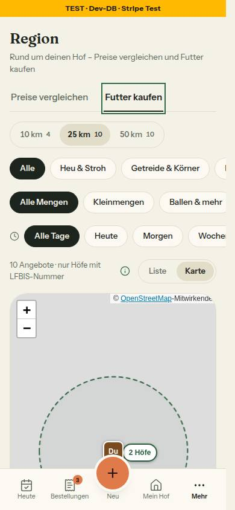

# Morgenbericht Nachtlauf 20 (21.10.2026)

Freigabe: `docs/nachtlauf/freigabe.md` §24 (im Chat erteilt am 21.10.2026). Dirigent nach `docs/nachtlauf.md`, Tempo nach 4a und §0 der Freigabe. Lauf 20 war ein fünfter Lauf: Nach dem Doku-PR kam die Regel-Inventur (Abschnitt 3).

- **Keine Nummer übersprungen, keine gestoppt.** Alle sieben Nummern 130–136 sind fertig und stecken im **Sammel-PR [#343](https://github.com/Uttoranger/FarmerZone/pull/343)** (`integration/lauf20`).
- **124 (PR [#329](https://github.com/Uttoranger/FarmerZone/pull/329)): auf main nachgezogen** (`d6fad97`, Basis main, ohne Rebase und Force-Push), **Leitplanken geschlossen** (`e3b436e`, Bericht `8e46aa9`), **CI grün** (ci und integration). **Nicht gemergt** – erst nach der rechtlichen Prüfung der Spanne (N23). Die Probe im Sammel-PR: 124 lässt sich auf dessen Stand sauber mergen (ohne Konflikt; tief geprüft mit allen Tests grün, nur `BAUSTEINE.md` neu zu erzeugen).
- **Keine Migration** (frische Datenbank: 34 Migrationen wie auf main, `migrate diff --exit-code` = 0). **Zwei neue Entwicklungspakete**, nur in 135: `yaml` 2.9.1 und `jsdom` 30.1.2; das Lockfile ändert sich genau wie freigegeben.
- **Die CI auf `main` sollte nach dem Merge wieder grün sein** (130): Der Hook-Test ruft den Hook jetzt immer aus einem eigenen Repository auf einem Feature-Branch auf; die Lage der CI auf `main` ist als eigener Fall mit Gegenprobe festgehalten.
- **Zwei Funde, beide behoben:** Der neue Hydrier-Test (135) fand eine echte Abweichung am Darstellungs-Umschalter (falsche Beschriftung im dunklen Modus); ein Integrationstest zum Abmelden war in 1 von 256 Läufen rot (CI des PR 133) – behoben im Sammelstand.
- **Stand des Sammel-PR:** typecheck grün, **lint 0 Fehler** (5 Warnungen, wie main), 519 Testdateien / 9649 Tests grün (ohne eine Zeitüberschreitung), Integration ganz 70 Dateien / 621 Tests; frische Datenbank mit allen 34 Migrationen, `migrate diff --exit-code` = 0. CI auf allen Einzel-PRs grün, auch auf dem gestapelten #342 (G3).

## 1. PRs

| Nr | Thema | PR | Basis | Migration | Paket | Runden · Durchgänge | Vorschau |
|---|---|---|---|---|---|---|---|
| Doku | Freigabe §24, Register, Konzept Umfeld, Wortliste, Mockup-README, Status | [#335](https://github.com/Uttoranger/FarmerZone/pull/335) | main | nein | nein | – (Dirigent prüfte die Wörtlichkeit) | [Vorschau](https://farmer-zone-git-docs-lauf20-bierbaron.vercel.app) |
| 130 | CI auf main und ein Wackler (G4) | [#336](https://github.com/Uttoranger/FarmerZone/pull/336) | `docs/lauf20` | nein | nein | 0 · 1 gezielter Durchgang | [Vorschau](https://farmer-zone-git-nacht-2026-10-21130-ci-main-bierbaron.vercel.app) |
| 132 | Sicherheit und Admin, Nacharbeit aus 125 und 126 (G8-Ergänzung, N20) | [#337](https://github.com/Uttoranger/FarmerZone/pull/337) | `docs/lauf20` | nein | nein | 0 · 1 voller Durchgang, Integration ganz | [Vorschau](https://farmer-zone-git-nacht-2026-10-21132-sicherheit-admin-bierbaron.vercel.app) |
| 133 | Region-Nacharbeit und Seed (G9, F10) | [#338](https://github.com/Uttoranger/FarmerZone/pull/338) | `docs/lauf20` | nein | nein | 1 · 1 gezielter Durchgang | [Vorschau](https://farmer-zone-git-nacht-2026-10-21133-region-seed-bierbaron.vercel.app) |
| 131 | Volle Abholfenster in Hofliste und Hofseite (N19-Ergänzung) | [#339](https://github.com/Uttoranger/FarmerZone/pull/339) | `docs/lauf20` | nein | nein | 1 (Nachrunde) · 2 volle Durchgänge, Integration ganz | [Vorschau](https://farmer-zone-git-nacht-2026-10-21131-volle-abho-cda145-bierbaron.vercel.app) |
| 134 | Beiträge-Nacharbeit aus 128 und 129 (T5, F8, N11-Ergänzung, G4) | [#340](https://github.com/Uttoranger/FarmerZone/pull/340) | `docs/lauf20` | nein | nein | 0 + Nachrunde Dirigent (Bericht) · 1 gezielter Durchgang | [Vorschau](https://farmer-zone-git-nacht-2026-10-21134-beitraege-d805b6-bierbaron.vercel.app) |
| 135 | Pakete `yaml` und `jsdom`, Test des Hydrierens (G6-Ergänzung) | [#341](https://github.com/Uttoranger/FarmerZone/pull/341) | `docs/lauf20` | nein | **ja** – `yaml` 2.9.1, `jsdom` 30.1.2 (dev) | 1 (Nachrunde) + Nachrunde Dirigent (Tagebuch) · 1 gezielter Durchgang | [Vorschau](https://farmer-zone-git-nacht-2026-10-21135-yaml-jsdom-bierbaron.vercel.app) |
| 136 | Regelvorschläge aus Morgenbericht 19, Zeitgrenzen und Reste (G4, G3) | [#342](https://github.com/Uttoranger/FarmerZone/pull/342) | `integration/lauf20` (Abzweig `f5efd6e`) | nein | nein | 2 · 1 gezielter Durchgang + 2 Nachprüfungen; CI auf dem gestapelten PR grün | [Vorschau](https://farmer-zone-git-nacht-2026-10-21136-regeln-reste-bierbaron.vercel.app) |
| 124 | Region · Preise vergleichen – nachgezogen, Leitplanken geschlossen (N23) | [#329](https://github.com/Uttoranger/FarmerZone/pull/329) | main | nein | nein | Nachziehen (Dirigent) + Leitplanken 0 + Nachrunde Dirigent (Bericht) · 1 gezielter Durchgang | [Vorschau](https://farmer-zone-git-nacht-2026-10-20124-preise-ver-429d22-bierbaron.vercel.app) |
| Sammel | 130–136 (ohne 124) | [#343](https://github.com/Uttoranger/FarmerZone/pull/343) | main | nein | ja (135) | – | [Vorschau](https://farmer-zone-git-integration-lauf20-bierbaron.vercel.app) |

- **CI auf den PRs** (`ci` und `integration`): #335, #336, #337, #339, #340, #341 und #329 beim ersten Lauf grün. **#338** war im Job `integration` einmal rot – ein Wackler, der nicht von 133 kommt (Abschnitt 2, „Sammelstand-Fix“); der eine Neustart war grün, mit Kommentar im PR. **#342** (gestapelt auf `integration/lauf20`) bekam die CI selbst (G3) – grün.
- **Vorschau und Entwicklungsdatenbank:** Kein PR bringt eine Migration; die Vorschau-Builds spielen nichts ein. Aus dem Nachtlauf lief kein Befehl gegen die Entwicklungsdatenbank.

## 2. Sammel-PR

### Keine Migration, zwei Entwicklungspakete
- `prisma/schema.prisma` und `prisma/migrations/` sind unverändert.
- **Regel 3 auf dem Zwischenstand (`f5efd6e`, Schema seitdem unverändert):** frische lokale Datenbank, 34 Migrationen eingespielt (wie auf main), `migrate status` „up to date“, zweiter `migrate deploy` ohne Arbeit, `migrate diff --exit-code` = 0 (Datenbank = Schema), RLS auf allen Tabellen; die Wegwerf-Datenbank ist gelöscht.
- **Pakete (nur 135, nur Entwicklung):** `yaml` 2.9.1 und `jsdom` 30.1.2. Lockfile: 30 neue Pakete, alle aus den Bäumen der zwei; keine bestehende Version geändert; fünf Schlüssel nur durch Peer-Zusätze umbenannt. `pnpm install --frozen-lockfile` läuft.

### Merge-Reihenfolge (`integration/lauf20` von main `c9d860f`, jeweils `--no-ff`)
1. Doku-PR `docs/lauf20` (`d9c0c2b`, Basis aller Nummern außer 136)
2. 130 (`1da202c`), 132 (`93af753`)
3. 131 (`b1cb8c0`), 133 (`7b933e2`)
4. Sammelstand-Fix am Abmelde-Test (`97da4c6`)
5. 134 (`6f365ef`)
6. 135 (`964a101`) – danach der volle lokale Lauf auf `f5efd6e` als Bedingung für 136: typecheck grün, lint 0 Fehler, 517 Dateien / 9635 Tests, Integration 70 Dateien / 621 Tests
7. 136 (`c9e7726`, zweigte von `f5efd6e` ab)
8. danach der Morgenbericht mit `status.md`

### Konflikte und Auflösung
- **Textkonflikte nur in `DEVELOPMENT.md`** (bei 134 und 135): angehängte Abschnitte, beide Seiten in Merge-Reihenfolge.
- `docs/ai/TESTING_GUIDELINES.md` (132, 135, 136), `TECH_STACK.md` (131, 135) und `ARCHITECTURE.md` (131, 134) mergten ohne Konflikt an getrennten Stellen; nach jedem Merge per Grep geprüft, dass jede Stelle da ist. `docs/ai/BAUSTEINE.md` nach jedem Merge mit `pnpm bausteine` geprüft (ohne Änderung).
- **Sammelstand-Fix (`97da4c6`, nur Testcode):** `tests/integration/abmelden.int.test.ts` – der Fall „ein falscher Token ändert nichts“ setzte die letzten zwei Hex-Zeichen der Signatur auf `00`; bei zufälliger Adresse blieb der Token in 1 von 256 Läufen gültig (CI auf #338 einmal rot, Neustart grün). Nachgezählt: bei 20 000 Tokens 70-mal wirkungslos, ein Tausch nur des letzten Zeichens nie. Jetzt wird das letzte Zeichen sicher getauscht.

### Probe „124 lässt sich mergen“ (Freigabe)
Auf dem Endstand `87f68f9`: `git merge --no-commit --no-ff origin/nacht/2026-10-20/124-preise-vergleichen` (Stand `8e46aa9`), danach `git merge --abort`.
- **Ergebnis: konfliktfrei.** Seit dem Nachziehen der 124 auf main (`d6fad97`) gibt es keinen Textkonflikt mehr.
- **Tiefe Probe in einem Wegwerf-Worktree** mit genau diesem Merge: Nur `docs/ai/BAUSTEINE.md` muss danach mit `pnpm bausteine` neu erzeugt werden. Dann typecheck grün, lint 0 Fehler, `pnpm test` 521 Dateien / 9701 Tests grün, Integrationsdateien zu Umfeld, Region, Auswertung Region und Testhof 4 Dateien / 23 Tests grün. Nichts davon ist committet; der Worktree ist gelöscht.

### Prüfungen auf dem Endstand `87f68f9`
- typecheck grün, `pnpm lint` 0 Fehler / 5 Warnungen (wie main), `pnpm test` 519 Dateien / 9649 Tests grün – ohne eine einzige Zeitüberschreitung (136 hat die Zeitgrenzen nachgetragen).
- `pnpm test:integration` ganz unter der Sperre: 70 Dateien / 621 Tests grün.
- CI auf allen Einzel-PRs grün, auch auf dem gestapelten #342 (Basis `integration/lauf20`, G3).

### Bekannt, nicht Teil dieses PRs
- Die CI auf `main` (Push) ist seit dem 16.10. rot (Hook-Test). 130 behebt das; nach dem Merge dieses PRs bitte die CI auf `main` ansehen.

## 3. Regel-Inventur (Register G4) – nur Vorschläge, gestrichen ist nichts

Sonnet, nur lesend im Wegwerf-Worktree `wt-inventur` (losgelöst auf d9c0c2b). Stand der 20 Vorschläge aus Lauf 15: umgesetzt und hier mit Test belegt sind 3 (`workflows-wache`), 4 (`decrement-wache`), 11 (`migrationen-wache`), 12 (ESLint-Selektoren); umgesetzt, Hook und CLAUDE.md gelesen bzw. Eingabeprobe: 2, 6, 7, 18. Wiederholt „(wie Lauf 15)“: 1, 5, 8, 9, 10, 13, 14, 16, 20 (mit neuen Belegen). Nicht erneut belegt: 15, 17, 19 (Rest in Zeile 18).

| # | Fundstelle (Datei:Zeile) | Grund | Vorschlag |
|---|---|---|---|
| 1 | `docs/ai/CODING_STANDARDS.md:128-130` (11 365 Zeichen = 24 % der Datei, Z.129 allein 8 404) und `:132` | doppelt mit dem Kopfkommentar `src/lib/sentry-hygiene.ts` (1 723 Zeilen) und den vier Tests `tests/sentry-hygiene-{felder,sdk,vergleich,wachstum}.test.ts`; Z.132 abgedeckt durch `tests/beobachtbarkeit.test.ts` «findet genau die zwei init-Aufrufe …» und «jeder init-Aufruf setzt sendDefaultPii: false und beide …», Gegenprobe rot (neue Datei mit `Sentry.init({ dsn })` unter `src/lib`: 2 Tests rot) | zusammenlegen: etwa fünf Regelzeilen (nur Kennungen in tags/extra, nie `cause`, neues Muster = Fall im Test, Mehrfund zuletzt, jedes init mit `bereinigeEreignis`); Mechanik in den Modulkopf (wie Lauf 15) |
| 2 | `CODING_STANDARDS.md:57` (1 623 Zeichen), `ARCHITECTURE.md:343` | dreifach: „Stichtag nur in `umgebung-server.ts` gelesen, Regel nur aus `testzahlung.ts`“ steht auch im Kopf von `src/lib/testzahlung.ts:1-28`; abgedeckt durch `tests/testzahlung-wache.test.ts` «kein Fund in src/: Variable an einer Stelle gelesen, Regel nur in testzahlung.ts, nie mit null abgeschaltet», Gegenprobe rot (`process.env.STRIPE_LIVE_AB` in neuer Datei unter `src/lib`) | Z.57 auf drei Sätze plus Verweis auf Modulkopf und Wache; Mechanik (AND-Form, Töpfe-Konstanten) nur im Modulkopf |
| 3 | Herkunftsvermerke: `TESTING_GUIDELINES.md:55,148-157,181`, `CODING_STANDARDS.md:129-130,341` u. a. | widersprüchlich zu CLAUDE.md §3 (Verlauf gehört in `DEVELOPMENT.md`): Zeilen mit „seit Nr.“/„Regelvorschlag“/„Lauf n“/„Morgenbericht n“/„freigegeben tt.mm.“ (Befehl: `grep -cE "seit Nr\.\|Regelvorschlag\|Lauf [0-9]+\|Morgenbericht [0-9]+\|freigegeben [0-9]+\." <datei>`): TESTING 22, CODING 7, ARCHITECTURE 86, DESIGN_SYSTEM 150 (Lauf 15: 15/6/68/125), wächst je Lauf | schärfen: Regeln ohne Herkunftsvermerk, Verlauf ins Tagebuch; Zähl-Wache mit Bestand, der nur schrumpft (Muster `palette-klassen-wache`) (wie Lauf 15) |
| 4 | `TESTING_GUIDELINES.md:3-4`, `:171-177` | überholt: „100 Testdateien / ~1.600 Tests“, „5 Dateien / 15 Tests“ und Mock-Zahlen 27/15/14/8/15/13/3; heute 506 Unit-Dateien (`ls tests/*.test.ts \| wc -l`), 69 Integrationsdateien (`ls tests/integration/*.int.test.ts \| wc -l`), Mocks `@/lib/prisma` 131, `auth` 70, `email` 45, `stripe` 24, `next/headers` 73, `next/cache` 54, `@vercel/blob` 10 (`grep -lE "vi\.mock\(['\"]<modul>['\"]" tests/*.test.ts \| wc -l`) | Zahlen streichen oder von `pnpm bausteine` erzeugen lassen (wie Lauf 15) |
| 5 | `CLAUDE.md:157-162` („Zwei Hooks“), `.claude/hooks/gefahr-blocken.mjs:301-302`, `tests/gefahr-blocken.test.ts` | ungeprüft und lückenhaft: Der Hook blockt `rm -rf /…` (Eingabeprobe Exit 2), die Liste in CLAUDE.md nennt es nicht, der Test hat keinen Fall (`grep -nE "rm -rf\|Destruktiv" tests/gefahr-blocken.test.ts` → 0 Treffer; das Muster findet im Hook Z.302), und `rm -fr /…` sowie `rm -r -f /…` gehen durch (Eingabeprobe Exit 0, das Muster `rm\s+-rf?` kennt nur die Reihenfolge `-r…`) | in Prüfung überführen: Muster für alle Flag-Reihenfolgen, Fälle im Test, `rm -rf` in die Liste |
| 6 | `CLAUDE.md:47`, `CODING_STANDARDS.md:41,45` (nie `Number(decimal)` für Geld) | ungeprüft: keine Wache, keine Lint-Regel (`eslint.config.mjs` kennt nur Farb- und Datumsselektoren); drei echte Stellen in `src/`: `app/(hof)/status/new/page.tsx:79`, `app/(public)/[farmSlug]/bestaetigen/[token]/page.tsx:147`, `lib/produkt-dto.ts:21` (Befehl: `grep -rnE 'Number\([A-Za-z_.]*(price\|Price\|amount\|Amount\|total\|Total\|fee\|Fee\|betrag\|Betrag\|preis\|Preis)' src --include=*.ts --include=*.tsx \| grep -v Percent`, Positivprobe `Number(order.totalAmount)` → 1; dazu zwei Kommentartreffer) | in Prüfung überführen: Quelltext-Wache nach `tests/decrement-wache.test.ts` mit Positivliste dieser drei Stellen und Gegenprobe |
| 7 | `CODING_STANDARDS.md:34-35` (auch `:454`) | ungeprüft und nicht befolgt: 63 einzeilige exportierte Funktionen ohne Rückgabetyp (22 `.ts`, 41 `.tsx`; Muster `^export (async )?function [A-Za-z0-9_]+(<[^>]*>)?\([^)]*\) *\{`, Positivprobe 1; gleich viele wie Lauf 15); 17 Codezeilen mit `!`-Assertion (Muster `[]A-Za-z0-9_)]!([.,;)[]\|$)`, Positivprobe 1, Negativprobe `a !== b` 0), keine mit `//` in derselben Zeile | schärfen: Komponenten vom Rückgabetyp ausnehmen; `no-non-null-assertion` als Warnung für neue Dateien (wie Lauf 15, Z.34) |
| 8 | `CODING_STANDARDS.md:450-464` (§9 Checkliste) | doppelt mit `.claude/skills/pruefen/SKILL.md:21-47` (any/ts-ignore/`!`, Session und Besitz, WHERE, `revalidatePath`, Decimal/Date) und CLAUDE.md §1; Z.452 steht verirrt vor der Liste; Z.456 „Auth in jeder schreibenden Action“ abgedeckt durch `tests/actions-sitzung-wache.test.ts` «jede exportierte Funktion erreicht eine Sitzungsprüfung …», Gegenprobe rot (neue Datei `src/server/actions/gegenprobe.ts` ohne Sitzung); der Besitz in der WHERE-Klausel (Z.457) bleibt ungeprüft | durch Verweis auf `/pruefen` ersetzen (wie Lauf 15) |
| 9 | `CODING_STANDARDS.md:141` | abgedeckt durch `tests/transaktion-nacheinander.test.ts` «in ganz src/ läuft auf einem Transaktions-Client nichts gleichzeitig», Gegenprobe rot (`Promise.all([tx.product.findMany(), tx.farm.findMany()])` im `$transaction`-Rückruf einer neuen Datei; Fund mit Datei und Zeile) | auf zwei Sätze mit Verweis auf die Wache kürzen |
| 10 | `CODING_STANDARDS.md:65` (637 Zeichen) | abgedeckt durch ESLint (`DATUM_SELEKTOREN`, `DATUM_ORT_SELEKTOREN` in `eslint.config.mjs`) und `tests/datums-regeln.test.ts` «die Dateien, die davor … umgestellt wurden, haben keinen Treffer» sowie «Gegenprobe: dieselbe Datei ohne timeZone schlägt an», Gegenprobe rot (`timeZone` in `src/lib/whatsapp.ts` ersetzt: 2 Tests rot, ESLint auf die Datei Exit 1; der Test prüft nur benannte Dateien, die Fläche trägt ESLint) | Z.65 auf Regel plus Verweis auf `eslint.config.mjs` kürzen |
| 11 | `CODING_STANDARDS.md:253-257`, `:314-316`, `DESIGN_SYSTEM.md:713` | abgedeckt durch ESLint (`FARBLITERAL_SELEKTOREN`) und `tests/design-tokens.test.ts` «kein Hexwert in src/components und src/lib außer den benannten Ausnahmen und der Nacharbeit», Gegenprobe rot (`#123456` in `src/components/shared/zeichen-zaehler.tsx`: 1 Test rot, ESLint Exit 1 «Keine Farbwerte im Quelltext»); der alte Wert `#62705F` aus DS:713 steht in `src/` und `tests/` nirgends (`grep -rniE "62705F" src tests \| wc -l` → 0; Positivprobe auf DS:713 → 1) | auf Verweis kürzen, den Satz zum alten Farbwert streichen (wie Lauf 15) |
| 12 | `CODING_STANDARDS.md:15` („Verb zuerst“) | widersprüchlich zu den eigenen Beispielen in Z.44-66 und 425: `centsAlsEuro`, `kilopreisNetto`, `grundpreisCents`, `alsCents`, `bestellSummen`, `wienKalendertag`, `abholtage`, `uhrzeitInWien`, `kalendertagInWien`, `bildFormat` | schärfen: Verb für Aktionen, Handler, Hooks; Lese- und Rechenfunktionen heißen nach dem Ergebnis (wie Lauf 15) |
| 13 | `TESTING_GUIDELINES.md:43,46,198,237` | widersprüchlich: dreimal „die einzige Ausnahme“ bzw. „die eine erlaubte Abhängigkeit“ von der Uhr (Z.46 und Z.198 Integrationsschicht, Z.237 `performance.now()`); „Gegenprobe“ als Pflicht steht in 13 Zeilen (`grep -c Gegenprobe`; Lauf 15: 7) | eine Ausnahmenliste in §4, Z.43/46/198 verweisen darauf; die Gegenprobe-Pflicht einmal (wie Lauf 15) |
| 14 | `TESTING_GUIDELINES.md:22-26` | überholt: „Keine weiteren Unterordner“, aber `tests/fixtures/bausteine-beispiel` existiert (`ls tests/fixtures`), und `admin-sitzung.ts`, `element-suche.ts`, `finanzen-jahr-daten.ts` liegen als Hilfsdateien lose in `tests/` | Ausnahme `tests/fixtures/` nennen, Hilfsdateien nach `tests/fabrik/` (wie Lauf 15) |
| 15 | `DESIGN_SYSTEM.md:319`, `:210`, `:119` | `:319` doppelt mit `:210` (beide „Leerzustand mit Ausweg“); `:210` abgedeckt durch `tests/leerzustaende-wache.test.ts` «steht in einem EmptyState, in der Textquelle eines EmptyState oder mit Grund in AUSNAHMEN», Gegenprobe rot (`
Noch keine Einträge vorhanden.
` in neuer Datei); `:119` abgedeckt durch `tests/fachwort-wache.test.ts` «kein Fachwort ohne Erklärung in einem Text unter src/», Gegenprobe rot (`
Primärproduktion
`) | `:319` streichen; `:210` und `:119` auf Regel plus Testverweis kürzen (wie Lauf 15, Zeilen verschoben) |
| 16 | `TESTING_GUIDELINES.md:278` („nie `.skip`“) | ungeprüft, heute eingehalten: 0 Treffer (Befehl: `grep -rnE '\.skip\(\|\bit\.only\|describe\.only\|xit\(\|xdescribe\|\.todo\(' tests \| wc -l`; Positivprobe `it.skip('a')` → 1) | in Prüfung überführen: eine Zeile in einer vorhandenen Quelltext-Wache mit Gegenprobe |
| 17 | `.claude/hooks/gefahr-blocken.mjs:248,276,295,305` gegen `tests/gefahr-blocken.test.ts:156,307` | widersprüchlich: stash, prettier und migrate deploy lassen Text durch, der den Befehl nur nennt (Testkommentar Z.156, Z.307); `db push`, Force-Push, Push auf main und npm/yarn stehen ohne `BEFEHLSANFANG` und blocken auch Text: `grep -n 'prisma db push' README.md` und `echo prisma db push` → Exit 2; im Lauf zweimal selbst getroffen (Hook des Hauptrepos, ein grep-Muster und ein Probetext) | schärfen: die vier Muster an `BEFEHLSANFANG` binden und „lässt durch“-Fälle ergänzen, oder den Fehlalarm wie bei stash als „gewollt vorsichtig“ im Test festhalten |
| 18 | `CLAUDE.md:81`, `:56`, `:54` | schwach, ohne Gegenprobe („vermutlich abgedeckt“): `:81` Hook blockt nur npm/yarn (Eingabeprobe `pnpm add left-pad` → Exit 0), dazu `minimumReleaseAge` (Z.84); `:56` durch `deny: mcp__claude-in-chrome__*` in `.claude/settings.json` (kein Test: `grep -rl claude-in-chrome tests .claude` → nur settings.json); `:54` durch die Allowlist in `prisma/seed.ts:26-39` und `tests/umgebung.test.ts` | `:81` präzisieren („Hook blockt npm/yarn, nicht `pnpm add`; Fragen bleibt Pflicht“); `:56` und `:54` auf Verweis kürzen (wie Lauf 15, schwach) |

Gegenproben: je Test erst grün, dann mit Verstoß rot, dann zurückgenommen: `design-tokens` (37 grün → 1 rot; ESLint Exit 0 → 1), `datums-regeln` (15 → 2 rot; ESLint 0 → 1), `transaktion-nacheinander` (9 → 1 rot), `beobachtbarkeit` (50 → 2 rot), `testzahlung-wache` (9 → 1 rot), `migrationen-wache` (17 → 1 rot, `DROP COLUMN` ohne Marker in neuer Migration), `actions-sitzung-wache` (15 → 1 rot), `leerzustaende-wache` (18 → 1 rot), `fachwort-wache` (13 → 1 rot), `decrement-wache` (6 → 1 rot), `workflows-wache` (22 → 1 rot, neue Workflow-Datei mit `pull_request_target`); Hook: `tests/gefahr-blocken.test.ts` 192 grün, Eingabeproben (erfundener Text, nie ausgeführt) `git stash`, `prisma db push`, `git push origin main`, `npm install`, `rm -rf /…` → Exit 2; `ls`, `pnpm add`, `git commit` im losgelösten Worktree, `rm -fr /…`, `rm -r -f /…` → Exit 0.
Gelesen: ganz `CLAUDE.md` (§2 und §4), `docs/ai/CODING_STANDARDS.md`, `docs/ai/TESTING_GUIDELINES.md`; per Grep (Niemals|Nie |Immer|Pflicht|verboten) `docs/ai/ARCHITECTURE.md` und `docs/ai/DESIGN_SYSTEM.md` (Zeilen 343, 713, 210, 319, 119 im Wortlaut); dazu `eslint.config.mjs`, `.claude/settings.json`, `.claude/hooks/gefahr-blocken.mjs` (Ausschnitte), Kopf von `src/lib/testzahlung.ts` und `sentry-hygiene.ts`, Lauf 15 Abschnitt 4, Lauf 19 Abschnitt 5 (nicht bewertet).
Worktree am Ende sauber: ja (`git status --short` nach jeder Gegenprobe und zuletzt leer; HEAD unverändert d9c0c2b; einmal `git stash list` nur zum Lesen, Ausgabe 0 Zeilen, nichts verändert).
Schritte: 31 von 60 (zwei Aufrufe vom Hook des Hauptrepos blockiert und wiederholt).

## 4. Zu den Nummern

### 130 · CI auf main und ein Wackler
- **Hook-Test auf main:** Im Wegwerf-Klon auf einem lokalen Branch `main` war die alte Testdatei rot (3 rot, 189 grün – genau die drei erlaubten Commit-Fälle), die neue grün (193). Der neue Fall startet den Hook aus einem Verzeichnis auf `main` mit dem Ordner eines Feature-Branchs in der Eingabe (→ 0), Gegenprobe ohne Ordner in der Eingabe (→ 2). Der pruefer hat zusätzlich den Hook zweimal verändert (nur im Klon): Beide Male schlug der Fall bzw. seine Gegenprobe an.
- **Wackler in `code-bremse.int`:** **20 Läufe einzeln: 0 rot** (je 13/13), **5 Läufe mit allen Integrationsdateien: 0 rot** (je 69 Dateien / 609 Tests). Kein Versuch zu viel. Nicht nachstellbar – nach Auftrag nichts geändert, keine Wiederholung im Test. Ursache bleibt offen: Die Vermutung im Kopf der Datei ist ungeprüft, und der Fall prüft beim Tagesfenster nur „mindestens 10“ (ein Ausreißer von 11 würde dort nicht rot).
- **`AGENTS.md`:** `/AGENTS.md` steht verankert in `.gitignore`; die getrackte Datei unter `.claude/skills/…` trifft es nicht.

### 131 · Volle Abholfenster – alle Wege, die eine Bestellung anlegen oder stornieren
- Anlegen: nur `src/app/api/checkout/route.ts` (`imAbholfenster` → `db.order.create`) → `erneuereHoflisteNachBestellung(abholung.fenster.slot.maxOrders)`.
- Auf CANCELLED: `src/server/actions/orders.ts` `storniere` (Stornieren und „Artikel fehlt“ ohne Rest) → `erneuereHoflisteNachStorno(orderId)`; `src/server/unbezahlte-bestellung.ts` `storniereUnbezahlteBestellung` → `erneuereHoflisteNachStorno(orderId)`. Letzteres deckt checkout `route.ts:196`, Stripe-Webhook `:227`, `bar-bestaetigung.ts:167`, `verwaiste-bestellungen.ts:113` und `:119` (Cron und `gibVerwaisteFreiOhneRisiko` beim Rendern). Die übrigen `'CANCELLED'`-Treffer lesen nur (`where`). Wache: `tests/hofliste-erneuern-wache.test.ts`.
- `{ expire: 0 }`: `node_modules/next/dist/docs/01-app/03-api-reference/04-functions/revalidateTag.md`, „Revalidation Behavior“ und Beispiel für Route Handler; Wurf beim Rendern `node_modules/next/dist/server/web/spec-extension/revalidate.js` (`phase === 'render'`), next 16.4.2 – im Kommentar von `hofliste-erneuern.ts`.
- **Grenzen, die bleiben:** Verbindlich bleibt die Prüfung der Kasse (`imAbholfenster` mit `FOR UPDATE`). Ohne Erneuern altert die Liste höchstens 300 s, ebenso wenn das Erneuern nach dem Rendern nicht wirkt. `nextPickupDays` zeigt ein laufendes Fenster weiter bis zu seinem Ende, die Kasse nimmt nur bis zum Beginn an (unverändert, Kommentar dort).
- **Gleichheit Kasse = Liste = Hofseite:** Integrationsfall mit vier vollen Terminen aus drei Abholzeiten, absichtlich in umgekehrter Reihenfolge angelegt; die Kasse gegen ein festes Array (Tag, dann Beginn). Vertauschte oder fehlende Sortierung → rot (Nachrunde 1, beide Prüfdurchgänge hatten das verlangt).

### 132 · Allowlist der CSP mit Quelle je Host (Report-Only, Stand nach 132)
| Direktive | Host | Quelle |
|---|---|---|
| script-src, frame-src | `https://js.stripe.com`, `https://*.js.stripe.com` | Stripe-Doku „Integration security guide › Content Security Policy › Stripe.js", docs.stripe.com/security/guide, abgerufen 21.10.2026 (G8-Ergänzung); `csp.ts:44-45`, Z. 107/112 |
| connect-src | `https://api.stripe.com` | dieselbe Stelle; `csp.ts:46`, Z. 111 |
| frame-src | `https://hooks.stripe.com` (3-D-Secure) | dieselbe Stelle; `csp.ts:47`, Z. 112 |
| img-src | `https://tile.openstreetmap.org` | `KARTEN_KACHELN.url` (`src/lib/hoefe-anzeige.ts`); `csp.ts:56` |
| img-src | `https://*.public.blob.vercel-storage.com` | `images.remotePatterns` (next.config.ts), `constructBlobUrl` (@vercel/blob); `csp.ts:48` |
| connect-src | `https://vercel.com` | `defaultVercelBlobApiUrl` (Ziel von `upload()`); `csp.ts:49` |
| connect-src | Sentry-Host | nur der Host aus `NEXT_PUBLIC_SENTRY_DSN` |
| alle sechs Quell-Direktiven | `https://vercel.live` | nur bei `VERCEL_ENV=preview`; `csp.ts:50` |
Nicht dabei: `maps.googleapis.com`, die Hosts von Link, `*.stripe.com` in img-src (G8).
- **Stripe-Doku:** Aus der Sandbox nicht erreichbar (Proxy 403). Quelle im Kommentar von `csp.ts` ist der Wortlaut der G8-Ergänzung mit dem Abrufdatum der Projektleitung.
- **Login-Bremse bei ausgefallener Datenbank:** zwei echte Ausfälle (Verbindung abgewiesen; Datenbank stumm über 1,5 s) – die Bremse zählt je Instanz, nie offen. Ohne den Rückfall werden beide Fälle rot. Am Code der Bremse nichts geändert, kein Fund.
- **Menü in der Landmarke:** Axe am offenen Menü, Regel „region“ nicht ausgenommen: Admin-Shell 390 hell und dunkel 0, Hof-Shell 1280 hell und dunkel 0; Gegenprobe (Portal wieder im `body`) → 1. Tastatur, Escape und Fokus-Rückgabe gleich. Dieselbe Lücke haben noch `admin/hoefe-ansicht.tsx` und `meldungen-werkzeug.tsx` (Nacharbeit).

### 133 · Region-Nacharbeit und Seed
- **Drei Orte im Seed getauscht (G9).** Slug, Name, Inhaber und Sorten blieben; die Stufen des Umkreises sind vorher und nachher gleich (4 Höfe bis 10 km, 17 bis 25 km, 31 bis 50 km), die Entfernungen mit `entfernungKm` nachgerechnet, die erwarteten Zahlen der Seed-Tests unverändert. Die alten Orte stehen in keiner hinzugefügten Zeile, keinem Commit-Text, keinem PR-Text und keinem Bericht (per Skript gezählt, nur Zahlen ausgegeben). Sie stehen weiter in 13 Dateien außerhalb der Grenze (Mockups, einzelne Tests, eine Seite) – Aufräumen ist laut Freigabe offen bei dir.
- **/hoefe unverändert:** Das Markup der Pin-Vorschau vom Stand `d9c0c2b` steht eingefroren als `KURZFORM_VORHER` im Test (3093 Byte); `toBe` prüft es. Das ist bewusst ein Schnappschuss, obwohl TESTING_GUIDELINES §1 sonst keine will – der Auftrag verlangt genau diesen bleibenden Beleg (Abschnitt 9).
- **Reiterwechsel:** alle vier Wege mit Liste und Karte, Test zuerst rot (3 von 4).

### 134 · Beiträge – alle Links auf einen Beitrag und ihre Regel
- Mail an Abonnentinnen und WhatsApp je Person nutzen dieselbe Funktion (`beitragIdImLink` neben `beitragLink`): `?beitrag=` nur, wenn der Beitrag auf der Hofseite steht; `k=wa` bleibt.
- Teilen-Fenster: nur nach `beitragDarfInsBild` (verlangt `showOnFarmPage`) – gleiche Bedingung, aber nicht dieselbe Funktion (Nacharbeit). „Ansehen“ in „Dein Beitrag“ und „Neu bei den Höfen“: nur Beiträge aus `AKTIVER_BEITRAG`.
- Ohne Beitragslink: „Neuester: …“, Mein Hof › Beiträge (`#aktuell`), das Bild `/api/status-image/<id>`, die zwei QR-Links auf den Hof.
- Anlass-Wörter nur noch in `BEITRAG_ANLASS` (Wache über ganz `src/`, vorher 18 Funde, jetzt 0). „Neu bei den Höfen“: Obergrenze 200 Beiträge, Ergebnis vorher = nachher bei 20 Beiträgen von 8 Höfen und bei 60 Beiträgen eines Hofs; eine zu kleine Obergrenze (30) macht den Fall rot.

### 124 · Die Leitplanken als Liste der Prüfungen (Unterlage für die rechtliche Prüfung; Stand #329, `8e46aa9`)
Alle in `tests/umfeld-leitplanken.test.ts`, wo nichts anderes steht. Gegenproben, die anschlagen, sind für 1 und 2 belegt (auch von Hand, siehe die drei Lücken unten); 3 und 6 sind Tests, eine eigene Gegenprobe lief in diesem Lauf nicht; zu 4 und 5 siehe „Nicht gelöst“.
1. Kein Text empfiehlt oder wertet einen Preis. (a) Quelltext-Wache über alle String-Literale und JSX-Texte von `umfeld.ts`, `umfeld-*.tsx`, `preis-streifen.tsx`; (b) **neu:** dieselbe Verbotsliste auf den gerenderten Text (`renderToStaticMarkup`) von Liste, aufgeklappter Zeile, Karte am Pin und geöffnetem „So rechnen wir“, samt der wiederverwendeten Bausteine (`HofKopf`, `HoefeProduktzeilen`, `HofKurzkarte`, `ErklaerKnopf`). Verboten am Wortanfang: „empfehl/empfiehl“ (außer „empfiehlt keine“), „solltest“, „zu teuer/billig“, **„günstig“** (statt „zu günstig“, „günstiger als“), „erhöh“, „senk“, „teurer als“, „Rang“. Gegenprobe: „Du solltest erhöhen“ rot; ein verbotenes Wort in jedem der vier gerenderten Texte rot; „empfiehlt keine Preise.“ steht im HTML des Dialogs.
2. **Vor dem Antippen zeigt die Karte keinen Preis** (vorher „Kein Preis an den Pins“). Die Daten der Karte tragen die Preise der zwei Produkte als Zahl (`price` aus `alsVorschau`), wie die Hofseite; geprüft wird die Darstellung: gerendert wird die Karte vor dem Antippen (Pins mit Nummer und Name, eigener Hof) samt allen Eigenschaften, die die Kartenkomponente bekommt – ohne „€“ und ohne eine Schreibweise der Preise (Cent, 15.8, 15.80, 15,80). Gegenprobe: ein Preis im Pin-Namen macht den Test rot; nach dem Antippen steht der Preis in der Karte am Pin. Unverändert dazu: `baueUmfeldKarte` ohne „€“ (Gegenprobe Zeilen) und `KartenHof` nur mit Kennung, Nummer, Lage, Namen (`umfeld-karte.test.ts`).
3. Keine Sortierung nach Preis: aufgeklappte Zeile, Zeilen und Karte am Pin mit vertauschten Preisen unverändert; Query behält `PRODUCT_ORDER_BY`.
4. Testhof, pausierter und eigener Hof fehlen in Zählung, Streifen und Karte: je ein Test (Unit + `integration/umfeld.int.test.ts`); die Gegenprobe „ohne `isPaused: false` rot“ ist nur behauptet (siehe „Nicht gelöst“).
5. Keine Namen an Punkten: `PreisStreifen` ohne `title`, `tabindex`, Knopf oder Link (Render-Test); Werte ohne Namen und IDs.
6. Nur öffentliche Daten: keine Hof-ID, kein Bestand, keine Bestellungen, kein Umsatz (`umfeld-query.test.ts`).
Die drei Lücken (Morgenbericht 19 §3), geschlossen:
- **Wache zu eng:** Prüfung 1b. Von Hand ausprobiert und zurückgenommen: „Günstig zum Hof“ in `HofKurzkarte` und „Wir empfehlen:“ in `ErklaerKnopf` machen nur die neuen Tests rot, die Quelltext-Wache blieb grün.
- **„günstigstes Angebot“:** Punkt 3 lautet jetzt „Je Hof zählt in einer Sorte das Angebot mit dem kleinsten Grundpreis – ein Hof mit drei Heusorten zählt einmal.“ Der Satz von vorher schlägt an der neuen Verbotsliste an (Gegenprobe im Test); Punkt 4 bleibt ohne „oder Stück“. Bild: `so-rechnen-wir-390-hell.jpg`.
- **Preis als Zahl:** Prüfung 2. Von Hand ausprobiert und zurückgenommen: die Preiszahl im Pin-Namen von `umfeld-karte.tsx` macht „Pin, Name am Pin und alles vor dem Antippen …“ rot.

### 135 · Pakete und Test des Hydrierens
- **Node:** lokal v22.22.2, im letzten CI-Lauf auf main 22.23.3 (Schritt `setup-node`, Eingabe 22) – beide ≥ 22.22.2.
- **Lockfile:** `1 file changed, 296 insertions(+), 13 deletions(-)`; 1197 → 1227 Pakete (+30), keine bestehende Version geändert oder entfernt, alle neuen im Baum von `yaml` oder `jsdom`. Fünf Schlüssel nur durch Peer-Zusätze umbenannt (`vite`, `vitest`, `@vitest/mocker` und – weil sie `vitest` als Peer führen – `better-auth`, `@better-auth/passkey`). `pnpm install --frozen-lockfile` auf frischem Stand und in der CI grün.
- **Neue Unterpakete mit Veröffentlichung** (pnpm-Metadaten): yaml 2.9.1 (11.09.2026) · jsdom 30.1.2 (04.10.2026) · @asamuzakjp/css-color 7.1.3 (02.10.) · @asamuzakjp/dom-selector 9.2.4 (03.10.) · @bramus/specificity 2.4.3 (05.10., das jüngste) · @csstools/color-helpers 6.1.2 (25.09.) · css-calc 3.4.3 (02.10.) · css-color-parser 4.2.6 (02.10.) · css-parser-algorithms 4.0.2 (01.10.) · css-syntax-patches-for-csstree 1.1.15 (01.10.) · css-tokenizer 4.0.2 (25.09.) · @exodus/bytes 1.16.0 (22.09.) · bidi-js 1.1.0 (06.09.) · data-urls 8.0.0 (04.10.) · decimal.js 10.6.0 (06.07.2025) · entities 8.1.0 (07.09.) · html-encoding-sniffer 7.0.0 (21.09.) · is-potential-custom-element-name 1.0.1 (2021) · lru-cache 11.5.3 (18.09.) · parse5 8.0.1 (19.04.) · saxes 6.0.0 (2021) · tough-cookie 6.0.2 (07.07.) · tr46 7.0.0 (04.10.) · undici 8.11.2 (24.09.) · w3c-xmlserializer 6.0.0 (21.09.) · webidl-conversions 8.0.1 (02.01.) · whatwg-mimetype 5.0.0 (20.01.) · whatwg-url 17.2.0 (04.10.) · xml-name-validator 5.0.0 (2023) · xmlchars 2.2.0 (2019); 2026 wenn nichts anderes steht. Alle älter als 14 Tage (jüngstes 05.10. gegen 21.10.).
- **Laufzeit** von `tests/hydrieren.test.ts`: 6,5–7,5 s (davon Import 4,1 s) – unter 10 s, keine eigene Zeitgrenze.
- **Geprüfte Teile:** `Abholzeile` (Server 12:00, Browser 13:00), `BeitragMarke`, `ThemeUmschalter` und `ThemeUmschalterZeile`, `CookieBanner` (mit und ohne gespeichertes „Verstanden“), die Zahl im Korb der Kopfzeile (`KundenKopf`), `MeinHofAnsicht` und ein Rahmen um `useSchmalerAls`/`useMindestbreite`; dazu gewählt: `StartbildschirmKarte` (Anzeigemodus über `matchMedia` und `navigator`), `useCart` (Korb im Browser-Speicher, Geldweg), `useHoefeAdresse` (Filter von /hoefe aus der Adresse). Je Teil eine Gegenprobe (direktes Lesen statt `useSyncExternalStore` → genau ein Fall rot).
- **Fund:** Die Zeile des Darstellungs-Umschalters schrieb `aria-label` und `title` beim ersten Rendern im Browser schon nach dem Modus; React gleicht Attribute beim Hydrieren nicht an, im dunklen Modus blieb „Dunkelmodus einschalten“ am Knopf. Behoben in Runde 1 (Beschriftung erst nach dem Einhängen), mit Grenzerweiterung (Abschnitt 9).

### 136 · Regelvorschläge aus Morgenbericht 19, Zeitgrenzen und Reste
- **Regelvorschläge (G4-Ergänzung):** In `docs/nachtlauf.md` stehen wörtlich die Sätze 122, 123 und 129 (4a Punkt 1), 124 (§4 Schritt 1) und der G3-Satz (§4 Schritt 5), je mit Herkunft und Datum 21.10.2026; das Doppel in 4a Punkt 2 verweist jetzt auf §4 Schritt 5. **Prüfung vor Text:** neue Wache `tests/next-config-importe-wache.test.ts` (125) – folgt ab `next.config.ts` jedem relativen Import rekursiv und meldet `@/`; Gegenprobe im dritten Glied der Kette rot. 128 (`tests/use-cart-wache.test.ts`) und „CI auf main“ (130) stehen im Zwischenstand.
- **Zeitgrenzen:** neue Wache `tests/zeitgrenzen-wache.test.ts` (trägt selbst 30 000). Sie mahnte **63 `it` in 37 Dateien** an; diese haben nur `, 30_000` bekommen, sonst nichts (je Zeile per Skript geprüft). Erkannt werden auch die fünf Dateien, die in Lauf 19/20 unter Last ausliefen. TESTING_GUIDELINES trägt an der Regel nur den Zusatz „(geprüft von tests/zeitgrenzen-wache.test.ts; …)“. Grenze: eine Näherung ohne TypeChecker (kein `fs.globSync`, kein zur Laufzeit zusammengesetzter Ordner).
- **Fabrik `PublicProduct`:** `tests/fabrik/public-product.ts`; 11 Testdateien bauen den Typ nicht mehr selbst. Probe: Ein neues Pflichtfeld bricht nur noch die Fabrik und den echten Bau in `src/server/queries/farm.ts` (vorher 11 Testdateien). Die Fabrik-Wache vergleicht jetzt je Typ mit seinem Datenbankmodell.
- **Typ `AngebotVorhanden`** (in `src/lib/bereiche-anzeige.ts`) an allen fünf Stellen statt `readonly unknown[]`; typecheck belegt: kein Verhalten geändert.
- **Runden:** Der pruefer fand das fehlende Datum (Blocker). In Runde 1 kam das Datum dazu – und eine zusätzliche Wache außerhalb der Grenze; in Runde 2 ist sie wieder weg (ohne Grenzerweiterung). Holen ließe sie sich mit `git show 3eef10f:tests/regelvorschlag-herkunft-wache.test.ts` (Abschnitt 9).

## 5. Nicht begonnene bzw. gestoppte Nummern
- Keine.

## 6. Regelvorschläge aus den Berichten, gesammelt (Prüfung vor Textregel; eingetragen erst nach deiner Freigabe)

| Herkunft | Ursache | Gegenmaßnahme | Ort |
|---|---|---|---|
| 130 | Ein Test, dessen Ergebnis vom Arbeitsverzeichnis des Prozesses abhängt, ist in PRs grün und auf `main` rot; die CI für PRs zeigt das nicht. | **Prüfung, umgesetzt:** Solche Tests nennen ihr Verzeichnis selbst; der Fall „Lage der CI auf main“ mit Gegenprobe. | `tests/gefahr-blocken.test.ts` (erledigt) |
| 131 | Bilder mit „heute“ hängen an der Uhrzeit des Laufs (Fenster beginnt 15:00). | **Text:** Die Lesemappe nennt bei zeitabhängigen Bildern die späteste Uhrzeit. Eine Prüfung ist nicht sinnvoll. | `docs/nachtlauf.md` 4a Punkt 6 b |
| 132 | Ein Portal an den `<body>` liegt außerhalb jeder Landmarke; der Fund kam erst im Bild-Durchgang. | **Prüfung:** Quelltext-Wache „jedes `DropdownMenuContent` in Shells und Admin gibt `container` mit“, mit Gegenprobe; danach ein Satz in DESIGN_SYSTEM. | `tests/menue-ziel.test.ts` erweitern |
| 133 | Der Auftrag verlangte den Beleg „Markup bleibt gleich“, TESTING_GUIDELINES §1 verbietet Schnappschüsse. | **Text:** ein Satz für den Umbau-Beleg (eingefrorener Text, Stand-Commit im Kommentar). | `docs/ai/TESTING_GUIDELINES.md` |
| 134 | Die Freigabe nannte „page.tsx gibt es mit“, aber nicht die Dateien dazwischen – zwei Grenzerweiterungen. | **Prüfung vor Textregel:** Die Lesemappe zählt bei jedem durchgereichten Feld den Weg von der Abfrage bis zur Komponente per `git grep` auf. | Lesemappen-Vorlage, dann `docs/nachtlauf.md` |
| 135 | Eine Attribut-Abweichung beim Hydrieren fiel keinem Test auf, bis ein Test die Server-Seite wirklich ohne Browser rendert. | **Prüfung:** Wache, die jede Datei unter `src/` mit `useSyncExternalStore` gegen die Liste in `tests/hydrieren.test.ts` hält (neue Datei nennt sie mit Namen). | TESTING_GUIDELINES §2 |
| 124 | Die Wortwache las Quelltext, nicht den sichtbaren Text – wiederverwendete Bausteine und der geschlossene Dialog blieben außen vor. | **Prüfung, umgesetzt für Region:** Wachen über Nutzertext rendern ihn (`renderToStaticMarkup`, Gegenprobe mit einem Wort in einem Baustein). | TESTING_GUIDELINES §2 |
| Sammelstand (Dirigent) | Ein Test „falscher Token“ setzte die letzten zwei Zeichen auf einen festen Wert; bei zufälliger Adresse war der Token in 1 von 256 Läufen unverändert gültig. | **Prüfung:** Ein verfälschter Wert wird immer sicher anders (Zeichen tauschen statt festsetzen); eine Wache auf `slice(0, -n)}` + Literal in Tests mit Gegenprobe wäre möglich. | `tests/` (Muster), dann TESTING_GUIDELINES |
| Dirigent | Nach einem Neustart des Rechners war die lokale Datenbank aus; ein Integrationslauf meldete `P1001`. | **Text:** Im Rahmen der Umsetzer steht jetzt: bei `P1001` `service postgresql start` (nur lokal). | Rahmen des Laufs (erledigt) |
| 136 | Die Fabrik-Wache verglich jede Fabrik still mit der Zeile `Farm`. | **Prüfung, umgesetzt:** Jede neue Fabrik nennt ihr Modell in `DATENBANK_MODELL`; fehlt es, wirft die Wache. Ein Satz nur, falls gewollt. | TESTING_GUIDELINES §5 (Fabrik) |
| 136 (Dirigent) | Der Rahmen der Umsetzer nannte `test:` als Commit-Präfix; CLAUDE.md §5 kennt es nicht – zwei Commits tragen es. | **Text, erledigt:** Rahmen korrigiert; eine Prüfung (Commit-Hook auf das Präfix) wäre möglich. | Rahmen des Laufs; ggf. `.claude/hooks` |

## 7. Tempo

Zeiten in Wiener Zeit (21.10.2026).

| Nr | Beginn | Ende (PR) | Runden | Durchgänge (pruefer) | Integration | Bilder |
|---|---|---|---|---|---|---|
| Doku | 12:20 | 12:43 (#335) | – | Dirigent | – | 0 |
| Regel-Inventur | 12:44 | 12:56 | – | – | – | – |
| 124 nachziehen | 12:50 | 13:05 (CI grün) | Dirigent | – | Umfeld und Region (3 Dateien) | 0 |
| 130 | 13:00 | 14:14 (#336) | 0 | 1 gezielt | `code-bremse.int` 25 Läufe | 0 |
| 132 | 13:00 | 14:25 (#337) | 0 | 1 voll | ganz | 1 |
| 131 | 13:00 | 15:39 (#339) | 1 (Nachrunde) | 2 voll + Nachprüfung | ganz (dreimal) | 3 |
| 134 | 14:14 | 15:51 (#340) | 0 + Nachrunde Dirigent (Bericht) | 1 gezielt | vier Dateien | 2 |
| 133 | 14:24 | 15:39 (#338) | 1 | 1 gezielt + Nachprüfung | eine Datei | 3 |
| 135 | 15:38 | 16:50 (#341) | 1 (Nachrunde) + Nachrunde Dirigent (Tagebuch) | 1 gezielt + Nachprüfung | – | 0 |
| Leitplanken 124 | 15:38 | 16:45 (CI grün) | 0 + Nachrunde Dirigent (Bericht) | 1 gezielt | – | 1 |
| 136 | 17:09 | 18:34 (#342) | 2 | 1 gezielt + 2 Nachprüfungen | – | 0 |
| Sammel | 15:55 (Zwischenstand mit 130 und 132) | 18:59 (#343), Morgenbericht danach | Sammelstand-Fix (Abmelde-Test) | – | ganz (70 Dateien / 621 Tests, auf `f5efd6e` und `87f68f9`) | – |

**Was aus 4a anders lief:**
- **Die Regel-Inventur lief vor der ersten Nummer vollständig durch** (12 Minuten), das Nachziehen der 124 begann schon währenddessen (nach dem Doku-PR).
- **Die lokale Datenbank war nach einem Neustart aus**; der erste Integrationslauf der 124 brach mit `P1001` ab. Nach `service postgresql start` lief alles; der Rahmen nennt das jetzt.
- **Nachrunden:** 131 und 135 je als eigener kleiner Workflow mit Umsetzer und Nachprüfung; kleine Reste (Berichte 124 und 134, Tagebuch 135) als Nachrunde des Dirigenten.
- **Der Zwischenstand bekam schon unterwegs** 130–134 und den Sammelstand-Fix und einen ganzen Integrationslauf (70 Dateien / 621 Tests), vor dem vollen lokalen Lauf mit 135 (Bedingung für 136).
- Unter Last liefen in vollen lokalen Läufen einzelne Quelltext-Wachen in die Zeitgrenze von 5 s (`keine-emojis`, `ladeansichten`, `blob-loeschen-wache`, `sharp-wache`, `paket-mock-wache`); einzeln wiederholt waren sie grün. Genau diese Zeitgrenzen holt 136 nach.

## 8. Bilderstrecke (hell, wo nicht anders genannt)

Die Bilder liegen im Sammel-PR unter `docs/nachtlauf/berichte/bilder/<nr>/`; das von 124 im PR #329. Nach G9 stehen darin die erfundenen Seed-Höfe.
- **/hoefe mit vollem Fenster heute (390)** – 131: 
- **Kasse mit „ausgebucht“ (390)** – 131: 
- **Hofseite mit „Nächste Abholung“ ohne das volle Fenster (390)** – 131: 
- **Admin-Shell am Handy mit offenem Menü (390)** – 132: 
- **Futter kaufen, Liste (390 hell und dunkel)** – 133, nach dem Tausch der Orte:  ; Reiterwechsel mit Karte (390): 
- **Heute mit „Dein Beitrag“ (390)** und **Heute mit dem Anstoß, ohne Beitrags-Erinnerung in „Braucht dich“ (390)** – 134:  
- **„So rechnen wir“ mit neuem Punkt 3 (390)** – 124 (im PR #329): 
- 130, 135 und 136 haben keine Bilder (§0).

## 9. Für dich zu bestätigen
- **Grenzerweiterungen (vom Dirigenten erteilt, je ohne Berührung durch eine andere Nummer):**
  - 134: `src/components/farm/farm-page-view.tsx` reicht den Merker `beitraegeFehler` von der Seite an `HofseiteKunde` durch (eine optionale Eigenschaft) – ohne sie käme er nie an.
  - 135: `src/components/shared/theme-umschalter.tsx`, nur der Hook `useThemeUmschalter` – der Fix für den Fund des Hydrier-Tests (eine Zeile).
  - Sammelstand: `tests/integration/abmelden.int.test.ts` – Fix des 1:256-Wacklers (nur Testcode).
- **133:** bewusster Schnappschuss `KURZFORM_VORHER` (Markup der Pin-Vorschau) – der Auftrag verlangt den bleibenden Vergleich, TESTING_GUIDELINES §1 will sonst keine Schnappschüsse.
- **134:** Für die Bilder wurde in der lokalen Test-Datenbank ein erfundener Beitrag angelegt und über den bestehenden Weg „Löschen“ der App entfernt (Mails nur ins Log, Z3); der Hinweis lautete „ohne Zeilen zu löschen“, der Seed-Hof hatte aber keinen Beitrag zum Zurückdatieren.
- **132:** Der Punkt in `docs/betrieb/stripe-live.md` steht wörtlich; nur die Klammer „(Stripe-Doku wie oben)“ nennt die Quelle ausgeschrieben, weil „wie oben“ dort auf nichts zeigt.
- **130:** Die Commit-Zeile „Co-Authored-By“ des Umsetzers nennt sein eigenes Modell (der Umsetzer lief mit Sonnet).

## 10. Nacharbeit („Sollte“/„Kann“), gesammelt
- **130:** Der Wackler in `code-bremse.int` bleibt unerklärt (25 Läufe grün); der Fall prüft beim Tagesfenster nur „mindestens 10“. Altlasten neben dem Diff: zwei absolute lokale Pfade in `tests/gefahr-blocken.test.ts` (Z. 88, 148) und die Annahme, dass das Temp-Verzeichnis kein Repository ist.
- **131:** Der Kopfkommentar von `src/lib/hofuebersicht.ts` spricht noch von „Wochentag + Uhrzeit“ (außerhalb der Grenze).
- **132:** Dieselbe Landmarken-Lücke an den Menüs in `src/components/admin/hoefe-ansicht.tsx:685` und `meldungen-werkzeug.tsx:352`; ein Satz in DESIGN_SYSTEM zum Zielort des Menü-Portals und ein Eintrag in DEVELOPMENT.md fehlen (außerhalb der Grenze). Kann: In der Hof-Shell liegt das Menü „Neu“ jetzt im Stapelkontext der Seitenleiste (z-40) – heute liegt am Computer nichts darüber; ein Satz dazu im Kommentar wäre gut.
- **133:** Die Reiter-Links tragen die Ansicht vom Laden der Seite; wer danach per `replaceState` umschaltet, behält im Kopf die alte Ansicht. Die alten Orte stehen noch in 13 Dateien außerhalb der Grenze (Mockups, Tests, eine Seite). Kann: Der Test baut die Pin-Vorschau per Funktionsaufruf statt als Element (begründet im Kommentar).
- **134:** `showOnFarmPage` in `getStatusPostForWhatsApp` aufnehmen (dann entfällt die eigene Abfrage in `send-whatsapp/page.tsx`); `server/queries/teilen-bild.ts` auf `beitragIdImLink` stellen. Kann: der Typ `'karte' | 'anstoss' | null` steht in `src/lib/heute.ts` zweimal.
- **135:** Die Kommentare „kein jsdom“ in `tests/foto-feld.test.ts`, `ladeansichten.test.ts`, `hofseite-kunde-ansicht.test.ts` sind halb überholt; der Kopfkommentar der `workflows-yaml-wache` sagt noch „ohne YAML-Paket“. (Der überholte Satz in DEVELOPMENT.md ist erledigt, `964a101`; der Bericht 135 nennt ihn noch unter Nacharbeit.)
- **136:** Kann: Die Ausnahme der Fabrik-Wache für Literale mit einem typfremden Feld gilt für alle Typen (begründet nur mit `ProductData`). `istBestellbar` typisiert `abholfenster` weiter als `readonly unknown[]`. Commit `85e4872` trägt das Präfix `test:` (Abschnitt 9).
- **124:** Leitplanke 4 („ohne `isPaused: false` rot“) ist nur behauptet, Leitplanke 5 hat keinen Fall, der rot wird – für die rechtliche Prüfung offen genannt. Das Pin-Symbol der echten Leaflet-Karte zeichnet der Test nicht (Node). Kann: drei Kommentarzeilen über `UMFELD_TEXT` erklären Punkt 3 (harmlos, in der Grenze knapp darüber).
- **Inventur 5 (Hook):** Der Hook erkennt das rekursive Löschen eines Wurzelpfads nur in einer Schreibweise der Optionen; andere Schreibweisen gehen durch, und `tests/gefahr-blocken.test.ts` hat dafür keinen Fall (Abschnitt 3, Nr. 5).

## 11. Für dich zu tun

**Abnahme in der Vorschau** (die Anweisung steht hier; ausführen nur durch dich):
- **131:** Nimm einen Hof der **Entwicklungsdatenbank**, der **nicht** als Testhof markiert ist (sonst steht er nicht auf /hoefe), mit einer Abholzeit heute (vor ihrem Beginn) und Höchstzahl 1. Lege eine Testbestellung für dieses Fenster an (Stripe-Testkarte oder bar). Erwartung: /hoefe und die Hofseite zeigen sofort das nächste Fenster, die Kasse zeigt das Fenster „ausgebucht“. Nach dem Storno im Hofbereich zeigen alle drei es wieder.
- **132:** In der Browser-Konsole der Kasse bis zur Stripe-Testkarte – einmal normal, einmal mit einer 3-D-Secure-Testkarte bis zur Bestätigung im Rahmen: keine „[Report Only]“-Meldung zu einem Stripe-Host. Für das Menü: ein **Testkonto mit Admin-Recht und Passkey in der Entwicklungsdatenbank**; /admin am Handy, Plakette antippen – Menü unter dem Kopf, Esc schließt, Fokus zurück; /admin/einstellungen/anmeldung zeigt die Sätze ohne Passwort.
- **133:** Region › Futter kaufen und Preise vergleichen, je mit Liste und Karte; der Wechsel des Reiters behält die Ansicht.
- **134:** einen Beitrag per WhatsApp je Person teilen – der Link öffnet genau diesen Beitrag; Heute mit dem Anstoß zeigt in „Braucht dich“ keine Beitrags-Erinnerung.
- **135:** nichts in der Vorschau; die CI auf #341 ist grün (Installation mit Lockfile).
- **136:** nichts in der Vorschau; die CI auf #342 ist grün. Lokal: `pnpm vitest run tests/next-config-importe-wache.test.ts tests/zeitgrenzen-wache.test.ts tests/fabrik-wache.test.ts`.

**Merge:**
1. Den Sammel-PR [#343](https://github.com/Uttoranger/FarmerZone/pull/343) **per Merge-Commit** (nicht Squash). Die Einzel-PRs #335–#341 und #342 gelten danach als gemergt.
2. Danach die **CI auf `main`** ansehen: Sie muss wieder grün sein (130).
3. **124 (#329) erst nach der rechtlichen Prüfung der Spanne (N23).** Die Leitplanken als Prüfungen stehen in Abschnitt 4 (124).

**Nach dem Merge:**
- Ab **28.10.** die CSP-Meldungen in Sentry ansehen (Tag `bereich:csp`) und entscheiden, ob „CSP scharf“ folgt. Vorher im Stripe-Dashboard nachsehen, ob **Link** an ist (`docs/betrieb/stripe-live.md`, „0. Vorher“) – dann brauchen frame-src, connect-src und img-src die Link-Hosts.

**Entscheidungen für Lauf 21:**
- CSP scharf schalten (ab 28.10.), mit Nonces bzw. Hashes statt `'unsafe-inline'`.
- Backups der Produktion.
- Aufräumen der gesperrten Orte und Namen in Mockups und Tests (133 hat nur den Seed getauscht; 13 Dateien außerhalb nennen die alten Orte noch).
- Die Regel-Inventur (Abschnitt 3) und die Regelvorschläge (Abschnitt 6): welche freigeben?
- Die Liste „Nicht in diesem Lauf“ der Freigabe (u. a. Eier je Stück, „zuletzt benutzt“ je Passkey, Wache für G6, Neuigkeiten-Anmeldung ohne Bestellung, Aufrufe je Beitrag).
